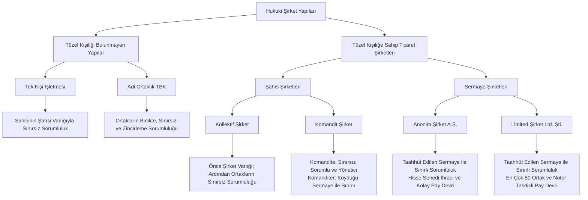
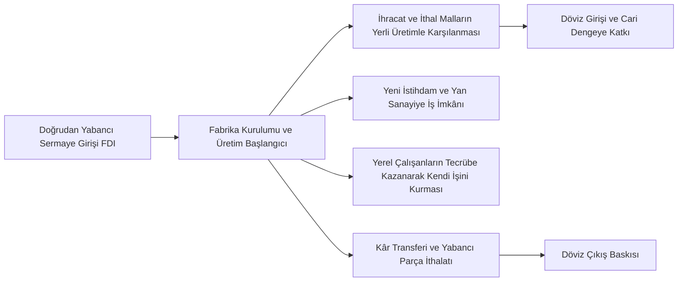

## A. Faaliyet Alanı ve Pazar Yapısına Göre İşletmeler
### 1. Faaliyet ve Üretim Çıktısına Göre Sınıflandırma

Piyasadaki milyonlarca işletme ortak niteliklerine göre belirli gruplara ayrılır. Devlet kurumları vergi, teşvik ve yasal düzenlemeleri bu gruplara göre belirler. Sanayi ve ticaret odaları da üyelerine yönelik eğitim, fuar ve sektörel destekleri bu ayrımlara dayanarak planlar.

#### Mal Üreten İşletmeler
Fiziksel ve somut ürünler ortaya koyan işletmelerdir. [[kavram-imalat|İmalat]] sanayisinde teknoloji geliştikçe otomasyon oranı yükselir. Fabrikalarda makinelerin ve robotların payı arttıkça, buradaki iş gücü ihtiyacı azalır ve çalışanlar hizmet alanına yönelirler. 

#### Hizmet Üreten İşletmeler
Müşteriye soyut fayda sağlayan işletmelerdir. Bankacılık, sigortacılık, sağlık, eğitim bu gruba girer. Bu işletmelerde başarı, doğrudan insan ilişkilerine ve çalışanların bireysel iletişim becelerine dayanır.

### 2. Hedef Müşteri Kitlesine Göre Sınıflandırma

#### Tüketici Odaklı İşletmeler
Ürün ve hizmetlerini doğrudan son kullanıcıya, yani bireysel tüketiciye ulaştıran işletmelerdir ([[İşletmeden Tüketiciye|B2C]]). Perakende mağazalar, bakkallar ve kişisel tüketim eşyası satan firmalar bu gruptadır.

#### Endüstriyel Müşteri Odaklı İşletmeler
Ürünlerini başka işletmelerin üretim süreçlerinde girdi veya ara malı olarak kullanmaları için üreten yapılardır ([[İşletmeden İşletmeye|B2B]]).
- **Sağlık Sektörü**: Bir özel hastanenin bünyesinde görüntüleme cihazı bulundurmak yerine, harici bir görüntüleme merkeziyle kurumsal anlaşma yapması bu duruma örnektir. Hastane, tahlil ve tarama hizmetini dışarıdaki işletmeden kurumsal olarak satın alır ve kendi sağlık hizmetinin bir parçası hâline getirir.
- **Otomotiv Sektörü**: Otomobil üreten şirketler, binek araçları ve ticarî araçları ayrı gruplarda değerlendirir. Çünkü bireyler genellikle kendileri için otomobil alırken şirketler işlerinde kullanmak için kamyonet veya kamyon gibi araçlar satın alır. Bu müşterilerin satın aldıkları miktarlar, ödeme koşulları ve kullanım amaçları farklıdır.

## B. Mülkiyet Yapılarına Göre İşletmeler

### 1. Sermaye Sahipliğine Göre Temel Ayrım

#### Özel İşletmeler
Sermayesi bireylere veya özel [[Tüzel kişiler|tüzel kişilere]] ait olan yapılardır. **Bu işletmelerin birinci önceliği kâr elde etmek ve yatırılan sermayeyi büyütmektir.**

#### Kamu İşletmeleri
Sermayesinin tamamı veya büyük kısmı devlete ait olan işletmelerdir. **Kamunun işletme kurmasındaki temel amaçlar; piyasada rekabet ortamı sağlamak, doğal tekelleri toplum ararına işletmek, stratejik alanları korumak ve özel sektörün henüz giremediği alanlarda sermaye birikimi oluşturmaktır.**

- **Cumhuriyetin Kuruluşu ve Türkiye İş Bankası Örneği**: Cumhuriyetin ilk yıllarında uzun savaşlar sebebiyle ülkede özel sermaye birikimi tükenmiş durumdaydı. Atatürk öncülüğünde uygulanan devletçilik politikası, devletin öncülük ederek sermaye birikimi oluşturmasını ve bu gücü zamanla özel sektöre devretmesini hedeflemiştir. Bu dönemde kurulan Türkiye İş Bankası, devlet öncülüğünde kurulan ilk özel banka olarak bu kalkınma modelinin en somut adımıdır.
- **Stratejik Kontrol ve BOTAŞ**: Petrol ve doğal gaz boru hatlarını işleten BOTAŞ, uluslararası anlaşmalar ve enerji arz güvenliği açısından kritik bir geçiş koridoru oluşturur. Bu stratejik değer sebebiyle kurumun kamu mülkiyetinde kalması tercih edilir.

### 2. Kamu İşletmelerinin Bütçe Türleri

#### Genel ve Katma Bütçeli İdareler
Genel bütçeli idareler, harcamalarını doğrudan devletin merkezî bütçesinden karşılayan kurumlardır (Sağlık Bakanlığı'na bağlı devlet hastaneleri). 

Katma bütçeli idareler ise genel bütçeden destek almanın yanında kendi ürettikleri hizmetlerden gelir elde etme yetkisine sahip birimlerdir (Karayolları Genel Müdürlüğü'nün köprü ve otoyol ücretleri; Devlet Su İşleri'nin baraj ve su gelirleri)

#### Özerk ve Mahalli Bütçeli İdareler
**Özerk bütçeli kuruluşlar, kendi iç yönetiminde serbest, dış denetiminde devlete bağlı olan yapılardır** (cihaz alımlarındaki [[bandrol]] ücretleriyle gelir sağlayan TRT; ayrıca TÜBİTAK, TSE, TÜRKSAT). 

Mahalli bütçeli idareler ise belediyelere bağlı olarak şehir içi taşımacılık ve altyapı hizmeti sunan işletmelerdir (İzmir'deki ESHOT, İZELMAN ve İzmirgaz).

### 3. Karma Modeller ve Kamu Varlık Yönetimi

#### Karma İşletmeler
**Sermayesinde kamu payı ile özel sektör payının bir arada yer aldığı şirketlerdir.** Türk Hava Yolları (hisselerinin %49,5'i kamuya aittir, kalanı borsada işlem görür) ve Türkiye Cumhuriyet Merkez Bankası bu karma yapının başlıca örnekleridir. Bir şirkette yönetim hakkını veren kontrol payı (%50 + 1 hisse) elde tutulduğunda bu kurum **[[Bağlı Ortaklık|bağlı ortaklık]]** adını alır. Kontrol gücü vermeyen daha düşük oranlı ortaklıklar ise **[[İştirak|iştirak]]** olarak adlandırılır.

#### Türkiye Varlık Fonu
Kamuya ait büyük ve stratejik şirketlerin paylarını tek bir çatı altında toplayan **[[Holding]]** niteliğinde bir fondur. THY, Borsa İstanbul ve Türkiye Petrolleri Anonim Ortaklığı (TPAO) gibi dev işletmeler bu fon üzerinden merkezî bir stratejiyle yönetilir.

### 4. Kamuda Yaşanan Tıkanıklıklar ve Mülkiyet Devri

#### Kamu İşletmelerinde Yapısal Sorunlar
Kamu işletmelerinde karar süreçleri çok sayıda resmî makamın onayına bağlıdır. Bu hiyerarşi piyasa fırsatlarına hızlı cevap verilmesini zorlaştırır.

- **Çatışan Mevzuat Örneği**: Elektrik hattı bulunmayan tarlasında sulama yapabilmek için güneş paneli kuran bir çiftçiye bir kamu kurumunun hibe desteği vermesi, aynı anda elektrik dağıtım şirketinin izinsiz üretim gerekçesiyle ceza kesmesi bürokratik kuralların birbiriyle çelişebildiğini gösterir.
- **Ekonomik Ömür ve [[kavram-amortisman|Amortisman]] Kısıtı**: Kamuda kullanılan bir bilgisayar veya teknik cihaz, mevzuatta yazılı resmî kullanım süresi dolana kadar yenilenemez. Bu durum çağın gerisinde kalan teknolojilerin kullanımını zorunlu kılar. 
- **Aşırı İstihdam**: Kamu işletmelerinde siyasî etkilerle ihtiyaç duyulandan çok daha fazla kişi işe alınabilir (200 kişilik şeker fabrikasında 1.500 kişinin çalışması). Bu durum personel giderlerini büyüterek verimliliği düşürür.

#### Özelleştirme
Kamunun elindeki işletmelerin hisse satışı yoluyla özel sektöre devredilmesidir. Bu devir, hisselerin [[Halka Arz|halka arz]] edilmesiyle yapılabileceği gibi doğrudan [[blok satış]] yoluyla tek bir yatırımcı grubuna da verilebilir. Türk Telekom'un Oger Grubu'na blok satışı sonrasında şirketin borçlarını ödeyememesi üzerine payların yerli bankalar ile Varlık Fonu'na geçmesi, özelleştirme süreçlerindeki riskleri gösteren önemli bir vakadır.

### 5. Sınır Ötesi Yatırımlar

#### Doğrudan Yabancı Sermaye Yatırımları
Yabancı şirketlerin bir ülkede fabrika açması, sabit tesis kurması veya mevcut bir işletmeyi satın almasıdır (FDI - Foreign Direct Investment). Faiz ve borsa getirisi için gelen ve hızlıca çıkabilen sıcak para yatırımlarının aksine kalıcıdır.

- **Ekonomik Etkileri**: Ülkeye yeni [[kavram-sermaye|sermaye]], [[kavram-teknoloji|teknoloji]] ve üretim gücü kazandırır. Üretilen mallar ihraç edilirse ülkeye döviz girdisi sağlanır. Ancak fabrikanın yabancı işçi getirmesi, girdileri dışarıdan alması veya elde ettiği kârı kendi merkezine aktarması döviz çıkışına yol açar. 
- **Teknoloji ve Girişimcilik Yayılımı**: Çin, 1970'lerden itibaren ülkesine gelen yabancı firmalara yerel ortaklık şartı koymuş ve tersine mühendislik yoluyla üretim teknolojilerini öğrenerek dünya devi olmuştur. Benzer şekilde, Mercedes'in Aksaray kamyon fabrikasında ustabaşı olarak yetişen teknik personelin işten ayrılarak Çiğli Organize Sanayi Bölgesi'nde kendi yedek parça atolyesini kurması yerel girişimciliği canlandırır.

---

## C. Büyüklüklerine Göre İşletmeler

### 1. Büyüklüğün Belirlenmesi

İşletmelerin büyüklüğü sektöre ve zamana göre değişir. 

- **Niceliksel Ölçütler**: Çalışan sayısı, sermaye tutarı, yıllık satış cirosu, fabrika alanı va makine kapasitesi gibi [[kantitatif]] ölçütlerdir.
- **Niteliksel (Yorumsal) Ölçütler**: Şirketin yönetim biçimi ve pazardaki hâkimiyeti gibi [[kalitatif]] ölçütlerdir. Örneğin, sadece 7 çalışanı olan bir yazılım şirketi niş bir sektör pazarının %70'ini tek başına elinde tutabilir.

### 2. Ölçek Türleri
#### Küçük ve Orta Büyüklükteki İşletmeler (KOBİ)
Türkiye'deki işletmelerin %99,5'i bu gruptadır (uluslararası literatürde SME - Small and Medium-sized Enterprises). Toplam istihdamı %70-80'ini bu işletmeler sağlar. KOSGEB gibi kamu kurumları KOBİ'lere kredi ve hibe desteği sunar.

- **Güçlü Yönleri**: Müşteri isteklerine göre esnek ve butik üretim yapabilirler. Kararları hızlı alırlar ve sanayinin Anadolu şehirlerine yayılmasını sağlarlar.
- **Zayıf Yönleri**: Bir kişinin hem satışa hem muhasebeye bakması sebebiyle uzmanlaşma düşüktür. Bankalardan kredi alırken yüksek faizle karşılaşırlar ve Ar-Ge bütçeleri kısıtlı kalır.

#### Büyük İşletmeler
Türkiye'deki işletmelerin binde beşlik kısmını oluşturan büyük yapılardır. Yüksek sermaye birikimi, kitlesel üretim kapasitesi ve kurumsal yönetim kurullarıyla çalışırlar. 

---

## D. Hukukî Biçimlerine Göre İşletmeler
### 1. Şahıs Temelli Hukukî Yapılar

#### Tek Kişi İşletmesi
- İşletmenin tek bir şahsa ait olduğu modelldir.
- İşletmenin ayrı bir tüzel kişiliği bulunmaz. **İşletmenin tüm hakları ve borçları doğrudan sahibinin kişiliğine bağlıdır.**
- İşletme sahibi, işletme borçlarına karşılık evini, arabasını ve kişisel birikimlerini kapsayan tüm malvarlığıyla birinci dereceden ve sınırsız sorumludur.

#### Adi Ortaklık

> *Adi = sıradan, olağan, özel bir statüsü olmayan.*

**Birkaç kişinin ortak bir amaç için sözleşmeyle bir araya gelip emek ya da sermaye koyduğu, ama tüzel kişilik kurmadığı ortaklıktır**.

- Türk Borçlar Kanunu hükümlerine göre kurulan ortaklıktır.
- Ayrı bir tüzel kişiliği bulunmaz. **Haklar ve borçlar ortakların şahsına aittir.**
- Kuruluş için sözlü anlaşma dahi yeterlidir.
- Ortaklar, ortaklığın borçlarından dolayı üçüncü kişilere karşı kişisel mallarıyla sınırsız ve [[müteselsil-sorumluluk|müteselsil]] (zincirleme) sorumluluk taşır.

> *Metin ve Mert'in kurduğu bir bakkal işletmesi 3 milyon lira borçla tasfiyeye girdiğinde ve dükkânda sadece 1 milyon liralık mal kaldığında; Metin ortadan kaybolsa bile alacaklılar geriye kalan 2 milyon liralık borcun tamamını tek başına Mert'in şahsi ev ve birikimlerinden tahsil edebilir.*

### 2. Tüzel Kişiliğe Sahip Şahıs Şirketleri
#### Kolektif Şirket

- Türk Ticaret Kanunu'na göre **en az iki gerçek kişi tarafından kurulan şirkettir.**
- Tüzel kişiliği mevcuttur.
- **Şirketin borçları için alacaklılar öncelikle şirket tüzel kişiğine başvurur**. Şirket kasası borcu ödemeye yetmediğinde, ortaklar kişisel malvarlıklarıyla ikinci dereceden, sınırsız ve [[müteselsil-sorumluluk|müteselsil]] olarak sorumlu olurlar.
- Ortaklar emeklerini ve ticarî itibarlarını şirkete sermaye olarak koyabilirler.

#### Komandit Şirket

> 	**Komandit** (Fr. *commandite*; emanet etmek, bir işi başkasına bırakmak).

İki tür ortağın bir arada olduğu şirkettir. Biri işi yönetir ve her şeyiyle sorumludur, diğeri sadece para koyar ve riski sınırlıdır.

##### Komandite Ortak (İşi Yürüten)
- Yalnızca gerçek kişi olabilir.
- Şirketi yönetir.
- Borçlardan kendi malvarlığıyla, sınırsız ve [[müteselsil-sorumluluk|müteselsil]] olarak sorumludur. Şirket batarsa evi, arabası dâhil her şeyi gidebilir.
- Para yerine emek ve itibarını da sermaye olarak koyabilir.

##### Komanditer Ortak (Parayı Koyan)
- Gerçek veya tüzel kişi olabilir.
- Sadece sermaye verir, yönetime karışmaz.
	- Sermayesi nakit veya mal olmalıdır. Emek koyamaz.
- Sorumluluğu koyduğu sermaye ile sınırlıdır. Şirket batarsa en fazla verdiği parayı kaybeder.

### 3. Tüzel Kişiliğe Sahip Sermaye Şirketleri
#### Anonim Şirket
Bkz. **[[1-finansal_yonetime_giris_ve_temel_kavramlar#Anonim Şirket (A.Ş.)|Anonim Şirket (A.Ş.)]]**
- **Tanım**: Sermayesi eşit paylara bölünmüş ticaret şirketidir.
- **Sorumluluk**: Ortak, taahhüt ettiği sermaye kadar sorumludur. Evi, arabası gibi kişisel malvarlığı şirket borçlarından korunur.
- **Ortaklık Belgesi**: [[Hisse Senedi|Hisse senedi]]. Pay hiç kimseye sormadan serbestçe satılabilir.
- **Borsa**: Halka açılabilir, borsada işlem görebilir.
- **Zorunlu Alanlar**: Bankacılık ve sigortacılık gibi alanlarda anonim şirket olmak kanunen zorunludur.
- **Sermaye Türleri** (örnek: 1.000.000 TL taahhüt, 250.000 TL yatırılmış):
	- Taahhüt edilen sermaye: 1.000.000 TL, toplam söz verilen tutar. 
	- Ödenmiş sermaye: 250.000 TL, fiilen kasaya girmiş kısım.
	- Ödenmemiş sermaye: 750.000 TL, henüz yatırılmamış taahhüt. Ortak bu kısımdan şirkete karşı sorumludur.
- **Tipik Yapı**: Büyük, çok ortaklı, halka açık işletmeler.

#### Limited Şirket (Ltd. Şti.)
Bkz. **[[1-finansal_yonetime_giris_ve_temel_kavramlar#Limited Şirket (LTD. ŞTİ.)|Limited Şirket (LTD. ŞTİ.)]]**
- **Tanım**: Bir veya daha fazla kişi tarafından kurulan, [[esas sermaye|esas sermayesi]] belirli şirketlerdir.
- **Ortak Sayısı**: En fazla 50.
- **Sorumluluk**: Ortak yalnızca taahhüt ettiği sermaye payı kadar sorumludur.
- **Ortaklık Belgesi**: Hisse senedi <u>çıkaramaz</u>, sadece ortaklık payı vardır. Borsada işlem göremez.
- **Pay Devri**: Genel kurul onayı ve noter tasdiki gerekir. Bu yüzden ortaklık bağları daha sıkıdır, yabancı biri kolayca ortak olamaz.
- **Tipik Yapı**: Ortakların birbirini tanıdığı küçük ve orta ölçekli işletmeler.

## 2. Analiz falan
### A. Makro Çevre Koşullarının ve Devlet Politikalarının İşletme Kararlarına Etkisi

İşletmeler bulundukları ekonomik ve yasal çevrenin kurallarına bağlı olarak varlıklarını sürdürürler. Döviz kuru hareketleri, faiz oranları ve ithalat-ihracat kısıtlamaları şirketlerin kâr marjlarını ve ayakta kalma güçlerini belirler. Devletin piyasadaki rolü ülkedeki sermaye birikimine göre şekillenir. 

Özel sermayenin az olduğu dönemlerde kamu işletmeleri üretime doğrudan girerek öncülük eder. Dışarıdan gelen doğrudan yabancı yatırımlar ise yerli yan sanayiyi beslediği ve ihracat sağladığı ölçüde ülke rezervlerine katkı sunar. Ancak dış girdiye aşırı bağımlılık kâr transferi yoluyla döviz çıkışına sebebiyet verebilir.

### B. Kaynak Kıtlığı, Ölçek Sınırları ve Büyüme Engelleri
İşletmenin ölçek büyüklüğü onun hareket kabiliyetini sınırlar:

- **[[Finansman]] Engeli**: KOBİ'ler bankalardan borçlanırken yüksek teminat ve ağır faiz şartlarıyla karşılaşır. Büyük işletmeler ise [[Tahviller|tahvil]] çıkararak veya borsaya açılarak düşük maliyetli fon bulur.
- **Uzmanlaşma Engeli**: Küçük işletmelerde kısıtlı bütçeler sebebiyle bir çalışan birden fazla işi üstlenir. Bu durum stratejik yönetim kalitesini düşürür. 
- **Bürokrasi Engeli**: Kamu kuruluşlarında bir kararın uygulanması çok sayıda hiyerarşik kademenin onayını gerektirdiği için piyasadaki hızlı değişimlere uyum zorlaşır.

### C. Hukukî Yapı Tercihinin Finansman ve Risk Yönetimine Etkileri
Şirket türü seçimi, işletme sahiplerinin karşılaşacağı mâlî risklerin sınırını çizer. Şahıs işletmeleri ve adi ortaklıklarda şirket borçları ortakların kişisel malvarlığını doğrudan tehdit eder. Bu durum büyük yatırımlar için risk oluşturur. Anonim şirket modeli ise ortakların sorumluluğunu taahhüt ettikleri payla sınırlandırarak kişisel varlıkları korur. Bu güvence, çok sayıda yatırımcının şirkete ortak olmasını ve büyük sermaye tutarlarının toplanmasını sağlar.

# Görselleştirmeler ve Grafikler

### A. Hukuki Şirket Yapıları ve Sorumluluk Düzeni

### B. Doğrudan Yabancı Yatırımların İktisadi Akışı

### C. Hukuki Şirket Modellerinin Karşılaştırmalı Tablosu

| Şirket Türü                | Dayandığı Kanun           | Tüzel Kişilik Durumu                | Ortak Sayısı Sınırı              | Ortakların Borç Sorumluluğu                            | Emek ve İtibarın Sermaye Olması                            | Pay Devir Şartları                                     |
| :------------------------- | :------------------------ | :---------------------------------- | :------------------------------- | :----------------------------------------------------- | :--------------------------------------------------------- | :----------------------------------------------------- |
| **[[Tek Kişi İşletmesi]]** | Ticaret / Borçlar Kanunu  | Şahsın kendi varlığı geçerlidir     | 1 Gerçek Kişi                    | Tüm kişisel varlığıyla birinci dereceden sınırsız      | Kişinin kendi emeği doğrudan işin içindedir                | İşletmenin devriyle mümkündür                          |
| **[[Adi Ortaklık]]**       | Türk Borçlar Kanunu (TBK) | Ortakların şahsında toplanır        | En az 2 Kişi                     | Birinci dereceden, sınırsız ve zincirleme sorumluluk   | Sermaye olarak konulabilir                                 | Bütün ortakların oybirliği şarttır                     |
| **[[Kolektif Şirket]]**    | Türk Ticaret Kanunu (TTK) | Şirketin ayrı tüzel kişiliği vardır | En az 2 Gerçek Kişi              | Önce şirket kasası; yetmezse ortaklar sınırsız sorumlu | Sermaye olarak konulabilir                                 | Ortaklar kurulu kararı ve sözleşme değişikliği şarttır |
| **[[Komandit Şirket]]**    | Türk Ticaret Kanunu (TTK) | Şirketin ayrı tüzel kişiliği vardır | En az 1 Komandite + 1 Komanditer | Komandite: Sınırsız Komanditer: Sermayesi kadar    | Komandite koyabilir; Komanditer sadece nakit/mal koyabilir | Şirket sözleşmesi ve ortaklar onayı gerekir            |
| **[[Anonim Şirket]]**      | Türk Ticaret Kanunu (TTK) | Şirketin ayrı tüzel kişiliği vardır | En az 1 Kişi                     | Taahhüt edilen sermaye payı tutarıyla kesin sınırlı    | Yalnızca nakit ve maddi mallar konulabilir                 | Hisse devri serbesttir, kurul onayı gerekmez           |
| **[[Limited Şirket]]**     | Türk Ticaret Kanunu (TTK) | Şirketin ayrı tüzel kişiliği vardır | En az 1, en çok 50 Kişi          | Taahhüt edilen esas sermaye payıyla sınırlı            | Yalnızca nakit ve maddi mallar konulabilir                 | Genel kurul onayı ve noter tasdiki zorunludur          |

### D. KOBİ ve Büyük İşletmelerin Karşılaştırmalı Tablosu

| Analiz Alanı                 | Küçük ve Orta Büyüklükteki İşletmeler (KOBİ)                     | Büyük İşletmeler                                                   |
| :--------------------------- | :--------------------------------------------------------------- | :----------------------------------------------------------------- |
| **Sayısal Oran ve İstihdam** | İşletmelerin %99,5'i; toplam istihdamın %70-80'i                 | İşletmelerin binde beşi; toplam istihdamın %20-30'u                |
| **Esneklik ve Değişim Hızı** | Müşteri talebine göre hızla değişebilen butik üretim             | Sabit kurallar ve kitle üretimine dayalı standart yapı             |
| **Yönetim ve Uzmanlaşma**    | Birkaç görevi tek kişinin yürüttüğü sade yapı                    | Farklı departmanlara ayrılmış profesyonel kadrolar                 |
| **Kredi ve Fon Bulma**       | Yüksek faiz oranları ve ağır banka teminatı şartları             | Borsaya açılma, tahvil satışı ve düşük maliyetli kurumsal krediler |
| **Ar-Ge ve Yenilikçilik**    | Kısıtlı bütçeler sebebiyle sınırlı teknoloji yatırımı            | Özel Ar-Ge birimleri ve yüksek bütçeli patent çalışmaları          |
| **Pazardaki Fiyat Gücü**     | Piyasadaki fiyatları kabul eden konum; tekelleri dengeleyici rol | Pazardaki fiyatları belirleme gücü ve sektör liderliği             |
