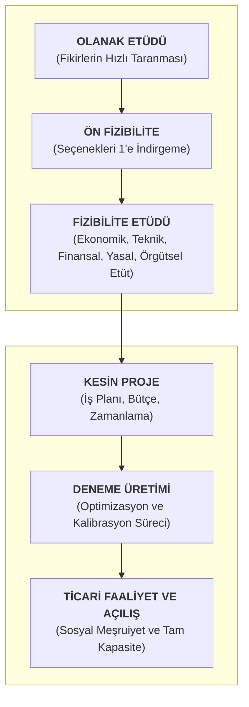

# Kavramsal Çerçeve ve Açıklamalar

## [[Centilmenlik Anlaşması]] (Gentlemen's Agreement)
Centilmenlik anlaşması, iki veya daha fazla bağımsız işletmenin karşılıklı saygı, güven ve ticarî itibar zemininde akdettikleri, resmî yaptırım gücünden ziyade tarafların zımni taahhütlerine dayanan gayriresmî işbirliği formudur. Bu anlaşmalar sözlü taahhütler biçiminde varlık kazanabildiği gibi taraflar arasında imzalanan bağlayıcılığı sınırlı protokol metinleri üzerinden de yürütülür. Anlaşmanın ihlali durumunda işletmeler karşı tarafın misillemeyle ve piyasa nezdindeki kurumsal güvenilirliklerinin sarsılması riskiyle yüzleşir.

Uygulamada bu model, işletmelerin birbirlerinin kilit teknik personelini işe almaktan kaçınması yönündeki personel istihdam protokollerinde görülür. İki rakip firmanın çalışan transferini karşılıklı olarak durdurması, işletmelerin mevcut beşeri sermayelerini koruma işlevi görür. Bu tür anlaşmaların serbest piyasa koşullarındaki geçerlilik sınırı [[Rekabet Kurulu]] tarafından çizilir. Şayet mutabakat, ilgili coğrafyadaki istihdam olanaklarının ezici bir çoğunluğunu denetim altına alarak işgücü piyasasındaki ücret seviyelerini ve serbest çalışan hareketliliğini baskılayacak bir pazar payına ulaşırsa, kamu otoritesi söz konusu işbirliğini 'rekabeti zedeleyici' kabul ederek idari yaptırım uygular.


## [[Kartel]] (Cartel)
Kartel; aynı iş kolunda faaliyet gösteren hukukî ve iktisadî açıdan bağımsız işletmelerin pazar rekabetini sınırlandırmak, arz miktarını denetlemek ve kâr marjlarını yükseltmek amacıyla aralarında kurdukları gizli ve mutlak sûrette yasa dışı çıkar birliğidir. Kartel yapısında bir araya gelen aktörler; piyasaya sürülecek toplam üretim kotasını belirleyen **kota kartelleri**, satış fiyatını sabitleyen **fiyat kartelleri** veya coğrafî operasyon bölgelerini paylaşan **bölge kartelleri** tesis ederler.

İktisadi mekanizma açısından kartel, piyasadaki toplum arzı yapay biçimde kısarak serbest piyasa fiyat mekanizmasını tüketici aleyhine yukarı yönlü esnetir. İki büyük un fabrikasının pazara arz edilecek un miktarını sınırlandırması, sabit tüketici talebi karşısında fiyatların doğrudan sıçramasına yol açar. Tüketici refahıı yok eden ve kaynak tahsisinde etkinsizlik doğuran bu yapılar, modern hukuk düzenlerinde [[Rekabet Kurumu]] marifetiyle ağır para cezalar ve adli tedbirle tasfiye edilir.

## [[Konsorsiyum]] (Consortium)
Konsorsiyum, tek bir işletmenin öz kaynaklarını, teknik donanımını veya risk üstlenme kapasitesini aşan büyük ölçekli ve yüksek maliyetli projelerin ortaklaşa yürütülmesi amacıyla kurulan proje bazlı geçici işbirliği modelidir. Konsorsiyuma katılan ortaklar, söz konusu büyük proje haricindeki tüm ticarî ve [[sınai]] faaliyetlerinde bağımsız [[Tüzel kişiler|tüzel kişiliklerini]] eksiksiz biçimde korurlar.

Altyapı yatırımlarında, baraj, asma köprü veya nükleer santral gibi kamu ihalelerinde konsorsiyum yapısı yaygın biçimde tercih edilir. Örneğin, İzmir Körfez Geçişi Projesi (Bostanlı-Üçkuyular Asma Köprüsü) büyüklüğündeki bir mühendislik taahhüdünde; çelik konstrüksiyon uzmanı bir firma, zemin mekaniği ve betonarme işlerinde yetkin bir inşaat devi ile uluslararası finansman sağlama kabiliyetine sahip bir yatırım grubu tek bir ihale sözleşmesi altında birleşir. Konsorsiyum ortakları yalnızca bu köprünün inşasından doğan yükümlülükleri müşterekten üstlenir; konsorsiyum dışındaki konut veya hastane projelerinde birbirlerinden tamamen bağımsız hukukî ve mâlî operasyon yürütürler.

## [[Tröst]] (Trust - Şirket Birleşme ve Devralmaları)

> Bkz. [[antitröst]]

Tröst, aynı veya birbiriyle ilişkili sektörlerde çalışan işletmelerin sermaye, yönetim ve hukukî varlıklarını tek bir dev çatı altında ebediyen birleştirmeleri neticesinde ortaya çıkan tekelleşme veya yüksek pazar konsantrasyonu formudur. Tröstleşme iki temek hukukî mekanizmayla hayat bulur:

1. **Ele Geçirme / Satın Alma ([[Acquisition]])**: Güçlü bir şirketin diğer bir şirketin tüm hisselerini ve operasyonel varlıklarını satın alarak kendi bünyesine katması ve hedef şirketin tüzel kişiliğine son vermesidir. Migros'un *Tesco* bünyesindeki Kipa perakende zincirini satın alması bu yapının örneğidir. Süreç esnasında Rekabet Kurulu, alışveriş merkezlerindeki perakende pazar payının Migros lehine mutlak bir tekele dönüşmesini engellemek amacıyla, belirli lokasyonlardaki Kipa mağazalarının Carrefour gibi rakip perakendecilere devredilmesi şartıyla birleşmeye onay vermiştir.
2. **Birleşme / Kaynaşma**: İki veya daha fazla bağımsız şirketin mevcut tüzel kişiliklerini eşzamanlı olarak feshederek yepyeni bir hukukî ve ticarı kimlik altında bütünleşmesidir. Aycell ve Aria isimli iki GSM operatörünün kendi kurumsal kimliklerini tasviye edip "*Avea* unvanlı yeni bir anonim ortaklık kurması merger operasyonudur.

İşletmeler tröst oluşturarak [[Ölçek Ekonomisi]] (Economics of Scale) avantajı elde eder, birim sabit maliyetlerini düşürür ve Ar-Ge bütçelerini merkezîleştirir. Büyümenin doğal bir sonucu olarak ortaya çıkan karar alma süreçlerindeki hantallaşma ve bürokratik gecikmeler ise bu yapının temel yönetsel bedelini teşkil eder.


## [[Holding]] (Holding Company) 
Holding; doğrudan doğruya [[sınai]] veya ticarî bir mal ya da hizmet üretimini yürütmek yerine, diğer anonim ortakların yönetimsel kontrolünü ve stratejik kararlarını yönlendirmeye yetecek orandaki hisse senetlerini portföyünde toplayan saf bir yönetim ve sermaye idare şirketidir. Holding mimarisi, sermayedarların çok sayıda farklı sektördeki (enerji, finans, [[perakendecilik|perakende]], çimento) şirketlerini tek bir merkezden eşgüdümlü yönetmelerine olanak tanır.

> Adı üstünde; **holding** company demektir; **hisseleri elinde tutan company**.


Holdingin alt şirketlerle olan sermaye bağı iki kurumsal kategoride somutlaşır:

- **[[Bağlı Ortaklık]] (Subsidiary)**: Holdingin yönetim kurulu üyelerini seçme ve şirketin operasyonel kararlarını belirleme yetkisine sahip olduğu, ekseriyetle hisselerin yüzde 50'sinden fazlasını veya dağınık halka açık paylar sebebiyle fiili yönetim çoğunluğunu elinde tuttuğu ortaklıktır.
- **[[İştirak]] (Associate)**: Holdingin sermaye payının yönetimsel tahakküm kurmaya yetmediği, genellikle yüzde 20 ile yüzde 50 arasında seyreden, kâr payı ([[temettü]]) ve değer artışından istifade etmeyi amaçlayan stratejik ortaklık modelidir. **Sabancı Holding'in CarrefourSA üzerindeki hâkim hisselerini devrederek payını yüzde 20 düzeyidne muhafaza etmesi, ilgili kuruluşu [[Bağlı Ortaklık|bağlı ortaklık]] statüsünden [[İştirak|iştirak]] konumuna geçirmiştir.**


## Reel Yatırım Türleri (Types of Real Capital Investment)
İşletme biliminde [[reel yatırım|reel yatırım]]; *atıl fonların menkul kıymet piyasalarında gelir getiren finansal enstrümanlara dönüştürülmesini ifade eden* [[Portföy Yatırımı|portföy yatırımlarından]] ayrışır. **Reel yatırım, ekonomik sisteme fizikî ve kalıcı bir üretim tesisi, makine parkı veya hizmet sunum kapasitesi ekleme faaliyetidir.** Reel yatırımlar üç temel gruba ayrılır:


- **[[Genişleme (tevsi) Yatırımı]] (Expansion Investment / Tevsî)**: Mevcut ürün hattında sıfırdan yeni bir kapasite yaratılması veya var olan kapasite tavanının yukarıya çekilmesidir. Yılda 10000 gömlek üreten bir fabrikanın üretim hattını genişleterek kapasitesini 250.000 gömleğe çıkarması ya da gömlek üretiminde [[ham madde]] olarak kullandığı kumaşı kendisi üretmek üzere 60.000 metrelik iplik-dokuma tesisi eklemesi [[Genişleme (tevsi) Yatırımı|tevsi yatırımı]] mahiyetindedir.
- **[[Yenileme Yatırımı]] (Replacement Investment)**: Fiziksel olarak çalışmaya devam etse dahi aşınma ve eskime neticesinde arıza sıklığı artan, yakıt ve bakım giderleri ekonomik sınırları aşan ve böylece [[ekonomik ömür|ekonomik ömrünü]] tamamlayan üretim araçlarının yerine yenilerinin ikame edilmesidir. İşletmeler, mevzuat gereği her yıl ayırdıkları [[amortisman]] fonlarını ve eski makinenin hurda değerini birleştirerek üretim güçlerinin sürekliliğini teminat altına alırlar.
- **[[Modernizasyon Yatırımı]] (Modernization Investment)**: Mevcut makine parkının fiziksel ve ekonomik ömrü tükenmemiş olmasına rağmen, küresel teknolojik gelişmelerin gerisinde kalmamak adına daha hızlı, daha az enerji tüketen, daha düşük birim maliyetle ve en yüksek kalite standardıyla çalışan yeni nesil teknolojilere geçilmesidir. İşletmenin rakipleri karşısında maliyet ve kalite liderliğini korumasını sağlar.


## Fizibilite Etüdü ve Kademeli Karar Süreci (Feasibility Study)
> Bkz. [[Feasible|Fizibilite]]

Yeni bir yatırım fikrinin doğuşundan tesisin işletmeye alınmasına kadar uzanan süreç, kaynak israfını önlemeyi hedefleyen aşamalı bir eleme süzgecinden oluşur.



### 1. [[Olanak Etüdü]] (Opportunity Study)
Girişimcinin veya kurumsal yönetim grubunun olası yatırım alanlarını genel ekonomik göstergeler, küresel talep eğilimleri ve [[ikincil veri kaynakları]] üzerinden hızlıca değerlendirdiği ilk fikir süzgecidir. Çok sayıda alternatif sektör arasından pazar potansiyeli taşıyan alanlar bu aşamada öne çıkar.

### 2. [[Ön Fizibilite Etüdü]] (Pre-Feasibility Study)
Olanak etüdü neticesinde tespit edilen birkaç yatırım alternatifinin(örn. gıda, otomotiv veya tekstil) kuruluş yeri gereksinimleri, tahmini tesis kapasiteleri ve yasal teşvikler çerçevesinde biraz daha derinlemesine incelenerek tek bir yatırım alanına indirgenmesidir.

### 3. Kapsamlı Fizibilite Etüdü (Feasibility Study)
Tercih edilen tek alanda projenin hayata geçirilip geçirilmeyeceğini belirleyen çok disiplinli, aylar süren ve yüzlerce sayfalık teknik, ekonomik ve finansal raporlar üreten nihai karar evresidir.

#### 3.1. Ekonomik Etüt
Geleceğe dönük efektif pazar talebinin, pazar payının, tesis kapasitesinin, fabrikanın kurulacağı bölgeye sağlayacağı istihdamın, yerel kalkınma etkisinin ve döviz çıkışını engelleyecek ithal ikamesi potansiyelinin tahlilidir. Afyon'da kurulacak bir şeker fabrikasının bölgedeki şeker pancarı tarımına ve yem sanayine yapacağı katkı ekonomik etüdün konusudur.

#### 3.2. Teknik Etüt
Fabrikada kullanılacak üretim teknolojisinin seçimi, makinelerin teknik özellikleri ve tedarikçileri, [[ham madde]] kimyasal nitelikleri (örn: şeker pancarındaki kuru madde oranı), su ve enerji tüketim miktarları, atık yönetimi (melas ve posanın değerlendirilmesi) ve arazi inşaat gereksinimlerini belirler.

#### 3.3. Finansal Etüt

Projenin toplam yatırım tutarını ortaya koyar. Toplam yatırımın tutarı iki kurucu bileşenin toplamından oluşur:

```code
Toplam Yatırım Tutar = Sabit Yatırımlar + Çalışma Sermayesi
```

- **Sabit Yatırımlar**: Arsa, inşaat, patent, şirket kuruluş harçları ve makine donanımını kapsar. [[Çalışma Sermayesi (İşletme Sermayesi)]]; fabrika kurulduktan sonra ürünlerin üretilip satılması ve [[vadeli satış]] bedellerinin tahsil edilmesine kadar geçecek cari işletme döneminde (asgari bir yıl) işçi ücretlerinin, elektrik faturalarının, ham madde ödemelerinin ve sigorta primlerinin karşılanmasını sağlayan nakit rezdrvidir. Finansal etüt ayrıca sermaye maliyetini, borç-öz kaynak oranını ve projenin kârlılığa geçiş takvimini (yatırımın geri dönüş süresi) hesaplar.

#### 3.4. Yasal Etüt
Şirket türünün seçimi ([[Anonim Şirket]], [[Limited Şirket]] vb.), İş Kanunu, Türk Gıda Kodeksi, çevre izinleri ve Çevresel Etki Değerlendirmesi ([[ÇED Raporu]]) süreçlerinin incelenmesidir.

#### 3.5. Örgütsel Etüt
Fabrika içi hiyerarşik kademe sayısını, yönetim yapısını, farklı ürün gruplarının hat organizasyonunu (Tofaş fabrikasında binek ve hafif ticarî araç hatlarının ayrışması) ve ham madde tedarik zinciri modellerini (çiftçilerle yapılan sözleşmeli ekim protokolleri veya batarya tedarik anlaşmaları) yapılandırır. 

## [[Kesin Proje, Deneme Üretimi ve Sosyal Meşruiyet]] (Definitive Project, Pilot Production & Social Legitimacy)
