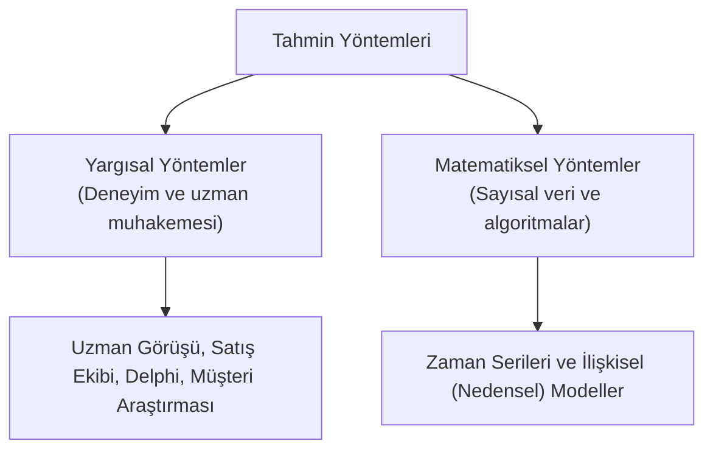
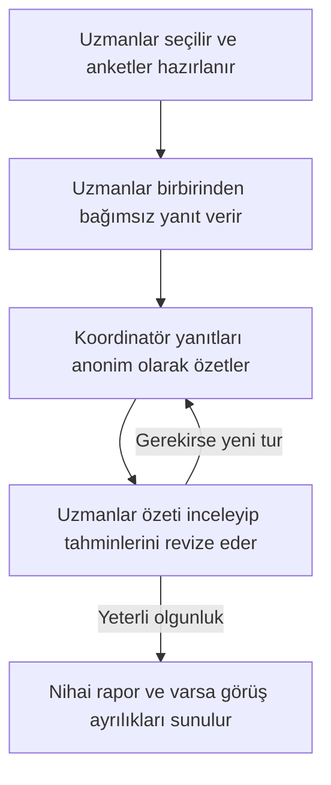
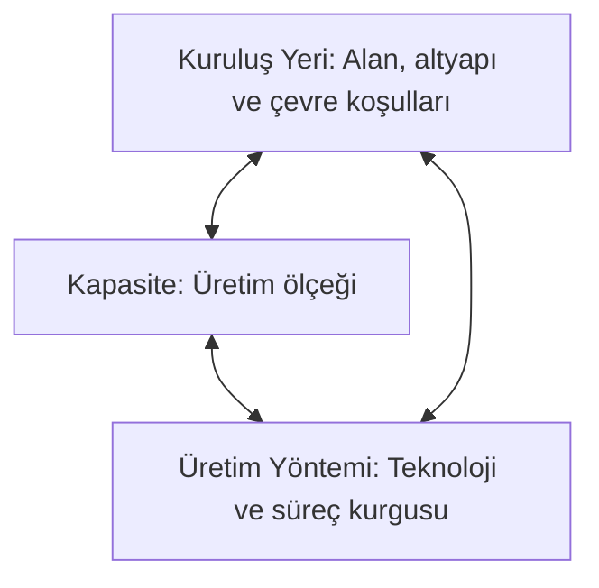

# Talep Tahmini, Kuruluş Yeri Seçimi ve Kapasiteye Giriş

## 1. Talep Tahmini

### 1.1. Talep Tahmini Neden Gereklidir?
[[Talep tahmini]], gelecekte bir ürün veya hizmetin ne kadar, ne zaman ve hangi özelliklerde isteneceğini önceden belirleme çabasıdır. Bir işletme, müşteri talebi fiilen ortaya çıktığı anda sıfırdan harekete geçemez. Girdilerin temini, üretim, depolama ve dağıtım evreleri belirli bir hazırlık süresi (lead time) gerektirir.

Markette satılan bir şişe su örneğinde; müşteri suyu raftan almak istediğinde ürünün orada hazır bulunması gerekir. Bunun için şişenin imalatı, dolumu, etiketlenmesi ve dağıtımı aylar öncesinden planlanmış olmalıdır. Her ürünün tedarik ve üretim süresi farklıdır; ancak **tahmini zorunlu kılan temel dinamik, hazırlık süreci ile talebin gerçekleştiği an arasındaki zaman farkıdır.**

Ürünün rafta bulunmaması yalnızca o anki satışı kaybettirmez; müşteri rakip markalara yönelerek kalıcı olarak kaybedilebilir. Buna karşılık aşırı hazırlık yapmak da satılmayan stoklara, depolama maliyetine ve atıl sermaye yüküne yol açar.

Kuruluş aşamasında bu problem daha kritik hale gelir. Bir fabrikanın projelendirilip açılması yıllar sürebilir. Girişimci, tesisin faaliyete geçeceği tarihteki pazar büyüklüğünü ve sonraki olası dalgalanmaları bugünden öngörerek fabrika ölçeğini belirlemek zorundadır. Zira fiziki olarak kurulan bir kapasiteyi kısa vadede değiştirmek maliyetli ve güçtür.

#### Tahminin Kapsamı (Talep Dışı Alanlar)
Tahminleme yalnızca satış adetleri için yapılmaz. Döviz kurları, faiz oranları, enflasyon, gelecekteki girdi maliyetleri ve insan kaynakları ihtiyacı da tahmin konusudur. Örneğin bir işletme, gelecek faaliyet döneminde kaç personelin işten ayrılabileceğini ve bu pozisyonlar için ne kadarlık istihdam açılacağını önceden tahmin etmeye çalışır.

---

### 1.2. Tahminin Doğası ve Belirsizlik Yönetimi

> **"Bütün tahminler yanlıştır."**  
> Geleceği kusursuz şekilde bilmek imkânsızdır. Talebi şekillendiren tüketici tercihleri, hava koşulları, rakip hamleleri ve makroekonomik dalgalanmalar tam kontrol altında tutulamaz.

**Tahmine, hata payı barındıran stratejik bir karar girdisi olarak yaklaşılmalıdır.** Tahmin yapmamak da belirsizliği ortadan kaldırmaz; işletme her halükarda üretim, satın alma ve yatırım kararı vermek zorundadır. Rasyonel yöntemlere dayalı bir tahmin, kararları tamamen sezgisel vermekten çok daha güvenilirdir. Buradaki amaç geleceği hatasız bilmek değil, karardaki belirsizliği yönetilebilir düzeye çekmektir.

#### 1.2.1. Nokta Tahmini ve Sapma Aralığı
"Gelecek hafta 5.000 adet satılacak" ifadesi bir **nokta tahminidir**. Ancak operasyonel kararlar tek bir rakama bağlanamaz; tahminin etrafındaki olası değişim payı da hesaba katılmalıdır:
$$
4.750 \leq \text{beklenen talep} \leq 5.250 \quad (5.000 \pm 250)
$$
Bu aralık, bütçe ve kapasite hazırlığının esnek tutulmasını sağlar. Benzer mantık bütçelemede de geçerlidir; 5 milyon liralık bir yatırım bütçesinin hangi alt ve üst sapmalarla karşılaşabileceği modellenir. **Nokta tahmini üretmek yanlış değildir; onun içerdiği belirsizliği yok sayarak plan yapmak risk yaratır.**

#### 1.2.2. Tahmin Vadesi

| Vade | Tipik Kullanım Alanı | Karar Niteliği | Temel Özellik |
| :--- | :--- | :--- | :--- |
| **Kısa Dönem** | Yakın dönem sipariş, stok ve iş programı | Operasyonel | Mevcut veriler çoğunlukla daha yol göstericidir. |
| **Orta Dönem** | Üretim, iş gücü ve hammadde planlaması | Taktiksel | Dönemsel ve konjonktürel dalgalanmalar dikkate alınır. |
| **Uzun Dönem** | Tesis, kapasite ve teknoloji yatırımı | Stratejik | Yapısal değişim ve belirsizlik en yüksek düzeydedir. |

---

### 1.3. Tahmin Süreci ve Yöntem Seçimi
Tahmin süreci; tahmin amacının tanımlanması, verilerin toplanması, model seçimi, sonuçların sınanması ve fiili gerçekleşmelerle karşılaştırılarak modelin güncellenmesini içerir.

Model seçiminde dört temel soru belirleyicidir:
1. **Yeterli geçmiş veri var mı?**
2. **Ne düzeyde bir doğruluk (hassasiyet) gerekiyor?**
3. **Yöntemin geliştirme, veri toplama ve yazılım maliyeti nedir?**
4. **Çıkan sonuçları karar verici anlayıp yorumlayabiliyor mu?**

Bir yöntemin çıktısı, arka planındaki mekanizma bilinmeden doğru kullanılamaz. Örneğin "mevsim etkisinden arındırılmış istihdam" verisini doğru yorumlayabilmek için mevsimsellik kavramının bilinmesi gerekir.

Bu iki yaklaşım birbirini dışlamaz; analitik model sonuçları uzman değerlendirmesiyle harmanlanabilir.

#### 1.3.1. Yargısal Tahmin Yöntemleri
Sayısal veri setinin bulunmadığı, yeni bir ürünün pazara sunulduğu veya stratejik dönüşümlerin yaşandığı durumlarda insan muhakemesine başvurulur.

* **Uzman Görüşü:** Konuyu iyi bilen tek bir uzmanın değerlendirmesidir. Hızlı ve düşük maliyetlidir; ancak uzmanın aşırı iyimserliği, kötümserliği ya da bazı dinamikleri gözden kaçırma riski taşır.
* **Uzmanlar Grubu ve Satış Ekibinin Görüşleri:** Birden fazla uzmanın veya sahada müşteriyle doğrudan temas kuran satış temsilcilerinin öngörüleri bir araya getirilir. Uzmanlar grubu genel bir yaklaşımdır; satış ekibinden veri toplamak bunun sahaya dönük özel bir uygulamasıdır. 
  * *Risk:* Grup içi hiyerarşi (yöneticinin fikrine karşı çıkamama) veya prim sistemleri tahminin objektifliğini bozabilir. Belirlenen kotanın üzerinde prim alacak bir satışçı tahmini bilerek düşük gösterebilirken; yönetimin gözüne girmek isteyen bir diğeri aşırı iyimser rakamlar sunabilir. **Tahminin doğruluğu, tahmini verenin teşvik mekanizmasından bağımsız değildir.**
* **[[Delphi Tekniği]]:** Uzmanların birbirlerinin kişiliğinden, statüsünden veya otoritesinden etkilenmesini önlemek amacıyla görüşlerin bir koordinatör aracılığıyla, anonim olarak ve turlar halinde toplandığı yöntemdir.

*Delphi'nin avantajı grup baskısını kırmasıdır; dezavantajı ise sürecin zaman alması ve koordinasyon maliyetidir. Süreç mutlak bir uzlaşmayla bitmek zorunda değildir; devam eden görüş ayrılıkları da bir sonuçtur.*

* **Müşteriye Sormak ve Pazar Araştırması:** Müşteri sayısı az ise doğrudan ihtiyaçları sorulabilir. Ancak müşteri pazarlık avantajı veya tedarik güvencesi sağlamak için ihtiyacını abartabilir. Geniş kitlelerde ise hedef kitleyi temsil eden bir **örneklem** üzerinden anket, mülakat ve panel çalışmaları yapılır.
  * Burada **talebin niceliği** (kaç adet alınacağı) ile **niteliği** (hangi özelliklerin beklendiği) ayrışır. Pazar araştırmaları özellikle nitelik beklentilerini tespit etmede başarılıdır. Bir müşterinin ürünü beğendiğini söylemesi, kesin satın alma taahhüdü anlamına gelmez.

#### 1.3.2. Matematiksel Tahmin Yöntemleri
Ölçülebilir geçmiş verilerin matematiksel fonksiyonlarla geleceğe taşınmasıdır.

##### Zaman Serisi Modelleri
Bir değişkenin eşit aralıklı ardışık zaman noktalarında kaydedilmiş değerleridir (ör. günlük elektrik tüketimi, aylık satışlar). Değişkenin geçmişteki hareket örüntülerinden faydalanır. **Bu durum, talebi yalnızca zamanın etkilediği anlamına gelmez;** ekonomik ve çevresel etkiler zaten o verilerin içine yansımıştır. Bkz. [[veri-madenciligi-11#1. Zaman Serisi (Time Series) Nedir?|Zaman serisi nedir]].

| Bileşen | Anlamı | Tipik Örnek |
| :--- | :--- | :--- |
| **Trend (Eğilim)** | Verideki uzun vadeli genel artış veya azalış yönü. | Yıllar içinde artan e-ticaret hacmi |
| **Mevsimsel (Dönemsel)** | Belirli takvim aralıklarında düzenli tekrarlanan değişim. | Kampüs kafeteryasının ders yoğunluğuna göre her pazartesi kalabalık, salı sakin olması |
| **Döngüsel (Devrî)** | Süresi ve şiddeti sabit olmayan, uzun dalgalanmalar. | Makroekonomik kriz ve genişleme periyotları |
| **Rassal (Düzensiz)** | Düzenli bileşenlerle açıklanamayan tesadüfi sapmalar. | Beklenmeyen ani bir fırtınanın günlük satışa etkisi |

* **Trend**, sadece büyüme demek değildir; düzenli düşüşler de trenddir. Doğrusal veya eğrisel olabilir.
* **Mevsimsellik**, yalnızca 4 mevsimle sınırlı değildir; haftalık, günlük ve hatta saatlik döngülerde de mevsimsellik gözlenir.
* **Mevsim Etkisinden Arındırma:** Düzenli periyodik etkileri ayrıştırarak genel yönelimi görebilmeyi sağlar. Yaz aylarında tarım ve turizm etkisiyle istihdamın yükselmesi, tek başına ekonominin genel bir büyüme trendine girdiğini kanıtlamaz.
* **Rassallık:** Düzenli örüntüler çıkarıldıktan sonra kalan, öngörülemeyen dalgalanmadır. Bütün olasılıkların eşit olduğu anlamına gelmez; mevcut modelle açıklanamayan sapmayı temsil eder.

##### İlişkisel (Nedensel) Modeller
Talepteki değişimi zamana değil; onu etkileyen başka bir bağımsız değişken veya değişkenler grubuna bağlayan modellerdir (ör. sıfır araç satışları ile lastik talebi ilişkisi). **İki değişken arasında istatistiksel bir ilişki saptanması, tek başına kesin bir neden-sonuç bağını ispatlamaz.**

* **[[Korelasyon]] Katsayısı ($r$):** Değişkenler arasındaki doğrusal ilişkinin yönünü ve gücünü gösterir:
  $$-1 \leq r \leq 1$$
  Pozitif değer aynı, negatif değer ters yönlü ilişkiyi gösterir. Mutlak değer 1'e yaklaştıkça ilişki güçlenir.
* **[[Determinasyon Katsayısı]] ($R^2$):** Bağımlı değişkendeki değişkenliğin model tarafından açıklanan payıdır. 
$$
r = 0{,}60 \implies R^2 = 0{,}36
$$
  Bu değer, lastik satışlarındaki değişkenliğin %36'sının otomobil satışları modeliyle açıklandığını gösterir. **"Otomobil satışı 1 birim artarsa lastik satışı %36 artar" anlamına kesinlikle gelmez.** Kalan %64'lük pay modele dahil edilmeyen diğer faktörlere veya rassallığa aittir.

---

## 2. Kuruluş Yeri Seçimi ve Kapasite

### 2.1. Kuruluş Yeri, Kapasite ve Üretim Yöntemi Etkileşimi
[[Kuruluş Yeri]], [[Kapasite]] ve [[Üretim Yöntemi]] birbirine bağımlı stratejik kararlardır. Biri diğerlerinden bağımsız optimize edilemez. Seçilen alan hedeflenen üretim ölçeğini fiziki olarak barındırabilmeli; seçilen üretim yöntemi de o lokasyonda uygulanabilir olmalıdır.

Örneğin küçük bir atölye alanına yılda 100.000 araç üretecek bir montaj hattı kurulamayacağı için ya yer, ya kapasite hedefi ya da üretim süreci değiştirilmek zorundadır. 

Kuruluş yerini sonradan değiştirmek; arsa/bina kaybının yanı sıra söküm, taşıma, montaj ve üretim duruşu maliyeti doğurur. Bazı tesislerde bu taşıma maliyeti sıfırdan tesis kurmaktan daha pahalıya gelebilir. Bu nedenle kuruluş yeri seçimi geri dönüşü zor, uzun vadeli bir karardır.

Girişimci kâr maksimizasyonunu hedefler; ancak gelecekteki satış fiyatı ve miktarı belirsiz olduğundan, kuruluş yeri seçiminde **maliyet minimizasyonu** temel karşılaştırma kriteri olarak öne çıkar.

---

### 2.2. Lojistik Yaklaşım: Kaynağa mı, Pazara mı Yakınlık?
Kararda ana kriter, girdi ve nihai ürünün **toplam lojistik maliyetidir**. Bu maliyet yalnızca navlunu kapsamaz; fire, bozulma, sigorta, güvenlik ve depolama unsurlarını da içerir.

#### 2.2.1. Girdi Kaynağına Yakınlık (Ağırlık Kaybeden Üretim)
Üretim sürecinde hammadde büyük oranda ağırlık veya hacim kaybına uğruyorsa tesisi kaynağın yanında kurmak avantajlıdır.
* **Şeker Pancarı Örneği:** 20 kilo pancardan yaklaşık 1 kilo şeker üretildiği varsayıldığında; 20 kiloluk hacimli pancarı pazara taşımaktansa, tarlanın yakınında işleyip 1 kiloluk şekeri pazara sevk etmek lojistik maliyeti dramatik biçimde düşürür. Çabuk bozulan yaş meyve-sebze veya konserve tesisleri de bu kapsama girer.

#### 2.2.2. Pazara Yakınlık (Değer ve Hassasiyet Artışı)
Nihai ürünün taşınması pahalı, hassas, kırılabilir veya yüksek güvenlik gerektiren nitelikteyse tesis pazara yakın kurulur.
* **Elmas / Mücevherat Örneği:** Ağırlık kaybı olmasa dahi, işlenmiş yüksek değerli bir nihai ürünün taşıma sırasındaki güvenlik ve sigorta maliyetleri hammaddeden katbekat fazladır. Benzer şekilde kırılgan cam ürünleri veya hacim kazanan mobilya imalatında pazara yakınlık gözetilir.

#### 2.2.3. Lojistik Esneklik
Girdi ile ürünün taşıma maliyet ve şartları birbirine denk ise iki uç noktaya bağımlılık azalır. Un fabrikası ile makarna üretimi dengeli lojistik esnekliğe örnek verilebilir.

---

### 2.3. Kuruluş Yerini Etkileyen Faktörler

#### Pazar ve Talep Koşulları
İşletmenin kurulduğu bölge yalnızca yerel pazarı değil; hinterlandındaki diğer pazarları da kapsar. Tesisin iç ve dış pazarlara dağıtım arterlerine olan erişimi değerlendirilir.

#### Hammadde, Malzeme ve Yan Sanayi
Hammadde doğadan doğrudan alınan temel girdidir (ör. pancar); malzeme ve parçalar ise önceden işlenmiş bileşenlerdir (ör. otomobil montajındaki motor bloğu veya elektronik kartlar). Yer seçiminde yalnızca ana hammadde değil, gelişmiş bir yan sanayi kümelenmesine erişim de incelenir.
* **Hammadde Niteliği ve Fire Analizi:** Sofralık domates ile salçalık sanayi tipi domates aynı maliyet sonucunu üretmez. Sanayi tipi domatesin kuru madde oranı (brix) yüksek, kabuğu taşımaya dayanıklıdır. 
  * *Örnek Karşılaştırma:* 8 kg sanayi tipi domatesten 1 kg salça alınırken, sofralık domatesten 12 kg gerekebilir. Karar yalnızca domatesin kilo fiyatıyla değil; gereken girdi miktarı, nakliye firesi ve işleme maliyetleriyle bütünleşik hesaplanır. Bölgede birden fazla rakip fabrikanın bulunması girdi rekabetini ve alım fiyatlarını yukarı çekebilir.

#### [[Sözleşmeli Tarım]] ve Belirsizliğin Azaltılması
İşletmenin üreticiyle ekim öncesinde anlaşarak miktar, kalite, ekim-hasat takvimi ve fiyatlandırma koşullarını protokole bağladığı modeldir.
* Sanayici tedarik güvencesi sağlarken, çiftçi satış ve fiyat belirsizliğini azaltır.
* Sözleşmeli tarım tüm rekolte ve doğal afet risklerini sıfırlamaz; sabit fiyat da tek model değildir (kademeli veya endeksli modeller mevcuttur).
* Sanayici her zaman en ucuz girdiyi hedeflemez; operasyonel planlama yapabilmek adına öngörülebilir tedarik koşullarını tercih edebilir. (Üründeki bir QR kod izlenebilirlik sağlar; fakat ürünün mutlak surette sözleşmeli tarımla üretildiğinin göstergesi değildir).

#### İş Gücü Mevcudiyeti ve Yaşam Koşulları
İş gücünün sayısal çokluğu yeterli değildir; nitelik ve maliyet dengesi aranır. Yerel pazarda ucuz iş gücü bulunsa dahi, aranan mühendis ve teknik kadro yoksa dışarıdan personel transferi gerekir. Bu da barınma (lojman), servis, sosyal yaşam, eğitim ve sağlık imkânları gibi ek yan maliyetler doğurur. İnsanlar sadece iş yerinde çalışmaz, o yerleşim yerinde yaşar.

#### Enerji, Yakıt ve Su
* **Enerji:** Yalnızca birim kilowatt fiyatı değil; enerjinin voltaj kalitesi ve kesintisizliği önemlidir. Rüzgâr veya güneş gibi şebeke kapasitesine bağımlı kaynaklarda yedek hatlar irdelenir. Jeotermal enerji ise seracılıkta ısıtma avantajı nedeniyle doğrudan yer seçimi sebebidir.
* **Yakıt:** Gereksinim duyulan yakıt türünün sürekliliği ve depolama mevzuatları incelenir.
* **Su:** Soğutma, buhar, arıtma, boyama ve kimyasal testlerde kritik girdidir. Suyun debisi kadar sertlik derecesi de önemlidir; kireçli sular yüksek maliyetli yumuşatma/arıtma yatırımları gerektirir.

#### Ulaşım ve Lojistik Altyapısı
Bir ulaştırma koridoruna fiziki olarak yakın olmak, orayı verimli kullanabilmek anlamına gelmez. Uygun terminal, rampa, liman derinliği ve elleçleme kapasitesi bulunmalıdır.

| Taşıma Türü | Temel Avantaj | Kritik Hususlar |
| :--- | :--- | :--- |
| **Denizyolu** | Çok büyük hacimli yüklerde en düşük birim maliyet | Liman bağlantısı, elleçleme altyapısı ve uzun transit süreleri |
| **Demiryolu** | Ağır ve dökme yüklerde ekonomik ve güvenli | Ray hattı, vagon temini ve yükleme terminali gereksinimi |
| **Karayolu** | En yüksek esneklik, kapıdan kapıya teslimat | Birim maliyet dalgalanmaları, trafik ve yol altyapısı |
| **Havayolu** | En yüksek hız | Çok yüksek birim maliyet; yalnızca acil/yüksek değerli kargoya uygun |

#### Teşvikler, Caydırıcılar ve Finansman
* **Teşvik:** Vergi indirimleri, istihdam prim destekleri, hibe ve ucuz arsa tahsisleridir. Ancak teşvik tek başına karar verdirmez; ucuz arsa tahsis edilse dahi lojistik ve iş gücü altyapısı yetersizse operasyon zarara uğrar.
* **Caydırıcı:** Bölgedeki katı çevresel filtre zorunlulukları, yüksek emisyon vergileri veya yerel sınırlamalardır.
* **Finansman ve İklim:** Bölgeye göre değişen kredi faizleri ve teminat şartları toplam maliyeti etkiler. İklim ise tesis yalıtımını, ısıtma-soğutma masraflarını ve personelin sahadaki çalışma verimliliğini doğrudan belirler.

---

### 2.4. Organize Sanayi Bölgesi ile Serbest Bölge Ayrımı

#### [[Organize Sanayi Bölgesi]] (OSB)
Sanayi işletmelerinin çarpık kentleşmeyi önleyecek şekilde planlı alanlarda toplandığı kümelenmelerdir. Enerji dağıtımı, su, yol, telekomünikasyon, ortak atık su arıtma tesisleri ve itfaiye gibi kritik altyapı hizmetleri tek elden sunulur. Sanayicinin bu sistemleri tek tek kurmak zorunda kalmaması yatırım maliyetlerini belirgin şekilde düşürür.

#### [[Serbest Bölge]]
Ülkenin siyasi sınırları içinde bulunmasına rağmen **gümrük hattı dışında** kabul edilen özel alanlardır. 
* İzmir Gaziemir'deki Ege Serbest Bölgesi ([[ESBAŞ]]) bu modelin örneğidir. 
* Bölgeye giren yabancı menşeili hammadde ve makineler gümrük vergisine tabi tutulmaz. Üretilen mamuller azaltılmış bürokratik prosedürlerle doğrudan yurt dışına ihraç edilir. 
* Serbest bölgeden Türkiye iç pazarına yapılacak satışlar ise normal bir ülkeden ithalat yapılıyormuş gibi genel dış ticaret ve gümrük rejimine tabidir.

---

### 2.5. Kuruluş Yeri Alternatiflerinin Karşılaştırılması

#### 1. Ağırlıklı Faktör Karşılaştırması
Tüm faktörlere firmanın stratejik önceliklerine göre bir önem ağırlığı ($w_i$), aday şehirlere ise o faktördeki yeterliliğine göre bir puan ($p_{ij}$) verilir:

> **Ağırlık ($w$) ile Puan ($p$) Ayrımı:**  
> Ağırlık, *"Bu faktör bizim operasyonumuz için ne kadar hayati?"* sorusunu yanıtlar. İki faktör eşit derecede kritikse aynı ağırlığı alabilir. Puan ise *"Aday yer bu faktörde ne kadar başarılı?"* sorusunun karşılığıdır.
$$
S_j = \sum_{i=1}^{n} w_i \cdot p_{ij} \quad \implies \quad \text{Yer Puanı} = \sum (\text{Faktör Ağırlığı} \times \text{Yerin Faktör Puanı})
$$
| Faktör | Ağırlık ($w$) | A Şehri Puanı | B Şehri Puanı | C Şehri Puanı |
| :--- | :---: | :---: | :---: | :---: |
| Pazar Erişimi | 5 | 8 | 5 | 7 |
| İş Gücü Uygunluğu | 5 | 7 | 4 | 6 |
| Enerji Güvenilirliği | 4 | 8 | 6 | 7 |
| Ulaşım Altyapısı | 3 | 8 | 4 | 6 |
| Su Uygunluğu / Kalitesi | 2 | 6 | 8 | 7 |
| **Toplam Ağırlıklı Puan** | **19** | **$S_A = 143$** | **$S_B = 97$** | **$S_C = 125$** |

A şehri için hesaplama:
$$S_A = 5(8) + 5(7) + 4(8) + 3(8) + 2(6) = 40 + 35 + 32 + 24 + 12 = 143$$
En yüksek ağırlıklı puana sahip A şehri tercih edilir.

#### 2. Birim Maliyet Karşılaştırması
Birim üretim başına düşen değişken maliyetler ile sabit maliyet payları toplanarak karşılaştırılır. Değişken maliyetler teknik verilerle öngörülebilirken, sabit maliyetlerin birim payını hesaplamak için fabrikanın gelecekte hangi fiili üretim hacminde çalışacağını bilmek gerekir. Bu durum yeni kurulacak tesislerde kapasite kullanım belirsizliği barındırır.

#### 3. [[Rantabilite]] (Sermaye Kârlılığı)
Yatırılan sermayenin yıllık kâr oluşturma gücüdür:
$$
\text{Rantabilite} = \frac{\text{Yıllık Ortalama Kâr}}{\text{Yatırım Sermayesi}} \times 100
$$
* *Örnek Karşılaştırma:* 
  * 20 milyon TL yatırımla yıllık 2,5 milyon TL kâr elde edilmesi: **%12,5 Rantabilite**
  * 100 milyon TL yatırımla yıllık 10 milyon TL kâr elde edilmesi: **%10 Rantabilite**

İlk alternatif oransal kârlılık (sermaye verimliliği) açısından üstünken, ikinci alternatif mutlak kâr hacmi açısından büyüktür. Karar verici; sermaye kısıtını, yatırımın kendini amorti etme süresini ve alternatiflerin içerdiği risk düzeyini birlikte tartarak nihai yeri belirler.