# Kapasite Planlaması, Ölçek Ekonomileri ve İşletme Yönetimi
## Kapasite nedir?

[[Kapasite]], **belirli bir zaman dilimindeki iş yapma gücünün ölçüsüdür.** Bir işletmenin günlük üretebileceği ürün, bir hastanenin hizmet verebilme imkânı veya bir kişinin günlük ders çalışma süresi kapasiteyle ilişkilidir.

Kapasiteyi değerlendirirken iki soruyu ayırmak gerekir: **Ne kadar yapılabilir? Ne kadarı gerçekten yapıldı?** Bir fabrikanın günde 600 ürün üretebilmesi, o gün 600 ürün ürettiği anlamına gelmez.

Zaman boyutu üretim kapasitesinde açıkça belirtilmelidir: 1.000 adet/gün, 100 işlem/saat gibi. Şişenin 500 mililitre hacmi veya hastanenin 50 yatağı gibi statik göstergeler de kapasite ölçüsü olarak kullanılabilir; fakat bunlardan belirli bir dönemdeki hizmet çıktısına geçmek için kullanım ve işgal süresini bilmek gerekir. Hoca bu örneklerle zaman boyutunun bazen örtük kaldığını vurgular.

### 1Girdi ve çıktı ölçütleri

| Ölçüt | Neyi gösterir? | Örnek | Dikkat edilecek nokta |
| --- | --- | --- | --- |
| **Girdi ölçütü** | Kullanılabilir üretim kaynaklarını | Yatak sayısı, makine sayısı, kullanılabilir kişi-saat | Kaynak miktarı tek başına gerçekleşen çıktıyı göstermez. |
| **Çıktı ölçütü** | Belirli dönemde üretilebilen ürün veya hizmeti | Adet/gün, işlem/saat, hasta/ay | Ürün ve hizmetler farklıysa tek sayı karşılaştırmayı zorlaştırabilir. |

**Kişi-saat**, çalışan sayısı ile çalışma süresinin çarpımıdır. Örneğin 10 kişinin 8 saatlik çalışması 80 kişi-saatlik emek girdisi sağlar. Bunun kaç ürüne dönüşeceği çalışanların becerisine, teknolojiye ve işin düzenlenmesine bağlıdır.

50 yataklı bir hastanenin aylık hasta sayısı yalnızca yatak sayısından bulunamaz. Bir hastanın yatağı ortalama ne kadar süre kullandığı ve yatakların doluluk oranı da önemlidir. Amaç farklıysa girdi ve çıktı ölçütleri birlikte kullanılabilir.

### Kapasite Stratejileri

Talep zaman içinde değişirken tesis kapasitesi bir süre sabit kalır ve yatırımla basamak hâlinde artar. Sürekli değişen taleple basamaklı kapasiteyi eşleştirmek için üç temel strateji kullanılabilir.

| Strateji              | Talep ile ilişkisi                                                         | Avantajı ve bedeli                                                                           |
| --------------------- | -------------------------------------------------------------------------- | -------------------------------------------------------------------------------------------- |
| **Eksik kapasite**    | Yatırım talebin gerisinden gelir.                                          | Kapasite yüksek oranda kullanılır; karşılanamayan talep, gelir ve müşteri kaybı yaratabilir. |
| **Aşırı kapasite**    | Gelecek talep için önceden yatırım yapılır.                                | Talebe hazır olunur; kullanılmayan kapasite ve daha büyük sermaye ihtiyacı doğar.            |
| **Ortalama kapasite** | Kapasite dönemin bir kısmında talebin üstünde, bir kısmında altında kalır. | Atıl yatırım yüküyle karşılanamayan talebin kaybı dengelenmeye çalışılır.                    |

Ortalama stratejide dönemin tam yarısının aşırı, diğer yarısının eksik olması gerekmez. Strateji; sermaye olanakları, pazar büyümesi ve rekabet koşullarına göre belirlenir. Talep yüksek olsa bile arızalar nedeniyle bütün kapasitenin kullanılması garanti değildir.

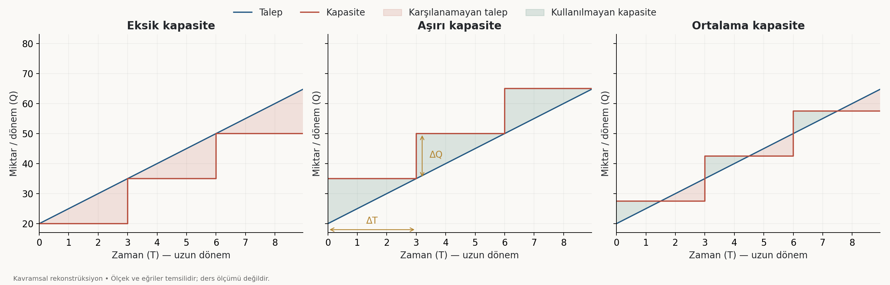

**Nasıl okunur?** Kırmızı basamak kapasiteyi, mavi doğru talebi gösterir. Talep üstteyse karşılanamayan talep; kapasite üstteyse kullanılmayan kapasite vardır.

| Strateji | Öncelik                          | Temel risk                       |
| -------- | -------------------------------- | -------------------------------- |
| Eksik    | Yatırımı yüksek oranda kullanmak | Talebi ve müşteriyi kaçırmak     |
| Aşırı    | Gelecek talebe hazır olmak       | Kullanılmayan yatırıma katlanmak |
| Ortalama | İki maliyeti dengelemek          | Tahmin ve zamanlama hataları     |

### Kapasite genişleme kararları
Kapasite artırımında **ne zaman** ve **ne kadar** soruları birlikte cevaplanır.

**Kapasite genişleme zaman aralığı**, iki kapasite artırımı arasında geçen süredir. Grafikte basamağın yatay uzunluğu olan $\Delta T$ ile gösterilir.

**Kapasite genişleme büyüklüğü**, bir yatırımda eklenen üretim gücüdür. Basamağın dikey yüksekliği olan $\Delta Q$ ile gösterilir. Örneğin 10.000 adet/yıldan 15.000 adet/yıla çıkışta artırım 5.000 adet/yıldır.

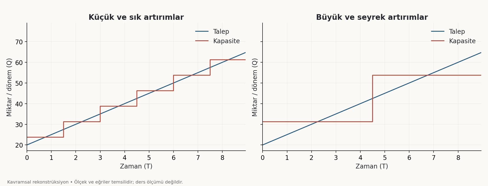

**Küçük ve sık artırım**, talepteki değişime daha yakın uyum sağlayabilir; fakat sık finansman, kurulum ve fiziki alan düzenlemesi gerektirir. **Büyük ve seyrek artırım**, daha uzun dönemli öngörü gerektirir ve tahmin hatası halinde daha büyük kullanılmayan kapasite veya talep açığı doğurabilir.

Üç stratejiyle bu iki genişleme biçimi birlikte **altı temel kombinasyon** oluşturur. Yatırım zamanı gelmeden finansman hazırlanmalı; ekonomik ömür, alan ve sonraki genişleme imkânları düşünülmelidir. Kapasite yatırımını sonradan satmak harcanan kaynakların tamamını geri getirmeyebilir. Nominal satış fiyatının artması da tek başına reel kazanç göstermez. **Hurda veya kalıntı değer**, yatırım varlığının ekonomik ömrü sonunda elden çıkarılmasından beklenen değerdir; yalnızca metal hurdası anlamına gelmez. Genişleme planı yapılırken mevcut donanımın kullanım ömrü ve sonraki dönemde nasıl değerlendirileceği de hesaba katılır.

### Talep dalgalanmaları ve diğer koşullar

Mevsimsel talep karşısında kısa dönem kapasitesi sabit kalabilir. Dondurma üretiminde yazın talep kapasiteyi aşarken kışın tesisin bir bölümü kullanılmayabilir. Kapasiteyi yaz zirvesine göre kurmak atıllığı, kış tabanına göre kurmak yüksek sezondaki satış kaybını artırır.

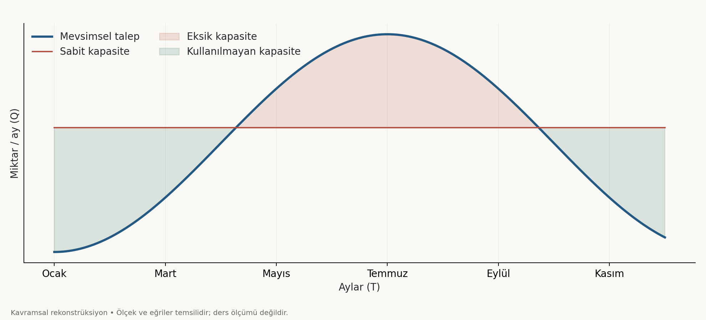

Ürün ve saklama koşulları uygunsa ilkbaharda fazla üretip yaz talebinin bir bölümünü stoktan karşılamak mümkündür. Bunun depolama, bozulma ve finansman maliyetleri vardır. Üretim gücünü kurmakla onu sürekli kullanmak bu nedenle ayrı planlama problemleridir. Grafikteki miktarlar temsilidir.

Kapasiteyi talebin yanında **hammadde ve bileşenlerin miktarı, kalitesi ve fiyatı; enerji, su, yakıt ve ulaşım; sermaye, iş gücü ve teknolojiye erişim** sınırlar. Salça fabrikasının ölçeği, erişilebilen domates miktarı ve bozulmadan taşınabileceği mesafeyle ilişkilidir. Fabrikanın iç üretim gücü, dış lojistik ağı bu hacmi taşıyamıyorsa bütünüyle kullanılamaz.

İçeride ise işlem sıralaması, yerleşim, bekleme, ürün çeşitliliği, çalışan becerisi, motivasyon ve yönetim yapısı etkilidir. Teknik olarak mümkün iki farklı işlem sırası farklı akış ve kapasite sonuçları yaratabilir. Kuruluş yeri, kapasite ve üretim yöntemi birlikte değerlendirilmelidir.

## Kapasite, maliyet ve ölçek ekonomileri

[[Birim Satın Alma Maliyeti|birim maliyeti]], **tesis/kapasite ölçeği, üretim yöntemi ve girdi fiyatları** şekillendirir. Ortalama maliyet, toplam maliyetin üretim miktarına bölümüdür:

$$AC(Q)=\frac{TC(Q)}{Q},\qquad Q>0$$
Sabit giderin ($AFC(Q)$) birim payı $FC/Q$ olduğundan üretim azaldığında aynı gider daha az ürüne dağılır. Atıl kapasite bu yolla birim maliyeti yükseltebilir; toplam sabit giderin mutlaka arttığı anlamına gelmez.

Uzun dönemde tesis büyüklüğü değiştirilebilir. **Ölçek ekonomileri**, büyüklüğün sağladığı birim maliyet tasarruflarıdır. Tasarruflar belli noktadan sonra koordinasyon ve denetim sorunları karşısında yetersiz kalırsa maliyet yeniden yükselir.

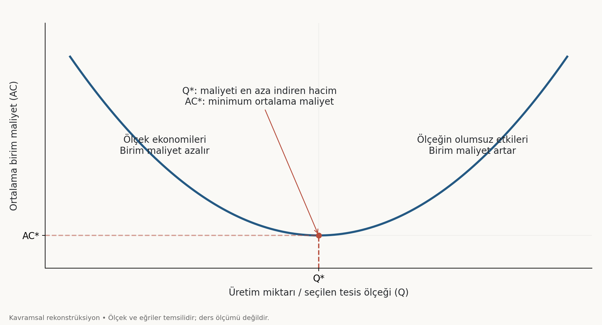

U eğrisinin dip noktası **optimum kapasiteyi**, bu noktadaki değer minimum ortalama maliyeti gösterir. Minimum birim maliyet, maksimum toplam kârla aynı şey değildir; kâr için satış fiyatı ve miktarı da gerekir.

Sol kol ölçek tasarruflarını; sağ kol ölçeğin olumsuz etkilerini gösterir. $Q^*$, modelde ortalama maliyetin en düşük olduğu üretim/ölçek düzeyidir. $AC^*$ bu noktadaki maliyettir ve **optimum kapasite** olarak adlandırır.

> [!important] Minimum maliyet ile maksimum kâr farklıdır
> En düşük birim maliyet noktası, tek başına en yüksek toplam kârı göstermez. Kâr için satış fiyatı, satılabilen miktar ve gelir yapısı da gerekir. U biçimi derste kullanılan modeldir; her işletmede tek ve keskin dip noktası bulunması zorunlu değildir.

### Talebe uygun tesis seçimi

A, B, C ve D farklı tesis alternatifleridir. **Maliyetler aynı üretim miktarında karşılaştırılır.** Büyük tesisin dip maliyeti düşük olsa bile pazar o miktarı satın almıyorsa o noktada çalışılamaz. Düşük hacimde küçük tesis daha uygun olabilir.

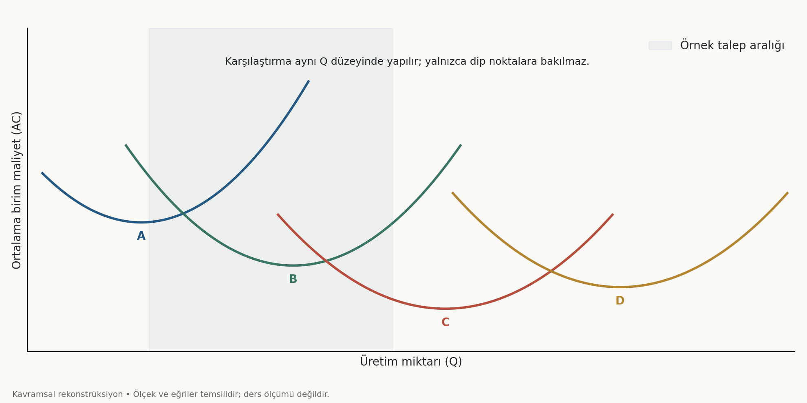

**Karşılaştırma aynı üretim miktarında yapılır.** Bir tesisin eğrisinin dip noktası çok düşük olsa bile pazar o miktarı satın almıyorsa işletme o maliyet noktasında çalışamaz. Büyük tesisi düşük hacimde işletmek, küçük bir tesisten pahalı olabilir.

Bu durumda başlangıçtaki yüksek maliyete katlanıp C'yi seçmek de B ile başlayıp sonradan genişlemek de değerlendirilebilir. Karar, **gelecekteki talep, sermaye imkânı, genişletilebilirlik, yatırım maliyeti ve risk** birlikte incelenerek verilir. Fiyat bilinmeden yüksek birim maliyete bakıp kesin olarak “zarar ediyor” denilemez.

Görselde C en düşük dip maliyetine sahipken D daha büyük hacimlere uygundur. Bu yerleşim temsilidir; **en büyük tesisin mutlaka en düşük dip maliyetine sahip olduğu varsayılmamıştır.**

### İçsel ve dışsal tasarruflar

**İçsel ölçek ekonomileri**, işletmenin kendi büyüklüğünden doğar. İşletmenin kendi büyüklüğünden ve faaliyetlerinin düzenlenmesinden kaynaklanan birim maliyet tasarruflarıdır.

**Emek ekonomileri:** Yeterli iş hacmi, çalışanı belirli işte uzmanlaştırmayı mümkün kılar. Tekrar arttıkça işin süresi ve hata azalabilir. Aynı ücretle daha fazla çıktı elde edilmesi birim işçilik maliyetini düşürür. Deneyim paylaşımı da öğrenmeyi destekleyebilir.

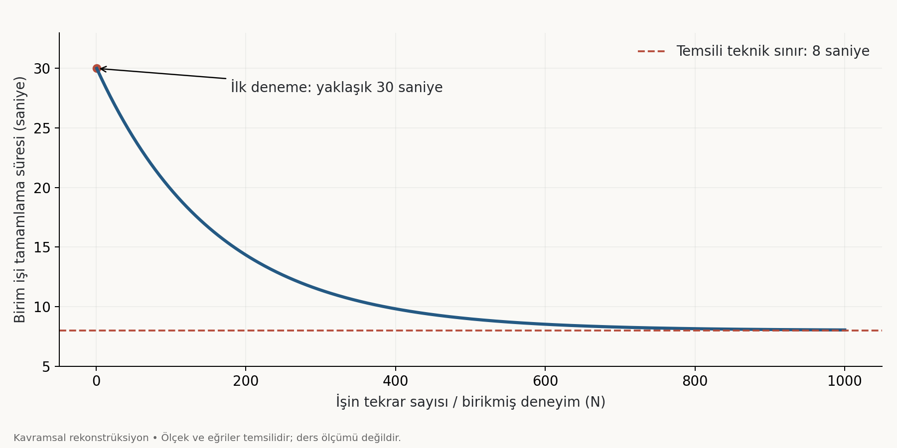

Öğrenme eğrisinde yatay eksen tekrar sayısı, dikey eksen birim iş için gereken süre veya kaynaktır. Vida sıkma süresinin örneğin 30 saniyeden 8 saniyeye yaklaşması, deneyimin etkisini gösterir. Eğrinin yataylaşması ek öğrenmenin katkısının küçülmesidir.

**Teknik ekonomiler:** Büyük hacim, uzmanlaşmış makine kullanımını ekonomik hale getirebilir. Ayrıca üretim faktörleri bölünmez: Makinenin yarısını kullanmak bedelinin yarısını ödemek değildir. Kapasite daha çok kullanıldığında yatırımın birim payı azalabilir. Kapasite iki katına çıkarken makine fiyatının aynı oranda artması da gerekmez.

Örneğin 1.000 işlem/gün kapasiteli makinenin bedeli 100, 2.000'liğin 175, 4.000'liğin 300 olsun. Bedelin kapasiteye oranı sırasıyla 0,10; 0,0875 ve 0,075'tir. Bunlar **kapasite başına yatırım göstergeleridir**; gerçek üretim maliyetinin tamamını göstermez. Avantaj, kapasitenin kullanılmasına bağlıdır. Uzmanlaşmış insan veya makineden yararlanmanın ekonomik koşulu, mesaisini dolduracak kadar ilgili işe sahip olmaktır. İş hacmi düşükken aynı çalışanı birbirinden farklı görevlere dağıtmak gerekebilir; uzmanlaşmanın kazancı bu durumda sınırlanır.

**Yönetim ekonomileri:** Uzman yöneticiler daha iyi kararlarla kaynak kullanımını iyileştirebilir. **Pazarlama ekonomileri:** Araştırma, reklam ve dağıtım sisteminin sabit giderleri daha çok ürüne yayılabilir.

**Depolama ve stok ekonomileri:** Büyük deponun maliyeti hacmiyle aynı oranda artmayabilir. Stoka bağlanan kaynağın finansman maliyeti de önemlidir. **Finansal ekonomiler:** Uygun borçlanma koşulları veya sermaye sağlama işlemlerinin sabit giderlerini daha büyük tutara yaymak avantaj yaratabilir. Stokta depolama gideriyle finansman yükü ayrıdır: Ürün beklerken ona bağlanan para başka işte kullanılamaz. Finansman borçla sağlanıyorsa faiz, öz kaynakla sağlanıyorsa fırsat maliyeti değerlendirilir. Büyük işletmenin finansman avantajı koşullara bağlıdır; büyüklük tek başına düşük risk garantisi vermez.

**Satın alma ve artıkların değerlendirilmesi:** Büyük sipariş pazarlık gücü sağlayabilir. İktisadi kullanım açısından atık, uzaklaştırılması gereken fazlalık; artık, yeniden değer üretmekte kullanılabilen fazlalıktır. Bir torba talaşı işlemek ekonomik olmayabilirken çok miktardaki talaşı işletme içinde değerlendirmek mümkün olabilir.

**Dışsal ölçek ekonomileri**, sektörün ve bölgesel üretim ortamının gelişmesinden doğar. Yan sanayinin büyümesi girdi maliyetlerini düşürebilir; ortak enerji, ulaşım ve arıtma altyapısı yatırım yükünü paylaşabilir. Artıkları satın alan işletmelerin bölgede gelişmesi de avantajdır. Talaşı kendi tesisinde işlemek içsel, gelişmiş yerel alıcı ağı sayesinde değerlendirmek dışsal tasarruf örneğidir.

### Ölçeğin olumsuz etkileri

Aşırı büyüme; iş gücü denetimini zorlaştırabilir, yönetim kademelerini artırarak kararları yavaşlatabilir ve dağıtım mesafelerini uzatabilir. Bölünmez donanım yatırımı da talebin üzerinde kapasite doğurabilir.

4.000 kapasiteli makinenin yanına aynı makineden eklenince kapasite 8.000'e çıkarken talep 5.000'de kalırsa 3.000 kullanılmaz. Yalnızca 1.000'lik küçük makine eklemek de kapasite başına yatırım yükünü değiştirebilir. Yatırımın büyümesiyle birim maliyetin düşmesi her durumda birlikte gerçekleşmez.

## Kısa dönem maliyet ve kapasite türleri

### Azalan verimler ve kapasite bant genişliği

Kısa dönemde tesis gibi bazı girdiler sabittir. **Azalan verimler**, sabit girdiler yanında değişken girdinin artırılmasının bir noktadan sonra giderek daha az ek çıktı sağlamasıdır. Ek girdinin katkısı **marjinal ürün**, ek tüketimin tatmini **marjinal faydadır**. Üretim maliyetini açıklarken marjinal ürün kullanılır.

Girdi fiyatı sabitken ek çıktı elde etmek zorlaştığında marjinal maliyet artar. Uzun dönemdeki ölçek etkisiyle kısa dönemdeki verim etkisi, benzer U eğrileri oluştursa da farklı mekanizmalardır.

**Kapasite bant genişliği**, minimum birim maliyetten kabul edilen sapma içinde çalışılabilecek üretim aralığıdır. Örneğin %10 tolerans seçilirse:
$$AC(Q)\leq1{,}10\,AC^*$$
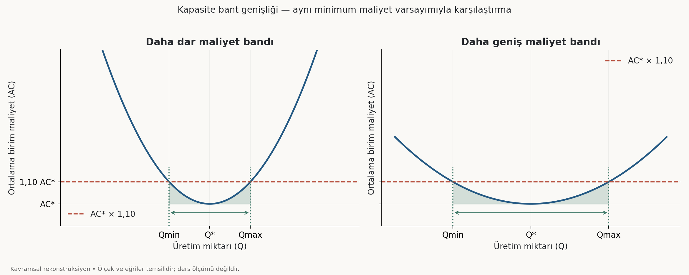

Tolerans çizgisinin eğriyi kestiği $Q_{min}$ ile $Q_{max}$ arasındaki mesafe bant genişliğidir. %10 örnek bir tercihtir. Yayvan eğri, aynı toleransta daha geniş hacim esnekliği sağlayabilir. Toleransı artırmak da bandı genişletir; fakat daha yüksek maliyeti kabul etmek demektir. Üretim yöntemi seçilirken minimum maliyet kadar hacim değişimlerine uyum da önemlidir. Tek bir miktarda çok düşük maliyet sunan katı sistem, talep biraz değiştiğinde pahalı hale gelebilir. Daha geniş bantlı yöntem dalgalanmalara daha kolay cevap verebilir. Bununla birlikte bant içinde kalmak tek başına kârı garanti etmez; kabul edilebilir maliyet ile satış geliri birlikte değerlendirilir.

### Teorik, normal, fiili ve atıl kapasite

Saatte 100 işlem yapan makinenin 8 saatlik teorik kapasitesi 800 adet/gündür. Bakım, mola, ayar ve beklenen fireler sonrasında normal kapasite 600; gerçekleşen üretim 450 olsun.

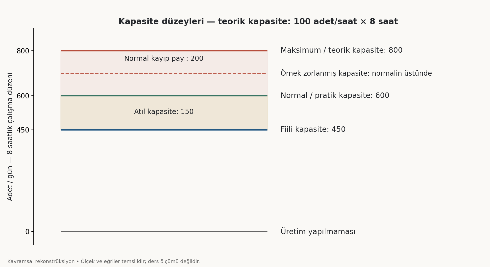

| Kapasite | Anlamı | Örnek |
| --- | --- | --- |
| **Maksimum / teorik / tasarım** | Tanımlanan çalışma süresindeki ideal üst sınır | 800 |
| **Normal / pratik** | Olağan kayıplar sonrası ulaşılabilir üretim gücü | 600 |
| **Fiili / gerçek** | Gerçekleşen çıktı | 450 |
| **Atıl / boş / aylak** | Normal kapasitenin kullanılmayan kısmı | 150 |
| **Zorlanmış** | Normal koşullar geçici zorlanarak erişilen çıktı | Örneğin 700 |

Teorikten normale düşen **200**, olağan kayıp payıdır. Normalden fiiliye kalan **150**, atıl kapasitedir. Atıllık; talep yetersizliği, beklenmeyen arıza, girdi gecikmesi veya fazla fireyle oluşabilir.

Bakım ve molaları geçici azaltarak elde edilen yüksek üretim sürdürülemeyebilir; sonraki arıza ve yorgunluk kayıpları artırabilir. Buna karşılık geçiş sürelerini kalıcı iyileştirmek normal kapasiteyi yükseltebilir. Çalışmayı 8 saatten 11 saate çıkarmak ise hesaplama çerçevesini değiştirir; teorik kapasite 1.100 olur ve normal kapasite yeniden hesaplanır.
$$\text{Tasarım kapasitesi kullanım oranı}=\frac{450}{800}\times100=\%56{,}25$$
$$\text{Pratik kapasite kullanım oranı}=\frac{450}{600}\times100=\%75$$
Optimum kapasite bu seviyelerden otomatik çıkarılamaz; maliyet yapısına bağlıdır. Normal kapasite de gerçek bakım, geçiş ve kayıp süreleri görülmeden kesinleşmeyebilir. Sıfır üretim mümkünken her küçük miktarın teknik veya ekonomik olarak uygun olması gerekmez. Hızlı veya partiyle çalışan donanımda tek bir ürün üretmek pratik olmayabilir. Üretim çok azaldığında sabit giderin ürün başına payı da büyür. Bu nedenle teorik alt ve üst sınırlarla ekonomik faaliyet aralığı aynı şey değildir.

Normal kapasiteyi belirlerken planlanan bakım, beklenen fire ve ürün geçiş süreleri birlikte değerlendirilir. Gerçek çalışma koşullarında bunların süreleri değişebilir. Bir makinenin katalog değeri bilinse bile fabrikanın ulaşabileceği günlük çıktı, istasyonların karşılıklı etkileşimleri görülmeden aynı kesinlikle bilinmeyebilir. Tasarım aşamasındaki kapasite tahmini bu yüzden uygulamada gözden geçirilir.

## Darboğaz ve üretim akışları

**Darboğaz**, sistemin nihai çıktısını sınırlayan aşamadır. Ürünlerin bire bir geçtiği basit seri hatta kapasite, en düşük istasyon kapasitesidir.

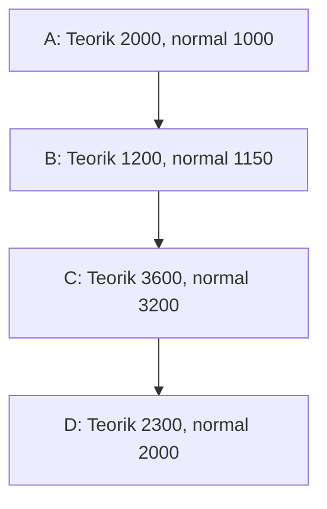

Birim adet/gündür. Bu sayısal modelde teorik darboğaz B=1.200, normal koşullardaki darboğaz A=1.000'dir. A günde 2.000 üretirken B yalnız 1.200 geçirirse önünde günlük 800 **ara stok** birikebilir. Alan dolduğunda önceki istasyon da durabilir. Nihai çıktı artmadan stok ve finansman yükü büyür.

B'nin teorik kapasitesini 2.400'e çıkarmak sistem kapasitesini ikiye katlamaz; yeni sınır A=2.000 olur. Normal koşullarda ise yalnız B'yi artırmak başlangıçtaki A=1.000 sınırını kaldırmaz. Önce A yeterince artırılırsa sonraki sınır B=1.150 olur; ilk artış en fazla 150'dir. **Yatırımın getirisi yerel makine hızından değil, sistemin yeni kısıtından hesaplanır.**

> [!note] Sayısal belirsizlik
> Görüntüde netleşmeyen istasyon değerleri için bu şemadaki sayılar model kabulüdür; kritik karşılaştırma teorik ve normal darboğazın farklılaşmasıdır.

### Montaj ve ayrılan akışlar

Bir ürün için 2 A ve 3 B parçası gerekiyorsa kapasite, bileşen oranlarıyla hesaplanır:
$$K=\min\left(\frac{5.000}{2},\frac{7.500}{3},3.000\right)=2.500$$
Buradaki 3.000 montaj istasyonunun kapasitesidir. İki girdiden gelen 2.500 değerleri toplanmaz; aynı ürünün tamamlayıcı parçalarıdır.

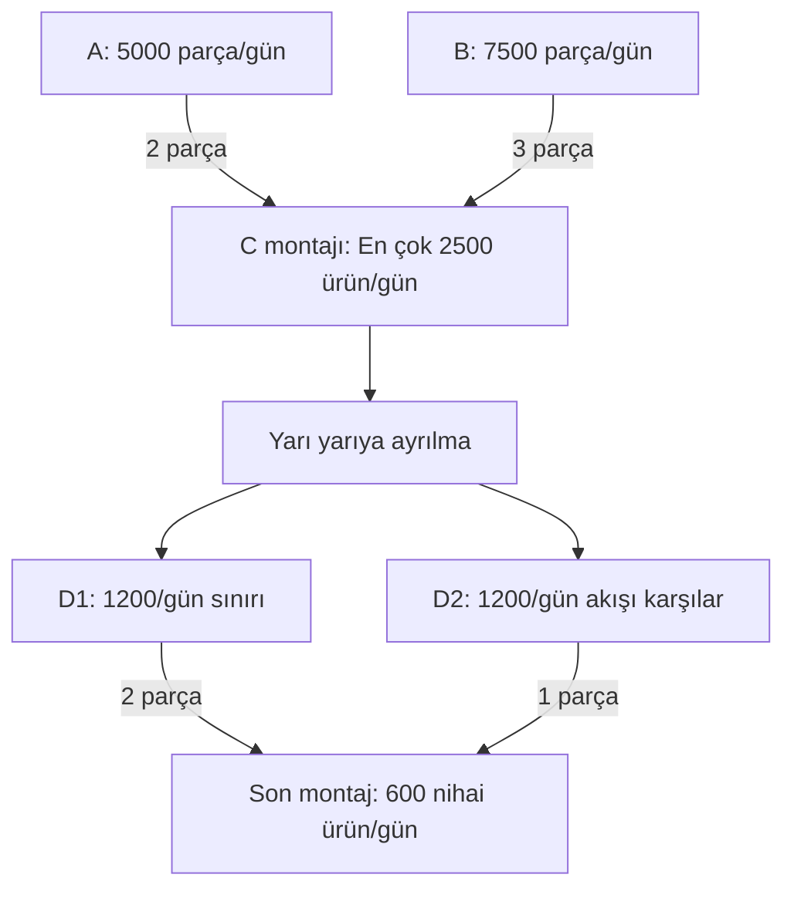

2.500'ün yarısı her kola gönderilirse 1.250'şer giriş oluşur. 1.200'lük kol bunu karşılayamaz. İlk montajı 2.400'e çekmek her kola 1.200 sağlar; bunun için 4.800 A ve 7.200 B gerekir. Son montaj 2 D1 ve 1 D2 tüketiyorsa sınır 600 nihai üründür.

Ancak 600 ürün için 1.200 D1 ve yalnız 600 D2 kullanılır. İki kol da 1.200 üretirse D2 tarafında fazlalık oluşur. Akış, nihai ürünün bileşen ihtiyacına göre düzenlenmelidir. **600 sonucu, D1 sınırının 1.200 olduğu model içindir; kaynak çizimdeki kol değerleri kesinleşmediğinden evrensel optimum sayılmaz.**

## İşletme fonksiyonları ve yönetim

**Fonksiyon**, yürütülen iş grubu; **departman**, bu işlerin örgütlendiği birimdir. Ayrı insan kaynakları bölümü olmayan küçük işletmede personel işleri yine yapılır. Süreklilik ise faaliyet grubu değil, amaçtır.

**Yönetim**, insan, makine, para ve bilgiyi amaç doğrultusunda yönlendiren üst fonksiyondur. **Üretim** mal veya hizmeti ortaya çıkarır; **pazarlama** ihtiyaçları ve müşteriye ulaşmayı düzenler; **finans** gerekli fonları sağlar ve kullanımını yönetir. Satış, pazarlamanın bir boyutudur.

Destek fonksiyonlar; **insan kaynakları, muhasebe, AR-GE, bakım-onarım ve tedarik zinciri yönetimidir.** İnsan kaynakları personel ihtiyacı, işe alım, özlük ve motivasyonla ilgilenir. Muhasebe işlemleri kaydeder, maliyet ve raporlama bilgisi sağlar. AR-GE ürün ve süreç geliştirir; bakım donanımın sürekliliğini destekler. Tedarik zinciri girdi, stok ve dağıtım akışlarını birlikte yönetir. Destek olmak önemsiz olmak değildir. **Finans ile muhasebe ayrımı**, fonu sağlama ve kullanma kararlarıyla bu işlemlerin kaydedilmesi arasındadır. Tedarik zinciri bazı işletmelerde ana faaliyet kadar belirleyici olabilir. Fonksiyonların ayrı departmanlarda mı yoksa başka görevlerle birlikte mi yürütüleceği işletmenin büyüklüğüne ve iş yapısına bağlıdır.

### Yönetim kademeleri ve kararlar

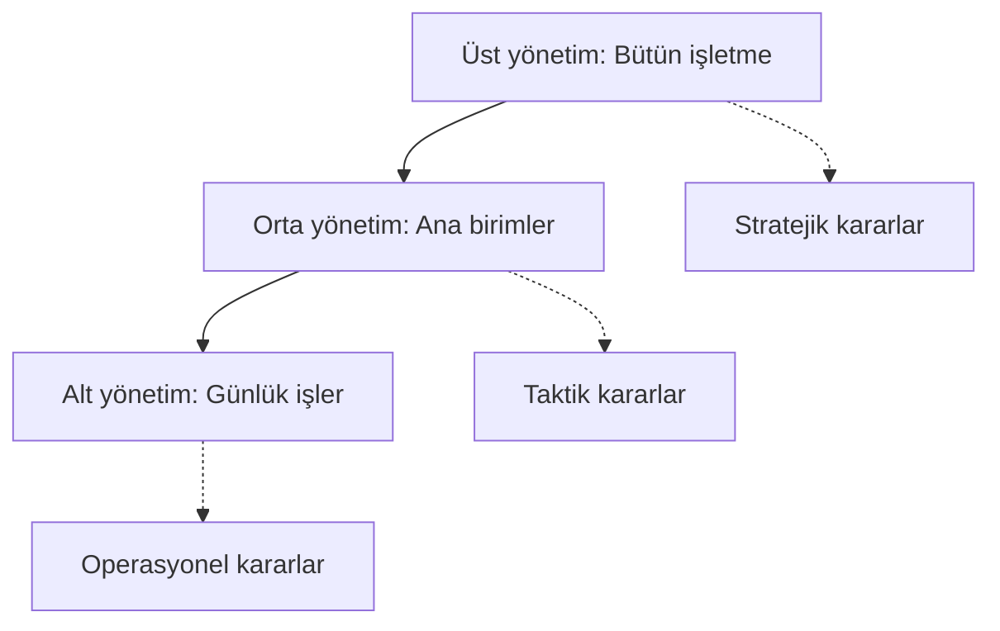

**Stratejik kararlar**, örgütün bütününü veya büyük bölümünü etkiler. **Taktik kararlar** ana birimlere; **operasyonel kararlar** dar kapsamlı günlük faaliyetlere yöneliktir. Üst kademede kararlar görece az ve geniş kapsamlıyken aşağıya doğru sayı ve tekrar artar. Sınırlar işletmenin büyüklüğüne göre değişebilir.

Stratejik kararın temel ayrımı yalnız süresi değildir. Geniş yapısal değişim daha çok uyarlama ve direnç, bunlar daha çok kaynak ve zaman gerektirir. Dolayısıyla uzun vade çoğunlukla bu kapsamın sonucudur. Günlük iş sırasını değiştirmekle işletmenin genel yapısını dönüştürmek aynı karar düzeyi sayılmaz. Bir sınıfın yerini değiştirmek bile alışılmış düzene göre hareket edenleri yeniden yönlendirmeyi gerektirir. Örgütün bütününü etkileyen değişiklikte bu uyarlama ihtiyacı büyür. Taktik ve operasyonel kararlarda kapsam daraldığı için kaynak gereksinimi ve uygulama süresi genellikle azalır.
