> Vizelerden önce olan 7. ders ve vizelerden sonra olan 8. ders birleştirilmiştir, nitekim yönetimin fonksiyonlarına 8. derste de devam edildi.

## Yönetime Dair Bütüncül Çerçeve
**[[isletme-yönetim|Yönetim]]** (Management), işletmenin sahip olduğu beş temel kaynağı (insan, makine/donanım, malzeme, para, bilgi) ortak bir amaç doğrultusunda harekete geçirme ve sonuç alma sürecidir. Bu süreç kararları alan ve uygulayan **insan ile beceri mimarisi** ve bu insanları yönlendiren **tarihsel yönetim düşünceleri** olmak üzere iki temel eksen üzerinde açıklanır. Makineler ve yazılımlar matematiksel optimizasyon kurallarına göre çalışırken, insanlar duyguları, algıları, niyetleri ve sosyal etkileşimleriyle hareket eder. Bu nedenle yönetim bilimi, üretimden pazarlamaya kadar tüm işletme işlevlerini kapsayan makro bir üst şemsiye kurar; ardından bu şemsiyeyi ölçek daraltarak alt işlevlere uygular.

İşletme yönetimi sahada dört ana yapı taşının birleşimiyle işlerlik kazanır:

1. **Kaynak ve Rasyonellik Zemini:** İnsan, donanım, malzeme, finansal sermaye ve bilgi kaynaklarının yönetimi ile insan kararlarının matematiksel optimizasyondan ayrışan doğası.
2. **Hiyerarşi ve Beceri Dağılımı:** Stratejik, taktik ve operasyonel karar düzeylerinin üst, orta ve alt kademe yönetim piramidini şekillendirmesi ve her kademede gereken teknik, karar verme, insan ilişkileri ve kavramsal beceri bileşimi.
3. **Yönetim Düşüncesinin Tarihsel Evrimi:** Sanayi Devrimi öncesindeki kamu odaklı yaklaşımlardan ve sahip-yönetici modelinden başlayarak Klasik dönem (Taylor, Fayol, Weber), Neo-Klasik dönem (Hawthorne araştırmaları ve insan ilişkileri) ve Çağdaş dönem (Sistem, Durumsallık, Toplam Kalite, Z Kuramı, Arz Zinciri, Altı Sigma, Yalın Yönetim, Güçlendirme ve Cezbolma) yaklaşımlarına uzanan çizgi.
4. **Yönetimin İlk İki Temel İşlevi:** Gelecekteki amaca giden rotayı tahminler ve SMART hedeflerle çizen **[[isletme-planlama|Planlama]] (Planning)** ve bu planı uygulayacak birimleri, kademeleri, yetki-sorumluluk bağlarını kuran **[[isletme-orgutleme|Örgütleme]] (Organizing)**.

Aşağıdaki sistem akışı, bu dört ana yapı taşının birbirini nasıl beslediğini ve örgüt mimarisine nasıl dönüştüğünü göstermektedir.

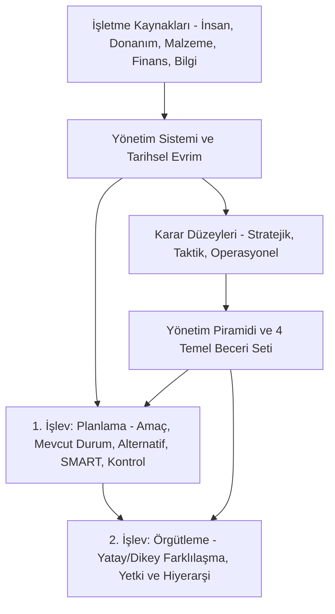

---

## 2. Yönetimin özüne ve işletme kaynaklarına dair

### 2.1. İşletme kaynakları ve bilginin stratejik konumu
İşletme kaynakları geniş bir kapsama yayılır ve temelde beş ana başlık altında sınıflandırılır:

- **İnsan Kaynakları (İş Gücü)**: Yönetimin merkezinde yer alır. Diğer tüm kaynaklar insanların iradesi ve idaresi aracılığıyla harekete geçer.
- **Donanım ve Sermaye Donatımı**: Üretim araçları, makineler ve fiziksel altyapı unsurları.
- **Malzeme**: Üretim ve hizmet sürecine doğrudan giren ham maddeler ve ara girdiler.
- **Finansal Kaynaklar (Para)**: İşletmenin faaliyetlerini finanse eden ve kaynak dönüşümünü sağlayan nakit ve sermaye gücü.
- **[[isletme-bilgi|Bilgi]] (Know-How)**: Modern işletmecilikte önemi hızla yükselen çift yönlü bir varlık ve kaynaktır. Dış çevreye dönük yüzü müşteri ve pazar bilgisini kapsarken; iç yapıya dönük yüzü ürün bilgisini, tasarım bilgisini ve iş yapabilme becerisini ifade eden teknik **know-how** birikimini içerir.

Yönetimin burada kurduğu ilkeler işletmenin genel amaçlarına yönelik makro bir çerçeve sunar. Aynı yönetim mantığı, ölçek daraltılarak üretim yönetimi veya pazarlama yönetimi gibi daha mikro işletme işlevlerine de doğrudan uyarlanır.

### 2.2. Optimizasyon, yapay zekâ ve insanın rasyonellik sınırı

Günümüzde yapay zekâ ve gelişmiş yazılımların iş süreçlerine entegre olmasıyla, geleneksel yönetim tanımındaki insan kapsamının belirli alanlarda zaman içinde daralacağına dair öngörüler bulunmaktadır. Makinelerin devreye girdiği alanlarda karar mekanizması doğrudan **[[kavram-optimizasyon|optimizasyon]]** temelli işler.

Sıkça birbirine karıştırılan iki kavram netleştirilmelidir: **[[kavram-optimum|Optimum]]**, "*en verimli*" anlamına gelmek yerine, belirlenen ölçüte göre **"en uygun"** olan durumu ifade eder. **[[kavram-optimizasyon|Optimizasyon]]** ise bu en uygun noktanın bulunması sürecidir. Matematiksel programlama yaklaşımında işletmenin amacı bir fonksiyon olarak tanımlanır ve iki temel fonksiyon türü karşımıza çıkar:
* **Maksimizasyon Fonksiyonları:** Örneğin kârın en yüksek düzeye çıkarılması.
* **Minimizasyon Fonksiyonları:** Örneğin maliyetlerin veya toplam işlem süresinin en düşük düzeye indirilmesi.

Bilgisayarlar ve algoritmalar bu fonksiyonlar üzerinden tam bir rasyonellik içinde optimum noktayı bulur. İnsan davranışının da teoride kendi faydasını maksimize ederek optimuma yöneldiği varsayılır; ancak gerçek örgüt yaşamında insan kararları çok sayıda karmaşık etkenin etkisi altında kalır. Duygular, açıkça beyan edilmemiş niyetler, öznel algılar ve kişisel tercihler insanı salt matematiksel rasyonellikten uzaklaştırır. Bu nedenle makine ve donanım optimizasyonu teknik bir hesaplama problemiyken, insanı yönetmek çok daha karmaşık ve kritik bir yönetsel sorumluluktur.

---

## 3. Yönetim hiyerarşisi ve yöneticilik becerilerine dair

### 3.1. Karar düzeyleri ve yönetim piramidi

İşletmede alınan kararlar, örgütün ne kadarlık kısmını etkilediğine bağlı olarak üç temel düzeye ayrılır:
1. **[[karar-duzeyleri-stratejik|Stratejik Düzey]] (Strategic):** Örgüt yapısının tamamını ya da çok büyük bir bölümünü etkileyen uzun vadeli kararlar.
2. **[[karar-duzeyleri-taktik|Taktik Düzey]] (Tactical):** Örgütün ana bileşenleri ve bölümleri düzeyindeki kararlar.
3. **[[karar-duzeyleri-operasyonel|Operasyonel Düzey]] (Operational):** Doğrudan alt düzeyde, günlük fiili işlerin yürütüldüğü alana ilişkin kararlar.

Bu üç karar düzeyi, işletmede kademeli bir yönetim piramidi oluşturur: stratejik düzey **üst kademe yönetim**, taktik düzey **orta kademe yönetim**, operasyonel düzey ise **alt kademe yönetim** ile eşleşir. Piramidin tabandan tepeye doğru daralması ve üst kademede görece çok daha az sayıda yönetici bulunması, yapının **bütünleşikliği** ile ilgilidir. Örgütün bütünü tek bir merkezden yönetildiği için parça sayısı azdır ve az sayıda üst yönetici yeterli olur; tıpkı tek bir sınıfa dört öğretmen koymak yerine bir öğretmenin yeterli olması gibi. Ancak okul sınıflara bölündüğünde her sınıfa bir öğretmen gerektiği benzeri, örgüt ana bileşenlere ve fiili iş parçalarına bölündükçe her parça için yeni yöneticilere ihtiyaç doğar ve alt kademelerde yönetici sayısı büyür.

### 3.2. Dört temel yöneticilik becerisi
Her yönetim kademesindeki yöneticilerin işlerini hakkıyla yürütebilmek için **sahip olması gereken** belirli beceri bileşimleri vardır. Fiiliyatta görev yapan bir yöneticinin kişisel beceri profili bu dağılımdan farklılık gösterebilir; fakat ilgili kademenin gerektirdiği beceri setinden uzaklaşıldığında o kademedeki yönetsel işlevlerin yerine getirilmesinde aksama riski ortaya çıkar. Genel yöneticilik becerileri dört ana grupta toplanır:

1. **[[Teknik Beceriler]]**: Bir işi teknik boyutlarıyla, tüm detaylarıyla yapabilme bilgisi ve yetkinliğidir. **Alt kademelerde** en yüksek ihtiyaç duyulan beceridir; çünkü alt kademe yöneticisi işi bizzat kendisi yapmasa bile astlarına işin nasıl yapılacağını net biçimde tarif edebilmeli ve işi yapılırken teknik olarak denetleyebilmelidir. Üst kademeye çıkıldıkça —örneğin bir İcra Kurulu Başkanının (CEO) aşağıda bir vidanın nasıl sıkıldığını bilmesine ihtiyaç duyulması yerine— bu becerinin yönetsel ağırlığı azalır.
2. **[[Karar Verme Becerisi]]**: **Üst kademede** en kritik öneme sahiptir. Üst düzeyde alınan kararlar çok daha geniş ölçekli, uzun dönemli, yüksek kaynak gerektirici ve kapsamlıdır; hatalı verilen bir karar tüm örgüt yapısını sarsma riski taşır. Alt kademedeki yöneticiler de karar verir; ancak verdikleri kararların örgütsel kapsamı daha dar olduğundan bu beceriye duyulan ihtiyaç alt kademede daha düşük düzeyde kalır.
3. **[[İnsan İlişkileri Becerisi]]**: Yönetimin insan odaklı doğası gereği **her kademede** neredeyse eşit ve yüksek önemdedir. Alt kademe yöneticisi çok sayıda ast ve orta kademeyle; orta kademe yöneticisi kendinden alt ve üst kademelerle; üst kademe ise örgüt içi tüm yapının yanında müşteriler ve devlet kurumları gibi işletme dışı unsurlarla sürekli iletişim hâlindedir. Dış çevreyle kurulan temasların örgütü bütünüyle etkileme gücü nedeniyle üst kademede bu beceriye duyulan ihtiyaç belli belirsiz bir miktar daha belirginleşebilir. İleride ayrı bir başlık oluşturan **[[Liderlik]] (Leadership)** de insan ilişkileri becerisinin çatısı altında değerlendirilen önemli bir yetkinliktir.
4. **[[İdarecilik Becerisi]] / [[Kavramsal Beceri]]**: Günlük dilde "yöneticilik" ile "idarecilik" kelimeleri birbirine benzese de işletme literatüründe farklı anlamlar taşır. Kavramsal beceri olarak da adlandırılan idarecilik becerisi; yönetilen yapının tamamını bir bütün olarak, alt unsurları ve aralarındaki etkileşimlerle birlikte algılayabilme, alınan bir kararın hangi birimi nasıl etkileyeceğini bütüncül görebilme becerisidir. Üst kademede yönetilen yapı çok büyük ve etkileşim ağı yoğun olduğu için bu beceri en yüksek düzeyde gerekir; alt kademeye inildikçe yapı küçüldüğü için ihtiyacı azalır.

![[yonetici_becerileri_grafigi.svg]]

#### Yöneticilik Yetkinliğinin Gelişimi ve Aile İşletmeleri Vakası

Yöneticilik beceri seti doğuştan getirilen bir yetenekten ziyade zamanla, deneyimle ve bilinçli çabayla inşa edilen bir donanımdır. Yöneticiler alt veya uygun kademelerden yukarıya doğru yetişir. Bu noktada, Türkiye gibi **aile işletmelerinin** yoğun olduğu ekonomilerde kritik bir risk doğar: İkinci ya da üçüncü kuşak bireylerin, sermaye sahipliğinin getirdiği imkânla doğrudan en üst yönetim kademesine yerleştirilmesi, gerekli yönetim becerilerini geliştiremedikleri için işletmelerin başarısızlığa sürüklenmesine yol açar. Kurumsallaşmış büyük aile işletmelerinde dahi gelecek kuşakların en alt veya uygun başlangıç kademelerinden işe başlatılıp zamanla beceri setlerini kazanmalarının sağlanması, örgütün sürdürülebilirliği açısından sağlıklı olan yoldur.

---

## 4. Yönetim düşüncesinin tarihsel gelişimine dair

Yönetim biliminin temel ilkelerinden biri, **her durumda geçerli tek bir doğru yönetim yaklaşımı bulunması yerine, her durumun kendine özgü koşullarına uygun yaklaşımlar geliştirilmesidir**. Bu çağdaş noktaya nasıl gelindiğini anlamak için yönetim düşüncesinin tarihsel evrimini incelemek gerekir.

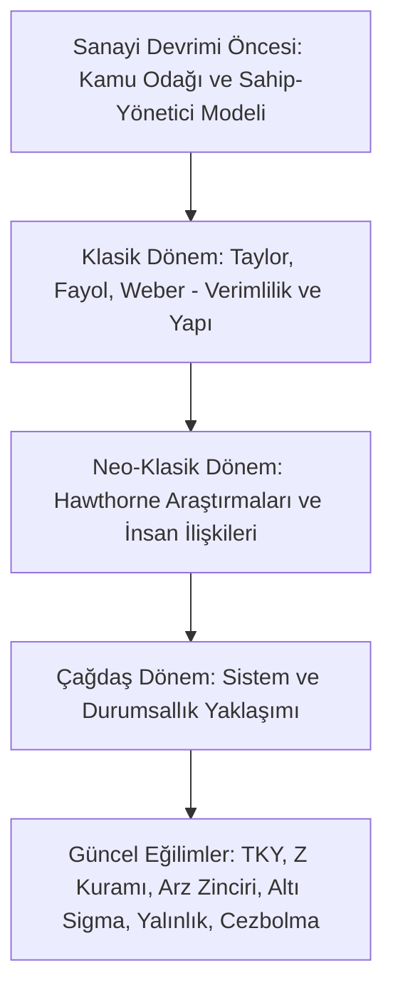

### 4.1. Sanayi Devrimi Öncesi Kökler ve Dönüşümün Nedenleri

İnsanoğlunun kabileler hâlinde toplu yaşamaya başlamasından bu yana yönetim olgusu varlığını sürdürmüştür. MÖ 5000'lerde bugünkü anlamda beceri setleri tartışılmasa da, MÖ 2000–1000 dönemine ve Antik Yunan'a ulaşıldığında Platon'un *Devlet* eseri ve Aristoteles'in metinleri başta olmak üzere, ilerleyen yüzyıllarda ise Machiavelli'nin eserlerinde "yönetici nasıl olmalıdır?" tartışmaları görülür. Ancak bu erken dönem metinleri **kamu yönetimi ve devlet rejimi** üzerine yoğunlaşır.

İşletme yönetimi literatürünün başlangıcının **Birinci Sanayi Devrimi** ile anılmasının yapısal bir nedeni vardır. Sanayi Devrimi öncesinde de işletmeler faaliyet gösteriyordu; fakat yapılar küçük ölçekliydi ve işletmenin sahibi ile yöneticisinin aynı kişi olduğu **[[Sahip-Yönetici Modeli]]** egemendi. Ara yönetim kademeleri ve gelişmiş iletişim ağları henüz kurumsallaşmadığı için "profesyonel yönetici kimdir?" sorusu bir işletme problemi olarak gündeme gelmiyordu.

Birinci Sanayi Devrimi ile birlikte fabrikalar 2–10 kişilik atölyelerden yüzlerce işçiyi barındıran karmaşık yapılara dönüştü. Dönemin piyasa anlayışı *"her arz kendi talebini yaratır"* (üretilen her malın satılacağı) düşüncesine dayanıyordu. Bu ortamda kârı artırmanın yolu üretim miktarını büyütmekten, yani doğrudan fiili üretim yapan **mavi yakalı** çalışanlardan daha fazla çıktı almaktan geçiyordu. Yönetim biliminin işletmelerdeki ilk sistemli arayışı, *"bu insanları nasıl daha verimli çalıştırırız?"* problemi üzerinden filizlendi.

### 4.2. Klasik Yönetim Dönemi
#### Bilimsel Yönetim Yaklaşımı (Scientific Management - Frederick W. Taylor)
Amerikalı mühendis **[[Frederick Winslow Taylor]]**, üretim sahasında işçilerin mesaide işi yavaşlatıp kaytarmak için çaba harcadığını, ancak öğle molasında beyzbol (Türkiye'deki eski fabrika bahçelerinde ise voleybol) oynarken kazanmak için canını dişine taktığını gözlemledi. Aynı insanın iki ortam arasındaki davranış farkını araştıran Taylor, çalışmalarını bildiriler ve 1911 yılında yayımladığı ***Bilimsel Yönetimin İlkeleri*** (The Principles of Scientific Management) adlı kitabıyla sistemleştirdi.

Taylor'a göre çalışma hayatı bilimsel ve standart yöntemlerle düzenlenmelidir:
* **Nicel Ölçüm ve Standartlaştırma:** Yalnızca mesai saatini izlemek yerine üretim adedi ve işlem süresi gibi sayılara dayalı (**nicel**) değişkenler standart yöntemlerle ölçülmelidir.
* **Net Hedef ve Denetim:** Çalışanlara açık hedefler verilmeli ve bilimsel yöntemlerle denetim sağlanmalıdır.
* **Ücret Teşviki:** Ücret artışları ve **akort ücreti** (parça başına ücret) gibi düzenlemeler çalışanların verimliliğini doğrudan artırır.
* **Fiziksel Koşullar ve Ergonomi:** Işıklandırma, ısıtma gibi fiziksel ortam faktörleri iyileştirilmelidir. Ergonomi, insan ile çalışma ortamının etkileşimini inceleyen bilim dalıdır. 

Aynı dönemde çalışan mühendis **Frank ve Lillian Gilbreth** çifti, 11 çocuklarına yetişebilmek için günlük işlerin en standart yapılış yollarını araştırırken geliştirdikleri teknikleri işletmelere uyarlayarak **[[Zaman-Hareket Etüdü]]** akımını başlattı. **Henry Gantt** ise proje ve iş planlamasında bugün hâlâ kullanılan **[[Gantt Şeması]]** yöntemini geliştirdi.

Dönemin arka planındaki temel insan varsayımı **homo economicus** (ekonomik insan) anlayışıdır. Bu varsayım, insanın karar verirken daima kendi faydasını maksimize etmeye çalıştığını kabul eder; para burada yalnızca bir dolaşım aracıdır. Ancak sonraki yıllarda yapılan gözlemler insanın her koşulda kendi maddi faydasını maksimize etmediğini gösterdi. Bu da 1930–40'lara yaklaşırken yeni yaklaşımların önünü açtı.

#### Genel Yönetim Yaklaşımı (General Management - Henri Fayol)
Taylor ve takipçileri daha çok atölye düzeyindeki üretim işçilerine odaklanırken, Fransız mühendis **Henri Fayol**, örgütün **bütününe (genel yönetimine)** yöneldi. Fayol görüşlerini Taylor ile yakın dönemlerde kaleme almasına karşın, Fransızcanın dönemin yaygın küresel iş ve bilim dili olmaması sebebiyle 1930'lardan sonra uluslararası literatürde geniş yer buldu.

Fayol, işletmenin fonksiyonlarından (üretim, pazarlama, finans vb.) ayrı olarak **yönetimin beş temel fonksiyonunu (işlevini)** tanımladı:
1. **[[isletme-planlama|Planlama]] (Planning):** Gelecekteki amaca giden yolların önceden belirlenmesi.
2. **[[isletme-orgutleme|Örgütleme]] (Organizing):** Amaca ulaşacak örgütsel yapının oluşturulması.
3. **[[isletme-yoneltme|Yöneltme]] (Commanding / Leading):** Yapının insan boyutunu oluşturup ilişkileri harekete geçirme süreci. *(İngilizce literatürde kadro oluşturma anlamında "staffing" kavramıyla da bağlantılandırılan bu işlev, kadro kurmanın yanında çalışanlar arası ilişkileri kurarak yapıyı harekete geçirmeyi kapsar.)*
4. **[[isletme-koordinasyon|Koordinasyon]] / Eşgüdümleme (Coordinating):** Örgüt içindeki farklı birimlerin ortak amaç doğrultusunda aynı yönde ilerlemesini sağlama; tüm diğer işlevlerin içinde işleyen bir bütünleştirici unsurdur.
5. **[[isletme-kontrol|Kontrol]] (Controlling):** Planlanan amaç ve hedeflere ulaşılıp ulaşılmadığının izlenmesi.

Fayol ayrıca toplam sayısı 14'e ulaşan genel yönetim ilkeleri geliştirdi (motivasyonun artırılması, liyakat esası, tüm bileşenler arası koordinasyon vb.). Bu ilkeler arasından dört tanesi modern örgütleme mimarisinin temel taşlarıdır:
* **[[Yönetim Birliği]]:** Benzer yapıdaki işlerin tek bir elden ve tek bir planla yönetilmesi.
* **[[Komuta Birliği]]:** Her astın yalnızca tek bir üst yöneticiden emir alması.
* **[[Örgütte Kademeleşme]] / Hiyerarşi:** Yönetim kademeleri arasında net bir dikey basamaklaşma kurulması.
* **[[Yetki ve Sorumluluk Denkliği]]:** Verilen sorumluluğa eş düzeyde yetki tanınması ve verilen yetki ölçüsünde hesap verebilirlik yüklenmesi.

#### Bürokrasi Yaklaşımı (Bureaucracy Approach - Max Weber)
1900'lerin başında **Max Weber**, bugün günlük dilde işlerin yavaşlaması ve "bugün git yarın gel" anlayışı şeklinde kullanılan anlamından çok farklı biçimde **[[bürokrasi]]** kavramını ortaya koydu. Weber'e göre bürokrasi, **rasyonellik (akılcılık) esasıyla hareket eden büyük örgütlerin yönetim modeli**dir ve devlet yönetimi dâhil her büyük örgüt için geçerlidir.

Weberyan yaklaşımın temel ilkeleri şunlardır:
* **Kurallar ve Otorite:** Örgüt içinde kurallar açık, yazılı ve net biçimde tanımlanmalı; bu kurallar istisnasız herkese eşit uygulanmalıdır.
* **Liyakat (Meritocracy):** Doğru işe uygun nitelikte kişilerin yerleştirilmesi esastır.
* **Nepotizm (Kayırmacılık) Karşıtlığı:** Akraba, eş-dost veya kişisel kayırmacılık örgüt dışına çıkarılmalıdır.
* **İdeal Bürokrasi:** Weber'e göre kusursuz bir ideal bürokrasi fiili dünyada birebir gerçekleşmekten ziyade bir referans modelidir. Ancak büyük örgütler bu ideal modele yaklaştıkları ölçüde akılcı ve sağlıklı işlerler.

### 4.3. Neo-Klasik Dönem: İnsan İlişkileri ve Örgütsel Davranış

Klasik dönemin verimlilik ve seri üretim (montaj hattı) kaygıları sürerken, ABD'nin Hawthorne bölgesindeki (Taylor'ın çalıştığı işletmeden farklı) bir ampul fabrikasında yapılan 4 yıllık deneyler yönetim biliminin seyrini değiştirdi. Mühendisler, fiziksel çalışma koşullarının verimlilik üzerindeki etkisini ölçmek için değişkenlerin değiştirildiği bir **deney grubu** ve koşulların sabit tutulduğu bir **kontrol grubu** kurdular. Deney grubunda ışıklandırma görmeyi zorlaştıracak seviyeye kadar düşürülmesine karşın, hem koşulları kötüleşen deney grubunda hem de koşulları sabit kalan kontrol grubunda verimliliğin eşit oranda ve pozitif yönde arttığı görüldü. Klasik kuramın fiziksel iyileştirme varsayımıyla açıklanamayan bu durumu çözmek üzere üniversiteden davranış bilimciler **Elton Mayo** ve **Fritz Roethlisberger** fabrikaya davet edildi.

Araştırmalar sonucunda **[[İnsan İlişkileri Yaklaşımı]]** ortaya çıktı. Temel bulguları şu şekilde özetlenir:
* **Sosyal İlişkilerin Üstünlüğü:** Fiziksel koşullar ve ücret düzenlemeleri verimliliği tek başlarına belirlemekten ziyade, çalışanlar arasındaki sosyal ilişkiler ve çalışan-yönetim ilişkileri çok daha baskın bir etki üretir.
* **Grup Etkileşimi:** Deney ve kontrol grupları arasındaki yoğun sosyal iletişim nedeniyle iki grup birbirini etkilemiş ve verimlilik her iki grupta birlikte artmıştır. *(Bu mekanizmanın ters yönlü bir riski de vardır: kontrol grubunda verimlilik düşseydi, fiziksel koşulları iyileştirilen grubun verimliliği de sosyal etkileşim nedeniyle aşağı çekilebilirdi.)*
* **Destekleyici Denetim:** "Bunu neden böyle yaptın, ceza vereceğim" şeklindeki **baskıcı denetim** yerine "bunu şu nedenle böyle yapmışsın, daha iyi yapmak için şu yolu izlemelisin" yaklaşımını benimseyen **destekleyici denetim**, çalışan verimliliğini belirgin biçimde yükseltir.

Bu yaklaşım zamanla **[[Örgütsel Davranış]] (Organizational Behavior)** disiplinine evrildi. Örgüt iklimini (örgüt içi sosyal etkileşim ortamını) dikkate alarak çalışanların verimlilik değişimlerini bilimsel yöntemlerle incelemeyi ve uygun davranışsal yönetim çerçeveleri geliştirmeyi esas alır.

### 4.4. Çağdaş Yönetim Yaklaşımları ve Güncel Eğilimler

#### Sistem Yaklaşımı
1940'lı yıllara doğru ortaya çıkan [[Sistem Yaklaşımı]], örgütleri bir bütün olarak ele alır. [[Sistem]], ortak bir gaye doğrultusunda birlikte ve etkileşim içinde çalışan parçalar bütünüdür (bkz. [[ybs3023-5#Sistem Kavramı ve Hudutları|Bilişim Sis. An. & Tas., Ders 5]]). Bilgisayar, üniversite veya insan bedeni sisteme birer örnek teşkil ederler. Sistemin kendi içinde birden çok unsurdan oluşan iç birimlerine **alt sistem**, tekil unsurlarına ise **bileşen** adı verilir.

Örgüt karmaşık bir sistemdir. Alt sistemler kendi iç amaçları ve kaynak talepleri doğrultusunda hareket ettiğinde diğer birimlerle çıkar çatışması yaşayabilir. Sistem teorisi, bu parçaların farklı yönlere çekme güçlerini ve etkileşimlerini eşgüdümleyerek örgütün ana amaçtan sapmasını önlemeyi öngörür.

Sistemler dış çevreyle kurdukları ilişki yoğunluğuna göre ikiye ayrılır:

- **Açık Sistem**: Çevresinden girdi alıp çevresine çıktı sunan, dış unsurlarla yoğun etkileşim hâlindeki yapılardır. İşletmeler birer açık sistemdir.
- **Kapalı Sistem**: Dış çevreyle etkileşimi görece çok düşük olan sistemlerdir. Gerçek yaşamda dış çevreyle sıfır etkileşimli bir sistem varlığını sürdürmekte başarısız olur ve [[entropi]] kanunu uyarınca yok olur.

Teoride Tedarik Zinciri Yönetimi, Toplam Kalite Yönetimi, Altı Sigma ve Yalın Yönetim gibi tüm modern uygulamaların temelinde *sistem yaklaşımı* yer alır. Pratikse ise işletme büyüdükçe alt sistem sayısı hızla arttığı için açık sistemin sınırlarını nerede çizileceğini belirlemek ve tüm görünmeyen değişkenleri modellemek ciddi bir zorluk oluşturur.

#### Durumsallık Yaklaşımı 
Sistem yaklaşımının doğal uzantısı olan bu yaklaşım, her örgütsel koşulda geçerli tek bir ideal yönetim modeli bulunması yerine **duruma uygun yönetim yaklaşımının seçilmesi** gerektiğini savunur. Her örgütün iç yapısı, insan kaynağı ve dış etkileşimleri farklı olduğu için aynı yönetim tarzı farklı işletmelerde farklı sonuçlar üretir. Burada kastedilen gelişigüzel bir "nabza göre şerbet" tutumundan farklı olarak; örgüt yapısının ve değişkenlerinin **bilimsel yöntemlerle araştırılıp analiz edilmesi** ve elde edilen bulgulara en uygun yönetim modelinin uygulanmasıdır. 

#### Toplam Kalite Yönetimi (TQM) ve Z Kuramı
1940–50'lerden itibaren Amerikalı uzman **W. Edwards Deming**'in katkılarıyla Japonya'da kök salıp tüm dünyaya yayılan **[[kavram-tqm|Toplam Kalite Yönetimi]]**, 1960'ların sonu ve 1970'lerin başında Japon firmalarının Amerikalı rakiplerine büyük üstünlük kurmasını sağladı. Bu yaklaşım kaliteyi ürün niteliğiyle sınırlamak yerine çalışan davranışlarından yönetim tarzına kadar örgütün her aşamasına yayar ve insan odaklı sürekli iyileştirmeyi esas alır.

Japon modelinin başarısı karşısında ABD'li yöneticiler bu sistemi doğrudan kopyalamanın kendi sosyolojik yapılarına uymadığını görünce, Amerikan ve Japon yönetim felsefelerini birleştiren melez **[[Z Kuramı]]** geliştirildi:

| Boyut                      | Amerikan Yaklaşımı (Tip A)               | Japon Yaklaşımı (Tip J)                       | Z Kuramı (Melez Model)               |
| :------------------------- | :--------------------------------------- | :-------------------------------------------- | :----------------------------------- |
| **İstihdam Süresi**        | Kısa dönemli, yüksek personel devir hızı | Ömür boyu / süresiz istihdam, yüksek aidiyet  | Uzun dönemli istihdam                |
| **Terfi ve Değerlendirme** | Kısa zamanda hızlı yükselme beklentisi   | Çok uzun zamanda yavaş yükselme               | Orta hızda değerlendirme ve yükselme |
| **Performans Ölçümü**      | Bireysel performansa dayalı              | Grup / takım performansına dayalı             | Takım performansını öne çıkaran yapı |
| **Çalışana İlgi**          | Yalnızca çalışma ortamıyla sınırlı ilgi  | Aile anlayışıyla özel yaşamı da kapsayan ilgi | Daha geniş ve uzun dönemli ilgi      |
| **Uzmanlaşma**             | Yüksek düzeyde tek alan uzmanlığı        | Birden fazla alanda çalışabilme esnekliği     | Üst düzey uzmanlaşmayı koruma        |

#### Güncel Süreç ve Mikro Odaklı Yönetim Kavramları
* **[[Tedarik Zinciri Yönetimi]] / Arz Zinciri Yönetimi (Supply Chain Management, 1990'lar ve sonrası):** İngilizce *Supply Chain* ifadesinin Türkçeye daha doğru bir çevirisi "Arz Zinciri"dir. Bu yaklaşım, tek bir işletmeyi yönetmek yerine bir ürünün son müşteriye ulaşmasını sağlayan tüm bağlantılı işletmeler ağını eşgüdümlü yönetmeyi hedefler. Bakkaldan alınan bir şişe su aslında ***bakkal–dağıtım merkezi–fabrika–şişe üreticisi–plastik üreticisi–petrol çıkarıcısı*** şeklinde uzanan dev bir zincirin ürünüdür; zincirdeki tek bir halkanın aksaması müşterinin suya erişimini engeller.
* **[[6 Sigma|Altı Sigma]]:** Kalite yönetiminin mikro düzeydeki uzantısıdır. Bir milyon işlemde beklenen hata oranını en fazla **3,4 hataya** düşürmeyi hedefleyen, mükemmele yakın süreç kalitesi yaklaşımıdır.
* **[[Yalın Üretim|Yalın Yönetim]] / [[Yalın Üretim]] (Lean Management):** Sistemde **israfa** yol açan, değer üretmeyen ve müşteriye doğrudan hizmet sunmayan tüm unsurların tespit edilerek sistemden çıkarılmasına dayanan müşteri odaklı yaklaşımdır.
* **Yetkilendirme / Güçlendirme (Empowerment):** Klasik yetki devrinin ötesinde, alt kademelerdeki çalışanlara dahi üst düzey örgütsel etki doğurabilecek karar alma ve tasarruf etme yetkisi verilmesidir.
* **[[Örgütsel Cezbolma]]:** Çalışanın kuruma karşı duyduğu klasik aidiyetin ("*ben buranın bir parçasıyım*") ötesine geçerek *"ben buyum, ben burayla varım"* noktasına ulaşan derin özdeşleşme düzeyidir.

| Yönetim Okulu        | Temel Odak Noktası                           | İnsan Varsayımı                                  | Öne Çıkan Kavram ve Araçlar                                                          |
| :------------------- | :------------------------------------------- | :----------------------------------------------- | :----------------------------------------------------------------------------------- |
| **Klasik Dönem**     | Verimlilik, biçimsel yapı, rasyonel kurallar | *Homo economicus* (Fayda maksimizasyonu)         | Zaman-hareket etüdü, akort ücreti, Gantt şeması, 5 işlev, 14 ilke, ideal bürokrasi   |
| **Neo-Klasik Dönem** | Sosyal etkileşim, örgüt iklimi, motivasyon   | Sosyal ve duygusal grup üyesi                    | Hawthorne deneyleri, destekleyici denetim, örgütsel davranış                         |
| **Çağdaş Dönem**     | Çevre uyumu, süreç entegrasyonu, değer       | Çok yönlü, geliştirilebilir, bağ kurabilen aktör | Açık sistem, durumsallık, TKY, Z Kuramı, Arz Zinciri, Altı Sigma, Yalınlık, Cezbolma |

---

# Yönetimin Fonksiyonları

## 5.1. Planlama
[[Planlama]], gelecekte ulaşılması isteen bir amacın başarılmasını sağlamak üzere izlenecek yolların önceden belirlenmesi işlevidir. İşleri bölümlere ayırma işi olan örgütlemeden ayrı bir süreçtir ve **tüm yönetim işlevlerinin başlangıcıdır**. Planlama yapılmadığında bir amaca ulaşmak tamamen şansa bırakılmış olur.

Planlama kavramının alt basamağında *Programlama* yer alır. Planlama daha genel ilkeleri ve yönelimleri çizerken, programlama bunun yer, zaman ve kaynak ayrıntılarını kesineştiren alt düzey hâlidir. Söz gelimi, üniversitedeki *ders programı*, hangi grubun hangi saatte, hangi derslikte ve hangi öğretim üyesiyle ders işleyeceğini belirlediği için somutlaştırılmış bir programlama örneğidir. Planlama da karar düzeylerine paralel biçimde **[[karar-duzeyleri-stratejik|stratejik planlar]]**, **[[karar-duzeyleri-taktik|taktik planlar]] (kısaca taktikler)** ve çoğunlukla programlama niteliğindeki **[[karar-duzeyleri-operasyonel|operasyonel planlar]]** olarak ölçeklenir.

Her düzeydeki planlamanın en temel girdisi **tahmin (forecasting)** verileridir. **Gelecekteki hedefi etkileyecek değişkenlerin hangi aralıkta ve yönde değişeceğine dair öngörüler tahminlerle oluşturulur.** Planlamada ayrıca **amaç** ile **hedef** kavramları birbirinden ayrılır. **Amaç**, genel olarak neyin elde edilmek istendiğini çerçeveler (örneğin *fabrikayı kurmak*). Hedef ise bu amaca giden yolda ara veya nihai aşamalarda ulaşılan sonuçları ölçmeyi sağlayan somut göstergelerdir (*örneğin 6 ayda kaba inşaatı bitirmek* veya *8. ayda makineleri kurmak*)

### 5.1.1 Planlama Sürecinin Hiyerarşik Aşamaları

Sağlıklı bir planlama süreci altı aşamalı bir akış içinde yürütülür:

1. **Amaçların Saptanması**: Ne planlanacağının (örneğin orta dönemli üretim planlaması) ve hangi kaynaklara ihtiyaç duyulacağının genel çerçevesini çizer.
2. **Mevcut Durum Analizi**: Başlangıç koşullarının tespit edilmesidir. Başlangıç noktası bilinerke rota çizilir; örneğin dersten çıkıp eve gitmeyi planlarken önce okuldan ne zaman çıkılacağını, nerede bulunulduğunu ve hava koşullarını bilmek gerekir.
3. **Alternatif Yolların Belirlenmesi**: Mevcut durumdan amaçlanan noktaya ulaşmayı sağlayacak farklı seçeneklerin oluşturulmasıdır. Yatırım kararlarının erken aşamasında yapılan [[Olanak Etüdü]], farklı yatırım alanları arasından alternatif üretmeye karşılık gelir.
4. **En Uygun «Optimum» Alternatifin Seçimi**: Belirlenen seçenekler arasından genellikle **fayda-maliyet oranı** ölçütü kullanılarak en az kaynak kullanımıyla en fazla faydayı sunan alternatif seçilir.
5. **Hedeflerin Tanımlanması ([[isletme-SMART|SMART]] Kriterleri)**: Seçilen hedefin yolun somut izlenebilir ölçütlere bağlanmasıdır. Hedeflerin şu beş niteliği taşıması beklenir:
	- **S - Specific**: Net ve diğer hedeflerden ayırt edilebilir olmalıdır.
	- **M - Measurable**: Sayısal veya nesnel biçimde ölçülebilmelidir.
	- **A - Achiavable/Attainable**: Aşırı kolay ya da imkânsız olmak yerine çalışanı ve örgütü belirli ölçüde zorlayarak gelişimi teşvik eden bir ulaşılabilirlik düzeyinde olmalıdır.
	- **R - Relevant/Realistic**: Ana amaçla tutarlı olmalıdır. Örneğin fabrika henüz inşaat aşamasındayken "*fiili üretim süresini 10 dakikanın altına indirme*" hedefi koymak, ortada henüz işleyen bir üretim sistemi bulunmadığı için rasyonel bir hedef olmaktan uzaktır.
	- **T - Time-bound**: "6 ayda tamamlama" veya *"6 ayda yüzde 20 azaltma"* gibi kesin bir zaman dilimine bağlanmalıdır.
6. **Planın Uygulanması ve Planın Kontrolü:** Uygulama süreci üç katmanlı bir denetim yapısıyla takip edilir:
   * **Ön Kontrol**: Uygulamaya geçilmeden hemen önce yapılan son revizyon ve hazırlık kontrolü.
   * **Süreç İçi Kontrol:** Uygulama sürerken ara hedeflere ulaşılıp ulaşılmadığının izlenmesi.
   * **Son Kontrol:** İş tamamlandığında plan amaç ve hedeflerinin gerçekleşme düzeyinin genel değerlendirmesi.

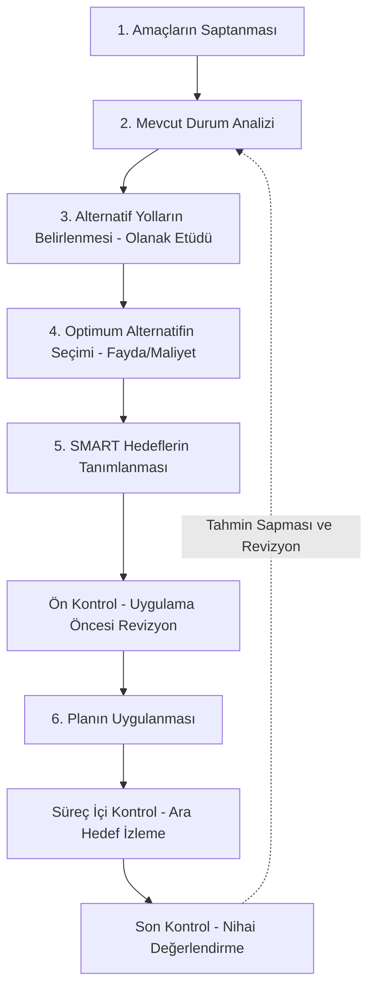

### 5.1.2. Planlamanın Sağladığı Kazanımlar ve Yapısal Sınırlılıkları
Planlama, işletmeye 3 temel kazanım sağlar: Yazılı ve yapılandırılmış bir çerçeve sunarak çalışanlara neyin nasıl yapılacağını tarif eder (**tanımlama**)$_1$; somut hedeflerle izleme ve kıyaslama imkânı verir (**ölçülebilirlik**)$_2$; kaynakların hangi tarihte ve hangi miktarda gerekeceğini önceden belirleyerek **kaynak optimizasyonuna** öncülür eder$_3$.

Bunun yanında planlama yönetilirken beş yapısal sınırlılığın gözetilmesi gerekir:
- **Zaman ve Kaynak Maliyeti**: Kapsam genişledikçe, örneğin detaylı bir fizibilite çalışmasında, planlama süreci yüksek zaman ve kaynak tüketir. İşin ölçeğine göre aşırı kapsamlı yapılan bir plan, harekete geçme zamanının kaçırılmasına ve maliyetin artmasına neden olur. 
- **Tahmin Sapmaları ve Esneklik İhtiyacı**: Temel girdi olan tahminler doğası gereği yanılma payı barındırdığı için planda sapmalar yaşanır. Planların değişmez birer kural metni gibi katı biçimde kutsallaştırılması yerine, değişen koşullara göre revize edilebilen esnek araçlar olarak görülmesi gerekir.
* **Model Varsayımları ve Ön Koşullar:** Tüm dış ve iç değişkenleri tek bir plana dâhil etmek pratikte hem güçtür hem de fayda-maliyet dengesini bozar. Dolayısıyla her plan belirli ön koşullar altında geçerlidir ve bu koşullar değiştiğinde planın ne ölçüde sapacağının bilinmesi gerekir.
* **Aralık Hedef Yaklaşımı:** Planlarda öngörülen sayısal değerler tek bir nokta olarak ele alınmak yerine bir tolerans aralığını temsil eder. Örneğin fizibilitede 10 milyon dolar olarak öngörülen bir değer aslında 8 milyon ile 12 milyon dolar arasındaki bir aralığın beklenen değeridir; bu aralık içindeki dalgalanmalar yönetilebilir kabul edilir.
* **Dikey ve Yatay Uyum Gerekliliği:** Örgüt içindeki üst ve alt kademe planlar birbiriyle uyumlu olmalıdır. Bu yoğun koordinasyon ihtiyacı nedeniyle büyük işletmelerde **planlama birimleri** kurumun en yoğun mesai harcayan bölümleri arasında yer alır; ayrı bir planlama birimi bulunmayan işletmelerde ise diğer bölümlerin zamanının önemli bir kısmı planlama faaliyetlerine ayrılır.

## 5.2. Örgütleme
### 5.2.1. Örgütleme Süreci: Yatay ve Dikey Farklılaşma
Planlamayla belirlenen amaç ve rotayı fiiliyata geçirecek kurumsal yapının inşa edilmesine [[isletme-orgutleme|Örgütleme]] (Organizing) denir. Örgütleme süreci beş ardışık adımdan oluşur:

1. **Yatay Farklılaşma**: Yönetim kademelerinden bağımsız olarak, örgüt içinde yapılması gereken tüm işlerin belirlenip birbirinden ayrılmasıdır.
2. **Bölümleşme/Departmanlaşma**: Ayrıştırılan işlerin belirlenen benzerlik ölçütlerine göre bir araya getirilerek bölümlerin oluşturulmasıdır.
3. **Dikey Farklılaşma**: Yönetim hiyerarşisinin ve kademelerinin kurulmasıdır.
4. **Yetki ve Sorumluluk İlişkilerinin Kurulması**: Birimlerin ve yöneticilerin karar, uygulama ve danışma sınırlarının tanımlanması.
5. **Yetki Devri ve Harekete Geçme**: Tanımlanan yetkilerin ilgili kademelere aktarılmasıyla örgütün işler hâle getirilmesi.

#### Bölümleşme türleri

**Fonksiyonel bölümleşme** (ölçüt: işletme fonksiyonları)

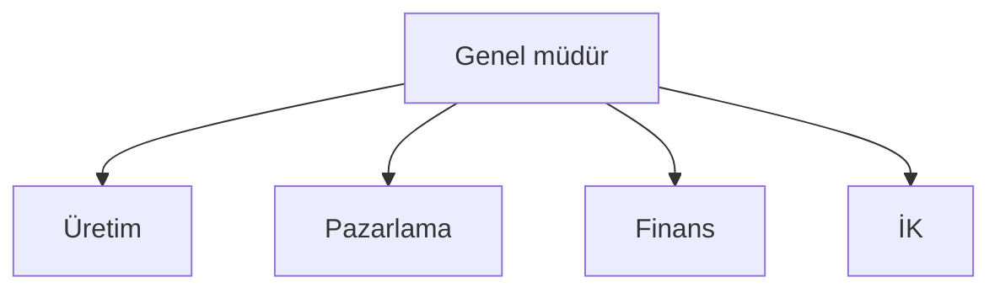

**Ürüne göre bölümleşme** (ölçüt: ürün niteliği)

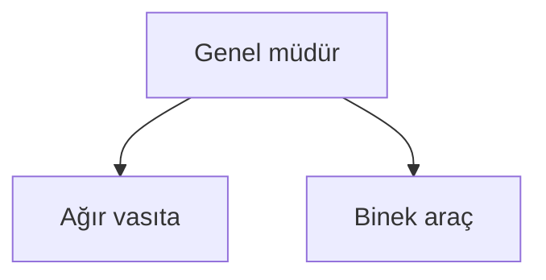

**Süreç donatımına göre bölümleşme** (ölçüt: makine/süreç)

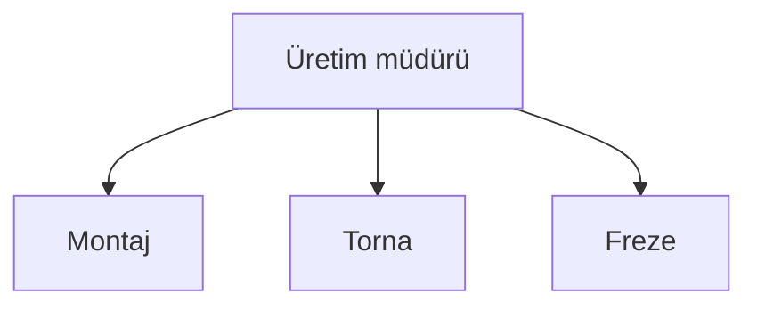

**Müşteriye göre bölümleşme** (ölçüt: müşteri tipi)

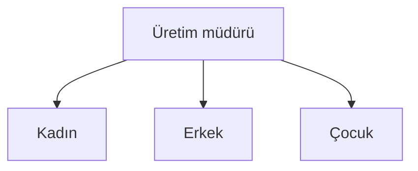

**Coğrafi bölümleşme** (ölçüt: bölgeler)

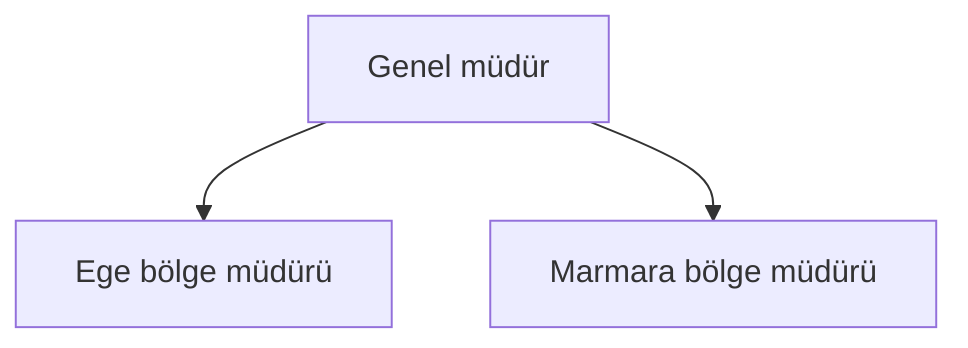

**Karma bölümleşme** (üstte fonksiyon, altta coğrafya, müşteri ve süreç birlikte)

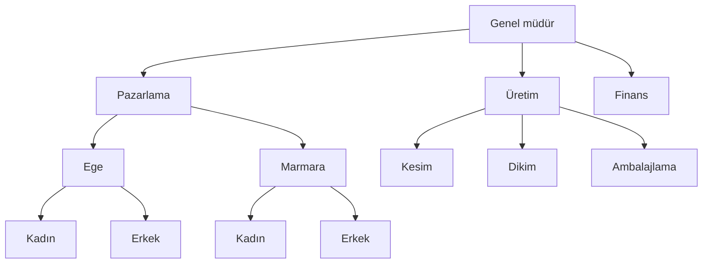

### 5.2.2 Yetki, Sorumluluk, Yönetim Alanı ve Merkezileşme
**Yetki**, iş yapma veya yaptırma gücü; **sorumluluk** ise yapılan işin sonuçları hakkında hesap verebilir olma yükümlülüğüdür. Bu iki unsur arasında mutlaka **yetki-sorumluluk denkliği** kurulmalıdır. Kilitli bir derslik kapısı ve anahtar üzerinden bu denge iki uç senaryoyla somutlaşır:
* **Sorumluluksuz Yetki:** Anahtarın bir kişiye teslim edilip kapının kullanımına dair hesap verebilirlik yüklenmemesi durumunda, ilgili kişi dersliği amacı dışında —örneğin parti düzenlemek için— kullanabilir. Bu durum **yetkinin kötüye kullanılmasına** yol açar.
* **Yetkisiz Sorumluluk:** Kapıyı ders saatinde açma sorumluluğu verilip anahtarın teslim edilmemesi durumunda, kişi kapıyı açmakta zorlanır ve ardından görevini yerine getirmediği gerekçesiyle azarlanır. Bu durum ise işin yapılamamasına ve çalışanın ezilmesine neden olur.

Örgüt yapısında **yetki alt kademeye devredilebilir; buna karşılık sorumluluk üst yöneticinin üzerinde kalmaya devam eder**. Üst yönetici belirli bir işi yapma yetkisini astına aktardığında ast yeni bir sorumluluk üstlense bile, üst yöneticinin o işin sonucuna ilişkin hesap verme yükümlülüğü varlığını sürdürür.

* **Yönetim Alanı:** Bir üst yöneticinin etkin biçimde yönetebileceği ast sayısıdır. Alt bileşenlerin ve işin çeşitliliği, yöneticinin kontrol yetkinliği, astların güdülenme (motivasyon) düzeyi ve merkezin beklentisi yönetim alanının **dar** ya da **geniş** olacağını belirler.
* **Merkezileşme ve Ademi Merkeziyetçilik:** Yönetim yetkisinin üstte toplanması merkezileşmeyi, yetkinin alt kademelere dağıtılması ise ademi merkeziyetçiliği (merkezileşmeden uzaklaşmayı) ifade eder. Yönetim alanı daraldıkça merkezileşme derecesi ve hiyerarşik kademe sayısı artar; yönetim alanı genişledikçe yetki dağılır ve kademe sayısı azalır.

Merkezileşme kararlara daha az taraf katıldığı için karar alma hızını artırabilir ve kontrolü üstte yoğunlaştırır; ancak işletme ölçeği büyüdükçe, coğrafi alan genişledikçe ve ürün çeşitliliği arttıkça yetkiyi merkezde tutmak karar mekanizmasını tıkayabilir. Yetki dağıtıldığında ise koordinasyon problemleri gündeme gelebilir. Bununla birlikte merkezileşme tercihi yalnızca ölçeğe bağlı bir zorunluluk olmanın yanında, **yöneticinin kişisel eğiliminden (meşrebinden)** de güçlü biçimde etkilenir. 

### 5.2.4 Örgüt İçi Yetki İlişkileri: Komuta, Kurmay ve Fonksiyonel Yetki

Örgüt yapısında yönetim kademeleri arasında üç farklı yetki ilişkisi kurulur:

1. **[[Komuta Yetkisi]] (Line Authority):** Üstten asta doğru doğrudan yetki devrini ve hesap verebilirliği kapsayan **emir-komuta zinciridir**. İşlerin fiilen yürütülmesini sağlar ve *komuta birliği* ilkesi uyarınca her ast tek bir üstten emir alır.
2. **[[Kurmay Yetkisi]] (Staff Authority):** Örgüt içinde doğrudan komuta yetkisi bulunmayan, buna karşılık komuta kademelerine uzmanlık alanlarında **danışmanlık yapan, durumun çerçevesini çizen, alternatif üreten ve yönlendirme sunan** yetki türüdür. Organizasyon şemalarında **noktalı çizgi** ile gösterilir. Örneğin işletme dışından destek alınan bir pazarlama profesörü veya askeriyedeki kurmay heyeti komutan/yönetici için alternatifleri hazırlar; nihai kararı komuta yöneticisi alır. Kurmay yetkisinde en önemli örgütsel risk, kurmay uzmanın sunduğu alternatiflerin alt kademeler tarafından birer komuta emri gibi algılanmasıdır.
3. **[[Fonksiyonel Yetki]] (Functional Authority):** Bir yöneticinin doğrudan emir-komuta bağında bulunmayan başka bölüm çalışanları üzerinde, yalnızca **kendi uzmanlık alanıyla sınırlı konularda** kazandığı çapraz komuta yetkisidir. Örneğin İnsan Kaynakları müdürünün üretim işçisinin üretim işleri üzerinde komuta yetkisi bulunmak yerine, o işçinin performans değerlendirmesi ve ücretinin belirlenmesi konusunda söz ve karar hakkına sahip olması fonksiyonel yetkidir. Benzer biçimde, günlük makine bakımını üretim operatörlerinin yaptığı bir işletmede Bakım müdürünün üretim operatörüne yalnızca günlük bakım prosedürleri hakkında talimat verme yetkisi bulunması da fonksiyonel yetkiye örnektir.

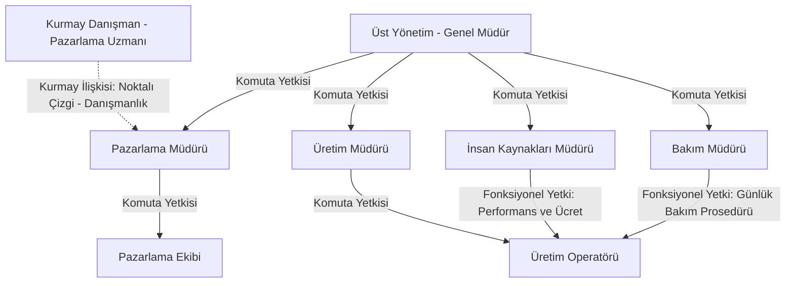

Bu üç yetki ilişkisinin örgüt içinde nasıl harmanlandığı; **komuta örgütü**, **komuta-kurmay örgütü** ve **matris örgütlenme yapısı** gibi farklı örgüt modellerinin ortaya çıkmasını belirler.

### 5.2.5. Örgüt Yapıları: Komuta, Komuta-Kurmay ve Matris Örgüt

Örgüt içi yetki ilişkilerinin bir araya getirilme biçimine göre uygulamada üç temel örgüt yapısı ortaya çıkar:

1. **[[Komuta Örgütü]]:** Tüm birimlerin ve kademelerin baştan sona doğrudan emir-komuta zinciri üzerine kurulduğu en yalın örgüt modelidir. Genel müdürden genel müdür yardımcılarına ve oradan alt fonksiyonel birimlere uzanan ilişkilerde her ast tek bir üste bağlıdır.
	- **Avantajları ve Sınırı:** Kimin kime karşı yetkili ve sorumlu olduğu açık olduğu için anlaşılırlığı yüksektir, etkileşim rahattır ve karar alma mekanizmaları görece hızlıdır. Merkezileşme derecesi ise yapının kendi niteliğinden çok yetkinin alt kademelere ne ölçüde dağıtıldığına göre değişir. Bunun yanında karar almanın gereği kadar hızlı olması gerekir; aşırı hızlı karar alma eğilimi detaylı analiz eksikliğini beraberinde getirebilir.
2. **[[Komuta-Kurmay Örgütü]]:** Komuta yapısının farklı kademelerine doğrudan emir verme yetkisi olmayan kurmay danışmanların (örneğin genel müdüre bağlı yönetim danışmanı, finans birimine bağlı finansal danışman) eklenmesiyle oluşur. Organizasyon şemasında komuta bağları düz çizgiyle, kurmay bağları ise kesikli çizgiyle gösterilir.
	- **Avantajı ve Riskleri:** Örgütün kendi insan kaynağında bulunmayan ek uzmanlığı karar süreçlerine katar. Buna karşılık yetki ve sorumluluk sınırları bulanıklaşabilir; astlar danışmanın önerilerini emir mi yoksa üst yöneticinin değerlendireceği bir tavsiye mi olarak alacağını kestirmekte zorlanabilir. Komuta yöneticisi hem astlarını hem danışmanı dinlemek zorunda kaldığı için **karar alma süreçleri uzama eğilimine girer**. Ayrıca yöneticinin danışmanın her söylediğini sorgulamadan uygulamaya alması da sakıncalıdır; dışarıdan gelen danışman örgütün iç dinamiklerini yönetici kadar iyi tanıyamayacağından, yöneticinin sunulan önerileri süzgeçten geçirebilecek yetkinliğe sahip olması gerekir.

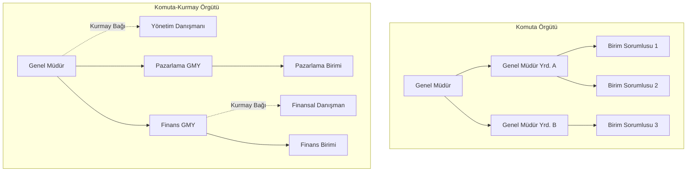

3. **[[Matris Örgüt]]:** Hem dikeydeki fonksiyonel birimlerin (pazarlama, üretim, finans vb.) hem de yataydaki proje veya süreç yöneticilerinin emir-komuta zincirini aynı tablo yapısında birleştiren karmaşık örgüt modelidir. İlk kez proje bazlı çalışan **NASA**'da tanımlanmıştır.

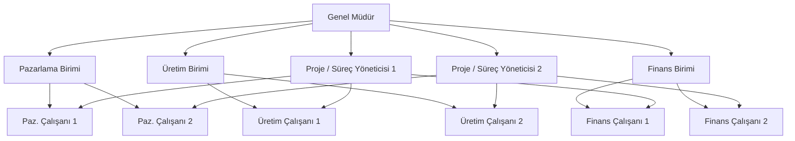

Matris yapının mantığını kavramak için üretim ve çalışma biçimindeki **[[Proje]]** ile **[[Süreç]]** ayrımına bakmak gerekir. İki tipi birbirinden ayıran temel özellik **tekrarlanabilirlik**tir:
* **Proje:** Belirli bir başlangıç ve bitiş zamanı bulunan, kendine özgü koşullarda bir kez yapılan işlerdir. Görsel olarak aynı görünseler bile iki proje aynı değildir. Söz gelimi Bayraklı'daki iki Folkart kulesi aynı zeminde ve aynı tasarımla yükselmiş olsa da yapım zamanları, beton dökümündeki hava koşulları, kuruma süreleri, kaynak kullanım takvimleri ve görevli personelleri farklı olduğu için iki ayrı projedir. Benzer şekilde aynı konuda, hatta aynı başlangıç koduyla hazırlanan iki yazılım ödevi de sonuçları itibarıyla ayrı projelerdir.
* **Süreç:** Belirli girdileri belirli işlem adımlarından geçirerek aynı çıktıyı tekrar tekrar elde etmeyi sağlayan faaliyetler dizisidir. Örneğin şişe su üretimi sürecinde üretim, finans, pazarlama ve insan kaynakları gibi farklı fonksiyonların "müşterinin önüne su koymak" ortak amacında birleşmesi gerekir.

Yalnızca fonksiyonel bölümlere ayrılan yapılarda birimlerin iç amaçları birbiriyle çatışabilir ve kaynak paylaşımı sorun yaratabilir. Öte yandan her süreci veya ürünü (örneğin hem su hem gazoz üreten bir işletmede) tamamen ayrı birimlere bölmek de ortak pazarlama ve dağıtım kanalları nedeniyle verimlilik kaybına yol açar. Matris yapı hem proje/süreç odaklı bütünleşmeyi hem de fonksiyonel uzmanlığın korunmasını aynı anda sağlar. Ancak çalışan aynı anda hem fonksiyonel yöneticiye hem proje/süreç yöneticisine (hatta birden fazla projeye) karşı sorumlu duruma gelir. İki üst yöneticinin aynı anda iş vermesi hâlinde öncelik çatışması yaşanır; bu durum **[[Komuta Birliği]]** ilkesini doğrudan ihlal eder. Yetki dengesine göre *zayıf*, *dengeli* ve *güçlü* matris türleri kurulabilir; yapının aksamaması için üst yönetimin yetki sınırlarını ve öncelik kurallarını çok net çizmesi şarttır.

| Örgüt Yapısı | Temel Dayanak | Öne Çıkan Avantaj | Başlıca Risk ve Maliyet |
| :--- | :--- | :--- | :--- |
| **Komuta Örgütü** | Tek yönlü emir-komuta zinciri | Yüksek anlaşılırlık, hızlı karar alma | Uzmanlık desteği sınırlı kalabilir |
| **Komuta-Kurmay** | Komuta hattına uzman danışman desteği | Örgüt dışı veya özel uzmanlığı sürece katar | Karar alma uzar, yetki sınırı karışabilir |
| **Matris Örgüt** | Dikey fonksiyon + yatay proje/süreç bağı | Amaç ortaklaşması ve kaynak paylaşımı | Komuta birliği bozulur, yüksek yönetim çabası ister |

### 5.2.6. Örgüt Yapısının İşlerliği, Etkinliği ve Örgüt İklimi

Kağıt üzerinde kurulan örgüt şemasının sahada sorunsuz çalışabilmesi için yetki devrinin kurumsallaşması, merkezileşme dengesinin kurulması ve yapının etkinlik ölçütlerini karşılaması gerekir:

- Sorumluluğun Paylaşılması ve İzlenebilirlik:** [[Yetki Devri]] yapıldığında yetkinin belirli bir bölümü asta aktarılır; ancak **sorumluluk verilse dahi devredilmez, paylaşılır**. Astın işi yerine getirmemesi üst yöneticinin kendi üstüne karşı sorumluluğunu ortadan kaldırmaz. İş kapsamı geniş çalışanlara görev sınırlarının yalnızca sözlü anlatılması hem pratik değildir hem de yeni durumlarda çalışanın sürekli soru sormasını gerektirir. Bu nedenle yetki, sorumluluk, iş yapış sınırları ve iletişim bağlantıları tercihen yazılı **[[Görev Tanımları]]** ve **örgütsel kılavuzlar** ile izlenebilir hâle getirilir. Bu belgeler kişilere göre değil **görev pozisyonları temelinde** hazırlanır; böylece çalışan değiştiğinde yapısal tanım geçerliliğini korur.
* **Merkezileşme ve Uzmanlaşma Dengesi:** Yöneticinin altındaki ast sayısı arttıkça merkezileşme azalır ve yetki alt kademelere yayılır. Ademi merkeziyetçi yapı işi parçalara böldüğü için **uzmanlaşmayı ve uzmanlıkların karara katılımını artırır**; fakat çok sayıda sesi uyumlaştırmak gerektiğinden karar süreçlerini uzatır ve koordinasyonu zorlaştırır. Aşırı merkezileşmede ise yeterli görüş alınamaz, üst yönetici günlük detaylarla uğraşmaktan esas yönetsel görevlerini aksatır ve tek kişinin her şeyi bilememesi nedeniyle performans kaybı yaşanır.
* **[[Örgüt Etkinliği]], [[Esneklik]] ve [[çeviklik]]:** Yapının amaçları hayata geçirebilme gücü olan etkinlik; planlama başarısı, verimlilik, amaç birliği (sistemdeki tüm alt bileşenlerin ortak hedefe yönelmesi), yetki-sorumluluk denkliği ve en önemlisi **esneklik** ile ölçülür. Esneklik, değişen dış ve iç koşullar karşısında yapıyı kırmadan biçim değiştirebilme ve uyum sağlama (*responsiveness*) yeteneğidir; esneyemeyen yapı kırılır ve işletme finansal ya da örgütsel zarar görür. İşlemsel düzeyde kurulu kapasiteyi uyarlamak, mevcut **kapasite bant genişliğini** maliyetlerle yönetmek ve çalışanı farklı işlerde değerlendirebilmek esneklik boyutlarıdır. Stratejik düzeyde ise ürünü, örgütü veya kritik bir çalışanı değiştirebilmek, yeni pazarlara girip çıkabilmek ve yürüyen bir projeden vazgeçebilmek (örneğin 1 milyon maliyet doğursa da vazgeçildiğinde 5 milyon kazandıracaksa projeyi sonlandırabilmek) esnekliği gösterir. Değişim hızının aşırı yükseldiği günümüzde ise esnekliği hızlıca başarabilme yeteneği olan **çeviklik** (*agility*) ön plana çıkar.
* **[[Örgüt İklimi]]:** Örgüt içindeki genel "hava"yı ifade eder. Çalışanların birbirleriyle ve yönetimle etkileşimi, samimiyet veya resmiyet düzeyi, uyum becerisi, bilgi paylaşım isteği (ya da kendini koruma refleksi), gönüllü katkı düzeyi, prosedürler dışındaki fiili kontrol tarzı ve ödül-ceza sistemlerinin algılanışı örgüt iklimini oluşturur. Destekleyici ve katılımcı **açık örgüt iklimi** ilkesel olarak tercih edilirken, sert ve katı ilişkilerin hâkim olduğu **kapalı örgüt iklimi** de durumsallık gereği belirli koşullarda işleyebilir. İklimin formel iletişim yapılarıyla bilinçli tasarlanan yönü yanında sosyal etkileşimlerden doğan **informal** bir yüzü de vardır. İşletme piknikleri veya akşam yemekleri yalnızca motivasyon amaçlı değil, bu informel iklimi yönetme aracıdır; çünkü çalışanlar arasındaki bir tartışma dahi arkadaş grupları üzerinden tüm örgüte yayılabilen yönetim sorunları yaratabilir.

---

## 5.3. Yöneltme

Kurulan örgüt yapısını ve pozisyonları insan unsuru üzerinden fiilen harekete geçirme işlevine **[[isletme-yoneltme|yöneltme]]** denir. Başlangıçta kadro kurma (*staffing*) ekseninde ele alınmış olsa da günümüzde **kadro oluşturma**, **motivasyon** ve **liderlik** olmak üzere üç ana eksen üzerinde yürütülür.

### 5.3.1. Kadro Oluşturma ve İnsan Kaynakları Süreci

Pozisyon temelli tanımlanan görevlere uygun çalışanların yerleştirilmesi ve çalışma yaşamının sürdürülmesi süreci olan [[Kadro Oluşturma]], günümüzde kapsamı genişlediği için başlı başına bir işletme fonksiyonu hâline gelen **[[İnsan Kaynakları Yönetimi]]** çerçevesinde yürütülür:

1. **İş Kapsamı ve Personel Tedariki:** Önce görev tanımlarıyla işin gerekleri saptanır; ardından aday havuzu oluşturulur. Günümüzde ilanların yanı sıra LinkedIn, kariyer siteleri, kişisel ağ (*network*), üniversite etkinlikleri ve örgüt içi kaynaklar kullanılır. Üst düzey yönetici (örneğin CEO) arayışlarında ise piyasayı tarayıp pazarlık yürüten **"kafa avcıları"** devreye girer.
2. **Personel Seçimi:** Adayın yalnızca mesleki niteliklerinin yüksek olması yetmez, **örgüt kültürüne ve yapısına uyumlu olması** gerekir. Örneğin Aksaray Mercedes fabrikasında genel müdürlük yapmış çok deneyimli bir yöneticinin İzmir'deki bir makine işletmesine geçip *"ya İzmir beni değiştirecek ya ben İzmir'i"* yaklaşımıyla hareket etmesi, örgüt uyumu sağlanamadığı için üç ay içinde işten ayrılmasıyla sonuçlanabilmektedir. İyi tasarlanmış iş görüşmelerindeki her soru ve doldurulan formlar, psikoloji biliminden yararlanılarak adayın belirli bir niteliğini ölçmek üzere kurgulanır.
3. **İşe Alıştırma ([[Oryantasyon]]) ve Yetiştirme:** İşe yeni başlayan çalışanın bocalamaması için oryantasyon eğitimi verilir; çalışma yaşamı boyunca da işe yönelik, teknik ve yönetsel eğitimler sürer. Doğrudan belirli bir işi yapmaya yönelik yetiştirme programları (*training*), genel eğitimden daha spesifik bir nitelik taşır.
4. **Performans Değerlendirme ve [[Personel Devir Hızı]]:** Çalışanın katkısını ölçmek, tutundurma ve ücret kararları almak için performans değerlendirilir. İşletmeden ayrılan ve yeni alınan personel sıklığını ölçen **personel devir hızı**nın yükselmesi; uyum, oryantasyon ve performans optimizasyonu maliyetlerini tekrarlatacağı için ciddi bir kaynak kaybına yol açar.
5. **Ücretlendirme:** Ücret düzeyi belirlenirken **performans**, **işin içeriği**, **işletmenin ödeme gücü** ve çalışanı elde tutabilmek adına **piyasadaki ortalama ücret düzeyi** dikkate alınır. Uygulamada üç temel ücret sistemi vardır:
   * **Zaman Ücreti:** Çalışılan süreye (örneğin aylık maaşa) bağlı ödenir. Gerçekte ödenen şey geçen süre değil, o sürede beklenen iş yüküdür ve bu planlama bir çalışanın bir saatlik emek miktarını gösteren **[[Adam-Saat]]** ölçütüne dayanır.
   * **Parça ([[Akort Ücreti]]):** Üretilen iş miktarıyla orantılıdır (günde 10 şişe için 100 TL, 100 şişe için 1.000 TL gibi). Verimliliği teşvik etse de çalışanın sayıyı artırmak uğruna **kaliteyi göz ardı etme riskini** taşır.
   * **[[Primli Ücret Sistemi]]:** Sabit bir temel ücretin üzerine performansa bağlı ek ücret ekler. Dengeleyici olsa da prim eşiğinin belirlenmesi işletme-çalışan çatışmasına yol açabilir; ayrıca prim geliriyle yaşamını planlayan çalışanlar eşiğe ulaşamadığında sürdürülebilirlik ve adalet algısı sorunları doğabilir. Dolayısıyla yüzde yüz ideal tek bir sistem yoktur.
6. **Terfi ve Çalışma İlişkileri:** Beklentisi olan başarılı çalışanların doğru zamanda terfi ettirilmemesi nitelikli personelin kaybına yol açar. Sigorta ve yasal yükümlülüklerin takibi ile gerektiğinde iş akdinin sonlandırılması da sürecin parçasıdır.

### 5.3.2. Motivasyon Kuramları

[[Motivasyon]] (güdüleme), çalışanların neden çalıştığını ve verilen bir işi ne kadar iyi yapacaklarını belirleyen temel etkendir. Literatürdeki çok sayıda yaklaşım "ne" ve "nasıl" soruları etrafında iki grupta toplanır:

* **Kapsam Kuramları ("Çalışanı ne motive eder?"):**
  * **[[Maslow'un Motivasyon Teorisi -ya da İhtiyaçlar Hiyerarşisi-|Maslow'un İhtiyaçlar Hiyerarşisi|]]:** Beş temel ihtiyaç basamağı üzerinden insan güdülerini açıklar.
  * **McGregor'ın [[X-Y Kuramı]]:** *X tipi* varsayım çalışanı özünde tembel ve işten kaçınan biri olarak görüp sıkı biçimsel denetimle yönetmeyi; *Y tipi* varsayım ise çalışmayı temel bir ihtiyaç, sosyalleşme ve fikir üretme alanı sayarak yetki ve teşvikle yönetmeyi önerir. Çalışanın profilini tespit edip ona göre yaklaşmayı gerektirdiği için özünde durumsal bir bakış sunar.
  * **Herzberg'in [[Çift Faktör Kuramı]]:** Çalışanın iş yapabilmesi için sağlanması gereken asgari koşulları **hijyen faktörler** (bazıları için ücret, bazıları için çalışma ortamı) olarak tanımlar; bunlar yoksa motivasyon oluşmaz ancak varlıkları da ekstra performans üretmez. Üst düzey katkı için **motive edici faktörlerin** (takdir, gelişim vb.) ayrıca eklenmesi gerekir.
* **Süreç Kuramları ("Çalışan nasıl motive edilir?"):**
  * **Alderfer'in [[ERG Kuramı]]:** Temel varoluş (*Existence*), ilişki kurma (*Relatedness*) ve gelişim (*Growth*) basamakları arasındaki geçişle motivasyon sürecini açıklar. *(**Not:** Ders anlatımında "Existence" ifadesi "beklenti (var olma)" biçiminde anılıp ERG kuramı süreç kuramları içinde örneklendirilmişse de, kuramın özgün anlamı temel "var olma" ihtiyaçlarıdır ve yerleşik örgütsel davranış literatüründe ERG kuramı Maslow'un hiyerarşisini esneten bir **Kapsam Kuramı** olarak sınıflandırılır.)*
  * **[[Hedef Belirleme Kuramı]]:** [[isletme-SMART|SMART]] ilkelerindeki ulaşılabilirlik (*attainable*) dengesinde olduğu gibi; ne aşırı kolay ne de imkânsız hedefler yerine **makul ölçekte zorlayan** hedefler vermenin gelişimi ve motivasyonu artırdığını savunur.
  * **[[Beklenti Kuramı]]:** Çalışanın göstereceği çabanın karşılık bulacağına dair beklentisinin motivasyonu belirlediğini ortaya koyar.
  * **[[Adalet Kuramı]]:** Çalışanın kendi çaba-ödül dengesini diğer çalışanlarla kıyaslayarak adalet algısına göre performansını ayarladığını açıklar.

### 5.3.3. Liderlik, Güç Kaynakları ve Durumsallık

**Yönetici ve Lider Ayrımı:** Her yönetici makamından aldığı biçimsel güç sayesinde belirli bir ölçüde lider sayılabilir; ancak iyi bir lider olup olmadığı ayrı bir konudur. Buna karşılık **her lider yönetici değildir**. Resmi bir makamı olmadığı hâlde grubunun saygı duyup izlediği **doğal liderler** vardır. Doğal lider yöneticinin dediğinin tersini savunursa örgütte çatışma doğar; bu nedenle çağdaş yönetim, liderliğin ustabaşından genel müdüre kadar tüm kademelerde yapısal bir unsur olmasını amaçlar. **[[Liderlik]]**, yalnızca emir vermek değil, **örnek teşkil ederek** takipçileri peşinden gelmeye ikna etmektir.

**[[Liderliğin Güç Kaynakları]]:** Liderin takipçilerini yönlendirme gücü altı kaynaktan beslenir:
1. *Biçimsel güç:* Makamın sağladığı yetki gücüdür (her yöneticide bulunur).
2. *Ödüllendirme gücü:* Prim vermek gibi maddi ödüller yanında "aferin" demek gibi sözlü takdir gücünü de kapsar.
3. *Cezalandırma gücü:* Yaptırım ve işten çıkarma gibi caydırıcı güçtür.
4. *Uzmanlık gücü:* Belirli bir alandaki bilgi ve yetkinliğe duyulan güvenden doğar.
5. *Bilgilendirme gücü:* Uzmanlıktan farklı olarak, üst yapıdan gelen örgütsel bilginin elde tutulup kontrollü biçimde paylaşılmasına dayanır.
6. *Kişisel beğeniye dayalı güç:* En tartışmalı ve yönetilmesi en güç kaynaktır; dış görünüş, hitabet gibi tamamen bireysel özelliklerden kaynaklanır.

**Özellikler, Tarzlar ve Durumsallık:** İyi diksiyon, dış görünüş veya yüksek uzmanlık tercih edilse de tek bir evrensel lider profili yoktur; üstelik etkili bir lider mutlaka ahlaki açıdan iyi bir insan olmak zorunda değildir (örneğin Hitler kötü bir insan olmasına karşın kitleleri yönlendirme bağlamında tarihsel bir liderlik örneği oluşturmuştur). Iowa, Ohio State ve Michigan çalışmaları liderlik davranışlarını iki uçlu bir yelpazede inceler (Bkz. [[Likert'in Sistem 4 Modeli]]):

* **[[Otoriter Liderlik]]:** Emir ve sert denetime dayanır. Kendi içinde salt baskıcı ve çıkarcı olan **sömürücü otoriter** (örneğin Hitler) ile sert ama koruyup sahiplenici olan **babacan otoriter** (örneğin eski Türk filmlerindeki Hulusi Kentmen rolleri) biçiminde ayrılır. Japon ve Türk toplum yapılarında babacan otoriter tarz sıklıkla verimli sonuçlar verir.
* **[[Serbestiyetçi Liderlik]]:** Çizilen sınırlar içinde işin yapılış biçimini çalışana bırakıp yalnızca sonuçlara bakan uçtur. İki uç arasında fikri alıp kendi kararını veren ya da ortak görüş birliğiyle hareket eden pek çok ara form bulunur.

Grubu değiştirmek zor, lideri uyarlamak ise görece kolay olduğu için durumsallık yaklaşımı; liderin özellikleri, makam gücü, işin niteliği, çalışan motivasyonu ve kültürel yapı incelenerek duruma uygun tarzın seçilmesini önerir. Günümüzde X, Y, Z ve Alfa kuşaklarının beklenti farkları da bu seçimi zorunlu kılar. Ancak liderler kendi yetiştikleri kültürden kolayca kopamazlar; öte yandan kuşaklar da yalnızca doğum yıllarıyla değil aile, eğitim, toplum yapısı ve küreselleşen iletişimin yarattığı etkilerle birlikte bilimsel olarak değerlendirilmelidir.

---

## 5.4. Kontrol

Planlanan, örgütlenen ve harekete geçirilen yapının amaçlardan sapmadan ilerlemesini güvence altına alma işlevi **[[isletme-kontrol|kontrol]]dür**. İnsanın kontrolünde göstere göstere baskı kurmak yerine liderlik destekli bir yaklaşım benimsenmesi performansı olumlu etkiler.

### 5.4.1. Kontrol Kavramı, Standartlar ve Kontrol Süreci

Kontrol hem **kıyaslama** (olması gereken ile olanı karşılaştırma) hem de **müdahale** ("kontrol altında tutma") anlamlarını içerir. Kıyaslama sonucunda üç durumdan biri ortaya çıkar: (1) her şey yolundadır, (2) şimdilik yolundadır ancak kontrolden çıkma eğilimi sezilmektedir, (3) işler kontrol dışına çıkmıştır. Kontrol yalnızca üretimin değil, pazarlama, finans ve insan kaynakları dâhil tüm yönetsel faaliyetlerin ortak sürecidir:

1. **Amaç ve Standartların Belirlenmesi:** Her değişkeni her yerde ölçmek anlamsızdır (örneğin sonraki işlemlerin değiştireceği bir niteliği sürecin en başında ölçmek). Doğru değişkenin, doğru yerde, doğru zamanda ve kıyaslanabilir sonuçlar için standart yöntemlerle ölçülmesi gerekir. Burada "standart" kavramı hem *eş özellikte* olmayı hem de bir ürünün taşıması gereken özellikler setini anlatır. Bu set içindeki her bir tekil özelliğe (örneğin suyun pH değeri, alkali oranı, hacmi veya plastiğin niteliği) **[[Spesifikasyon]]** denir. Hiçbir sistem sıfır sapmayla çalışmadığından, her spesifikasyonun bir hedef değeri ile sistemin bozulmadığını gösteren izin verilebilir değişim oranı, yani **[[Tolerans]]**ı tanımlanır.
2. **Ölçüm Alma ve Kıyaslama:** Tercihen nicel veriler belirlenen standart yöntemle toplanır ve hedef-tolerans sınırlarıyla karşılaştırılır.
3. **Müdahale ve Süreklilik:** Kıyaslama sonrasında üç aksiyondan biri devreye girer:
   * Her şey yolundaysa başarının gelecekte de sürmesi için iş yapış biçimi, girdi veya eğitim üzerinden **[[Standartlaştırma]]** ve daha iyiye taşıma amaçlı **iyileştirme** yapılır.
   * İşler henüz yolundayken bozulma eğilimi saptanırsa (matematiksel eğilim analizleriyle veya gözlemle) sorunu doğmadan engellemek için **[[Önleyici Faaliyet]]** uygulanır.
   * Tolerans dışına çıkılmışsa sapmayı gidermek için doğrudan **[[Düzeltici Faaliyet]]** başlatılır.

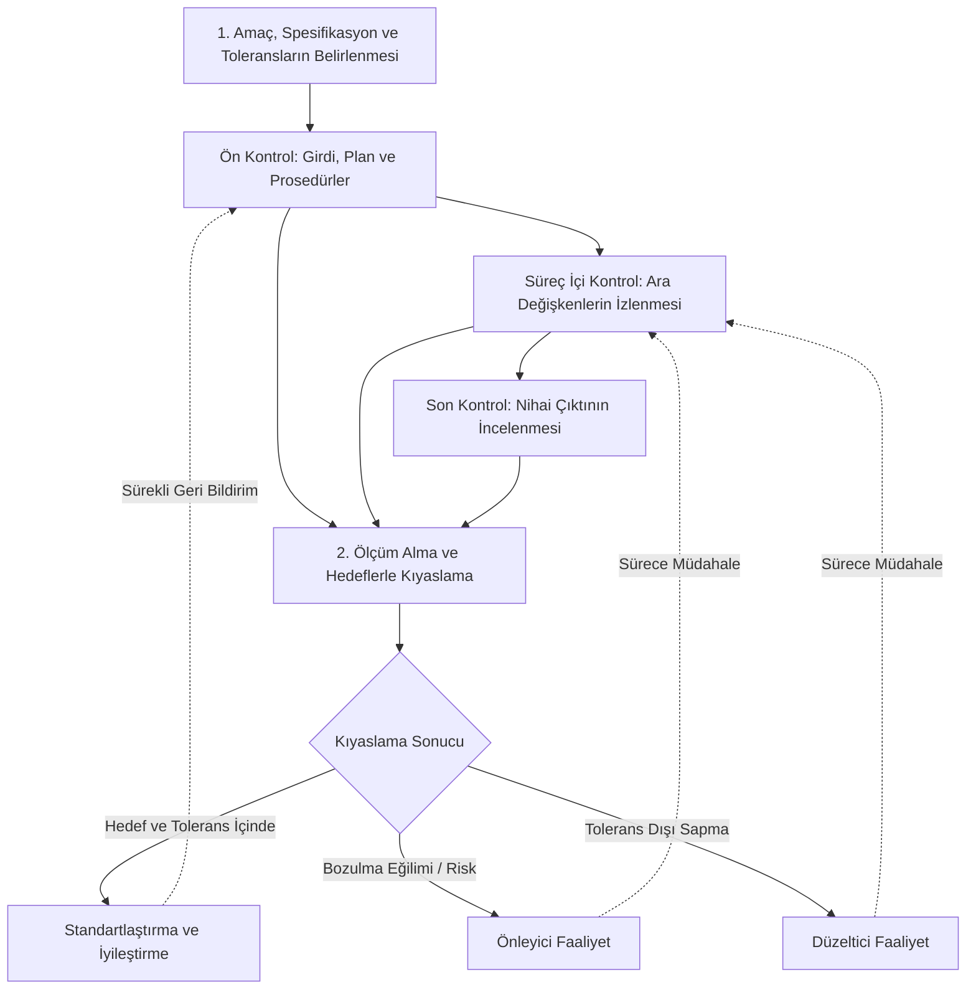

### 5.4.2. Kontrol Noktaları ve Uygulama Tasarımı

Kontrol üç temel zaman noktasında uygulanır:
* **[[Ön Kontrol]]:** İş başlamadan önce malzemelerin, makinelerin, planların ve yapım prosedürlerinin denetlenmesidir. Günümüzde tedarikçinin kendi üretim süreçlerini denetleyip gelen parçayı tekrar kontrol etmeden doğrudan kullanıma alma biçiminde **[[Kaynağında Kontrol]]** uygulamaları da yaygındır. Örneğin bir otomobil üreticisi hava yastığı tedarikçisinin süreçlerine güvenerek gelen parçayı kontrol etmeden araca takabilir; bu yaklaşım toplamda büyük verimlilik sağlasa da hata durumunda Toyota örneğinde görüldüğü gibi ölümlü kazalar ve büyük araç geri çağırma maliyetleri riskini taşır.
* **[[Süreç İçi Kontrol]]:** İş devam ederken nihai kaliteyi belirleyen ara değişkenlerin istenen sınırlar içinde tutulmasıdır. Yalnızca ön ve son kontrole güvenmek iş bitiminde kaynakların çöpe gitmesine yol açacağından, süreç içi kontrol hem hata maliyetini hem de son kontrol yükünü azaltır.
* **[[Son Kontrol]]:** İş tamamlandıktan sonra nihai çıktının hedeflere uygunluğunun ölçülmesidir.

Etkin bir kontrol sistemi kurulduğu örgüt yapısıyla çatışmamalı, uygulayıcılara gerekli eğitim verilmeli ve kontrol sisteminin kendisi de (ölçümlerin doğru zamanda, doğru yöntemle yapılıp kaydedilip kaydedilmediği) denetlenmelidir. Günümüzde **büyük veri** (*Big Data*) anlık takibi kolaylaştırsa da her alanı kapsayamaz. Ayrıca aşırı kontrol işletmeye faydadan çok maliyet ve zarar getirir; kontrol yatırımının elde edilen getiriyle dengeli olması şarttır.

---

## 5.5. Koordinasyon (Eşgüdümleme)

Örgütün tüm alt parçalarının ortak amaç doğrultusunda birlikte hareket etme becerisi olan **[[isletme-koordinasyon|Koordinasyon]]**, ayrı bir aşamadan çok planlama, örgütleme, yöneltme ve kontrol işlevlerinin tamamının içinde işleyen bütünleştirici bir mekanizmadır.

### 5.5.1. Eşgüdümün Aracı Olarak İletişim ve Yönleri

Koordinasyonun en temel aracı, herkesi ortak amaçtan haberdar eden **[[İletişim]]**dir. Ancak örgüt içinde herkes her bilgiye ulaşamaz ve herkesle aynı biçimde iletişim kuramaz. Örneğin yeni ürün tasarlayan kritik bir Ar-Ge çalışanının yaptığı işi üretim hattındaki arkadaşıyla paylaşması bilgi sızıntısına yol açar. Bu nedenle görev tanımları, **[[ERP|Kurumsal Kaynak Planlaması (ERP)]]** kullanıcı yetkileri, rapor erişim sınırları ve **gizlilik sözleşmeleri** gibi formel önlemler alınır. Benzer şekilde pazarlığa dayalı ücret farklarının çatışma çıkarmasını önlemek için çalışanların birbirine maaşını söylemesinin yasaklanması da örgütsel bir iletişim prosedürüdür.

Formel sınırlar yanında çalışanların sosyal ilişkilerinden doğan informel iletişim de kritik öneme sahiptir. Özellikle **dedikodu**, arzu edilen bir davranış olmasa da örgüt içi gerilimleri ve sorunları erkenden haber veren önemli bir bilgi kaynağıdır. Yönetici dedikoduyu doğrudan doğru kabul edip hareket etmemeli; kaynağını gizli tutarak (aksi hâlde bilgi akışı kesilir) dedikoduları duyabilmeli ve arkasındaki gerçeği araştırarak önlem almalıdır.

Örgüt içinde hem formel hem informel boyutlarıyla üç yönlü iletişim işler:
* **Dikey iletişim:** Emir-komuta zinciri boyunca farklı yönetim kademeleri arasında akar.
* **Yatay iletişim:** Aynı örgütsel seviyedeki çalışanlar arasındaki işle ilgili iletişimdir.
* **Çapraz iletişim:** Farklı fonksiyonel alanlarda ve farklı kademelerde yer alan çalışanlar arasında kurulur.

Kurumsal iletişim altyapısı kurulurken (örneğin **SAP** gibi ERP sistemlerinde) örgüt süreçleriyle yazılım arasında hassas bir denge gerekir. Sistem çok genel bırakılırsa işletme ihtiyacını karşılamaz, aşırı özelleştirilirse en küçük iş değişiminde güncelleme maliyeti altından kalkılmaz hâle gelir. Beş fabrikanın üretim koordinatörünün ürün formülasyonlarını ve akışını aktaramadığı için sonunda ERP danışmanlarına eğitim verip kodlamaları değiştirtmek zorunda kalması, süreç-sistem uyumunun önemini gösteren tipik bir vakadır.

### 5.5.2. İletişim Süreci, Engeller ve Katılımcı Yönetim

İletişim süreci; **gönderici**, mesajın **şifrelenmesi**, **iletişim kanalı**, alıcı tarafında **kod çözme**, **alıcı** ve **geri bildirim** unsurlarından oluşur. Bu zincirin her halkasında mesajı bozabilecek engeller doğabilir:

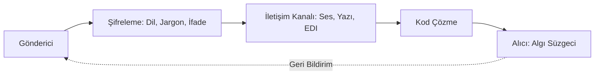

* **Dil ve Jargon Farklılıkları:** Aynı ulusal dil konuşulsa dahi farklı birimlerin (örneğin pazarlama ile üretimin) teknik jargonları şifreleme ve kod çözmede anlam kayması yaratır.
* **İfade (Semantik) Güçlükleri:** Göndericinin kendini söz dizimi açısından açık anlatamaması veya alıcının anlamakta zorlanmasıdır.
* **[[Algıda Seçicilik]] ve Kişiler Arası Tutumlar:** Alıcının sahip olduğu algı süzgeci nedeniyle mesajın kritik ön koşulunu atlayıp yalnızca dikkatini çeken kısmı almasıdır (örneğin *"derse sürekli devam edenlerin notuna 20 puan eklenecek"* cümlesinden devam şartını silip yalnızca *"20 puan eklenecek"* kısmını duymak). Ayrıca alıcının göndericiye duyduğu sevgi veya antipati de algıyı doğrudan büker.
* **Zamanlama ve Zaman Baskısı:** Mesajın geç iletilmesi kadar **gereğinden erken** iletilmesi de sorundur; erken verilen bilgi zamanı geldiğinde unutulur. Mesajın hazırlanması veya okunması sırasındaki zaman baskısı ise kişileri derinlemesine okumak yerine yüzeysel **göz gezdirmeye** iter ve metnin özünün kaçırılmasına yol açar.
* **İletişim Kanalı Bozuklukları:** Ses, anons sistemi veya dijital ağ gibi mecradaki bozulmalar mesajın anlaşılmasını güçleştirmekle kalmaz, içeriğini değiştirebilir (**dejenerasyon**). Örneğin ERP sistemleri arası **[[EDI|Elektronik Veri Değişimi (EDI)]]** kanalındaki bir eşleşme hatasıyla faturadaki miktar bilgisinin karşı tarafta fiyat alanına düşmesi ağır sonuçlar doğurur.

Sonuç olarak eşgüdümleme için tek başına kusursuz bir iletişim kurmak dahi yeterli değildir. Sistem yaklaşımı gereği her alt birimin kendi iç amaçları olduğundan, hedefleri tepeden tek taraflı dayatmak yerine **amaçların belirlenmesine alt birimlerin ve çalışanların katılımını sağlamak** ortak hareket etmeyi kolaylaştırır. Makine, malzeme ve yapay zekâ gizli anlamlar barındırmazken; insan duyguları, algıları, niyetleri ve karmaşık sosyal etkileşimleriyle hareket ettiği için işletmenin hangi işlevi yönetilirse yönetilsin tüm bu unsurların bütünleşik biçimde yönetilmesi gerekir.