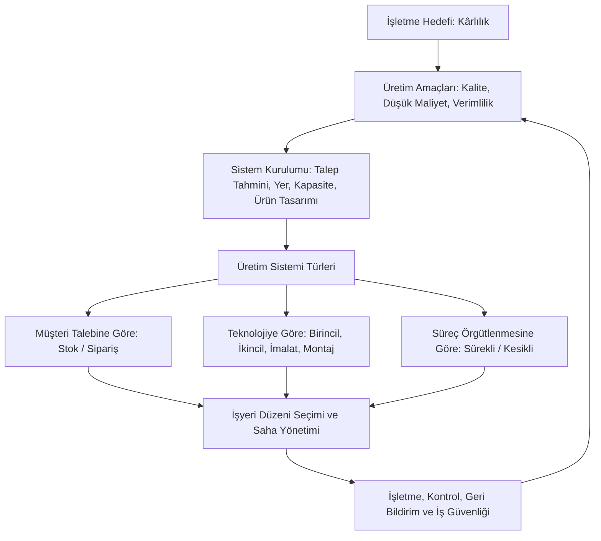
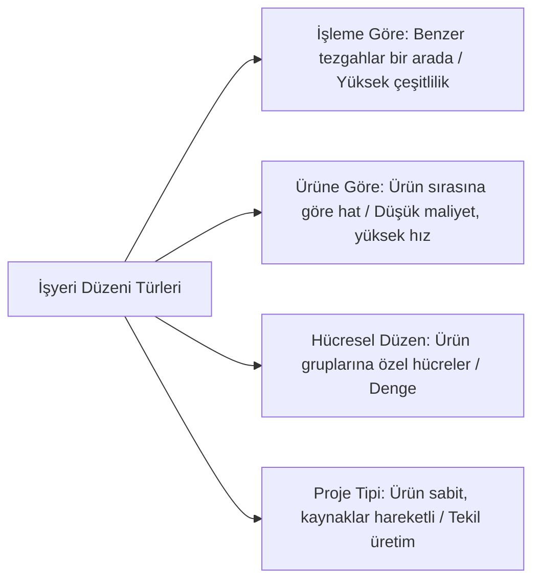

# Üretim İşlevi, Sistem Tasarımı ve İşyeri Düzeni

## Bütüncül Çerçeve: İşletmede Üretim Sistemi

Üretim işlevi, işletmenin nihai hedefi olan kârlılığı müşterinin ihtiyacını karşılayan mal ve hizmetlere dönüştüren ana mekanizmadır. Bir işletme neyi, nasıl ve nerede üreteceğine yalnızca makine parkuruna bakarak karar vermez; müşteri talebinin niteliği, seçilen üretim teknolojisi, ürün tasarımı, işyeri yerleşimi ve sahadaki insan faktörü birbirine sıkı sıkıya bağlıdır. Talep belirsizliğinden fabrika içi güvenlik önlemlerine kadar uzanan bu yapı, işletmenin hem maliyetlerini hem de rekabet gücünü belirler.

---
## 1. Üretim İşlevi, Amaçları ve Sistem Yapısı

### 1.1 Üretimin Tanımı ve Şekil Faydası

**Üretim, müşteri ihtiyacını karşılamak üzere mal ve hizmetlerin ortaya konulmasını kapsayan tüm süreçlerdir**. Çağdaş yönetim yaklaşımı fabrika içi mal üretimiyle, hizmet sunumunu (operations) ve bakım-onarım, kalite yönetimi, malzeme akışı gibi destek faaliyetlerini ile ele alır. Bu nedenle alan bütüncül olarak **[[üretim işlemler yönetimi]]** (operations management) adıyla anılır.

Her işletme işlevinin müşteriye sunduğu farklı bir yarar vardır. Üretim işlevinin sağladığı temel yarar **[[şekil faydası]]**dır. Bu kavram, **müşteri için ham hâliyle doğrudan işe yaramayan bir girdiyi daha yararlı bir çıktıya dönüştürmeyi ifade eder**. Örneğin mercimek tanesi büyüklüğündeki ham granül plastiğin tek başına bir değeri yoktur; ancak enjeksiyon ve diğer işlemlerle kalem gövdesine dönüştüğünde müşterinin yazma ihtiyacını karşılayan bir ürüne dönüşür.

### 1.2 Üretimin Dört Temel Amacı

Üretim sistemi işletmenin hedefleri doğrultusunda çalışan dört temel amaca hizmet eder:

1. **[[Kârlılık]]:** İşletmenin nihai amacıdır. Yalnızca mutlak kâr elde etmek yetmez. Yatırılan kaynağa göre kârlılığın sağlanması gerekir.
2. **[[Kalite]]:** Kârlılığın ön koşulu satış yapabilmektir. Kalite, mal veya hizmetin müşteri istek ve beklentilerini karşılama oranıdır. Müşteri kendisine fayda sağlayan ve fiyatıyla uyumlu bir kalite görmezse ürünü satın almaz.
3. **Düşük Maliyet:** Fiyatın müşteri beklentileriyle dengelenebilmesi için maliyetlerin kontrol altında tutulması şarttır. Maliyeti düşürmenin ilk akla gelen yolu girdileri ucuza almaktır; ancak ucuz girdi kaliteyi bozabilir ve her zaman sürdürülebilir değildir.
4. **[[Verimlilik]]:** Maliyeti kalıcı biçimde düşürmenin ana yoludur. Birim girdi başına daha fazla çıktı üretmek ya da birim çıktıyı daha az girdiyle elde etmek anlamına gelir. Girdi fiyatı ne olursa olsun verimlilik arttığında çıktı adedi büyüyeceği için birim maliyet düşer.

### 1.3 Üretim Sisteminin Yapısı ve Yönetim Alanları

Üretim sistemi temel olarak dört unsurdan oluşur:

- **Girdiler:** Üretim faktörleri (hammadde, emek, sermaye, bilgi vb.).
- **İşlemler:** Girdileri çıktıya dönüştüren süreçler.
- **Çıktılar:** Mal ve hizmetler.
- **Geri Bildirim:** Çıktılardan gelen verilerle sistemi düzelten kontrol mekanizmaları.

Bu sistemin yönetimi üç ana iş başlığında toplanır:
- **Sistemin Oluşturulması:** Uzun dönemli talep tahmini, kuruluş yeri seçimi, kapasite kararları, emek veya sermaye yoğunluğuna dayalı süreç teknolojisi seçimi ve ürün tasarımı.
- **Sistemin İşletilmesi:** Kısa ve orta dönemli talep tahminleriyle başlayan hiyerarşik üretim planlaması (bütünleşik planlama, ana üretim programı, kapasite planlama) ve fiilî üretimin yürütülmesi.
- **Sistemin Kontrolü:** Stok kontrolü, kalite kontrolü, bakım-onarım yönetimi ile büyük işletmelerde lojistik altında ele alınabilen depo ve stok yönetimi.

Günümüzde üretim sistemleri tek bir fabrika binasıyla sınırlı kalmaz. Aynı işletme üretimin bir aşamasını bir ülkede başlatıp başka bir ülkedeki tesisinde tamamlayabilir. Örneğin çocuk oyuncağı üreticisi Lego, Danimarka'da başlattığı üretimi Çekya'daki fabrikasında tamamlayıp piyasaya sürebilmektedir. Bu çok merkezli yapı, uluslararası ölçekte eşgüdüm gerektirdiği için üretim yönetimini daha karmaşık hâle getirir.

---

## 2. Üretim Sistemlerinin Sınıflandırılması

Üretim sistemleri müşterinin talebini nasıl karşıladığına, kullandığı teknolojiye ve süreçlerin içeride nasıl örgütlendiğine göre farklı biçimlerde sınıflandırılır.

### 2.1 Müşteri Talebini Karşılama Şekline Göre Sistemler

Talep yoksa üretim yapılmaz; ancak talebin ne zaman ve nasıl geldiği sistemin yapısını belirler.

| Sistem Türü                                                | Üretim ve Stok Mantığı                                                                                                             | Hacim ve Maliyet                             | Tedarik Hızı                                       |
| :--------------------------------------------------------- | :--------------------------------------------------------------------------------------------------------------------------------- | :------------------------------------------- | :------------------------------------------------- |
| **[[Stoklara Üretim]]**                                    | Müşteri istemeden önce talep öngörülerek standart ürün üretilir. Talep anında ürünü hazır etmek amaçlanır, stok biriktirmek değil. | Hacim en yüksek, birim maliyet en düşüktür.  | En hızlıdır (bakkaldan su almak gibi).             |
| **[[Sipariş Üstüne Montaj]]** (*Assemble / Make to Order*) | Katalogdaki çeşitler bellidir; temel girdiler ve ortak yarı mamuller stokta bekler, sipariş gelince birleştirilir.                 | Orta düzeyde hacim ve maliyet.               | Stoktan yavaş, tasarımdan hızlıdır.                |
| **[[Sipariş Üstüne Tasarım]]** (*Engineer to Order*)       | Ürün tasarımı dahi yoktur. Müşterinin ihtiyacına göre ürün sıfırdan tasarlanır ve üretilir. Yarı mamul stoğu tutulmaz.             | Hacim 1'e kadar düşer, maliyet en yüksektir. | En yavaştır (tasarım, tedarik ve üretim beklenir). |

Bu yapılarda **özelleşme düzeyi, üretim hacmi ve birim maliyet** sürekli bir denge içindedir. Sipariş üstüne tasarımda belirli bir ürüne özelleşmiş hat kurulamaz; bunun yerine çok çeşitli işleri yapabilen *genelleşmiş* bir üretim sistemi kurulur. Belirli bir ürüne *özelleşmiş* sistemler ise stoklara üretim için uygundur. Ayrıca uluslararası literatürdeki *engineering* kavramı mevcut ürünlerin ve süreçlerin iyileştirilmesini de kapsar.

### 2.2 Üretim Sistemlerinde Temel Süre Kavramları

Üretim sisteminin hızını ve performansını ölçmek için beş temel süre kavramı kullanılır:

- **[[Tedarik Süresi]] (Lead Time):** Müşterinin (nihai müşteri veya sonraki üretim aşaması) siparişi vermesinden ürünün teslimatına kadar geçen toplam süredir. Hesabı sisteme göre değişir: Bakkaldan su alırken raftan alıp ödemek 1-1,5 dakika sürerken; sipariş üstüne tasarımda tasarım onayı, malzeme tedariği, üretim, sevkiyat ve dağıtım sürelerinin tamamı bu kapsama girer.
- **[[Çevrim Süresi]] (Cycle Time):** Bir üretim sisteminden ardı ardına çıkan iki ürün arasında geçen süredir. Sistemin çalışma hızını gösterir ve kapasite hesabında belirleyicidir. İş istasyonlarında harcanabilecek azami süreyi veya sisteme iki girdi besleme aralığını ifade eder. Örneğin bir otomobilin montajı baştan sona yaklaşık iki gün sürerken, hattan ardı ardına iki otomobilin çıkması 3 ila 10 dakika arasında gerçekleşir. Bu durum, sistemde aynı anda işlem gören çok sayıda otomobilin bulunduğunu gösterir.
- **[[İşlem Süresi]] (Process Time) ve Toplam İşlem Süresi:** Tek bir işlemin yapılma süresine işlem süresi (örneğin şişe kapağının 5 saniyede kapatılması), bir ürünün sistemde gördüğü tüm işlemlerin toplam süresine ise toplam işlem süresi denir.
- **[[Akış Süresi]] (Throughput Time):** Bir ürünün üretim sistemine girdiği andan çıktığı ana kadar içeride geçirdiği toplam süredir. İşlem sürelerinin yanı sıra malzemenin bekleme sürelerini de kapsar. Örneğin plastik şişeler fabrikaya boş hâlde değil, taşıma hacminden tasarruf etmek için deney tüpüne benzer küçük, kalın gövdeli ön formlar hâlinde gelir; sıcak buharla kalıpta şişirilir. Bu ham şişenin depoda beklemesi, dolum öncesi beklemesi ve etiketlendikten sonra sevkiyat için beklemesi işlem süresine girmez ama akış süresine dahildir. Sistem tasarımında akış süresinin toplam işlem süresine olabildiğince yakın olması hedeflenir.
- **[[Takt Zamanı]]:** Müşteri talebini tam olarak karşılayacak şekilde belirlenen çevrim süresidir. Teknik olarak daha hızlı üretmek mümkün olsa bile gereksiz stok biriktirmemek için üretim hızı yalın üretim ilkeleriyle müşteri talebine eşitlenir.

### 2.3 Üretim Teknolojilerine Göre Sistemler

Üretim kavramı İngilizcede genel olarak *production* sözcüğüyle karşılanır; ancak uygulanan teknolojiye göre farklı kavramlar öne çıkar:
- *Processing:* Genellikle kimyasal süreçlerle veya gıda işleme (*food processing*) gibi yöntemlerle dönüşüm sağlamaktır (Türkçeye yanlış biçimde "süreç" olarak çevrilebilmektedir).
- *Fabrication:* Kumaş (*fabric*) dokumada olduğu gibi katmanları birleştirerek veya iç içe geçirerek yapılan üretimdir.
- *Manufacturing:* Fiziksel şekillendirmeye dayalı imalat.
- *Assembly:* Parçaların bir araya getirildiği montaj.

Teknolojik düzey açısından üretim iki ana basamakta incelenir:

#### Birincil (Primer) Üretim
Temel hammaddelerin doğrudan doğadan elde edilmesine yönelik faaliyetlerdir. Tarım, hayvancılık, madencilik ve balıkçılık bu gruba girer.

#### İkincil Üretim
Birincil üretimden gelen girdilerin işlendiği aşamadır ve iki temel yöntemle çalışır:
- **[[Analitik Üretim]]:** Temel hammaddelerin ayrıştırıcı yöntemlerle bileşenlerine bölünmesidir. Ham petrolün rafineride 7-9 farklı türeve ayrılması, sütün yağının ayrıştırılması veya ağaçtan kâğıt üretimi için selüloz elde edilmesi analitik üretimdir.
- **[[Sentetik Üretim]]:** Ayrıştırılmış bileşenlerin veya hammaddelerin genellikle kimyasal süreçlerle birleştirilmesidir. Buradaki sentetik sözcüğü "yapay" anlamına gelmez; birleştirme (sentez) demektir. Petrol türevine katkılar ekleyip granül ham plastik üretmek veya süte maya katarak tamamen doğal bir ürün olan yoğurt elde etmek sentetik üretimdir.

#### İmalat Yöntemleri: Talaşlı ve Katmanlı İmalat
Fiziksel biçimlendirme sağlayan imalat süreçleri geleneksel ve çağdaş yöntemler olarak ayrılır:
- **Geleneksel İmalat ve [[Talaşlı İmalat]] (*Subtractive Manufacturing*):** Bir bütünden parça eksilterek (kesme, biçme, delme, yontma) veya basınç ve ısıyla şekil vererek (pres, hadde, döküm) parça üretmektir. *(Not: Akademik literatürde döküm, presleme ve haddeleme talaşsız şekillendirme sınıfında yer alır; ancak uygulamada katmanlı imalatın karşısına konan geleneksel yöntemler bütünü olarak ele alınır.)* Bu yöntemlerde malzeme ve enerji sarfiyatı yüksektir. Ayrıca **geometrik kısıt** bulunur: İç bükey veya kıvrımlı kanalları kesici takımla açmak zordur; dökümde geçici kum kalıp parçaları (*maça*) kullanılsa bile karmaşık iç boşlukların temizlenmesi her zaman mümkün olmaz.
- **[[Katmanlı İmalat]] (*Additive Manufacturing*):** Üç boyutlu yazıcılar, SLM, SLA ve filament yığma gibi teknolojilerle malzemeyi katman katman ekleyerek parça üretmektir. Mantığı 1970'lerden beri bilinse de metal tozu gibi ileri malzeme teknolojilerinin gelişmesiyle son yıllarda seri üretim süreçlerine girmiştir. Başlıca avantajları şunlardır:
  1. Malzeme sarfiyatı çok daha düşüktür.
  2. Geometrik kısıtları büyük ölçüde ortadan kaldırır. Örneğin geleneksel yöntemlerle üretilemeyen toroidal (halka) pervaneler katmanlı imalatla üretilerek drone ve denizaltılarda verimliliği %100 ila %110 oranında artırabilmektedir.
  3. Kalıp maliyetini ortadan kaldırır. Örneğin Lego üretiminde tek bir enjeksiyon kalıbı 150.000 dolar ile 750.000 euro arasında maliyet çıkarabilir ve bir fabrikada ömrü sınırlı 400-500 kalıp bulunur. Kalıba ihtiyaç duymayan katmanlı imalat, düşük adetli özelleşmiş üretimi (tam *engineer to order* fabrikaları) mümkün kılar.
  4. Toz yatağı teknolojileriyle hareketli ve birbirine geçmeli parçalar tek seferde montaj gerektirmeden basılabilir.

Buna karşın plastik şişe veya oyuncak gibi çok yüksek hacimli ürünlerde geleneksel yöntemler hâlâ çok daha hızlıdır. Katmanlı imalatta çözünürlük, son işlem ihtiyacı ve malzeme dayanımı kullanılan teknolojiye göre değişkenlik gösterir.

#### Montaj
İmalatla üretilen parçaların karmaşık nihai ürünlere dönüştürülmesidir. 1910'ların başında Henry Ford ve Sorensen tarafından sistematik hâle getirilen montaj hattı yaklaşımı, günümüzde de yaygın biçimde kullanılmaktadır.

### 2.4 Süreç Örgütlenmesine Göre Sistemler

Üretim süreçlerinin fabrika içinde nasıl örgütlendiği beş temel yapıda incelenir:

1. **[[Sürekli Üretim Sistemleri]]:** 7 gün 24 saat çalışması şart değildir; çalışma süresi ne olursa olsun sistemin özellikleri değişmeden tekrar tekrar aynı ürünü üretir. Seri üretim ve montaj hatları bu gruba girer. İşlemler standart olduğu için uzmanlaşmış çalışan ve donanım kullanılır, otomasyon kolaydır, hacim yüksek ve birim maliyet düşüktür. Planlama odağı; hat hızı, çevrim hızı, arıza/bakım kesintilerinin en aza indirilmesi ve girdi besleme sırasıdır.
2. **Kesikli Üretim Sistemleri:** Aynı sistemden birden fazla ürün çeşidi çıkarmak için üretimin durdurulup makine ayarlarının değiştirildiği sistemlerdir. Kendi içinde alt türlere ayrılır:
   - **[[Parti Tipi Üretim]]:** Sürekliden kesikliye ilk geçiş noktasıdır. Benzer işlemlerden geçen 3-4 farklı ürün sırayla belirli partiler hâlinde (örneğin 10.000 adet A, ardından 30.000 adet B, sonra 5.000 adet C) üretilir. Ürün değişimlerinde duruş, temizlik, kalıp değişimi, deneme üretimi ve fire gibi **setup (üretime hazırlık) kayıpları** ortaya çıkar. Ölçek ekonomisinden kısmen vazgeçip kapsam ekonomisine yönelmeyi sağlar. Planlama problemi hangi üründen hangi sırada ne kadar üretileceği ve hazırlık kayıplarının nasıl azaltılacağıdır.
   - **[[Atölye Tipi Üretim]]:** 10 ila 50 veya daha fazla ürün çeşidinin üretildiği yapıdır. Şişe kapatma makinesi gibi özel amaçlı donanımlar yerine; matkap, torna, freze, planya, hızar, taşlama, pres ve **CNC** (*Computer Numerical Control*) gibi genel amaçlı tezgahlar kullanılır. Eski NC tezgahlarda koordinat kodları operatörler tarafından sayı tablosuyla haftalar süren çalışmalarla girilirken, CNC'lerde bilgisayar dosyaları saatler veya günler içinde makineye aktarılır. Yaygın CNC makineleri 3 ila 5 eksenlidir (ileri örneklerde 11 eksene çıkar; ortalama bir 5 eksenli tezgah 700-750 bin dolar düzeyindedir). Mobilya sektörü atölye üretiminin klasik örneğidir ve küçük olmak zorunda değildir; büyük ölçekli işletmeler de atölye tipi çalışabilir. Planlaması en zor sistemdir; temel problem işlerin makinelere hangi sırayla atanacağı yani **çizelgeleme (scheduling)** problemidir.
   - **[[Grup Teknolojisi]] / [[Hücresel Üretim]]:** 1990'larda olgunlaşan bu yöntemde tüm ürün çeşitliliği benzer işlemlerden geçen gruplara ayrılır ve her grup için yalnızca o ürünlere özelleşmiş üretim hücreleri kurulur. Geçiş kayıplarını azaltıp otomasyonu (örneğin robotik aktarımlı *Esnek Üretim Sistemleri - FMS*) kolaylaştırarak atölye esnekliği ile sürekli üretimin verimliliği arasında denge kurar.
   - **[[Proje Tipi Üretim]]:** Kesikli üretimin en uç noktasıdır. Tekrarlanabilirlik yoktur; belirli bir başlangıç ve bitiş noktası arasında, kendine özgü koşullarla genellikle **bir adet** çıktı üretilir. Bina inşaatları, gemi üretimi, yazılım projeleri ve (ABD'deki tek Boeing montaj hattı istisnası dışında) ticari yolcu uçakları proje tipi üretilir. Örneğin İzmir Bayraklı'daki iki Folkart kulesi görsel olarak ikiz olsa da aynı proje değildir; inşa edildikleri mevsim, beton kuruma süresi, taşeron işçilik, girdi fiyatları ve bütçe birbirinden farklıdır. PERT, CPM, proje hızlandırma (*crashing*) ve kaynak dengeleme gibi özel yönetim teknikleri gerektirir.

---

## 3. Ürün Tasarımı ve AR-GE Yönetimi

### 3.1 Pazarlama İlişkisi ve Ürün Fikri Kaynakları

Geleneksel iktisattaki "her arz kendi talebini yaratır" yaklaşımı yerini "arzın nedeni taleptir" anlayışına bırakmıştır. Müşterinin tepkisini ölçmeden pazara ürün sürmek büyük şirketler için bile ağır sonuçlar doğurur. Steve Jobs'ın Apple'daki diğer yöneticilerin itirazına rağmen ürettirdiği Lisa bilgisayar modelinin satışta başarısız olması ve bu yüzden şirketten ilk kez kovulması bunun tarihsel örneğidir. Dokunmatik ekran gibi müşterinin henüz bilmediği yeniliklerde bile pazar tepkisinin önceden sınanması gerekir.

Ürün tasarımı çok disiplinlidir ve yalnızca üretim biriminin işi değildir; küçük işletmelerde üretimle yakın yürütülse de büyük yapılarda ayrı bir AR-GE işlevine dayanır. Yeni ürün fikirleri müşteri beklentilerinden, değişen yasal standart ve yönetmeliklerden, yeni icat edilen teknolojilerden, çalışan önerilerinden (Kaizen) ve rakiplerden gelir.

Rakiplerin ürünlerini incelemede **[[tersine mühendislik]]** (*reverse engineering*) kritik bir yöntemdir. Fiziksel veya yazılımsal bir rakip ürün bileşenlerine ayrılarak her parçanın işlevi, performansa katkısı ve montaj mantığı analiz edilir. Ancak fikri mülkiyet yasaları nedeniyle birebir kopyalama yasal değildir; Apple ile Samsung arasındaki milyar dolarlık patent davaları bunun sonucudur. İç pazar büyüklüğü çok yüksek olan Çin gibi ülkeler uzun süre fikri mülkiyet koruması olmadan kendi iç pazarında büyük ölçek yakalamış, Trump dönemindeki ticaret müzakerelerinde ABD fikri mülkiyet düzenlemelerini temel şart olarak öne sürmüştür. Avrupa'nın ise "Made in Europe" gibi korumacı adımlarla kendi üreticisini koruma eğilimi görülmektedir.

### 3.2 Fizibilite, Ölçeklenebilirlik ve Prototipleme

Seçilen ürün fikri teknik ve ekonomik **fizibilite** süzgecinden geçirilir. Bu aşamada en kritik eşik **[[ölçeklenebilirlik]]**tir: Laboratuvar ortamında bir veya iki adet üretilebilen bir ürünün milyonlarca adet üretilip üretilemeyeceği test edilir ve "tamam ya da devam" kararı verilir.

Bu sınamalar için **[[prototip]]** (ilk örnek) hazırlanır. Prototip; otomobillerin rüzgar tüneli testleri gibi fiziksel sınamalar yapmak, müşteri tepkisini ölçmek ve tasarımı gerçek hayatta görmek için kullanılır. Otomobil fuarlarında sergilenen ancak yollarda aynı hâliyle görülmeyen konsept araçlar da aslında teknoloji ve tasarım testine yarayan prototiplerdir. Eskiden otomobil şirketleri kalıp maliyeti ödememek için sabundan model yontan heykeltıraşlar çalıştırırdı. Günümüzde bilgisayar destekli tasarım (*CAD*) ile sanal stres ve dayanım testleri yapılabilmekte, fiziksel parça üretimi içinse üç boyutlu yazıcıların ilk çıkış amacı olan **hızlı prototipleme (*rapid prototyping*)** kullanılmaktadır.

### 3.3 Detaylı Tasarım ve Eş Zamanlı Mühendislik

Tasarım onaylandıktan sonra detaylı tasarıma geçilir. Bu aşama üç ayaktan oluşur:
1. **Fonksiyonel Tasarım:** Ürünün işlevlerini ve performans sınırlarını belirler.
2. **Biçimsel Tasarım:** Fiziksel görünümü ve dış özellikleri tanımlar.
3. **Süreç Tasarımı:** Ürünün hangi üretim sistemiyle, hangi ekipman ve maliyetle üretileceğini planlar.

Ürünü tasarladıktan sonra "bunu nasıl üreteceğiz" diye sormak zaman kaybına ve teknik tıkanmalara yol açar. Üç ayağın birbiriyle paralel ve eş zamanlı yürütülmesine **[[eş zamanlı mühendislik]]** (*concurrent engineering*) denir. Bu yaklaşım özellikle montaj gerektiren ürünlerde üretim hızını ve maliyetini doğrudan optimize eder.

### 3.4 AR-GE Türleri ve Rekabet Stratejileri

Araştırma ve geliştirme kavramları birbirinden farklı üç faaliyeti içerir:
- **Temel Araştırma:** Doğrudan bir ürün hedefi olmadan tamamen bilimsel bilgi birikimini artırmaya yönelik meraka dayalı araştırmadır. Riski ve maliyeti çok yüksek olduğu için genellikle savunma sanayii veya BASF, Pfizer, pandemide mRNA teknolojisini geliştiren BioNTech gibi küresel devler tarafından yürütülür.
- **Uygulamalı Araştırma:** Elde edilen bilimsel bilginin nerede kullanılacağını (örneğin yeni bir molekülün ilaç mı, gübre mi yoksa plastik güçlendirici mi olacağını) belirlemeye çalışır.
- **Geliştirme:** Yeni ürün ortaya koymak veya mevcut ürünleri ve süreçleri iyileştirmektir. Türkiye'de AR-GE yaptığını belirten işletmelerin neredeyse tamamı geliştirme faaliyetleri yürütmektedir.

İşletmeler kaynak büyüklüklerine göre üç rekabet stratejisinden birini seçer: Pazara sürekli yeni ürün süren **yenilikçi strateji**, çıkan yenilikleri hızla uyarlayan **hızlı takipçilik** ve olgunlaşmış ürünleri düşük maliyetle üreterek pazara giren **korumacı (yavaş takipçi) strateji**.

---

## 4. İşyeri Düzeni ve Seçim Faktörleri

### 4.1 İşyeri Düzeni Türleri

İngilizcedeki *process* kelimesi hem "işlem" hem "süreç" anlamına geldiği için literatürde kavram karışıklığı yaşanabilmektedir. İşlem noktasal bir işi, süreç ise işlemler bütünüyle oluşan akışı ifade eder. Bu ayrım gözetilerek dört temel **[[işyeri düzeni]]** türü tanımlanır:

1. **İşleme Göre Düzenleme (*Süreç Temelli Yerleşim*):** Torna, freze, matkap, boya ve ambalaj gibi aynı türden makineler veya işlemler ayrı bölümlerde toplanır. Benzer donanımı kullanan çalışanların denetimi kolaydır ve her ürün kendi rotasına göre farklı sırada gezerek yüksek çeşitlilik elde edilir. Hastanelerde ortopedi, görüntüleme ve ameliyathanelerin ayrı bölümler hâlinde konumlanması bunun hizmet sektöründeki örneğidir. Dezavantajı akışın karmaşık olmasıdır; malzeme, araç ve insan yollarının kesişmesi beklemelere, taşıma maliyetlerinin artmasına, yüksek yarı mamul stoklarına ve iş güvenliği risklerine yol açar. Atölye tipi ve nadiren parti tipi üretime uygundur.
2. **Ürüne Göre Düzenleme:** Ekipmanlar tek bir ürünün işlem sırasına göre art arda dizilir. Hareketlilik en azdadır, taşıma bantları ve otomasyon kolayca kurulur, maliyet düşüktür. Sürekli ve parti tipi üretim için idealdir. Farklı bir ürün için kural olarak yeni bir hat gerekir; ancak ürün parçaları ve montaj işlemleri standardize edilip malzeme akışı doğru planlanırsa aynı hattan farklı modeller çıkarılabilir. Seri üretim avantajını kişiselleştirmeyle birleştiren bu yaklaşıma **[[kitlesel bireyselleştirme]]** (*mass customization*) denir.
3. **Grup Teknolojisi / Hücresel Üretim Düzeni:** Ürün gruplarına ayrılmış her hücre kendi içinde ürüne göre düzenlenmiş küçük bir akış hattı gibi çalışır. Böylece hem işleme göre düzenlemenin çeşitlilik avantajı hem de ürüne göre düzenlemenin akış hızı tek tesiste birleştirilir.
4. **Proje Tipi Düzenleme:** Sabit bir yerleşim planı yoktur. Üretilen yapı (bina, gemi, uçak) yerinde sabit kalır; kum, betoniyer, iskele veya montaj ekipleri geçici olarak ürünün yanına taşınır ve iş bitince ayrılır.

### 4.2 Yerleşim Kararını Belirleyen Faktörler

Doğru işyeri düzeni seçilirken şu ölçütler dikkate alınır:
- **Ürünün Teknik Gerekleri:** Üretim sırasında çıkan zehirli gazların sonraki aşamaları bozmaması için kapalı veya ayrı alanlara alınması; titreşim yaratan makinelerin hassas tezgahlardan uzaklaştırılması.
- **Çeşitlilik Gereksinimi:** Tek tip yüksek hacim mi yoksa çok çeşitli düşük hacim mi üretileceği.
- **Donanım ve Bakım İhtiyaçları:** Makinelerin duvara sıfır yerleştirilmemesi, bakım ve tamir için erişim payı bırakılması.
- **Taşıma ve Akış Özellikleri:** Malzeme, araç ve insan hareket yollarının mümkün olduğunca birbirinden ayrılması; sabit veya değişken rotalı taşıma sistemlerinin seçimi.
- **İş Güvenliği:** Yaya ve araç yollarının çizgilerle ayrılması, tehlikeli alanların tel örgülerle izole edilmesi.

---

## 5. Saha Gerçekleri: İş Sağlığı, Güvenliği ve Ara Eleman Sorunu

### 5.1 İş Kazaları, İnsan Davranışı ve İşveren Sorumluluğu

Üretim yönetimi yalnızca teknik verimlilik değil, sahadaki insan davranışını öngörme işidir. Fabrikalarda verilen giriş eğitimleri, koruyucu ekipmanlar (gıda tesislerinde bone ve maske gibi) ve zemin çizgileri tek başına kazaları önlemeye yetmez. Çalışanlar alışkanlıklarından vazgeçmemek veya işi hızlandırmak için güvenlik önlemlerini aşma eğilimi gösterir.

- **Pres Kazaları Vakası:** İzmir'deki bir otomotiv yan sanayi tesisinde alt tarafı sabit erkek kalıp, üst tarafı baskı yapan dişi kalıp olan 3-5 tonluk preslerde işçiler zaman kazanmak için parçayı eliyle tutup düğmeye basarken elini çekmeye çalışınca kazalar yaşanmıştır. Önlem olarak iki elle basılması gereken çift düğme sistemine geçilmiştir; ancak bir hafta dolmadan makinenin duvara yakın olmasını fırsat bilen bir işçi düğmelerden birine sırtıyla, diğerine tek eliyle basarak çalışmaya devam etmiş ve yine kaza geçirmiştir. Günde binlerce kez aynı hareketi tekrarlayan işçiler arasında sigara yakmak için presin altından sürünerek geçerken ezilerek ölen çalışanlar bile görülmüştür.
- **Sensör Sökme Vakası:** Bir işletmede işçinin elini algıladığında makineyi durduran güvenlik sensörlü yeni makineler kurulmuş; ancak aynı gün gece vardiyasındaki işçiler işi yavaşlatıyor gerekçesiyle bu sensörleri sökmüştür.

Bu örneklerin gösterdiği temel yönetim ilkesi şudur: İş sağlığı ve güvenliğinde ilk adım **aşılması imkânsız fiziksel engeller** koymaktır. Fiziksel engelin yeterli olmadığı yerlerde sürekli eğitim ve kesintisiz denetim şarttır. İşçi kendi ihmaliyle kaza geçirmiş olsa bile işverenin "neden önlem almadın ve denetlemedin" sorumluluğu ortadan kalkmaz.

### 5.2 Ara Eleman Kıtlığı ve İş Gücü Yönetimi

Güvenlik kurallarını ihlal eden nitelikli bir teknisyeni veya teknikeri işten çıkarmak kâğıt üzerinde kolay görünse de sahada büyük bir açmaz yaratır. Türkiye iş gücü piyasasında en zor bulunan kesim **ara eleman** (tekniker ve teknisyen) kadrolarıdır. İşsizlik oranlarına rağmen sanayide nitelikli ara eleman arzı yetersizdir; bazı fabrika sahipleri mühendis başvurularını kenara koyarken teknisyen başvurularını hemen işe başlatacak noktaya gelmiştir.

Bu kıtlık, ara elemanların iş seçme gücünü artırmakta ve yönetim süreçlerini zorlaştırmaktadır. Örneğin Aliağa'da kurulan bir fabrika için elektrik teknikeri arayan fabrika müdürü, görüşme teklif ettiği adayların Cuma gününü veya Cumartesi çalışmasını gerekçe göstererek işi kolayca reddetmesiyle karşılaşabilmektedir. Bu tablo, dört yıllık üniversite eğitiminin doğrudan meslek kazandırmaya değil akademik ve yönetsel bakış açısı vermeye odaklandığı bir yapıda, mesleki eğitimin eksikliğini işletme yönetiminin en yakıcı yapısal sorunlarından biri hâline getirmektedir.

