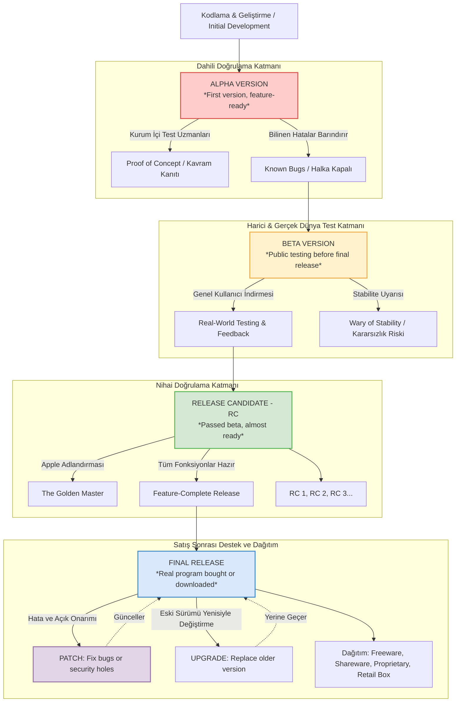

# Mesleki Yabancı Dil I | Unit 4: The Software Development Cycle & Software Applications

> [!tip] Sınav Tüyoları ve Çeldiriciler
> 1. **Alpha vs. Beta vs. RC (Release Candidate) Hiyerarşisi:**
>    - `First version` + `feature-ready` + `released to testers` (kurum içi testçiler) + `known bugs` / `proof of concept` $\rightarrow$ **Alpha Version**
>    - `Testing purposes before released to the public` + `real-world testing and feedback` $\rightarrow$ **Beta Version**
>    - `Passed the beta testing stage` + `almost ready to be released to the public` + `feature-complete` $\rightarrow$ **Release Candidate (RC)**
>    *Hoca Uyarısı:* Apple şirket içinde sürüm adayını (RC) **"The Golden Master"** olarak adlandırır. Sınavda bu benzetme sorulabilir!
> 2. **Freeware vs. Shareware Çelişkisi (En Büyük Sınav Tuzağı):**
>    - `Without cost` + `cannot be modified or sold without permission` $\rightarrow$ **Freeware** (*Tamamen ücretsizdir ancak kapalı kaynaklı ve tescillidir*).
>    - `Distributed freely` + `limited by features and/or time limit` + `until full version is purchased` $\rightarrow$ **Shareware** (*30 günlük deneme sürümü veya kısıtlı özellik mantığı*).
>    *Hoca Dersteki Örneği:* Samsung telefonların bir yıl boyunca ücretsiz verdiği Dropbox bulut depolama alanı bir **Shareware** örneğidir; süre bitiminde tam lisans satın alımı ister.
> 3. **Hoca İtirafı ve Sınav Formatı:**
>    - Sınav **%100 çoktan seçmeli testtir (MCQ)**; İngilizce cümle kurma veya çeviri yazma sorulmayacaktır.
>    - Hoca, sınavda kısaltmaları tek başına sorup mağduriyet yaratmayacağını belirtmiştir: **RC** terimi sorulduğunda parantez içinde veya açıkça **"Release Candidate"** yazacaktır. Aynı durum **GUI**, **CLI**, **VM** ve **OS** için de geçerlidir.
>    - Metin okunurken geçen genel fiiller (*perform = do [akademik kullanımı]*, *retrieve*, *maintain*, *unless = if not*) genel dil kültürüdür; sınavda teknik terim olarak **SORULMAYACAKTIR**. Zamanınızı isim ve terim odaklı kavramlara ayırın!
> 4. **Etimolojik ve Kavramsal Kök Analizi:**
>    - **Proprietary:** Latince *proprietas* ("özel mülk, sahiplik") kökünden türemiştir; mülkiyeti, telifi ve kaynak kodu şirkete ait olan yazılımdır.
>    - **Candidate (Aday):** Latince *candidatus* ("parlak beyaz cübbe giymiş kimse") sözcüğünden gelir. Antik Roma'da kamu görevine aday olanların saflığı ve dürüstlüğü simgeleyen beyaz toga (*toga candida*) giyme geleneğinden bilişime "yayımlanmaya aday sürüm" (*Release Candidate*) olarak geçmiştir.
>    - **Patch (Yama):** Eski Fransızca *pieche* ("kumaş parçası") kökünden gelir; yazılımdaki bir açığı veya hatayı bütünü bozmadan kapatmak için üzerine örtülen kod parçasıdır.
> 5. **Hata ve Sonlandırma Terminolojisi (Tahta Bulmacası Ayrımı):**
>    - `Bug` $\rightarrow$ Kodun yazımındaki mantıksal kusur veya açık (*defect/flaw in code*).
>    - `Error` $\rightarrow$ İnsan veya sistem kaynaklı hatalı eylem (*incorrect action attributable to...*).
>    - `Crash` $\rightarrow$ Bilgisayar sisteminin veya yazılımın çökmesi (*computer failure*).
>    - `Abort` $\rightarrow$ Bir işlemin/programın tamamlanmadan önce zorla durdurulması (*to end a program before its completion*).

---

## 1. Okuma Metni ve Birebir Akademik Çevirisi

| İngilizce Orijinal Metin | Birebir Türkçe Çevirisi |
| :--- | :--- |
| **The Software Development Cycle** | **Yazılım Geliştirme Döngüsü** |
| Without software applications, it would be very hard to actually perform any meaningful task on a computer unless one was a very talented, fast, and patient programmer. | Yazılım uygulamaları olmaksızın, bir kimse çok yetenekli, hızlı ve sabırlı bir programcı olmadığı sürece bir bilgisayarda anlamlı herhangi bir görevi gerçekleştirmek gerçekten çok zor olurdu. |
| Applications are meant to make users more productive and get work done faster. Their goal should be flexibility, efficiency, and user-friendliness. | Uygulamalar, kullanıcıları daha üretken kılmak ve işlerin daha hızlı yapılmasını sağlamak amacıyla tasarlanmıştır. Hedefleri esneklik, verimlilik ve kullanım kolaylığı olmalıdır. |
| Today there are thousands of applications for almost every purpose, from writing letters to playing games. | Günümüzde mektup yazmaktan oyun oynamaya kadar hemen her amaca yönelik binlerce uygulama bulunmaktadır. |
| Producing software is no longer the lonely profession it once was, with a few random geeks hacking away in the middle of the night. | Yazılım üretmek, artık bir zamanlar olduğu gibi gecenin bir yarısında harıl harıl kod yazan birkaç bilgisayar kurdunun icra ettiği yalnız bir meslek değildir. |
| Software is a big business and the development cycle goes through certain stages and versions before it is released. | Yazılım büyük bir sektördür ve geliştirme döngüsü yayımlanmadan önce belirli aşamalardan ve sürümlerden geçer. |
| Applications are released in different versions, including alpha versions, beta versions, release candidates, trial versions, full versions, and upgrade versions. | Uygulamalar; alfa sürümleri, beta sürümleri, yayın adayları, deneme sürümleri, tam sürümler ve yükseltme sürümleri dahil olmak üzere farklı versiyonlarda piyasaya sürülür. |
| Even an application's instructions are often included in the form of another application called a help file. | Bir uygulamanın talimatları bile genellikle yardım dosyası (help file) adı verilen başka bir uygulama biçiminde sunulur. |
| Alpha versions of software are normally not released to the public and have known bugs. | Yazılımların alfa sürümleri normalde halka sunulmaz ve bilinen hatalar barındırır. |
| They are often seen internally as a 'proof of concept'. | Bunlar şirket içinde sıklıkla bir "kavram kanıtı" (proof of concept) olarak görülür. |
| Avoid alphas unless you are desperate or else being paid as a 'tester'. | Çaresiz kalmadıkça ya da bir "test uzmanı" olarak ücret almadığınız sürece alfalardan uzak durun. |
| Beta versions, sometimes just called 'betas' for short, are a little better. | Bazen kısaca "beta" olarak anılan beta sürümleri biraz daha iyidir. |
| It is common practice nowadays for companies to release public beta versions of software in order to get free, real-world testing and feedback. | Günümüzde şirketlerin ücretsiz, gerçek dünya testleri ve geri bildirim elde etmek amacıyla yazılımların genel beta sürümlerini yayımlaması yaygın bir uygulamadır. |
| Betas are very popular and can be downloaded all over the Internet, normally for free. | Betalar oldukça popülerdir ve normalde ücretsiz olarak İnternet'in her yerinden indirilebilir. |
| In general you should be wary of beta versions, especially if program stability is important to you. | Genel olarak, özellikle program kararlılığı sizin için önemliyse beta sürümlerine karşı temkinli olmalısınız. |
| There are exceptions to this rule as well. For instance, Google has a history of excellent beta versions which are more stable than most company's releases. | Bu kuralın istisnaları da vardır. Örneğin Google, pek çok şirketin nihai sürümlerinden bile daha kararlı olan kusursuz beta sürümleri geçmişine sahiptir. |
| After the beta stage of software development comes the release candidates (abbreviated RC). | Yazılım geliştirmenin beta aşamasından sonra yayın adayları (kısaca RC) gelir. |
| There can be one or more of these candidates, and they are normally called RC 1, RC 2, RC 3, etc. | Bu adaylardan bir veya daha fazlası olabilir ve normalde RC 1, RC 2, RC 3 vb. olarak adlandırılırlar. |
| The release candidate is very close to what will actually go out as a feature complete 'release'. | Yayın adayı, özellik seti tamamlanmış bir "nihai sürüm" olarak piyasaya fiilen çıkacak olana son derece yakındır. |
| The final stage is a 'release'. The release is the real program that you buy in a shop or download. | Son aşama bir "yayımlama"dır (release). Release, bir mağazadan satın aldığınız veya indirdiğiniz gerçek programdır. |
| Because of the complexity in writing PC software, it is likely that bugs will still find their way into the final release. | Bilgisayar yazılımı geliştirmenin karmaşıklığı nedeniyle, hataların nihai sürümün içine de sızması muhtemeldir. |
| For this reason, software companies will offer patches to fix any major problems that end users complain loudly about. | Bu nedenle yazılım şirketleri, son kullanıcıların yüksek sesle şikayet ettiği büyük sorunları gidermek için yamalar (patches) sunacaktır. |
| Applications are distributed in many ways today. In the past most software has been bought in stores in versions called retail boxes. | Günümüzde uygulamalar pek çok yolla dağıtılmaktadır. Geçmişte çoğu yazılım perakende kutuları (retail boxes) adı verilen sürümler halinde mağazalardan satın alınırdı. |
| More and more, software is being distributed over the Internet, as open source, shareware, freeware, or traditional proprietary and upgrade versions. | Yazılımlar giderek artan bir biçimde İnternet üzerinden açık kaynak, shareware, freeware veya geleneksel tescilli (proprietary) ve yükseltme (upgrade) sürümleri olarak dağıtılmaktadır. |

---

## 2. Yazılım Geliştirme Yaşam Döngüsü ve Sürüm Mimarisi



---

## 3. Haftanın Odak Kelimeleri

### 1. Alpha Version
* **Resmî Tanım:** `Normally the first version of a software application that is feature-ready and released to testers.`
* **Türkçe Anlamı:** Alfa Sürümü; bir yazılım uygulamasının temel özellikleri hazır olan ancak yalnızca kurum içi test uzmanlarına sunulan ilk sürümüdür.
* **Örnek Cümle:** *"Alpha versions are rarely released to the public and frequently contain serious bugs."*
* **Sınav Tetikleyicisi (Trigger Words):** **`FIRST VERSION`**, **`FEATURE-READY`**, **`RELEASED TO TESTERS`**, **`NOT RELEASED TO THE PUBLIC`**, **`PROOF OF CONCEPT`**, **`KNOWN BUGS`**.

### 2. Beta Version
* **Resmî Tanım:** `A software program used for testing purposes before it is released to the public.`
* **Türkçe Anlamı:** Beta Sürümü; genel halka sunulmadan önce gerçek ortam testleri ve kullanıcı geri bildirimi toplamak üzere dağıtılan deneme sürümüdür.
* **Örnek Cümle:** *"The beta version of our program was released for testing yesterday."*
* **Sınav Tetikleyicisi (Trigger Words):** **`TESTING PURPOSES BEFORE IT IS RELEASED TO THE PUBLIC`**, **`REAL-WORLD TESTING AND FEEDBACK`**, **`WARY OF STABILITY`**, **`DOWNLOADED FOR FREE`**.

### 3. Release Candidate (RC)
* **Resmî Tanım:** `A piece of software that has passed the beta testing stage and is almost ready to be released to the public.`
* **Türkçe Anlamı:** Yayın Adayı; beta test aşamasını başarıyla geçmiş, neredeyse yayımlanmaya hazır ve tüm işlevleri tamamlanmış yazılım sürümüdür.
* **Örnek Cümle:** *"Apple refers internally to a release candidate as 'the golden master'."*
* **Sınav Tetikleyicisi (Trigger Words):** **`PASSED THE BETA TESTING STAGE`**, **`ALMOST READY TO BE RELEASED`**, **`FEATURE COMPLETE`**, **`THE GOLDEN MASTER`**, **`RC 1, RC 2`**.

### 4. Freeware
* **Resmî Tanım:** `Software distributed without cost by the developer which normally cannot be modified or sold without permission.`
* **Türkçe Anlamı:** Ücretsiz Yazılım; geliştiricisi tarafından hiçbir ücret talep edilmeksizin dağıtılan, ancak izin alınmadan kaynak kodu değiştirilemeyen veya satılamayan tescilli yazılımdır.
* **Örnek Cümle:** *"The woman said she always searched for freeware versions of an application before buying one."*
* **Sınav Tetikleyicisi (Trigger Words):** **`WITHOUT COST`**, **`BY THE DEVELOPER`**, **`CANNOT BE MODIFIED OR SOLD WITHOUT PERMISSION`**.

### 5. Shareware
* **Resmî Tanım:** `Proprietary software which can be distributed freely but is limited by features and/or time limit until a full version is purchased.`
* **Türkçe Anlamı:** Kısıtlamalı/Paylaşımlı Yazılım; serbestçe dağıtılabilen ancak tam sürümü satın alınıncaya kadar kullanım süresi (örn. 30 gün) veya işlevsellik bakımından sınırlandırılmış yazılımdır.
* **Örnek Cümle:** *"Many companies have a shareware version of their software with a 30-day free trial."*
* **Sınav Tetikleyicisi (Trigger Words):** **`PROPRIETARY SOFTWARE`**, **`DISTRIBUTED FREELY`**, **`LIMITED BY FEATURES`**, **`TIME LIMIT`**, **`UNTIL A FULL VERSION IS PURCHASED`**, **`30-DAY FREE TRIAL`**.

### 6. Patch
* **Resmî Tanım:** `A software update intended to fix bugs or security holes in a software release.`
* **Türkçe Anlamı:** Yama; piyasaya sürülmüş bir yazılımdaki kodlama hatalarını veya güvenlik açıklarını onarmak amacıyla çıkarılan yazılım güncellemesidir.
* **Örnek Cümle:** *"Software patches and other updates should be available on a software publisher's web site."*
* **Sınav Tetikleyicisi (Trigger Words):** **`SOFTWARE UPDATE`**, **`FIX BUGS`**, **`SECURITY HOLES`**, **`END USERS COMPLAIN LOUDLY`**.

### 7. Upgrade
* **Resmî Tanım:** `To replace an older version of software or hardware with a newer version.`
* **Türkçe Anlamı:** Sürüm Yükseltme; eski bir yazılım veya donanım parçasını daha yeni bir sürümle değiştirmektir.
* **Örnek Cümle:** *"The man needed to upgrade his office suite so he could export files as XML."*
* **Sınav Tetikleyicisi (Trigger Words):** **`TO REPLACE AN OLDER VERSION`**, **`WITH A NEWER VERSION`**, **`SOFTWARE OR HARDWARE`**.

### 8. Help File
* **Resmî Tanım:** `A file containing instructions how to use a certain feature or program.`
* **Türkçe Anlamı:** Yardım Dosyası; belirli bir özelliğin veya programın nasıl kullanılacağına dair yönergeleri ve kısayolları içeren belgedir.
* **Örnek Cümle:** *"The help file often contains useful program shortcuts."*
* **Sınav Tetikleyicisi (Trigger Words):** **`A FILE CONTAINING INSTRUCTIONS`**, **`HOW TO USE A CERTAIN FEATURE OR PROGRAM`**, **`SHORTCUTS`**.

### 9. Application
* **Resmî Tanım:** `A software program designed to make users more productive and perform specific tasks such as writing letters or processing data.`
* **Türkçe Anlamı:** Uygulama; kullanıcının mektup yazma veya veri işleme gibi belirli görevleri daha hızlı ve verimli gerçekleştirmesi için tasarlanan yazılımdır.
* **Örnek Cümle:** *"Without software applications, it would be very hard to perform any meaningful task on a computer."*
* **Sınav Tetikleyicisi (Trigger Words):** **`MAKE USERS MORE PRODUCTIVE`**, **`GET WORK DONE FASTER`**, **`PERFORM MEANINGFUL TASK`**.

---

## 4. Kritik Karşılaştırma ve Tuzak Tabloları

### Karşılaştırma 1: Yazılım Sürüm Aşamaları (Alpha vs. Beta vs. RC vs. Release)

| Kriter | Alpha Version | Beta Version | Release Candidate (RC) | Final Release |
| :--- | :--- | :--- | :--- | :--- |
| **Kullanıcı Kitlesi** | Yalnızca kurum içi testçiler (**Testers**) | Halka açık (**Public / All over Internet**) | Son test kullanıcıları / Halka açık | Genel Pazar / Mağaza müşterileri |
| **Geliştirme Durumu** | Özellikleri yeni hazır (**Feature-ready**) | Test ve geri bildirim aşaması | Özellik seti tamamlanmış (**Feature-complete**) | Gerçek nihai ürün (**Real program**) |
| **Hata & Kararlılık** | Bilinen ciddi hatalar (**Known bugs**) | Kararsız olabilir (**Wary of stability**) | Neredeyse hatasız (**Almost ready**) | Hatalar yamalarla (**Patches**) giderilir |
| **Sektör / Sınav Kodu**| **Proof of concept** | **Public Beta** (örn. Google) | **The Golden Master** (Apple) | **Retail box / Paid download** |

### Karşılaştırma 2: Lisans ve Dağıtım Modelleri (Freeware vs. Shareware vs. Open Source vs. Proprietary)

| Dağıtım Modeli | Maliyet / Ücret | Kaynak Kod Durumu | Değiştirme / Satış Hakkı | Zaman / Özellik Kısıtlaması |
| :--- | :--- | :--- | :--- | :--- |
| **Freeware** | Tamamen ücretsiz (**Without cost**) | Kapalı (**Proprietary**) | İzin alınmadan değiştirilemez veya satılamaz | **YOKTUR** (Süresiz ücretsiz) |
| **Shareware** | Başlangıçta ücretsiz, sonra ücretli | Kapalı (**Proprietary**) | Değiştirilemez / Satılamaz | **VARDIR** (Örn. 30 günlük süre veya kısıtlı özellik) |
| **Open Source** | Genellikle ücretsiz | Tamamen açık (**Source visible**) | Değiştirilebilir (**Alter, change, modify**) | Kısıtlama yoktur |
| **Proprietary** | Genellikle ücretli lisans | Şirkete ait özel mülk | Yasaktır (**Owned technology**) | Lisans sözleşmesine bağlıdır |

### Karşılaştırma 3: Sistem ve Kod Arızaları (Tahta Bulmacası Kritik Ayrımı)

| Terim | Tanım Özeti | Ayırt Edici Sınav Tetikleyicisi |
| :--- | :--- | :--- |
| **Bug** | Kaynak kodundaki mantıksal hata veya güvenlik deliği | `Flaw in code`, `fix bugs`, `known bugs` |
| **Error** | İnsan ya da sistem kaynaklı uygunsuz eylem | `Incorrect action attributable to...` |
| **Crash** | Sistemin veya uygulamanın aniden kapanması/çökmesi | `Computer failure` |
| **Abort** | Bir işlemin tamamlanmadan önce kasıtlı olarak sonlandırılması | `To end a program before its completion` |

### Karşılaştırma 4: Donanım Sınıflandırması (Component vs. Peripheral)

| Donanım Türü | Fiziksel Konumu | Tipik Örnekler | Ayırt Edici Tetikleyici |
| :--- | :--- | :--- | :--- |
| **Component** | Kasa içinde yerleşik (**Internal**) | Anakart (Motherboard), Dahili Sabit Disk, RAM | `Device internal to the computer` |
| **Peripheral** | Kasa dışından bağlanan eklenti (**External**) | Yazıcı (Printer), Hoparlör (Speaker), Tarayıcı | `External computer add-on` |

---

## 5. Sınav Simülatörü: Çoktan Seçmeli Sorular

```quiz
{
  "title": "Unit 4 - Software Applications & Development Cycle Sınav Simülatörü",
  "description": "Yazılım sürümleri, lisanslama modelleri, hata ve sistem terminolojisine yönelik 5 soruluk test simülatörü.",
  "questions": [
    {
      "id": 1,
      "question": "Which of the following terms is defined as \"normally the first version of a software application that is feature-ready and released to testers, but rarely released to the public and frequently contains serious bugs\"?",
      "options": [
        {
          "key": "A",
          "text": "Beta version",
          "isCorrect": false,
          "explanation": "Yanlış. Beta sürümü kurum içi testçilere değil, gerçek dünya testi için halka (public) dağıtılır."
        },
        {
          "key": "B",
          "text": "Release candidate",
          "isCorrect": false,
          "explanation": "Yanlış. Release candidate beta testlerini geçmiş ve yayına neredeyse hazır olan sürümdür."
        },
        {
          "key": "C",
          "text": "Alpha version",
          "isCorrect": true,
          "explanation": "Doğru! Tetikleyici: Sorudaki \"first version\", \"feature-ready\", \"released to testers\" ve \"contains serious bugs\" ifadeleri tartışmasız Alpha Version tanımıdır."
        },
        {
          "key": "D",
          "text": "Patch",
          "isCorrect": false,
          "explanation": "Yanlış. Patch, çıkmış bir yazılımdaki hataları kapatmak için sunulan güncellemedir."
        },
        {
          "key": "E",
          "text": "Shareware",
          "isCorrect": false,
          "explanation": "Yanlış. Shareware bir geliştirme aşaması değil, kısıtlı lisans dağıtım modelidir."
        }
      ]
    },
    {
      "id": 2,
      "question": "A proprietary software program which can be distributed freely across the Internet, but is strictly limited by features and/or a time limit until a full version is purchased, is known as:",
      "options": [
        {
          "key": "A",
          "text": "Freeware",
          "isCorrect": false,
          "explanation": "Yanlış. Freeware tamamen ücretsizdir, süre veya özellik kısıtlaması (trial limit) barındırmaz."
        },
        {
          "key": "B",
          "text": "Shareware",
          "isCorrect": true,
          "explanation": "Doğru! Tetikleyici: \"limited by features and/or time limit until a full version is purchased\" ifadesi doğrudan Shareware (deneme sürümü) kavramını ifade eder."
        },
        {
          "key": "C",
          "text": "Open source",
          "isCorrect": false,
          "explanation": "Yanlış. Açık kaynak kodlu yazılımlarda kaynak kod açıktır ve değiştirilebilir."
        },
        {
          "key": "D",
          "text": "Upgrade",
          "isCorrect": false,
          "explanation": "Yanlış. Upgrade eski sürümün yeni sürümle değiştirilmesi işlemidir."
        },
        {
          "key": "E",
          "text": "Help file",
          "isCorrect": false,
          "explanation": "Yanlış. Help file kullanım talimatlarını içeren kılavuz dosyadır."
        }
      ]
    },
    {
      "id": 3,
      "question": "Apple internally refers to a piece of software that \"has passed the beta testing stage and is almost ready to be released to the public as a feature-complete release\" as:",
      "options": [
        {
          "key": "A",
          "text": "The Proof of Concept",
          "isCorrect": false,
          "explanation": "Yanlış. Proof of concept alfa sürümleri için şirket içinde kullanılan bir ifadedir."
        },
        {
          "key": "B",
          "text": "The Retail Box",
          "isCorrect": false,
          "explanation": "Yanlış. Retail box yazılımın mağazalarda kutulu satılan fiziksel sürümüdür."
        },
        {
          "key": "C",
          "text": "The Golden Master (Release Candidate)",
          "isCorrect": true,
          "explanation": "Doğru! Tetikleyici: \"passed the beta testing stage\", \"almost ready to be released\" ve Apple'ın iç adlandırması olan \"The Golden Master\", Release Candidate (RC) kavramını tanımlar."
        },
        {
          "key": "D",
          "text": "The Alpha Prototype",
          "isCorrect": false,
          "explanation": "Yanlış. Alpha prototipi geliştirmenin en başındaki kararsız sürümdür."
        },
        {
          "key": "E",
          "text": "The Device Driver",
          "isCorrect": false,
          "explanation": "Yanlış. Device driver donanım ile işletim sistemini konuşturan sürücüdür."
        }
      ]
    },
    {
      "id": 4,
      "question": "Due to the complexity of software, bugs may still exist in the final release. A software update specifically released to \"fix bugs or security holes\" is called a:",
      "options": [
        {
          "key": "A",
          "text": "Patch",
          "isCorrect": true,
          "explanation": "Doğru! Tetikleyici: \"software update intended to fix bugs or security holes\" ifadesi doğrudan Patch (Yama) tanımıdır."
        },
        {
          "key": "B",
          "text": "Format",
          "isCorrect": false,
          "explanation": "Yanlış. Format diski silip veriye hazırlamaktır."
        },
        {
          "key": "C",
          "text": "Kernel",
          "isCorrect": false,
          "explanation": "Yanlış. Kernel işletim sisteminin çekirdeğidir."
        },
        {
          "key": "D",
          "text": "GUI",
          "isCorrect": false,
          "explanation": "Yanlış. GUI grafiksel kullanıcı arayüzüdür."
        },
        {
          "key": "E",
          "text": "Virtual machine",
          "isCorrect": false,
          "explanation": "Yanlış. Sanal makine donanımı taklit eden yazılımdır."
        }
      ]
    },
    {
      "id": 5,
      "question": "What is the primary operational distinction between an operating system crashing versus an operating system aborting a process?",
      "options": [
        {
          "key": "A",
          "text": "A crash is an intentional software update, whereas an abort is a complete hardware replacement.",
          "isCorrect": false,
          "explanation": "Yanlış. Her iki kavram da donanım değişimi veya yazılım güncellemesi değildir."
        },
        {
          "key": "B",
          "text": "A crash refers to a general computer failure, while abort means to deliberately end a program or process before its completion.",
          "isCorrect": true,
          "explanation": "Doğru! Tetikleyici: Dersteki tahta bulmacasında netleştiği üzere: Crash = \"computer failure\", Abort = \"to end a program before its completion\"."
        },
        {
          "key": "C",
          "text": "Abort only occurs in alpha versions, while crash only happens in final releases.",
          "isCorrect": false,
          "explanation": "Yanlış. Her iki arıza durumu da yazılımın her aşamasında yaşanabilir."
        },
        {
          "key": "D",
          "text": "A crash is caused by an external peripheral, whereas an abort is exclusively caused by an internal component.",
          "isCorrect": false,
          "explanation": "Yanlış. Çökme veya sonlandırma doğrudan donanım konumuna bağlanamaz."
        },
        {
          "key": "E",
          "text": "There is no difference; both terms are exact synonyms for formatting storage.",
          "isCorrect": false,
          "explanation": "Yanlış. Biçimlendirme (format) ile program hatası tamamen farklıdır."
        }
      ]
    }
  ]
}
```

---

## 6. Kelime Avı Bulmacası (Word Search Puzzle)

```puzzle
{
  "title": "Unit 4 - Software Development Cycle & Applications Word Search",
  "dimensions": {
    "rows": 15,
    "cols": 15
  },
  "grid": [
    [
      "U",
      "D",
      "A",
      "X",
      "I",
      "H",
      "H",
      "E",
      "X",
      "D",
      "V",
      "X",
      "R",
      "C",
      "S"
    ],
    [
      "N",
      "B",
      "A",
      "P",
      "P",
      "L",
      "I",
      "C",
      "A",
      "T",
      "I",
      "O",
      "N",
      "A",
      "C"
    ],
    [
      "P",
      "G",
      "H",
      "Q",
      "T",
      "A",
      "R",
      "G",
      "W",
      "U",
      "W",
      "R",
      "N",
      "H",
      "C"
    ],
    [
      "E",
      "O",
      "S",
      "H",
      "A",
      "R",
      "E",
      "W",
      "A",
      "R",
      "E",
      "S",
      "I",
      "Z",
      "O"
    ],
    [
      "R",
      "A",
      "Y",
      "Z",
      "F",
      "W",
      "N",
      "K",
      "I",
      "E",
      "G",
      "Y",
      "K",
      "D",
      "M"
    ],
    [
      "I",
      "C",
      "F",
      "R",
      "E",
      "E",
      "W",
      "A",
      "R",
      "E",
      "M",
      "D",
      "B",
      "L",
      "P"
    ],
    [
      "P",
      "L",
      "T",
      "I",
      "Z",
      "B",
      "X",
      "O",
      "R",
      "D",
      "M",
      "C",
      "E",
      "R",
      "O"
    ],
    [
      "H",
      "J",
      "U",
      "P",
      "G",
      "R",
      "A",
      "D",
      "E",
      "U",
      "A",
      "T",
      "T",
      "L",
      "N"
    ],
    [
      "E",
      "S",
      "G",
      "W",
      "C",
      "B",
      "V",
      "H",
      "Y",
      "J",
      "B",
      "C",
      "A",
      "H",
      "E"
    ],
    [
      "R",
      "D",
      "P",
      "A",
      "T",
      "C",
      "H",
      "M",
      "C",
      "I",
      "O",
      "O",
      "U",
      "L",
      "N"
    ],
    [
      "A",
      "F",
      "L",
      "L",
      "G",
      "V",
      "I",
      "W",
      "R",
      "V",
      "R",
      "U",
      "C",
      "T",
      "T"
    ],
    [
      "L",
      "U",
      "A",
      "L",
      "P",
      "H",
      "A",
      "F",
      "A",
      "R",
      "T",
      "X",
      "H",
      "F",
      "O"
    ],
    [
      "M",
      "I",
      "U",
      "W",
      "R",
      "H",
      "V",
      "K",
      "S",
      "Y",
      "Y",
      "B",
      "H",
      "B",
      "Z"
    ],
    [
      "K",
      "M",
      "K",
      "E",
      "R",
      "N",
      "E",
      "L",
      "H",
      "I",
      "C",
      "G",
      "S",
      "W",
      "K"
    ],
    [
      "G",
      "U",
      "P",
      "M",
      "U",
      "O",
      "E",
      "I",
      "E",
      "H",
      "X",
      "R",
      "R",
      "I",
      "X"
    ]
  ],
  "words": [
    {
      "word": "APPLICATION",
      "direction": "EAST",
      "start": [
        1,
        2
      ],
      "end": [
        1,
        12
      ],
      "path": [
        [
          1,
          2
        ],
        [
          1,
          3
        ],
        [
          1,
          4
        ],
        [
          1,
          5
        ],
        [
          1,
          6
        ],
        [
          1,
          7
        ],
        [
          1,
          8
        ],
        [
          1,
          9
        ],
        [
          1,
          10
        ],
        [
          1,
          11
        ],
        [
          1,
          12
        ]
      ]
    },
    {
      "word": "PERIPHERAL",
      "direction": "SOUTH",
      "start": [
        2,
        0
      ],
      "end": [
        11,
        0
      ],
      "path": [
        [
          2,
          0
        ],
        [
          3,
          0
        ],
        [
          4,
          0
        ],
        [
          5,
          0
        ],
        [
          6,
          0
        ],
        [
          7,
          0
        ],
        [
          8,
          0
        ],
        [
          9,
          0
        ],
        [
          10,
          0
        ],
        [
          11,
          0
        ]
      ]
    },
    {
      "word": "COMPONENT",
      "direction": "SOUTH",
      "start": [
        2,
        14
      ],
      "end": [
        10,
        14
      ],
      "path": [
        [
          2,
          14
        ],
        [
          3,
          14
        ],
        [
          4,
          14
        ],
        [
          5,
          14
        ],
        [
          6,
          14
        ],
        [
          7,
          14
        ],
        [
          8,
          14
        ],
        [
          9,
          14
        ],
        [
          10,
          14
        ]
      ]
    },
    {
      "word": "SHAREWARE",
      "direction": "EAST",
      "start": [
        3,
        2
      ],
      "end": [
        3,
        10
      ],
      "path": [
        [
          3,
          2
        ],
        [
          3,
          3
        ],
        [
          3,
          4
        ],
        [
          3,
          5
        ],
        [
          3,
          6
        ],
        [
          3,
          7
        ],
        [
          3,
          8
        ],
        [
          3,
          9
        ],
        [
          3,
          10
        ]
      ]
    },
    {
      "word": "FREEWARE",
      "direction": "EAST",
      "start": [
        5,
        2
      ],
      "end": [
        5,
        9
      ],
      "path": [
        [
          5,
          2
        ],
        [
          5,
          3
        ],
        [
          5,
          4
        ],
        [
          5,
          5
        ],
        [
          5,
          6
        ],
        [
          5,
          7
        ],
        [
          5,
          8
        ],
        [
          5,
          9
        ]
      ]
    },
    {
      "word": "BETA",
      "direction": "SOUTH",
      "start": [
        5,
        12
      ],
      "end": [
        8,
        12
      ],
      "path": [
        [
          5,
          12
        ],
        [
          6,
          12
        ],
        [
          7,
          12
        ],
        [
          8,
          12
        ]
      ]
    },
    {
      "word": "UPGRADE",
      "direction": "EAST",
      "start": [
        7,
        2
      ],
      "end": [
        7,
        8
      ],
      "path": [
        [
          7,
          2
        ],
        [
          7,
          3
        ],
        [
          7,
          4
        ],
        [
          7,
          5
        ],
        [
          7,
          6
        ],
        [
          7,
          7
        ],
        [
          7,
          8
        ]
      ]
    },
    {
      "word": "ABORT",
      "direction": "SOUTH",
      "start": [
        7,
        10
      ],
      "end": [
        11,
        10
      ],
      "path": [
        [
          7,
          10
        ],
        [
          8,
          10
        ],
        [
          9,
          10
        ],
        [
          10,
          10
        ],
        [
          11,
          10
        ]
      ]
    },
    {
      "word": "PATCH",
      "direction": "EAST",
      "start": [
        9,
        2
      ],
      "end": [
        9,
        6
      ],
      "path": [
        [
          9,
          2
        ],
        [
          9,
          3
        ],
        [
          9,
          4
        ],
        [
          9,
          5
        ],
        [
          9,
          6
        ]
      ]
    },
    {
      "word": "CRASH",
      "direction": "SOUTH",
      "start": [
        9,
        8
      ],
      "end": [
        13,
        8
      ],
      "path": [
        [
          9,
          8
        ],
        [
          10,
          8
        ],
        [
          11,
          8
        ],
        [
          12,
          8
        ],
        [
          13,
          8
        ]
      ]
    },
    {
      "word": "ALPHA",
      "direction": "EAST",
      "start": [
        11,
        2
      ],
      "end": [
        11,
        6
      ],
      "path": [
        [
          11,
          2
        ],
        [
          11,
          3
        ],
        [
          11,
          4
        ],
        [
          11,
          5
        ],
        [
          11,
          6
        ]
      ]
    },
    {
      "word": "KERNEL",
      "direction": "EAST",
      "start": [
        13,
        2
      ],
      "end": [
        13,
        7
      ],
      "path": [
        [
          13,
          2
        ],
        [
          13,
          3
        ],
        [
          13,
          4
        ],
        [
          13,
          5
        ],
        [
          13,
          6
        ],
        [
          13,
          7
        ]
      ]
    }
  ]
}
```