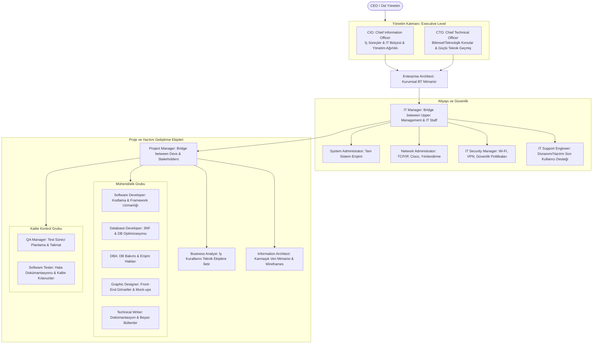

# Mesleki Yabancı Dil I | Unit 5: Choosing an IT Career Path

> [!tip] Sınav Tüyoları ve Çeldiriciler
> 1. **CIO vs. CTO Ayrımı (En Sık Çıkan C-Level Tuzağı):**
>    - **CIO (Chief Information Officer):** İç süreçler (*internal processes and practices*), şirket bütçesi (*IT budget*) ve dış kaynak yönetimi (*staff outsourcing*) ile ilgilenir. **İşletme/yönetim arka planı (business administration background), teknik yönünden daha baskındır.**
>    - **CTO (Chief Technical Officer):** Tüm bilimsel ve teknolojik meselelerden (*scientific and technological issues*) sorumludur. **Teknik yönü (strong technical background), yönetim yönünden daha güçlüdür.** (Derste hoca yedekleme hatası yüzünden kovulan CTO örneğine dikkat çekmiştir).
> 2. **Köprü (Bridge) Görevi Gören Roller Çelişkisi:**
>    - `Upper management` $\longleftrightarrow$ `IT staff` arasında köprü $\rightarrow$ **IT Manager** (*personel gelişimini destekler, IT çalışanının doğrudan amiridir*).
>    - `Developers` $\longleftrightarrow$ `Stakeholders (Paydaşlar)` arasında köprü $\rightarrow$ **PM (Project Manager)** (*projeyi zamanında ve bütçesinde teslim eder, Scrum/Agile kullanır*).
> 3. **Mimari ve Tasarım Rolleri Ayrımı:**
>    - **Enterprise Architect:** İşletmenin *genel ihtiyaçlarını* anlayıp buna uygun kurumsal BT altyapısını tasarlar (*designing an IT structure to support business needs*).
>    - **Information Architect:** Karmaşık veri yapılarını son kullanıcının rahatça anlayıp gezinebileceği hale getirir (*complex data structures easy to understand and navigate, wireframes*).
>    - **Graphic Designer:** Ön yüz (*front-end*) için görsel, tipografi ve maketler (*mock-ups*) tasarlar; Sanat Yönetmeni (*Art Director*) altında çalışır.
> 4. **Veritabanı Rolleri: DBA vs. Database Developer:**
>    - **DBA (Database Administrator):** İlişkisel veritabanlarını yönetir, korur ve **erişim haklarını (access rights)** belirler. İleri düzey SQL, performans ayarlama ve felaket kurtarma ile ilgilenir.
>    - **Database Developer:** Veritabanını **programlar ve optimize eder** (normalizasyon, 3NF - third normal form).
> 5. **Kavram ve Köken Bilgisi:**
>    - **Passive-aggressive (Pasif-agresif):** Bir kişi ya da fikir hakkında olumsuz düşünüp, o kişi ortamda yokken arkasından konuşma (*talking behind someone's back*) davranışıdır; ekip için yıkıcıdır.
>    - **Architect:** Grekçe **arkhi-** (*baş, lider, şef*) + **tekton** (*inşaatçı, zanaatkâr*) $\rightarrow$ **arkhitekton** (*baş mimar/kurucu*). BT'de üst düzey sistem kurucularına (Enterprise / Information Architect) bu ad verilir.

---

## 1. Okuma Metni ve Birebir Akademik Çevirisi

| İngilizce Orijinal Metin | Birebir Türkçe Çevirisi |
| :--- | :--- |
| **Choosing an IT Career Path** | **Bir BT Kariyer Yolu Seçmek** |
| Most people on English4IT.com are either studying for their first job in IT, or else trying to improve their current IT career. | English4IT.com'daki çoğu insan ya bilişim teknolojilerindeki (BT) ilk işleri için eğitim almakta ya da mevcut BT kariyerlerini geliştirmeye çalışmaktadır. |
| If this is the case with you, well then this unit should really help. | Eğer sizin durumunuz da buysa, o halde bu ünite gerçekten yardımcı olacaktır. |
| Sometimes the hardest part of meeting a goal is to properly define what you are trying to accomplish in the first place. | Bazen bir hedefe ulaşmanın en zor kısmı, en başta neyi başarmaya çalıştığınızı doğru bir şekilde tanımlamaktır. |
| In this article we will discuss the top IT job positions available around the world right now. | Bu makalede, şu anda dünya genelinde mevcut olan en popüler BT iş pozisyonlarını ele alacağız. |
| So read the rest of the article, reflect on which career most suits your personality... and then go for it! | Bu nedenle makalenin geri kalanını okuyun, hangi kariyerin kişiliğinize en çok uyduğunu etraflıca düşünün... ve ardından harekete geçin! |
| There are several things to keep in mind when determining what field of IT to go into. | BT'nin hangi alanına yöneleceğinizi belirlerken akılda tutulması gereken birkaç husus vardır. |
| Keep an eye on job web sites such as DICE.com or Monster.com to see which jobs are most in-demand. | Hangi işlerin en çok talep gördüğünü görmek için DICE.com veya Monster.com gibi iş bulma web sitelerini takip edin. |
| Keep in mind that for many jobs described below, there are several levels of positions available. | Aşağıda açıklanan birçok iş için mevcut çeşitli pozisyon kademelerinin bulunduğunu unutmayın. |
| For instance there are "junior", "senior", and "lead" software developer positions available. You probably can't start out your career as a lead developer. You have to know your own limits. | Örneğin "junior" (başlangıç), "senior" (kıdemli) ve "lead" (lider/baş) yazılım geliştirici pozisyonları mevcuttur. Kariyerinize muhtemelen bir baş yazılımcı olarak başlayamazsınız. Kendi sınırlarınızı bilmek zorundasınız. |
| Be honest with yourself. If you don't have previous experience, good contacts, or a good degree from a well-known university, you will be more successful in getting a lower-level job. | Kendinize karşı dürüst olun. Eğer geçmiş deneyiminiz, iyi bağlantılarınız veya tanınmış bir üniversiteden iyi bir diplomanız yoksa, daha alt düzey bir işe kabul edilme konusunda daha başarılı olursunuz. |
| Also, find out what the job you are applying for typically pays in your area. | Ayrıca, başvurduğunuz işin bölgenizde genellikle ne kadar maaş ödediğini öğrenin. |
| If you are young, living in a financially depressed area, or really need a job, keep your salary expectations a bit lower than the average. This will make your chances much higher than normal to get hired. | Eğer gençseniz, maddi olarak sıkıntılı bir bölgede yaşıyorsanız veya gerçekten bir işe ihtiyacınız varsa, maaş beklentinizi ortalamanın biraz altında tutun. Bu durum, işe alınma şansınızı normalden çok daha yüksek kılacaktır. |
| Once you have "job experience" then you will be in a good position to ask for more money. | Bir kez "iş deneyimi" kazandığınızda, daha fazla maaş talep etmek için iyi bir konumda olacaksınız. |
| Sometimes the best way to get more money is to quit your job and work for another similar company. This may sound cruel or thankless, but that is how business works in the real world. | Bazen daha çok para kazanmanın en iyi yolu işinizden ayrılmak ve benzer başka bir şirkette çalışmaktır. Bu kulağa acımasızca veya nankörce gelebilir, ancak iş dünyası gerçek hayatta bu şekilde işler. |
| Everyone who works hard deserves a raise every year. How do you show your IT manager that you are a good performer? Easy. | Çok çalışan herkes her yıl bir maaş artışını hak eder. BT yöneticinize iyi bir çalışan olduğunuzu nasıl gösterirsiniz? Çok kolay. |
| Show up on time, be dependable, be active in the meetings, and always do a little bit more than is asked of you. Also equally important is to be well-liked by members of your team. Read on for more details... | Zamanında gelin, güvenilir olun, toplantılarda aktif olun ve her zaman sizden istenenden bir parça fazlasını yapın. Ekibinizin üyeleri tarafından sevilip takdir edilmek de aynı derecede önemlidir. Daha fazla ayrıntı için okumaya devam edin... |
| **Learn something new every day** | **Her gün yeni bir şey öğrenin** |
| IT is an area where people are judged largely by how much they know. | BT, insanların büyük ölçüde ne kadar bildikleriyle değerlendirildiği bir alandır. |
| If money and a high job position are important to you, you can quickly raise your level by telling your manager that you want harder tasks and more responsibility. | Para ve üst düzey bir makam sizin için önemliyse, yöneticinize daha zorlu görevler ve daha fazla sorumluluk istediğinizi söyleyerek seviyenizi hızla yükseltebilirsiniz. |
| IT Managers normally love it when employees ask for more responsibility. When you meet with your manager, set goals for yourself and meet or exceed those goals. | BT Yöneticileri, çalışanlar daha fazla sorumluluk talep ettiğinde normalde bundan çok memnun olurlar. Yöneticinizle görüştüğünüzde kendinize hedefler belirleyin ve bu hedeflere ulaşın ya da onları aşın. |
| Here are some things you can do to increase your worth to your company: | Şirketinize olan değerinizi artırmak için yapabileceğiniz bazı şeyler şunlardır: |
| 1. learn a new programming language | 1. yeni bir programlama dili öğrenmek |
| 2. take a certification such as Microsoft, Linux Professional Institute, or Cisco | 2. Microsoft, Linux Professional Institute veya Cisco gibi bir sertifika almak |
| 3. study to be a ScrumMaster or another type of project manager. | 3. ScrumMaster veya başka bir tür proje yöneticisi olmak için çalışmak. |
| Meeting set goals can have beneficial results when it's time to renegotiate salaries, survive a round of layoffs, or get a promotion. | Belirlenen hedeflere ulaşmak; maaşları yeniden müzakere etme, işten çıkarma dalgalarından sağ çıkma veya terfi alma zamanı geldiğinde son derece yararlı sonuçlar sağlayabilir. |
| **Appearance and attitude is very important!** | **Görünüm ve tavır çok önemlidir!** |
| Take an active interest in things outside IT: such as sports, politics, music, and film. This will make socializing at company events easier for you. | BT dışındaki konulara aktif bir ilgi gösterin: örneğin spor, siyaset, müzik ve sinema gibi. Bu, şirket etkinliklerinde sosyalleşmenizi kolaylaştıracaktır. |
| If you are disliked in the company then you will not get promotions or important projects. | Şirkette sevilmeyen biri olursanız terfi alamaz veya önemli projelere dahil edilmezsiniz. |
| **Be courteous, helpful, and respectful to others** | **Başkalarına karşı kibar, yardımsever ve saygılı olun** |
| In my own career, I have been in some good IT departments and some bad ones. In a good IT department, the engineers are known for sharing knowledge and helping each other. | Kendi kariyerimde bazı iyi ve bazı kötü BT departmanlarında bulundum. İyi bir BT departmanında mühendisler bilgi paylaşmaları ve birbirlerine yardım etmeleriyle tanınırlar. |
| In bad IT departments, the engineers are secretive and hide knowledge. How can everyone get better if some people are selfish with what they know? | Kötü BT departmanlarında ise mühendisler ketumdur ve bilgiyi saklarlar. Eğer bazı insanlar bildikleri konusunda bencil olursa herkes nasıl kendini geliştirebilir? |
| Information wants to be free. You must set it free. | Bilgi özgür olmak ister. Onu serbest bırakmalısınız. |
| Despite the fact that I have been to several universities, graduate school, and have collected many IT certifications, I have still learned much more about IT from my fellow engineers than from all my higher education combined. | Birçok üniversiteye, lisansüstü eğitime gitmiş ve çok sayıda BT sertifikası toplamış olmama rağmen; BT hakkında meslektaşım olan mühendislerden öğrendiklerim, tüm yüksek öğrenimimin toplamından hala çok daha fazladır. |
| So my advice is to be kind and respect your fellow IT staff. They are your family for eight hours every day, forty hours every week! | Bu yüzden tavsiyem; meslektaşınız olan BT personeline karşı nazik olmanız ve onlara saygı duymanızdır. Onlar her gün sekiz saat, her hafta kırk saat boyunca sizin ailenizdir! |
| When you start a new job, realize how some people are nice to you and some people ignore you. Which kind of person do you want to be? | Yeni bir işe başladığınızda, bazı insanların size nazik davrandığını, bazılarınınsa sizi görmezden geldiğini fark edersiniz. Siz hangi türden bir insan olmak istiyorsunuz? |
| When you get a new junior team member, try to help them and include them in decisions. Make sure they have someone to eat lunch with. | Ekibe yeni bir başlangıç seviyesinde (junior) üye katıldığında, onlara yardımcı olmaya çalışın ve kararlara dahil edin. Birlikte öğle yemeği yiyecek birilerinin olduğundan emin olun. |
| If you party after work with your co-workers, invite new employees with you. Being nice to new people can have many rewards, both emotionally and financially. | Mesai sonrasında iş arkadaşlarınızla eğlenmeye giderseniz, yeni çalışanları da yanınıza davet edin. Yeni insanlara karşı iyi davranmanın hem duygusal hem de finansal olarak pek çok getirisi olabilir. |
| Back in the 90's we used to have a saying, "Think globally, act locally." What this means is that just by being nice and pleasant yourself, you can make the whole world a more nice and pleasant place as well. | 90'larda "Küresel düşün, yerel hareket et" diye bir sözümüz vardı. Bunun anlamı şudur: Sadece kendiniz nazik ve hoşgörülü olarak bile tüm dünyayı daha güzel ve yaşanır bir yer haline getirebilirsiniz. |
| **Have your own mind and your own opinions** | **Kendi zihninize ve kendi görüşlerinize sahip olun** |
| State your opinions in meetings and give good reasons and facts to back up your opinions. But don't be stubborn or insistent if things don't go your way. | Toplantılarda fikirlerinizi belirtin ve düşüncelerinizi desteklemek için geçerli gerekçeler ile somut gerçekler sunun. Ancak işler sizin istediğiniz gibi gitmediğinde inatçı veya ısrarcı olmayın. |
| And whatever you do, please don't be passive-aggressive! Passive-aggressive behavior is when you think something bad about a person or an idea, and then you talk badly behind someone's back (when that person is not around). | Ve ne yaparsanız yapın, lütfen pasif-agresif davranmayın! Pasif-agresif davranış; bir kişi veya bir fikir hakkında kötü düşünmeniz ve ardından o kişi yanınızda yokken arkasından kötü konuşmanız durumudur. |
| This is very destructive behavior to both yourself and your IT department. | Bu, hem kendiniz hem de BT departmanınız için son derece yıkıcı bir davranıştır. |
| Okay, now we are ready to investigate some popular IT job positions. I will rate the following jobs based on the following criteria: respect, qualities, salary, dress, and fun factor. | Pekala, artık bazı popüler BT iş pozisyonlarını incelemeye hazırız. Aşağıdaki işleri şu kriterlere göre derecelendireceğim: saygınlık, nitelikler, maaş, giyim ve eğlence faktörü. |
| I will also include some notes. These are subjective opinions. Some are even intentionally funny. If you disagree with me, please feel free to flame me. | Ayrıca bazı notlar da ekleyeceğim. Bunlar öznel görüşlerdir. Hatta bazıları kasıtlı olarak esprilidir. Benimle aynı fikirde değilseniz, lütfen beni eleştirmekten çekinmeyin. |
| **CTO (Chief Technical Officer), CIO (Chief Information Officer)**<br>• Respect: Very High<br>• Qualities: Business savvy, technical mindset, good people skills<br>• Average Salary: $150,000<br>• Dress: Business suit and very clean<br>• Fun Factor: Only fun if you are a workaholic or on a power trip.<br>• Notes: These jobs are highly competitive and usually political, so your chances are low. Sorry. | **CTO (Şef Teknik Görevli), CIO (Şef Bilgilendirme Görevlisi)**<br>• Saygınlık: Çok Yüksek<br>• Nitelikler: İş dünyasına hakimiyet, teknik zihniyet, iyi insan ilişkileri<br>• Ortalama Maaş: 150.000 $<br>• Giyim: Takım elbise ve son derece temiz/özenli<br>• Eğlence Faktörü: Yalnızca bir işkolikseniz veya güç tutkunuysanız eğlencelidir.<br>• Notlar: Bu pozisyonlar son derece rekabetçidir ve genellikle siyasidir; bu yüzden şansınız düşüktür. Üzgünüm. |
| **Enterprise Architect**<br>• Respect: High<br>• Qualities: Good technical, business, and design skills<br>• Salary: $100,000<br>• Dress: Clean and presentable with collared shirt and pants<br>• Fun Factor: Fun job because you get to talk to all other departments<br>• Notes: Responsible for all solutions that work; not responsible for ones that don't work. | **Kurumsal Mimar**<br>• Saygınlık: Yüksek<br>• Nitelikler: İyi teknik, ticari ve tasarım becerileri<br>• Maaş: 100.000 $<br>• Giyim: Yakalı gömlek ve pantolon ile temiz ve düzgün görünüm<br>• Eğlence Faktörü: Diğer tüm departmanlarla konuşma fırsatı bulduğunuz için eğlenceli bir iştir<br>• Notlar: Çalışan tüm çözümlerden sorumludur; çalışmayanlardan ise sorumlu tutulmaz. |
| **IT Manager**<br>• Respect: Medium-High<br>• Qualities: Detail oriented, punctual, critical, supportive<br>• Salary: $70,000<br>• Dress: Business Casual<br>• Fun Factor: Can be fun but often very stressed<br>• Notes: They always seem to be working. | **BT Yöneticisi**<br>• Saygınlık: Orta-Yüksek<br>• Nitelikler: Detay odaklı, dakik, eleştirel, destekleyici<br>• Maaş: 70.000 $<br>• Giyim: Yarı resmi iş kıyafeti (Business Casual)<br>• Eğlence Faktörü: Eğlenceli olabilir ancak sıklıkla çok streslidir<br>• Notlar: Sürekli çalışıyor gibi görünürler. |
| **Technical Writer**<br>• Respect: Medium<br>• Qualities: Excellent writing skills, good technical mind<br>• Salary: $50,000<br>• Dress: Business Casual<br>• Fun Factor: Writers are often good at telling stories. | **Teknik Yazar**<br>• Saygınlık: Orta<br>• Nitelikler: Mükemmel yazma becerisi, iyi bir teknik zihin yapısı<br>• Maaş: 50.000 $<br>• Giyim: Yarı resmi iş kıyafeti (Business Casual)<br>• Eğlence Faktörü: Yazarlar genellikle iyi hikaye anlatıcılarıdır. |
| **Graphic Designer**<br>• Respect: Low-Medium<br>• Qualities: Excellent drawing and illustration skills, good color matching and artistic qualities<br>• Salary: $50,000<br>• Dress: Casual<br>• Fun Factor: Generally fun people and sometimes a bit moody<br>• Notes: Not as 'square' as the rest of the IT department. All good designers seem to have tattoos, piercings, and a fashion sense. | **Grafik Tasarımcısı**<br>• Saygınlık: Düşük-Orta<br>• Nitelikler: Mükemmel çizim ve illüstrasyon becerisi, iyi renk eşleştirme ve sanatsal nitelikler<br>• Maaş: 50.000 $<br>• Giyim: Günlük / Rahat kıyafet (Casual)<br>• Eğlence Faktörü: Genellikle eğlenceli insanlardır ve bazen biraz dengesiz/huysuz olabilirler<br>• Notlar: BT departmanının geri kalanı kadar kuralcı/sıkıcı ('square') değillerdir. Bütün iyi tasarımcıların dövmeleri, piercingleri ve moda anlayışı var gibidir. |
| **Software Developer**<br>• Respect: Medium<br>• Qualities: Creative, persistent, insatiable thirst for knowledge<br>• Salary: $70,000<br>• Dress: Casual Dress is normally the rule (t-shirt and jeans)<br>• Fun Factor: If you don't have fun being a developer then you have the wrong job; other people might not understand your sense of humor though ;)<br>• Notes: Companies have a lot of developers compared to other positions listed. Therefore your chances of becoming a developer are good if you have the skills and more importantly the desire. | **Yazılım Geliştirici**<br>• Saygınlık: Orta<br>• Nitelikler: Yaratıcı, sebatkâr/ısrarcı, doyumsuz bilgi açlığı<br>• Maaş: 70.000 $<br>• Giyim: Günlük giyim genelde kuraldır (tişört ve kot pantolon)<br>• Eğlence Faktörü: Eğer yazılımcı olmaktan keyif almıyorsanız yanlış iştesiniz demektir; yine de başkaları mizah anlayışınızı anlamayabilir ;)<br>• Notlar: Şirketler listelenen diğer pozisyonlara kıyasla çok sayıda geliştirici istihdam eder. Bu yüzden beceriniz ve daha da önemlisi isteğiniz varsa geliştirici olma şansınız yüksektir. |
| **Project Manager**<br>• Respect: Medium<br>• Qualities: Cooperation, leadership, and organization skills<br>• Salary: $60,000<br>• Dress: Business Casual (collared shirt and nice jeans or pants)<br>• Fun factor: This tends to be a high stress position with long hours. If that sounds fun then go for it! | **Proje Yöneticisi**<br>• Saygınlık: Orta<br>• Nitelikler: İş birliği, liderlik ve organizasyon becerileri<br>• Maaş: 60.000 $<br>• Giyim: Yarı resmi (yakalı gömlek ve düzgün kot veya pantolon)<br>• Eğlence Faktörü: Uzun çalışma saatleri olan yüksek stresli bir pozisyon olma eğilimindedir. Kulağa eğlenceli geliyorsa hiç durmayın! |
| **Database Developer / Database Administrator**<br>• Respect: Medium-High<br>• Qualities: Detail-oriented, high business knowledge<br>• Salary: $80,000<br>• Dress: Business Casual<br>• Fun Factor: If processing giant data sets excite you, then this job is for you. | **Veritabanı Geliştiricisi / Veritabanı Yöneticisi**<br>• Saygınlık: Orta-Yüksek<br>• Nitelikler: Detay odaklı, yüksek iş dünyası bilgisi<br>• Maaş: 80.000 $<br>• Giyim: Yarı resmi iş kıyafeti (Business Casual)<br>• Eğlence Faktörü: Devasa veri kümelerini işlemek sizi heyecanlandırıyorsa bu iş tam size göredir. |
| **IT Security Manager**<br>• Respect: High<br>• Qualities: Military outlook on life, defensive, pro-active<br>• Salary: $70,000<br>• Dress: Smart, clean dress is very important<br>• Fun Factor: Are you kidding me? This guy is basically a cop! | **BT Güvenlik Yöneticisi**<br>• Saygınlık: Yüksek<br>• Nitelikler: Hayata askeri bir bakış açısı, savunmacı, proaktif<br>• Maaş: 70.000 $<br>• Giyim: Şık ve temiz giyim çok önemlidir<br>• Eğlence Faktörü: Dalga mı geçiyorsunuz? Bu adam temelde bir polistir! |
| **System Administrator**<br>• Respect: Medium-High<br>• Qualities: God complex, often eat fast food and drink a lot of soda<br>• Salary: $75,000<br>• Dress: If they were allowed to, they would probably dress as World of Warcraft characters!<br>• Fun Factor: Sysadmins can be patronizing; but they can be fun as well, especially after they have a few beers. They are often eager to show others that they are just "normal people". But this is not usually true.<br>• Notes: Never anger a sysadmin! Why? They have access to everything in the company. | **Sistem Yöneticisi (Sysadmin)**<br>• Saygınlık: Orta-Yüksek<br>• Nitelikler: Tanrı kompleksi, sık sık fast food yer ve çokça gazlı içecek tüketirler<br>• Maaş: 75.000 $<br>• Giyim: İzin verilseydi muhtemelen World of Warcraft karakterleri gibi giyinirlerdi!<br>• Eğlence Faktörü: Sistem yöneticileri üstten bakan/patronluk taslayan biri olabilir; ancak özellikle birkaç kadeh biradan sonra eğlenceli de olabilirler. Genellikle başkalarına sadece "normal insan" olduklarını kanıtlamaya heveslidirler. Ama bu genelde pek doğru değildir.<br>• Notlar: Bir sistem yöneticisini asla kızdırmayın! Neden mi? Şirketteki her şeye erişim yetkileri vardır. |
| **Software Tester**<br>• Respect: Low-Medium<br>• Qualities: Detail-oriented, persistent, curious<br>• Salary: $40,000<br>• Dress: Same as developers<br>• Fun Factor: They are normally seen hanging out with developers, trying to talk about bugs.<br>• Notes: Testers play a vital role in software development that cannot be understated. If you don't have a single tester on your team, you are probably in trouble. | **Yazılım Test Uzmanı**<br>• Saygınlık: Düşük-Orta<br>• Nitelikler: Detay odaklı, sebatkâr/ısrarcı, meraklı<br>• Maaş: 40.000 $<br>• Giyim: Geliştiricilerle aynı (tişört ve kot)<br>• Eğlence Faktörü: Genellikle geliştiricilerle takılıp yazılım hataları (bugs) hakkında konuşmaya çalışırken görülürler.<br>• Notlar: Test uzmanları yazılım geliştirmede hafife alınamayacak hayati bir rol oynarlar. Ekibinizde tek bir test uzmanı dahi yoksa muhtemelen başınız derttedir. |
| **IT Support Engineer**<br>• Respect: Low (except when someone needs help fixing their computer, then it's really high)<br>• Qualities: Must be good at dealing with technically incompetent people<br>• Salary: $35,000<br>• Dress: Casual<br>• Fun Factor: Often an endless source of funny stories about technically incompetent end-users<br>• Notes: Do not kill the end-users! | **BT Destek Mühendisi**<br>• Saygınlık: Düşük (birinin bilgisayarını tamir ettirmesi gerektiği anlar hariç; o zaman saygınlık tavan yapar)<br>• Nitelikler: Teknik açıdan yetersiz insanlarla iletişim kurmakta başarılı olmalıdır<br>• Maaş: 35.000 $<br>• Giyim: Günlük / Rahat kıyafet (Casual)<br>• Eğlence Faktörü: Teknik bilgisi yetersiz son kullanıcılar hakkında genellikle tükenmeyen komik hikayeler kaynağıdır<br>• Notlar: Son kullanıcıları öldürmeyin! |

---

## 2. IT Organizasyon Şeması ve Rol Hiyerarşisi



---

## 3. Haftanın Odak Kelimeleri

### 1. BA (Business Analyst)
* **Resmî Tanım:** `A position responsible for the interpretation of business rules and delivering them to technical systems.`
* **Türkçe Anlamı:** İş Analisti; iş kurallarının analiz edilerek yorumlanmasından ve bu gereksinimlerin teknik ekiplere/sistemlere aktarılmasından sorumlu pozisyondur.
* **Örnek Cümle:** *"A business analyst spends a lot of time gathering relevant business requirements in the initial stages of an IT project."*
* **Sınav Tetikleyicisi (Trigger Words):** **`INTERPRETATION OF BUSINESS RULES`**, **`DELIVERING THEM TO TECHNICAL SYSTEMS`**, **`BUSINESS REQUIREMENTS`**, **`INITIAL STAGES`**.

### 2. CIO (Chief Information Officer)
* **Resmî Tanım:** `An executive position responsible for internal processes and practices; normally has a stronger business administration background than technical background.`
* **Türkçe Anlamı:** Bilgi İşlem Dairesi Başkanı / Şef Bilgilendirme Görevlisi; şirketin iç işleyişinden ve kurumsal uygulamalarından sorumlu, işletme/yönetim arka planı teknik yönüne göre daha baskın olan üst düzey yöneticidir.
* **Örnek Cümle:** *"The CIO's work is often quite varied, ranging from managing a company's IT budget to overseeing staff outsourcing."*
* **Sınav Tetikleyicisi (Trigger Words):** **`EXECUTIVE POSITION`**, **`INTERNAL PROCESSES AND PRACTICES`**, **`STRONGER BUSINESS ADMINISTRATION BACKGROUND`**, **`IT BUDGET`**, **`STAFF OUTSOURCING`**.

### 3. CTO (Chief Technical Officer)
* **Resmî Tanım:** `An executive position responsible for all scientific and technological issues related to a company; normally has a strong technical and somewhat less strong management background.`
* **Türkçe Anlamı:** Şef Teknik Görevli / Teknolojiden Sorumlu Başkan; şirketin tüm bilimsel ve teknolojik meselelerinden sorumlu, teknik birikimi yönetimsel yönüne kıyasla çok daha güçlü olan üst düzey yöneticidir.
* **Örnek Cümle:** *"The CEO decided to fire the CTO after the company's IT department lost a year of financial records due to poor backup procedures."*
* **Sınav Tetikleyicisi (Trigger Words):** **`SCIENTIFIC AND TECHNOLOGICAL ISSUES`**, **`STRONG TECHNICAL BACKGROUND`**, **`SOMEWHAT LESS STRONG MANAGEMENT BACKGROUND`**, **`BACKUP PROCEDURES`**.

### 4. DBA (Database Administrator)
* **Resmî Tanım:** `A person in charge of managing and maintaining relational databases and their access rights.`
* **Türkçe Anlamı:** Veritabanı Yöneticisi; ilişkisel veritabanlarının idaresinden, kesintisiz bakımından ve kullanıcı erişim izinlerinin denetlenmesinden sorumlu kişidir.
* **Örnek Cümle:** *"The requirements for the DBA job position were: advanced SQL, performance tuning, and disaster recover for ORACLE systems."*
* **Sınav Tetikleyicisi (Trigger Words):** **`MANAGING AND MAINTAINING`**, **`RELATIONAL DATABASES`**, **`ACCESS RIGHTS`**, **`ORACLE`**, **`DISASTER RECOVERY`**.

### 5. Database Developer
* **Resmî Tanım:** `A position responsible for programming and optimizing databases.`
* **Türkçe Anlamı:** Veritabanı Geliştiricisi; veritabanı mimarisini kodlayan, tabloları tasarlayan ve veri yapılarını normalize ederek optimize eden pozisyondur.
* **Örnek Cümle:** *"The database developer spent three months refactoring the company database to obtain 3NF (third normal form)."*
* **Sınav Tetikleyicisi (Trigger Words):** **`PROGRAMMING AND OPTIMIZING DATABASES`**, **`REFACTORING`**, **`3NF`**, **`THIRD NORMAL FORM`**.

### 6. Enterprise Architect
* **Resmî Tanım:** `A high-level position responsible for understanding a business's overall needs and then designing an IT structure to support it.`
* **Türkçe Anlamı:** Kurumsal Mimar; işletmenin genel vizyonunu ve ticari gereksinimlerini kavrayarak bu yapıyı destekleyecek bütüncül BT omurgasını tasarlayan üst düzey uzmandır.
* **Örnek Cümle:** *"The firm hired an enterprise architect to oversee the development of the new software platform."*
* **Sınav Tetikleyicisi (Trigger Words):** **`HIGH-LEVEL POSITION`**, **`OVERALL NEEDS`**, **`DESIGNING AN IT STRUCTURE TO SUPPORT IT`**, **`SOFTWARE PLATFORM`**.

### 7. Graphic Designer
* **Resmî Tanım:** `A position responsible for the creation of images, typography, mock-ups for an organization's front end systems; normally works under a company Art Director.`
* **Türkçe Anlamı:** Grafik Tasarımcısı; şirketin ön yüz sistemleri için görsel öğeler, tipografi ve taslak modeller (maketler) hazırlayan, genellikle Sanat Yönetmenine bağlı çalışan uzmandır.
* **Örnek Cümle:** *"The graphic designer had an iMac with a 27\" screen, a graphics tablet instead of a mouse, and the latest version of Adobe Illustrator and Photoshop software."*
* **Sınav Tetikleyicisi (Trigger Words):** **`CREATION OF IMAGES`**, **`TYPOGRAPHY`**, **`MOCK-UPS`**, **`FRONT END SYSTEMS`**, **`ART DIRECTOR`**.

### 8. Information Architect
* **Resmî Tanım:** `A position responsible for making complex data structures easy to understand and navigate; especially critical at the beginning of new software development projects to ensure the application performs in a useful way for its intended end-users.`
* **Türkçe Anlamı:** Bilgi Mimarı; karmaşık veri yapılarını kullanıcılar için anlaşılır ve gezinmesi kolay hale getiren, projelerin başında tel kafes (wireframe) modellemeleri oluşturan uzmandır.
* **Örnek Cümle:** *"The information architect came prepared to the meeting with some wireframes and a glossary of target vocabulary for the project."*
* **Sınav Tetikleyicisi (Trigger Words):** **`COMPLEX DATA STRUCTURES`**, **`EASY TO UNDERSTAND AND NAVIGATE`**, **`WIREFRAMES`**, **`GLOSSARY OF TARGET VOCABULARY`**.

### 9. IT Manager
* **Resmî Tanım:** `A job position acting as a bridge between upper management and IT; one who encourages personal development in IT staff; the boss of an IT worker.`
* **Türkçe Anlamı:** BT Yöneticisi; üst yönetim ile bilişim çalışanları arasında köprü görevi üstlenen, çalışanların kişisel gelişimini teşvik eden ve BT personelinin doğrudan amiri olan kişidir.
* **Örnek Cümle:** *"The IT Manager said the new junior developer's attitude was unacceptable."*
* **Sınav Tetikleyicisi (Trigger Words):** **`BRIDGE BETWEEN UPPER MANAGEMENT AND IT`**, **`ENCOURAGES PERSONAL DEVELOPMENT`**, **`BOSS OF AN IT WORKER`**.

### 10. IT Security Manager
* **Resmî Tanım:** `A position responsible for setting best practices for securing wi-fi networks, servers, backups, laptops, and VPNs.`
* **Türkçe Anlamı:** BT Güvenlik Yöneticisi; kurumsal kablosuz ağların, sunucuların, yedekleme sistemlerinin ve VPN altyapılarının siber güvenliğini sağlamak için en iyi uygulamaları belirleyen kişidir.
* **Örnek Cümle:** *"The IT security manager ran a password cracker on his own network users to sniff out weak passwords."*
* **Sınav Tetikleyicisi (Trigger Words):** **`SECURING WI-FI NETWORKS`**, **`SERVERS, BACKUPS, LAPTOPS, AND VPNS`**, **`PASSWORD CRACKER`**, **`MILITARY OUTLOOK`**.

### 11. IT Support Engineer
* **Resmî Tanım:** `A position responsible for on-demand support for end users including: fixing hardware, installing software, and troubleshooting minor network issues.`
* **Türkçe Anlamı:** BT Destek Mühendisi; donanım arızalarını giderme, yazılım kurma ve küçük ağ problemlerini çözme dahil olmak üzere son kullanıcılara anlık teknik destek sağlayan uzmandır.
* **Örnek Cümle:** *"An IT support engineer must be able to troubleshoot and fix almost any hardware, software, or network problem that can affect an end user's PC."*
* **Sınav Tetikleyicisi (Trigger Words):** **`ON-DEMAND SUPPORT FOR END USERS`**, **`FIXING HARDWARE`**, **`INSTALLING SOFTWARE`**, **`TROUBLESHOOTING MINOR NETWORK ISSUES`**.

### 12. Network Administrator
* **Resmî Tanım:** `A position responsible for maintenance of all aspects of a computer network; often a specialist in TCP/IP, Linux, and related routing technology such as Cisco.`
* **Türkçe Anlamı:** Ağ Yöneticisi; bilgisayar ağının her türlü bakımından sorumlu, TCP/IP, Linux ve Cisco gibi yönlendirme teknolojilerinde uzmanlaşmış teknik personeldir.
* **Örnek Cümle:** *"\"The Network is down\" is a phrase a good network administrator never wants to hear."*
* **Sınav Tetikleyicisi (Trigger Words):** **`MAINTENANCE OF ALL ASPECTS OF A COMPUTER NETWORK`**, **`TCP/IP`**, **`ROUTING TECHNOLOGY`**, **`CISCO`**, **`THE NETWORK IS DOWN`**.

### 13. PM (Project Manager)
* **Resmî Tanım:** `A position responsible for organizing and delivering a project on time and on budget; often acts a bridge between developers and stake-holders.`
* **Türkçe Anlamı:** Proje Yöneticisi; bir projenin zamanında ve belirlenen bütçeyle tamamlanmasından sorumlu olan, yazılımcılar ile paydaşlar arasında köprü vazifesi gören yöneticidir.
* **Örnek Cümle:** *"Software project managers are increasingly turning to Scrum and other Agile practices to get good results from their teams."*
* **Sınav Tetikleyicisi (Trigger Words):** **`ON TIME AND ON BUDGET`**, **`BRIDGE BETWEEN DEVELOPERS AND STAKE-HOLDERS`**, **`SCRUM`**, **`AGILE PRACTICES`**.

### 14. QA Manager (Quality Assurance Manager)
* **Resmî Tanım:** `A job title whose responsibilities include ensuring appropriate performance for a software project and organizing and instructing testers.`
* **Türkçe Anlamı:** Kalite Güvencesi Yöneticisi; yazılım projesinin beklenen performans standartlarına uygunluğunu denetleyen, test uzmanlarını organize edip yönlendiren yöneticidir.
* **Örnek Cümle:** *"The QA manager organized a massive usability test to try to squash bugs before the software's release date."*
* **Sınav Tetikleyicisi (Trigger Words):** **`APPROPRIATE PERFORMANCE FOR A SOFTWARE PROJECT`**, **`ORGANIZING AND INSTRUCTING TESTERS`**, **`USABILITY TEST`**, **`SQUASH BUGS`**.

### 15. Software Developer
* **Resmî Tanım:** `A position responsible for gathering information around a programming task and performing it.`
* **Türkçe Anlamı:** Yazılım Geliştirici; kendisine verilen programlama görevi etrafında gereksinimleri toplayıp kodlama yoluyla görevi icra eden yazılım uzmanıdır.
* **Örnek Cümle:** *"Software developers often specialize in a specific software framework or paradigm such as Java applications, Python, or CSS."*
* **Sınav Tetikleyicisi (Trigger Words):** **`GATHERING INFORMATION AROUND A PROGRAMMING TASK AND PERFORMING IT`**, **`FRAMEWORK`**, **`JAVA, PYTHON, CSS`**.

### 16. Software Tester
* **Resmî Tanım:** `A job title whose responsibilities include ensuring that a software project meets established quality guidelines.`
* **Türkçe Anlamı:** Yazılım Test Uzmanı; geliştirilen yazılımın önceden belirlenmiş kalite yönergelerine ve fonksiyonel standartlara uygun olduğunu teyit eden kişidir.
* **Örnek Cümle:** *"The software tester spent all day documenting a nasty bug in the ERP software."*
* **Sınav Tetikleyicisi (Trigger Words):** **`MEETS ESTABLISHED QUALITY GUIDELINES`**, **`DOCUMENTING A NASTY BUG`**, **`HANGING OUT WITH DEVELOPERS`**.

### 17. Technical Writer
* **Resmî Tanım:** `A position responsible for the creation and maintenance of documentation relating to an IT project including online help, user guides, white papers, and design specifications.`
* **Türkçe Anlamı:** Teknik Yazar; çevrimiçi yardım belgeleri, kullanıcı kılavuzları, teknik raporlar (beyaz bültenler) ve tasarım şartnameleri dahil BT dokümantasyonunu üreten ve güncelleyen kişidir.
* **Örnek Cümle:** *"The technical writer wanted to write novels when she was young, but now she is documenting accounting software applications for IBM."*
* **Sınav Tetikleyicisi (Trigger Words):** **`CREATION AND MAINTENANCE OF DOCUMENTATION`**, **`ONLINE HELP`**, **`USER GUIDES`**, **`WHITE PAPERS`**, **`DESIGN SPECIFICATIONS`**.

---

## 4. Kritik Karşılaştırma ve Tuzak Tabloları

### Karşılaştırma 1: C-Level Üst Yönetim (CIO vs. CTO)

| Kriter | CIO (Chief Information Officer) | CTO (Chief Technical Officer) |
| :--- | :--- | :--- |
| **Ana Odak Alanı** | İç süreçler ve iş uygulamaları (*internal processes & practices*) | Bilimsel ve teknolojik sorunlar (*all scientific & tech issues*) |
| **Arka Plan Ağırlığı** | **İşletme / Yönetim (Business Administration)** > Teknik | **İleri Teknik Birikim (Strong Technical)** > Yönetim |
| **Bütçe ve Kaynak** | BT bütçesi yönetimi ve personel dış kaynak kullanımı (*outsourcing*) | Altyapı teknolojileri ve teknik mimari standartlar |
| **Tipik Sınav Sorusu** | *"responsible for internal processes... stronger business administration background"* | *"responsible for all scientific and technological issues... strong technical background"* |

### Karşılaştırma 2: Çift Taraflı Köprü Rolleri (IT Manager vs. Project Manager)

| Kriter | IT Manager | PM (Project Manager) |
| :--- | :--- | :--- |
| **Köprü Kurduğu Taraflar** | **Üst Yönetim** $\longleftrightarrow$ **BT Personeli** (*Upper management & IT*) | **Geliştiriciler** $\longleftrightarrow$ **Paydaşlar** (*Developers & Stake-holders*) |
| **Ana Misyonu** | Departman personeli gelişimi, personel idaresi ve operasyon amirliği | Projeyi **zamanında** ve **bütçesinde** tamamlama (*on time & on budget*) |
| **Yöntem ve Metodoloji** | Performans hedefleri koyma, yıllık değerlendirmeler | Çevik / Çevrimsel metodolojiler (**Scrum, Agile**) |

### Karşılaştırma 3: Veritabanı Uzmanlıkları (DBA vs. Database Developer)

| Kriter | DBA (Database Administrator) | Database Developer |
| :--- | :--- | :--- |
| **Temel Görev** | Veritabanını **yönetmek, korumak ve bakımını yapmak** | Veritabanını **programlamak ve optimize etmek** |
| **Odak Konular** | **Erişim hakları (Access rights)**, felaket kurtarma, Oracle | Tablo normalizasyonu, yeniden yapılandırma (**3NF / Refactoring**) |
| **Anahtar Fiiller** | Managing, maintaining, securing, recovering | Programming, refactoring, optimizing |

### Karşılaştırma 4: Tasarım ve Mimarlık Rolleri Karşılaştırması

| Rol | Odaklandığı Katman | Temel Çıktı / Anahtar İfade |
| :--- | :--- | :--- |
| **Enterprise Architect** | Kurumsal düzey; iş hedefleri ile BT altyapısı entegrasyonu | *Designing an IT structure to support business's overall needs* |
| **Information Architect** | Veri akışı; son kullanıcı gezinim ergonomisi | *Making complex data structures easy to understand and navigate, wireframes* |
| **Graphic Designer** | Görsel arayüz; ön yüz estetiği | *Creation of images, typography, mock-ups for front end systems* |

---

## 5. Sınav Simülatörü: Çoktan Seçmeli Sorular

```quiz
{
  "title": "Unit 5 - IT Careers Çoktan Seçmeli Test",
  "description": "IT kariyer rolleri, sorumluluk tanımları, C-level ayrımları ve teknik terimlere yönelik 5 soruluk sınav simülatörü.",
  "questions": [
    {
      "id": 1,
      "question": "Which executive job position is formally defined as being \"responsible for internal processes and practices\" and \"normally has a stronger business administration background than technical background\"?",
      "options": [
        {
          "key": "A",
          "text": "CTO (Chief Technical Officer)",
          "isCorrect": false,
          "explanation": "Yanlış. CTO teknik yönü yönetim yönünden daha güçlü olan ve bilimsel konulardan sorumlu liderdir."
        },
        {
          "key": "B",
          "text": "CIO (Chief Information Officer)",
          "isCorrect": true,
          "explanation": "Doğru! Tetikleyici: \"internal processes and practices\" ve \"stronger business administration background than technical background\" doğrudan CIO tanımıdır."
        },
        {
          "key": "C",
          "text": "Enterprise Architect",
          "isCorrect": false,
          "explanation": "Yanlış. Enterprise Architect genel iş ihtiyaçlarına uygun BT altyapısını tasarlar."
        },
        {
          "key": "D",
          "text": "IT Manager",
          "isCorrect": false,
          "explanation": "Yanlış. IT Manager üst yönetim ile IT kadrosu arasında köprüdür, C-level bir executive unvan değildir."
        },
        {
          "key": "E",
          "text": "PM (Project Manager)",
          "isCorrect": false,
          "explanation": "Yanlış. PM projeleri zamanında ve bütçesinde teslim etmekle yükümlüdür."
        }
      ]
    },
    {
      "id": 2,
      "question": "A professional who is primarily responsible for \"making complex data structures easy to understand and navigate\" and usually prepares wireframes at the beginning of a project is a/an:",
      "options": [
        {
          "key": "A",
          "text": "Graphic Designer",
          "isCorrect": false,
          "explanation": "Yanlış. Graphic Designer ön yüz için görsel, tipografi ve mock-up tasarlar."
        },
        {
          "key": "B",
          "text": "Database Developer",
          "isCorrect": false,
          "explanation": "Yanlış. Database Developer veritabanını programlar ve 3NF optimizasyonunu yapar."
        },
        {
          "key": "C",
          "text": "Information Architect",
          "isCorrect": true,
          "explanation": "Doğru! Tetikleyici: \"complex data structures easy to understand and navigate\" ve tel kafes (wireframe) hazırlama görevi şaşmaz bir şekilde Information Architect rolünü gösterir."
        },
        {
          "key": "D",
          "text": "Technical Writer",
          "isCorrect": false,
          "explanation": "Yanlış. Technical Writer kullanım kılavuzları ve dokümantasyon üretir."
        },
        {
          "key": "E",
          "text": "Business Analyst",
          "isCorrect": false,
          "explanation": "Yanlış. Business Analyst iş kurallarını teknik sistemlere aktarır."
        }
      ]
    },
    {
      "id": 3,
      "question": "An employee whose role is defined as \"acting as a bridge between upper management and IT; one who encourages personal development in IT staff\" is the:",
      "options": [
        {
          "key": "A",
          "text": "IT Manager",
          "isCorrect": true,
          "explanation": "Doğru! Tetikleyici: \"bridge between upper management and IT\" ve IT personelinin kişisel gelişimini destekleme görevi IT Manager'a aittir."
        },
        {
          "key": "B",
          "text": "Project Manager",
          "isCorrect": false,
          "explanation": "Yanlış. Project Manager üst yönetim ile değil, \"developers and stake-holders\" arasında köprüdür."
        },
        {
          "key": "C",
          "text": "QA Manager",
          "isCorrect": false,
          "explanation": "Yanlış. QA Manager test ekibini organize eder ve yazılım kalitesini denetler."
        },
        {
          "key": "D",
          "text": "ScrumMaster",
          "isCorrect": false,
          "explanation": "Yanlış. ScrumMaster çevik yazılım süreçlerini kolaylaştırır."
        },
        {
          "key": "E",
          "text": "IT Support Engineer",
          "isCorrect": false,
          "explanation": "Yanlış. IT Support Engineer son kullanıcılara donanım ve yazılım desteği sunar."
        }
      ]
    },
    {
      "id": 4,
      "question": "A company requires an IT specialist in charge of \"managing and maintaining relational databases and their access rights\". Which job title exactly corresponds to this description?",
      "options": [
        {
          "key": "A",
          "text": "Database Developer",
          "isCorrect": false,
          "explanation": "Yanlış. Database Developer veritabanını programlar ve optimize eder (3NF)."
        },
        {
          "key": "B",
          "text": "DBA (Database Administrator)",
          "isCorrect": true,
          "explanation": "Doğru! Tetikleyici: İlişkisel veritabanlarının bakımı, yönetimi ve özellikle \"their access rights (erişim hakları)\" DBA'nın sorumluluğundadır."
        },
        {
          "key": "C",
          "text": "System Administrator",
          "isCorrect": false,
          "explanation": "Yanlış. Sysadmin tüm sunucu ve işletim sistemi ortamından sorumludur."
        },
        {
          "key": "D",
          "text": "Network Administrator",
          "isCorrect": false,
          "explanation": "Yanlış. Network Administrator ağ bakımından ve TCP/IP/Cisco cihazlarından sorumludur."
        },
        {
          "key": "E",
          "text": "Enterprise Architect",
          "isCorrect": false,
          "explanation": "Yanlış. Enterprise Architect genel şirket BT omurgasını tasarlar."
        }
      ]
    },
    {
      "id": 5,
      "question": "Which position is responsible for \"on-demand support for end users including fixing hardware, installing software, and troubleshooting minor network issues\"?",
      "options": [
        {
          "key": "A",
          "text": "Network Administrator",
          "isCorrect": false,
          "explanation": "Yanlış. Network Administrator ağ omurgasının genel bakımından sorumludur."
        },
        {
          "key": "B",
          "text": "Software Tester",
          "isCorrect": false,
          "explanation": "Yanlış. Software Tester yazılımın kalite standartlarını test eder."
        },
        {
          "key": "C",
          "text": "IT Security Manager",
          "isCorrect": false,
          "explanation": "Yanlış. Güvenlik politikaları ve VPN/Wi-Fi güvenliğinden sorumludur."
        },
        {
          "key": "D",
          "text": "IT Support Engineer",
          "isCorrect": true,
          "explanation": "Doğru! Tetikleyici: \"on-demand support for end users\", \"fixing hardware\" ve \"installing software\" ifadeleri IT Support Engineer rolünü tanımlar."
        },
        {
          "key": "E",
          "text": "Technical Writer",
          "isCorrect": false,
          "explanation": "Yanlış. Dokümantasyon ve yardım kılavuzları hazırlar."
        }
      ]
    }
  ]
}
```

---

## 6. Kelime Avı Bulmacası (Word Search Puzzle)

```puzzle
{
  "title": "Unit 5 - IT Careers Word Search",
  "dimensions": {
    "rows": 15,
    "cols": 15
  },
  "grid": [
    [" ", " ", " ", " ", " ", " ", " ", " ", " ", " ", " ", " ", " ", " ", " "],
    [" ", "A", "R", "C", "H", "I", "T", "E", "C", "T", " ", " ", " ", " ", " "],
    [" ", " ", " ", " ", " ", " ", " ", " ", " ", " ", " ", " ", " ", " ", "D"],
    [" ", "D", "A", "T", "A", "B", "A", "S", "E", " ", " ", " ", " ", " ", "E"],
    [" ", " ", " ", " ", " ", " ", " ", " ", " ", " ", " ", " ", " ", " ", "S"],
    [" ", " ", "D", "E", "V", "E", "L", "O", "P", "E", "R", " ", " ", " ", "I"],
    [" ", " ", " ", " ", " ", " ", " ", " ", " ", " ", " ", " ", " ", " ", "G"],
    [" ", "S", "E", "C", "U", "R", "I", "T", "Y", " ", " ", " ", " ", " ", "N"],
    [" ", " ", " ", " ", " ", " ", " ", " ", " ", " ", " ", " ", " ", " ", "E"],
    [" ", " ", "N", "E", "T", "W", "O", "R", "K", " ", " ", " ", " ", " ", "R"],
    [" ", " ", " ", " ", " ", " ", " ", " ", " ", " ", " ", " ", " ", " ", " "],
    [" ", " ", " ", "T", "E", "S", "T", "E", "R", " ", " ", " ", " ", " ", " "],
    [" ", "W", "R", "I", "T", "E", "R", " ", " ", " ", " ", " ", " ", " ", " "],
    [" ", " ", "S", "C", "R", "U", "M", " ", " ", "C", "I", "S", "C", "O", " "],
    [" ", " ", " ", " ", " ", " ", " ", " ", " ", " ", " ", " ", " ", " ", " "]
  ],
  "words": [
    {
      "word": "ARCHITECT",
      "direction": "EAST",
      "start": [1, 1],
      "end": [1, 9],
      "path": [
        [1, 1], [1, 2], [1, 3], [1, 4], [1, 5],
        [1, 6], [1, 7], [1, 8], [1, 9]
      ]
    },
    {
      "word": "DESIGNER",
      "direction": "SOUTH",
      "start": [2, 14],
      "end": [9, 14],
      "path": [
        [2, 14], [3, 14], [4, 14], [5, 14],
        [6, 14], [7, 14], [8, 14], [9, 14]
      ]
    },
    {
      "word": "DATABASE",
      "direction": "EAST",
      "start": [3, 1],
      "end": [3, 8],
      "path": [
        [3, 1], [3, 2], [3, 3], [3, 4],
        [3, 5], [3, 6], [3, 7], [3, 8]
      ]
    },
    {
      "word": "DEVELOPER",
      "direction": "EAST",
      "start": [5, 2],
      "end": [5, 10],
      "path": [
        [5, 2], [5, 3], [5, 4], [5, 5], [5, 6],
        [5, 7], [5, 8], [5, 9], [5, 10]
      ]
    },
    {
      "word": "SECURITY",
      "direction": "EAST",
      "start": [7, 1],
      "end": [7, 8],
      "path": [
        [7, 1], [7, 2], [7, 3], [7, 4],
        [7, 5], [7, 6], [7, 7], [7, 8]
      ]
    },
    {
      "word": "NETWORK",
      "direction": "EAST",
      "start": [9, 2],
      "end": [9, 8],
      "path": [
        [9, 2], [9, 3], [9, 4], [9, 5],
        [9, 6], [9, 7], [9, 8]
      ]
    },
    {
      "word": "TESTER",
      "direction": "EAST",
      "start": [11, 3],
      "end": [11, 8],
      "path": [
        [11, 3], [11, 4], [11, 5], [11, 6], [11, 7], [11, 8]
      ]
    },
    {
      "word": "WRITER",
      "direction": "EAST",
      "start": [12, 1],
      "end": [12, 6],
      "path": [
        [12, 1], [12, 2], [12, 3], [12, 4], [12, 5], [12, 6]
      ]
    },
    {
      "word": "SCRUM",
      "direction": "EAST",
      "start": [13, 2],
      "end": [13, 6],
      "path": [
        [13, 2], [13, 3], [13, 4], [13, 5], [13, 6]
      ]
    },
    {
      "word": "CISCO",
      "direction": "EAST",
      "start": [13, 9],
      "end": [13, 13],
      "path": [
        [13, 9], [13, 10], [13, 11], [13, 12], [13, 13]
      ]
    }
  ]
}
```