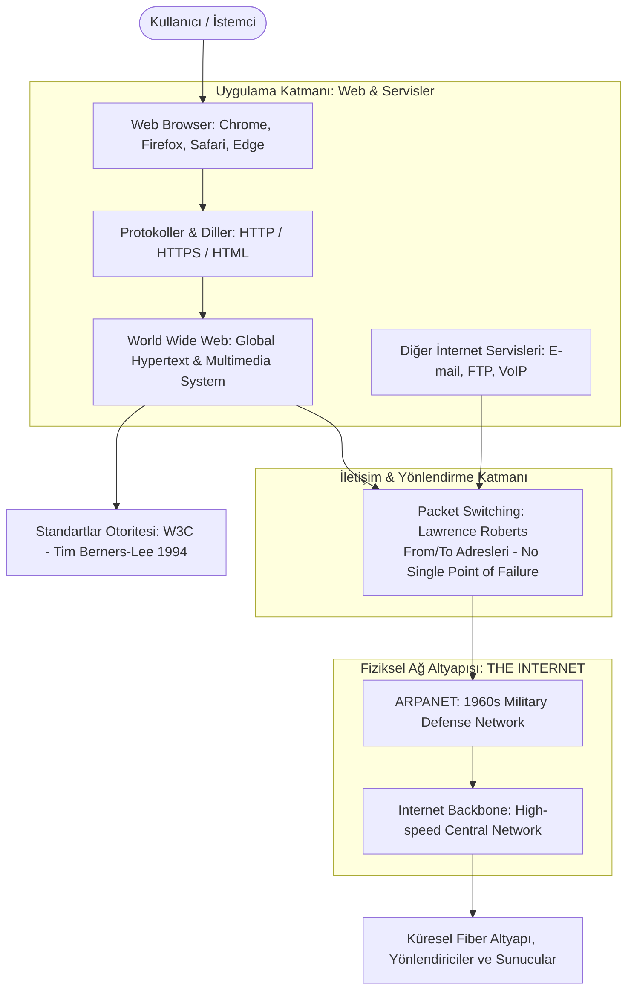

# Mesleki Yabancı Dil I | Unit 6: The Rise of the World Wide Web

> [!tip] Sınav Tüyoları ve Çeldiriciler
> 1. **Internet vs. World Wide Web (WWW) Çelişkisi (En Büyük Sınav Tuzağı):** 
>    - **Internet:** Dünyanın en büyük fiziksel ağ altyapısıdır (*the biggest network in the world*).
>    - **World Wide Web:** İnternet üzerinde çalışan bir yazılım, protokol ve multimedya uygulama katmanıdır (*an application / collection of software and protocols that runs ON the Internet*). 
>    - *Sınav Sorusu Uyarısı:* "Internet ve WWW aynı şeydir" yargısı kesinlikle **YANLIŞTIR**. Biri altyapı (ağ), diğeri onun üzerinde koşan bir uygulamadır.
> 2. **Download vs. Upload Yön Ayrımı:**
>    - `Remote Computer` $\rightarrow$ `User's (Local) Computer` = **Download** (*uzaktan yerele indirme*)
>    - `Local Computer` $\rightarrow$ `Remote Computer` = **Upload** (*yerelden uzağa/sunucuya yükleme*)
> 3. **Hypertext vs. Hyperlink vs. HTML:**
>    - **Hypertext:** 1945'te **Vannevar Bush** tarafından kuramsallaştırılan/öngörülen elektronik çapraz referanslı doküman biçimidir.
>    - **Hyperlink:** Altı çizili bir kelimeye veya görsele tıklayarak ilgili belgeye ulaşmayı sağlayan referans tekniğidir (*cross-reference technique*).
>    - **HTML:** Tarayıcılar için belge yazımında kullanılan etiketleme/kodlama sözdizimidir (*tagging/coding syntax*).
> 4. **Tarihsel İsimler ve Kritik Roller:**
>    - **Tim Berners-Lee:** 1990'da World Wide Web'i icat etmiş, 1994'te Web standartlarını belirleyen **W3C**'yi kurmuştur.
>    - **Lawrence Roberts:** ARPANET'i başarılı kılan ve tek bir arıza noktası olmaksızın (*no single point of failure*) çalışan **Paket Anahtarlama (Packet Switching)** teknolojisinin mucididir.
>    - **Vannevar Bush:** 1945'te Hypertext kavramını ilk kez öngören (*prophesized*) bilim insanıdır.
> 5. **Dot-Com Bubble (Dot-Com Balonu - 1999/2000):**
>    - İnternetin ilk finansal çöküşüdür. Temel iki sebebi: **Yavaş bağlantı hızları (slow connection speeds)** ve **aşırı iyimserlik (too much optimism)**. İnternetin "geçici bir heves (passing fad)" olduğu düşünülmüş, ancak ardından dinamik ve hızlı **Web 2.0** doğmuştur.
> 6. **Ders Notu (Vize Kapsamı):** Hoca derste bu ünitenin (6. Hafta - 21 Ekim 2026) **vize sınavından önceki son konu** olduğunu, sonraki hafta resmi tatil nedeniyle ders işlenmeyeceğini ve vize sınavının ilk 6 haftayı kapsayacağını özellikle vurgulamıştır.

---

## 1. Okuma Metni ve Birebir Akademik Çevirisi

| İngilizce Orijinal Metin | Birebir Türkçe Çevirisi |
| :--- | :--- |
| **The Internet and the Rise of the World Wide Web** | **İnternet ve World Wide Web'in Yükselişi** |
| By the early 1990's, people were using computers in many different ways. | 1990'ların başlarına gelindiğinde, insanlar bilgisayarları birçok farklı şekilde kullanıyorlardı. |
| Computers were already installed in most schools, offices, and homes. | Bilgisayarlar çoğu okulda, ofiste ve evde halihazırda kurulmuş durumdaydı. |
| They were commonly used for writing papers, playing games, financial accounting, and business productivity applications. | Genellikle yazı yazmak, oyun oynamak, finansal muhasebe ve iş verimliliği uygulamaları için kullanılıyorlardı. |
| But very few people used them for communication, research, and shopping the way we do now. | Fakat çok az insan bilgisayarları bugün bizim yaptığımız gibi iletişim, araştırma ve alışveriş amacıyla kullanıyordu. |
| A man named Tim Berners-Lee changed all that. | Tim Berners-Lee adında bir adam bütün bunları değiştirdi. |
| In 1990, Lee added an exciting hypertext and multimedia layer to the Internet and called it the World Wide Web. The rest, as they say, is history. | 1990 yılında Lee, İnternet'e heyecan verici bir köprü metin (hypertext) ve multimedya katmanı ekledi ve buna World Wide Web adını verdi. Gerisi, dedikleri gibi, tarihtir. |
| Believe it or not, the Web was not the first attempt at building a worldwide online community. | İster inanın ister inanmayın, Web dünya çapında çevrimiçi bir topluluk oluşturmaya yönelik ilk girişim değildi. |
| Cutting edge geeks have been using online services such as Compuserve all the way back to the early 1980's. | İleri teknolojiyi takip eden meraklılar (geeks), 1980'lerin başlarına kadar uzanan süreçte CompuServe gibi çevrimiçi hizmetleri kullanıyorlardı. |
| There were thousands of other privately run Bulletin Board Systems (BBS) as well, which served the general interest of curious nerds and researchers from around the world. | Dünyanın dört bir yanından meraklı araştırmacıların ve bilgisayar kurtlarının genel ilgi alanlarına hizmet eden özel olarak işletilen binlerce Bülten Panosu Sistemi (BBS) de mevcuttu. |
| Perhaps the most ambitious project was the French system Minitel, but it never caught on in the rest of the world and eventually faded into obscurity. | Belki de en iddialı proje Fransız sistemi Minitel idi; ancak dünyanın geri kalanında asla tutulmadı ve nihayetinde unutulup gitti (belirsizliğe büründü). |
| Experiences on these BBS was poor by today's standards. There was no graphics or even color. | Bu BBS'lerdeki deneyimler bugünün standartlarına göre oldukça yetersizdi. Hiçbir grafik, hatta renk bile yoktu. |
| There was no sound except of course the obnoxious beeps and gurgles a modem makes when it initiates a dial-up connection to a server. | Bir sunucuya çevirmeli ağ (dial-up) bağlantısı başlattığında modemin çıkardığı o çekilmez bip ve hırıltı sesleri dışında hiçbir ses bulunmuyordu. |
| Bandwidth was also very slow compared to today's speeds. Typical operating speeds were between 300 and 1200 baud. | Bant genişliği de bugünün hızlarına kıyasla çok yavaştı. Tipik çalışma hızları 300 ile 1200 baud arasındaydı. |
| Today, a typical broadband connection is thousands of times faster than this. | Günümüzde tipik bir geniş bant bağlantısı bundan binlerce kat daha hızlıdır. |
| The Web was not built for geeks. It was built for everyone. It was built with very high ideals. | Web, yalnızca bilgisayar meraklıları için inşa edilmedi. Herkes için inşa edildi. Çok yüksek ideallerle kuruldu. |
| No single company, government, or organization controls it. | Tek bir şirket, hükümet veya kuruluş onu kontrol edemez. |
| It was new and exciting. New ideas and words appeared almost daily. | Yeni ve heyecan vericiydi. Neredeyse her gün yeni fikirler ve kelimeler ortaya çıkıyordu. |
| Obscure technical terms became household words overnight. | Anlaşılması güç teknik terimler bir gecede herkesin bildiği ev içi kelimeler haline geldi. |
| First it was email. Then it was URL and domain name. | İlk önce e-posta idi. Sonra URL ve alan adı geldi. |
| Then rather quickly came spam, homepage, hyperlink, bookmark, download, upload, cookie, e-commerce, emoticon, ISP, search engine, and so on. | Ardından oldukça hızlı bir biçimde spam, ana sayfa, köprü metin, yer imi, indirme, yükleme, çerez, e-ticaret, duygu ifadesi (emoticon), ISP, arama motoru ve benzerleri geldi. |
| Years later we are still making up new words to describe our online world. | Yıllar sonra bile çevrimiçi dünyamızı tanımlamak için hala yeni kelimeler türetiyoruz. |
| Now we "google" for information. We "tweet" what's happening around us to others. The new words never seem to stop! | Artık bilgi edinmek için "Google'lıyoruz". Çevremizde olup bitenleri başkalarına "tweet"liyoruz. Yeni kelimeler asla duracak gibi görünmüyor! |
| Just because the web seems so chaotic and unorganized compared to more structured companies and governments, doesn't mean it's total anarchy. | Web'in daha organize şirketlere ve hükümetlere kıyasla böylesine kaotik ve örgütsüz görünmesi, tamamen anarşi olduğu anlamına gelmez. |
| In 1994, Tim Berners-Lee started the W3C, a worldwide organization dedicated to setting standards for the Web. | 1994 yılında Tim Berners-Lee, Web için standartlar belirlemeye adanmış dünya çapında bir organizasyon olan W3C'yi kurdu. |
| This group is probably the most respected authority for what should and should not be Web standards. W3C's mission is to lead the Web to its full potential. | Bu grup, neyin Web standardı olup neyin olmaması gerektiği konusunda muhtemelen en saygı duyulan otoritedir. W3C'nin misyonu, Web'i tam potansiyeline ulaştırmaktır. |
| As a student of English and Technology, you will hear people use the words 'Internet' and 'World Wide Web' almost interchangeably. | Bir İngilizce ve Teknoloji öğrencisi olarak, insanların 'Internet' ve 'World Wide Web' kelimelerini neredeyse birbirinin yerine kullandıklarını duyacaksınız. |
| They are, of course, not the same thing. So what is the difference between the two? | Elbette bunlar aynı şey değildir. Peki ikisi arasındaki fark nedir? |
| Perhaps a simple answer is that the Internet is the biggest network in the world, and the World Wide Web is a collection of software and protocols on that network. | Belki de en basit cevap; İnternet'in dünyadaki en büyük ağ olduğu, World Wide Web'in ise bu ağ üzerindeki bir yazılım ve protokoller bütünü olduğudur. |
| I guess a more simple way to put it is, the World Wide Web is an application that runs on The Internet. | Bunu ifade etmenin daha basit bir yolu sanırım şudur: World Wide Web, İnternet üzerinde çalışan bir uygulamadır. |
| The original backbone of the Internet is based on an old military network called ARPANET which was built by ARPA in the late 1960's. | İnternet'in orijinal omurgası, 1960'ların sonlarında ARPA tarafından inşa edilen ARPANET adlı eski bir askeri ağa dayanmaktadır. |
| ARPANET was built so information could withstand a nuclear war. The idea was not to have a single point of failure. | ARPANET, bilgi bir nükleer savaşa dayanabilsin diye inşa edilmişti. Amaç, tek bir başarısızlık/arıza noktasına sahip olmamaktı. |
| This means if part of the ARPANET was blown up in a nuclear war, the rest of it will still work! | Bu demektir ki, nükleer bir savaşta ARPANET'in bir parçası patlatılsa bile geri kalanı çalışmaya devam edecektir! |
| What made ARPANET so successful was its packet-switching technology, invented by Lawrence Roberts. | ARPANET'i bu kadar başarılı kılan, Lawrence Roberts tarafından icat edilen paket anahtarlama (packet-switching) teknolojisiydi. |
| The idea is that "packets" of information have a "from" address and a "to" address. How they get from point "a" to point "b" depends on what roads are open to them. | Temel fikir, bilgi "paketlerinin" bir "nereden (gönderen)" adresi ve bir "nereye (alıcı)" adresi olmasıdır. "a" noktasından "b" noktasına nasıl ulaşacakları, kendilerine hangi yolların açık olduğuna bağlıdır. |
| Packet switching is a very elegant thing. Without it, the Internet would simply not work. | Paket anahtarlama çok zarif bir buluştur. O olmasaydı, İnternet kesinlikle çalışamazdı. |
| People view the World Wide Web through a software application called a web browser or simply a "browser" for short. | İnsanlar World Wide Web'i, web tarayıcısı ya da kısaca "tarayıcı" adı verilen bir yazılım uygulaması aracılığıyla görüntülerler. |
| Some popular examples of web browsers include Microsoft Internet Explorer, Google Chrome, Mozilla Firefox, and Apple Safari. | Popüler web tarayıcısı örnekleri arasında Microsoft Internet Explorer, Google Chrome, Mozilla Firefox ve Apple Safari yer alır. |
| Browsers allow people to search, view, and even add and edit data on the World Wide Web. | Tarayıcılar insanların World Wide Web üzerinde arama yapmasına, verileri görüntülemesine ve hatta veri ekleyip düzenlemesine olanak tanır. |
| The Web is not supposed to be a passive experience. Creating new pages for the Web is getting easier all the time. | Web'in pasif bir deneyim olması beklenmez. Web için yeni sayfalar oluşturmak her geçen gün kolaylaşmaktadır. |
| Web editing software is specially designed to work with hypertext languages such as HTML, which is the original specification for the Web. | Web düzenleme yazılımları, Web'in orijinal teknik özelliği olan HTML gibi köprü metin dilleriyle çalışmak üzere özel olarak tasarlanmıştır. |
| Web editing software normally allows for the WYSIWYG creation of text, images, and hyperlinks between related documents. | Web düzenleme yazılımı normalde ilgili belgeler arasında metinlerin, resimlerin ve köprülerin WYSIWYG (Ne Görüyorsan Onu Alırsın) yöntemiyle oluşturulmasını sağlar. |
| With web applications such as wikis, MySpace and FaceBook, a typical user can create his or her first online presence in a matter of hours. | Vikiler, MySpace ve Facebook gibi web uygulamaları sayesinde sıradan bir kullanıcı birkaç saat içinde ilk çevrimiçi varlığını oluşturabilir. |
| In the year 1999, the Internet suffered its first financial crash. | 1999 yılında İnternet ilk finansal çöküşünü yaşadı. |
| Many companies selling products and services on the Web were not living up to sales expectations. This was known as the Dot Com Bubble. | Web üzerinden ürün ve hizmet satan birçok şirket satış beklentilerini karşılayamıyordu. Bu kriz Dot-Com Balonu olarak biliniyordu. |
| There were many reasons why this happened, but perhaps the two most important reasons were a combination of slow connection speeds and too much optimism. | Bunun gerçekleşmesinin birçok sebebi vardı; ancak belki de en önemli iki neden yavaş bağlantı hızları ile aşırı iyimserliğin birleşimiydi. |
| Very few people had fast internet connections and many people thought the Internet was "just a passing fad". But we know now that the Internet is not a fad. So what happened? Web 2.0 happened! | Çok az insanın hızlı internet bağlantısı vardı ve birçok insan İnternet'in "yalnızca geçici bir heves" olduğunu düşünüyordu. Ancak şimdi İnternet'in geçici bir heves olmadığını biliyoruz. Peki ne oldu? Web 2.0 ortaya çıktı! |
| What is Web 2.0? It's very hard to say. It's just a phrase to describe a transition from the pre-existing state of 'Web 1.0', which was slow, static, and unusable, to a new, 'second web', which was faster, more dynamic, and more usable for the average person. | Web 2.0 nedir? Bunu tanımlamak çok zordur. Bu, yavaş, statik ve kullanışsız olan önceki 'Web 1.0' durumundan ortalama bir insan için daha hızlı, daha dinamik ve daha kullanışlı olan yeni bir 'ikinci web'e geçişi tanımlayan bir ifadedir. |
| How did these things happen? Easy. Broadband modems enabled sites like video-streaming YouTube to become possible. | Bunlar nasıl gerçekleşti? Çok kolay. Geniş bant modemler, video akışı sağlayan YouTube gibi sitelerin var olabilmesini mümkün kıldı. |
| Better design and development practices enabled social media sites like MySpace and then Facebook to attract hundreds of millions of users. | Daha iyi tasarım ve geliştirme uygulamaları, MySpace ve ardından Facebook gibi sosyal medya sitelerinin yüz milyonlarca kullanıcıyı çekmesini sağladı. |
| Finally, search engine technology improved on sites like Google where people could actually find the information they were looking for. | Son olarak, arama motoru teknolojisi Google gibi sitelerde gelişti ve insanlar aradıkları bilgiyi gerçekten bulabilir hale geldi. |
| What will be the future of the Web? Easy. More speed and more power. | Web'in geleceği ne olacak? Çok basit: Daha fazla hız ve daha fazla güç. |
| In the future, digital distribution on the Internet is likely to replace all other forms of media distribution including CDs, DVDs, and even radio and television broadcasts. | Gelecekte, İnternet üzerindeki dijital dağıtımın CD'ler, DVD'ler ve hatta radyo ile televizyon yayınları dahil olmak üzere diğer tüm medya dağıtım biçimlerinin yerini alması muhtemeldir. |
| I personally feel lucky to be alive in the age of the Web. It is one of the coolest things ever invented. | Şahsen Web çağında hayatta olduğum için kendimi şanslı hissediyorum. İcat edilmiş en havalı şeylerden biridir. |
| It is unlikely that such another wonderful and major revolutionary invention will occur in our lifetime. | Bizim yaşam süremiz içinde böylesine harika ve büyük bir devrim niteliğinde başka bir icadın gerçekleşmesi pek olası değildir. |
| But I can still dream about the Next Big Thing. And who knows? Maybe you will invent it. | Yine de "Bir Sonraki Büyük Şey"in hayalini kurabilirim. Ve kim bilir? Belki de onu siz icat edersiniz. |

---

## 2. İnternet ve Web Mimarisi Şeması



---

## 3. Haftanın Odak Kelimeleri

### 1. ARPANET (Advanced Projects Research Agency Network)
* **Resmî Tanım:** `Developed by the US military for defense purposes, this was the first global network with packet switching.`
* **Türkçe Anlamı:** ABD ordusu tarafından savunma amaçlı geliştirilen, paket anahtarlamalı ilk küresel ağdır.
* **Örnek Cümle:** *"The current public Internet owes a big debt to ARPANET, which was the original global network."*
* **Sınav Tetikleyicisi (Trigger Words):** **`US MILITARY`**, **`DEFENSE PURPOSES`**, **`FIRST GLOBAL NETWORK`**, **`PACKET SWITCHING`**, **`NUCLEAR WAR`**.

### 2. Backbone
* **Resmî Tanım:** `A central high speed network that connects smaller, independent networks.`
* **Türkçe Anlamı:** Omurga; daha küçük, bağımsız ağları birbirine bağlayan merkezi, yüksek hızlı ağdır.
* **Örnek Cümle:** *"Homeland Security is worried that an attack on the Internet backbone could cripple the country for weeks or months."*
* **Sınav Tetikleyicisi (Trigger Words):** **`CENTRAL HIGH SPEED NETWORK`**, **`CONNECTS SMALLER INDEPENDENT NETWORKS`**.

### 3. BBS (Bulletin Board System)
* **Resmî Tanım:** `A predecessor to modern websites, these were early online communities that users could dial into using a modem.`
* **Türkçe Anlamı:** Bülten Panosu Sistemi; kullanıcıların bir modem aracılığıyla çevirmeli bağlanabildiği, modern web sitelerinin öncüsü olan ilk çevrimiçi topluluklardır.
* **Örnek Cümle:** *"The network administrator ran his own BBS as a boy back in the 1980s."*
* **Sınav Tetikleyicisi (Trigger Words):** **`PREDECESSOR TO MODERN WEBSITES`**, **`EARLY ONLINE COMMUNITIES`**, **`DIAL INTO USING A MODEM`**.

### 4. Cookie
* **Resmî Tanım:** `A text file created by web sites which contains personal information about an end user.`
* **Türkçe Anlamı:** Çerez; web siteleri tarafından oluşturulan ve son kullanıcı hakkında kişisel bilgiler barındıran metin dosyasıdır.
* **Örnek Cümle:** *"The web's use of cookies is quite controversial because most users have no idea that their information is being collected and stored on their computer."*
* **Sınav Tetikleyicisi (Trigger Words):** **`TEXT FILE CREATED BY WEB SITES`**, **`CONTAINS PERSONAL INFORMATION`**, **`END USER`**.

### 5. Domain Name
* **Resmî Tanım:** `The unique name which identifies a web site.`
* **Türkçe Anlamı:** Alan Adı; bir web sitesini tanımlayan benzersiz addır.
* **Örnek Cümle:** *"The domain name of Microsoft Corporation is microsoft.com"*
* **Sınav Tetikleyicisi (Trigger Words):** **`UNIQUE NAME`**, **`IDENTIFIES A WEB SITE`**.

### 6. Download
* **Resmî Tanım:** `The transfer of a file or files from a remote computer to the user's computer.`
* **Türkçe Anlamı:** İndirme; bir dosya veya dosyaların uzaktaki bir bilgisayardan (sunucudan) kullanıcının kendi bilgisayarına aktarılması işlemidir.
* **Örnek Cümle:** *"The professor asked us to download the example database from the school's server."*
* **Sınav Tetikleyicisi (Trigger Words):** **`FROM A REMOTE COMPUTER TO THE USER'S COMPUTER`**, **`TRANSFER A FILE`**.

### 7. E-commerce (Electronic Commerce)
* **Resmî Tanım:** `The term for buying and selling goods and services over the world wide web.`
* **Türkçe Anlamı:** E-ticaret; World Wide Web üzerinden mal ve hizmetlerin alınıp satılması sürecini ifade eden terimdir.
* **Örnek Cümle:** *"Although e-commerce started out small, it has grown into a multi-billion dollar industry."*
* **Sınav Tetikleyicisi (Trigger Words):** **`BUYING AND SELLING GOODS AND SERVICES`**, **`OVER THE WORLD WIDE WEB`**.

### 8. Emoticon
* **Resmî Tanım:** `A symbol that uses the characters on a computer keyboard to convey emotion in an email or instant message, such as the smiley face :)`
* **Türkçe Anlamı:** Duygu İfadesi (İfade Simgesi); e-posta veya anlık iletilerde duyguyu aktarmak için bilgisayar klavyesindeki karakterleri kullanan simgedir.
* **Örnek Cümle:** *"One of the most popular emoticons is perhaps the wink and smile ;) which is used to convey irony or satire."*
* **Sınav Tetikleyicisi (Trigger Words):** **`CHARACTERS ON A COMPUTER KEYBOARD`**, **`CONVEY EMOTION`**, **`SMILEY FACE :)`**.

### 9. Hyperlink
* **Resmî Tanım:** `A document cross-reference technique enabling the retrieval of a related document or resource simply by clicking on an underlined word or image.`
* **Türkçe Anlamı:** Köprü (Bağlantı); altı çizili bir kelimeye veya resme tıklayarak ilişkili bir belgenin ya da kaynağın getirilmesini sağlayan çapraz referans tekniğidir.
* **Örnek Cümle:** *"The man made a hyperlink from his personal homepage to his friend's business."*
* **Sınav Tetikleyicisi (Trigger Words):** **`CROSS-REFERENCE TECHNIQUE`**, **`RETRIEVAL OF A RELATED DOCUMENT`**, **`CLICKING ON AN UNDERLINED WORD OR IMAGE`**.

### 10. Hypertext
* **Resmî Tanım:** `Any electronic cross-referencing document first prophesized by Vannevar Bush in 1945.`
* **Türkçe Anlamı:** Hipermetin / Köprü Metin; ilk olarak 1945'te Vannevar Bush tarafından öngörülen, elektronik çapraz referanslama sağlayan metin belgesidir.
* **Örnek Cümle:** *"The woman asked her professor if the textbook was available as hypertext."*
* **Sınav Tetikleyicisi (Trigger Words):** **`ELECTRONIC CROSS-REFERENCING DOCUMENT`**, **`FIRST PROPHESIZED BY VANNEVAR BUSH IN 1945`**.

### 11. HTML (Hypertext Markup Language)
* **Resmî Tanım:** `The coding or tagging syntax used to write documents for web browsers.`
* **Türkçe Anlamı:** Köprü Metni İşaretleme Dili; web tarayıcıları için belgeler yazmak amacıyla kullanılan kodlama veya etiketleme sözdizimidir.
* **Örnek Cümle:** *"A good web developer will know most HTML tags without looking in a book."*
* **Sınav Tetikleyicisi (Trigger Words):** **`CODING OR TAGGING SYNTAX`**, **`WRITE DOCUMENTS FOR WEB BROWSERS`**.

### 12. URL (Uniform Resource Locator)
* **Resmî Tanım:** `The address which specifies the location of a file on the Internet.`
* **Türkçe Anlamı:** Tekdüzen Kaynak Konumlayıcı; İnternet üzerindeki bir dosyanın konumunu/yerini belirten adrestir.
* **Örnek Cümle:** *"One uses a URL to go directly to a particular web site."*
* **Sınav Tetikleyicisi (Trigger Words):** **`ADDRESS WHICH SPECIFIES THE LOCATION`**, **`OF A FILE ON THE INTERNET`**.

### 13. Upload
* **Resmî Tanım:** `To transfer a file from a local computer to a remote computer.`
* **Türkçe Anlamı:** Yüklemek; bir dosyayı yerel bir bilgisayardan uzaktaki bir bilgisayara (sunucuya) aktarmaktır.
* **Örnek Cümle:** *"The boy decided to upload a picture of his new girlfriend to his Facebook page."*
* **Sınav Tetikleyicisi (Trigger Words):** **`FROM A LOCAL COMPUTER TO A REMOTE COMPUTER`**, **`TRANSFER A FILE`**.

### 14. WWW (World Wide Web)
* **Resmî Tanım:** `A global hypertext system operating on the Internet that enables electronic communication of text and multimedia.`
* **Türkçe Anlamı:** Dünya Çapında Ağ; metin ve multimedyanın elektronik iletişimini mümkün kılan ve İnternet üzerinde çalışan küresel köprü metni sistemidir.
* **Örnek Cümle:** *"The World Wide Web is the best thing to happen to computing since birth of the PC."*
* **Sınav Tetikleyicisi (Trigger Words):** **`GLOBAL HYPERTEXT SYSTEM`**, **`OPERATING ON THE INTERNET`**, **`ELECTRONIC COMMUNICATION OF TEXT AND MULTIMEDIA`**.

### 15. W3C (World Wide Web Consortium)
* **Resmî Tanım:** `An organization which develops specifications and guidelines for the World Wide Web.`
* **Türkçe Anlamı:** Dünya Çapında Ağ Konsorsiyumu; World Wide Web için teknik özellikleri, kılavuz ilkeleri ve standartları geliştiren kuruluştur.
* **Örnek Cümle:** *"The W3C recommends that Web developers no longer use font tags in their HTML documents."*
* **Sınav Tetikleyicisi (Trigger Words):** **`ORGANIZATION`**, **`DEVELOPS SPECIFICATIONS AND GUIDELINES`**, **`SETTING STANDARDS FOR THE WEB`**, **`TIM BERNERS-LEE (1994)`**.

---

## 4. Kritik Karşılaştırma ve Tuzak Tabloları

### Karşılaştırma 1: Internet vs. World Wide Web (WWW)

| Kriter | The Internet | World Wide Web (WWW) |
| :--- | :--- | :--- |
| **Tanım** | Dünyanın en büyük fiziksel ağ altyapısı (*the biggest network*) | İnternet üzerinde koşan yazılım ve protokoller bütünü (*an application*) |
| **Köken / Doğuş** | 1960'lar ABD Askeri Savunma Projesi (**ARPANET**) | 1990 - **Tim Berners-Lee** (CERN) |
| **İşlev** | Cihazları ve ağları birbirine bağlar | Hipermetin ve multimedya belgelerini tarayıcıda sunar |
| **Kapsam** | E-posta, FTP, WWW ve oyun sunucularının tamamını taşır | Yalnızca Web sayfalarını (HTTP/HTML vb.) kapsayan katmandır |

### Karşılaştırma 2: Dosya Transfer Yönleri (Download vs. Upload)

| Kriter | Download (İndirme) | Upload (Yükleme) |
| :--- | :--- | :--- |
| **Kaynak (Source)** | **Remote Computer** (Sunucu / Uzak Bilgisayar) | **Local Computer** (Kullanıcının Yerel Bilgisayarı) |
| **Hedef (Destination)**| **User's Computer** (Yerel Bilgisayar) | **Remote Computer** (Sunucu / Uzak Sistem) |
| **Sınav İfadesi** | *from a remote computer to the user's computer* | *from a local computer to a remote computer* |

### Karşılaştırma 3: Web 1.0 vs. Web 2.0 (Dot-Com Bubble Geçişi)

| Özellik | Web 1.0 (1990'lar) | Web 2.0 (2000'ler ve Sonrası) |
| :--- | :--- | :--- |
| **Yapı** | Yavaş (*slow*), statik (*static*), kullanışsız (*unusable*) | Hızlı (*faster*), dinamik (*dynamic*), son derece kullanışlı (*usable*) |
| **Bağlantı Türü** | Dial-up (300-1200 baud), telefon hatlarını meşgul eden modemler | Geniş bant modemler (**Broadband modems**) |
| **Kullanıcı Rolü** | Pasif okuyucu (*passive experience*) | Aktif üretici, içerik paylaşan (*wikis, social media*) |
| **Temsilciler** | Dizin siteleri, tek yönlü statik HTML sayfaları | **YouTube** (video akışı), **Facebook / MySpace**, gelişmiş **Google** |
| **Kriz / Eşik** | 1999-2000 Dot-Com Balonu çöküşü (*financial crash*) | Geniş bant internet ve gelişmiş web tasarım pratikleri |

### Karşılaştırma 4: Hiper-Kavramlar Ayrımı

| Kavram | Tanım Odak Noktası | Anahtar İsim / İfade |
| :--- | :--- | :--- |
| **Hypertext** | Çapraz referanslı elektronik metin mimarisi | **Vannevar Bush (1945)** |
| **Hyperlink** | Altı çizili metne veya resme tıklayarak belge getirme tekniği | *Clicking on an underlined word or image* |
| **HTML** | Web tarayıcılarına içerik yazmak için kullanılan etiketleme sözdizimi | *Coding or tagging syntax* |

---

## 5. Sınav Simülatörü: Çoktan Seçmeli Sorular

```quiz
{
  "title": "Unit 6 - The Internet & The Rise of the Web Sınav Simülatörü",
  "description": "ARPANET, WWW mimarisi, Web standartları ve ağ terimlerine yönelik 5 soruluk vize prova testi.",
  "questions": [
    {
      "id": 1,
      "question": "Which of the following technically describes the fundamental difference between the 'Internet' and the 'World Wide Web'?",
      "options": [
        {
          "key": "A",
          "text": "The Internet was designed solely for multimedia, while the World Wide Web is an old military communication backbone.",
          "isCorrect": false,
          "explanation": "Yanlış. Askeri omurga olan ARPANET ve İnternet'tir; multimedya katmanı ise World Wide Web'dir."
        },
        {
          "key": "B",
          "text": "The Internet is the biggest physical network in the world, whereas the World Wide Web is an application and protocol collection that runs on it.",
          "isCorrect": true,
          "explanation": "Doğru! Tetikleyici: Metne göre 'Internet is the biggest network in the world, and the World Wide Web is an application that runs on The Internet'."
        },
        {
          "key": "C",
          "text": "The World Wide Web was developed in the late 1960s to survive a nuclear war, while the Internet was invented in 1990 by Tim Berners-Lee.",
          "isCorrect": false,
          "explanation": "Yanlış. Tarihler ve roller tam ters verilmiştir; 1960'larda nükleer savaşa dayanacak olan ARPANET'tir, 1990'da Tim Berners-Lee'nin kurduğu ise WWW'dir."
        },
        {
          "key": "D",
          "text": "Both terms are completely identical technical synonyms and can be used interchangeably without any distinction.",
          "isCorrect": false,
          "explanation": "Yanlış. Metinde açıkça 'They are, of course, not the same thing' denilerek birbirinin yerine kullanılamayacağı belirtilmiştir."
        },
        {
          "key": "E",
          "text": "The World Wide Web refers strictly to dial-up hardware devices, while the Internet refers only to web browsers like Chrome and Safari.",
          "isCorrect": false,
          "explanation": "Yanlış. Donanım veya tarayıcı tanımları bu şekilde eşleşmez."
        }
      ]
    },
    {
      "id": 2,
      "question": "What made the original ARPANET network so successful and capable of withstanding a potential nuclear conflict without a 'single point of failure'?",
      "options": [
        {
          "key": "A",
          "text": "The implementation of high-speed broadband modems",
          "isCorrect": false,
          "explanation": "Yanlış. Geniş bant modemler Web 2.0 döneminde ortaya çıkmıştır."
        },
        {
          "key": "B",
          "text": "Its reliance on the French Minitel operating framework",
          "isCorrect": false,
          "explanation": "Yanlış. Minitel Fransa'da ortaya çıkıp dünyaya yayılamadan yok olan bağımsız bir projedir."
        },
        {
          "key": "C",
          "text": "The packet-switching technology invented by Lawrence Roberts",
          "isCorrect": true,
          "explanation": "Doğru! Tetikleyici: 'What made ARPANET so successful was its packet-switching technology, invented by Lawrence Roberts' ifadesidir."
        },
        {
          "key": "D",
          "text": "The WYSIWYG web editing software interface",
          "isCorrect": false,
          "explanation": "Yanlış. WYSIWYG web sayfalarının düzenlenmesiyle ilgili bir arayüz tekniğidir."
        },
        {
          "key": "E",
          "text": "The integration of font tags governed by the W3C consortium",
          "isCorrect": false,
          "explanation": "Yanlış. W3C 1994 yılında kurulmuş ve Web standartları ile ilgilenmiştir."
        }
      ]
    },
    {
      "id": 3,
      "question": "An end user wants to \"transfer a file from a local computer to a remote computer\". Which technical term precisely identifies this operation?",
      "options": [
        {
          "key": "A",
          "text": "Download",
          "isCorrect": false,
          "explanation": "Yanlış. Download dosyanın uzaktan (remote) yerele (local) çekilmesidir."
        },
        {
          "key": "B",
          "text": "Upload",
          "isCorrect": true,
          "explanation": "Doğru! Tetikleyici: 'transfer a file from a local computer to a remote computer' doğrudan Upload teriminin tanımıdır."
        },
        {
          "key": "C",
          "text": "Hyperlink",
          "isCorrect": false,
          "explanation": "Yanlış. Hyperlink belgelere tıklayarak ulaşmayı sağlayan bağlantıdır."
        },
        {
          "key": "D",
          "text": "Backbone",
          "isCorrect": false,
          "explanation": "Yanlış. Backbone merkezi yüksek hızlı omurga ağıdır."
        },
        {
          "key": "E",
          "text": "Bookmark",
          "isCorrect": false,
          "explanation": "Yanlış. Bookmark web tarayıcısında sık kullanılanlar yer imidir."
        }
      ]
    },
    {
      "id": 4,
      "question": "Which of the following is officially defined as \"any electronic cross-referencing document first prophesized by Vannevar Bush in 1945\"?",
      "options": [
        {
          "key": "A",
          "text": "HTML",
          "isCorrect": false,
          "explanation": "Yanlış. HTML tarayıcılar için kodlama/etiketleme sözdizimidir."
        },
        {
          "key": "B",
          "text": "URL",
          "isCorrect": false,
          "explanation": "Yanlış. URL dosyanın internet üzerindeki adresidir."
        },
        {
          "key": "C",
          "text": "Hyperlink",
          "isCorrect": false,
          "explanation": "Yanlış. Hyperlink bir tıklamayla belge getirme tekniğidir."
        },
        {
          "key": "D",
          "text": "Hypertext",
          "isCorrect": true,
          "explanation": "Doğru! Tetikleyici: 1945 yılında 'Vannevar Bush' tarafından öngörülen elektronik çapraz referans dokümanı 'Hypertext'tir."
        },
        {
          "key": "E",
          "text": "Cookie",
          "isCorrect": false,
          "explanation": "Yanlış. Cookie kullanıcı bilgilerini saklayan metin dosyasıdır."
        }
      ]
    },
    {
      "id": 5,
      "question": "The term for \"a text file created by web sites which contains personal information about an end user\" is known as a(n):",
      "options": [
        {
          "key": "A",
          "text": "Emoticon",
          "isCorrect": false,
          "explanation": "Yanlış. Emoticon klavye karakterleriyle duygu belirten simgelerdir."
        },
        {
          "key": "B",
          "text": "Cookie",
          "isCorrect": true,
          "explanation": "Doğru! Tetikleyici: 'a text file created by web sites which contains personal information about an end user' doğrudan Cookie (çerez) tanımıdır."
        },
        {
          "key": "C",
          "text": "Domain name",
          "isCorrect": false,
          "explanation": "Yanlış. Domain name bir web sitesini niteleyen benzersiz addır."
        },
        {
          "key": "D",
          "text": "BBS",
          "isCorrect": false,
          "explanation": "Yanlış. BBS modemle bağlanılan eski çevrimiçi bülten panolarıdır."
        },
        {
          "key": "E",
          "text": "Broadband",
          "isCorrect": false,
          "explanation": "Yanlış. Broadband yüksek hızlı geniş bant bağlantı türüdür."
        }
      ]
    }
  ]
}
```

---

## 6. Kelime Avı Bulmacası (Word Search Puzzle)

```puzzle
{
  "title": "Unit 6 - The Internet & The Web Word Search",
  "dimensions": {
    "rows": 15,
    "cols": 15
  },
  "grid": [
    [" ", " ", " ", " ", " ", " ", " ", " ", " ", " ", " ", " ", " ", " ", " "],
    [" ", "A", "R", "P", "A", "N", "E", "T", " ", " ", " ", " ", "C", " ", " "],
    [" ", " ", " ", " ", " ", " ", " ", " ", " ", " ", " ", " ", "O", " ", " "],
    [" ", " ", "B", "A", "C", "K", "B", "O", "N", "E", " ", " ", "O", " ", "B"],
    ["H", " ", " ", " ", " ", " ", " ", " ", " ", " ", " ", " ", "K", " ", "R"],
    ["T", " ", " ", "E", "M", "O", "T", "I", "C", "O", "N", " ", "I", " ", "O"],
    ["M", " ", " ", " ", " ", " ", " ", " ", " ", " ", " ", " ", "E", " ", "W"],
    ["L", "H", "Y", "P", "E", "R", "L", "I", "N", "K", " ", " ", " ", " ", "S"],
    [" ", " ", " ", " ", " ", " ", " ", " ", " ", " ", " ", " ", " ", " ", "E"],
    [" ", " ", "D", "O", "W", "N", "L", "O", "A", "D", " ", " ", " ", " ", "R"],
    [" ", " ", " ", " ", " ", " ", " ", " ", " ", " ", " ", " ", " ", " ", " "],
    [" ", " ", " ", " ", "U", "P", "L", "O", "A", "D", " ", " ", " ", " ", " "],
    [" ", " ", " ", " ", " ", " ", " ", " ", " ", " ", " ", " ", " ", " ", " "],
    [" ", " ", " ", "D", "O", "M", "A", "I", "N", " ", " ", " ", " ", " ", " "],
    [" ", " ", " ", " ", " ", " ", " ", " ", " ", " ", " ", " ", " ", " ", " "]
  ],
  "words": [
    {
      "word": "ARPANET",
      "direction": "EAST",
      "start": [1, 1],
      "end": [1, 7],
      "path": [
        [1, 1], [1, 2], [1, 3], [1, 4], [1, 5], [1, 6], [1, 7]
      ]
    },
    {
      "word": "COOKIE",
      "direction": "SOUTH",
      "start": [1, 12],
      "end": [6, 12],
      "path": [
        [1, 12], [2, 12], [3, 12], [4, 12], [5, 12], [6, 12]
      ]
    },
    {
      "word": "BACKBONE",
      "direction": "EAST",
      "start": [3, 2],
      "end": [3, 9],
      "path": [
        [3, 2], [3, 3], [3, 4], [3, 5], [3, 6], [3, 7], [3, 8], [3, 9]
      ]
    },
    {
      "word": "BROWSER",
      "direction": "SOUTH",
      "start": [3, 14],
      "end": [9, 14],
      "path": [
        [3, 14], [4, 14], [5, 14], [6, 14], [7, 14], [8, 14], [9, 14]
      ]
    },
    {
      "word": "HTML",
      "direction": "SOUTH",
      "start": [4, 0],
      "end": [7, 0],
      "path": [
        [4, 0], [5, 0], [6, 0], [7, 0]
      ]
    },
    {
      "word": "EMOTICON",
      "direction": "EAST",
      "start": [5, 3],
      "end": [5, 10],
      "path": [
        [5, 3], [5, 4], [5, 5], [5, 6], [5, 7], [5, 8], [5, 9], [5, 10]
      ]
    },
    {
      "word": "HYPERLINK",
      "direction": "EAST",
      "start": [7, 1],
      "end": [7, 9],
      "path": [
        [7, 1], [7, 2], [7, 3], [7, 4], [7, 5], [7, 6], [7, 7], [7, 8], [7, 9]
      ]
    },
    {
      "word": "DOWNLOAD",
      "direction": "EAST",
      "start": [9, 2],
      "end": [9, 9],
      "path": [
        [9, 2], [9, 3], [9, 4], [9, 5], [9, 6], [9, 7], [9, 8], [9, 9]
      ]
    },
    {
      "word": "UPLOAD",
      "direction": "EAST",
      "start": [11, 4],
      "end": [11, 9],
      "path": [
        [11, 4], [11, 5], [11, 6], [11, 7], [11, 8], [11, 9]
      ]
    },
    {
      "word": "DOMAIN",
      "direction": "EAST",
      "start": [13, 3],
      "end": [13, 8],
      "path": [
        [13, 3], [13, 4], [13, 5], [13, 6], [13, 7], [13, 8]
      ]
    }
  ]
}
```