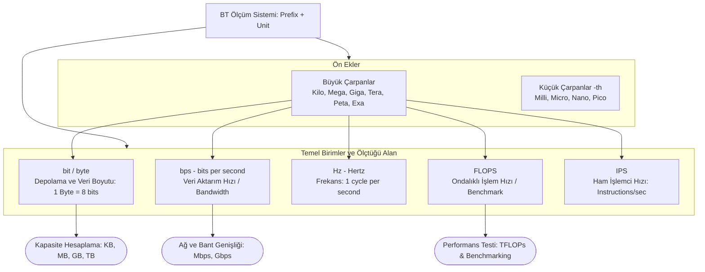

# Mesleki Yabancı Dil I | Unit 8: IT Acronyms and Measurements

> [!tip] Sınav Tüyoları ve Çeldiriciler
> 1. **Final Sınavı Kapsamı ve Taktik:** Hoca derste ilk 6 haftadaki kelimelerin finalde **çıkmayacağını**; final sınavının **7. hafta (Unit 8) ile 14. hafta arasındaki** konulardan oluşacağını belirtti. Ayrıca çoktan seçmeli soruları boş bırakmamak gerektiğini, işaretleme yapmanın %25 doğru bilme şansı sunduğunu vurguladı.
> 2. **Bit vs. Byte (Mülakat ve Sınav Klasiği):** `1 Byte = 8 bits` eşitliği temel kuraldır. Soru kökünde **`0 or 1`**, **`on or off switch`** veya **`smallest unit of storage`** geçerse cevap **Bit** (`binary digit`); **`8 bits`** veya **`single ASCII character`** geçerse cevap **Byte** (`binary term`) olur.
> 3. **Büyük Çarpanlar vs. Küçük Çarpanlar (`-th` Tuzağı):**
>    - Sonunda **`-th`** eki bulunan tanımlar (*one thousandth*, *one millionth*, *one billionth*) kesirli/küçük çarpanlardır: **`milli`** ($10^{-3}$), **`micro`** ($10^{-6}$), **`nano`** ($10^{-9}$).
>    - Sonunda **`-th`** olmayanlar (*one thousand*, *one million*, *one billion*, *one trillion*) büyük çarpanlardır: **`kilo`** ($10^{3}$), **`mega`** ($10^{6}$), **`giga`** ($10^{9}$), **`tera`** ($10^{12}$).
>    - *Dikkat (Resmî Tanım Farkı):* Sözlü anlatımda *nano* için "one trillionth" geçse de resmî kelime listesi ve slaytlarda **Nano = `one billionth`** (bir milyarıncı) olarak tanımlanmıştır; sınavda resmî tanım esas alınır. Ayrıca `microprocessor` ve `nanotechnology` kelimeleri matematiksel ön ekleri tam anlamıyla değil, genel olarak **"really damn small" (gerçekten çok küçük)** anlamında hatalı kullanır.
> 4. **Hız ve Aktarım Birimleri Ayrımı:**
>    - **`bps`** $\rightarrow$ *Data transmission throughput* (veri aktarım hacmi/hızı)
>    - **`Hz (Hertz)`** $\rightarrow$ *Frequency unit / one cycle per second* (frekans birimi)
>    - **`FLOPS`** $\rightarrow$ *Decimal calculations in a given amount of time* (ondalıklı hesaplama hızı)
>    - **`IPS`** $\rightarrow$ *Very raw measurement of computer processor speed* (işlemci hızının ham ölçümü)
> 5. **Moore Yasası (Moore's Law):** En basit tanımıyla yepyeni bir bilgisayarın **5 yıl içinde tamamen modasının geçeceğini** (*completely outdated in five years*) ifade eder.

---

## Okuma Metni ve Birebir Akademik Çevirisi

| İngilizce Orijinal Metin                                                                                                                                                                                                                                | Birebir Türkçe Çevirisi                                                                                                                                                                                                                                                           |
| :------------------------------------------------------------------------------------------------------------------------------------------------------------------------------------------------------------------------------------------------------ | :-------------------------------------------------------------------------------------------------------------------------------------------------------------------------------------------------------------------------------------------------------------------------------- |
| **IT Acronyms and Measurements**                                                                                                                                                                                                                        | **Bilişim Teknolojileri Kısaltmaları ve Ölçüm Birimleri**                                                                                                                                                                                                                         |
| The world of IT is full of acronyms and abbreviations. So is the world of measurements.                                                                                                                                                                 | Bilişim teknolojileri (BT) dünyası, akronimlerle (baş harflerden oluşan kısaltmalarla) ve kısaltmalarla doludur. Ölçümler dünyası da öyledir.                                                                                                                                     |
| That's pretty much a guarantee that everyone working with IT measurements is going to get confused.                                                                                                                                                     | Bu durum, BT ölçümleriyle çalışan herkesin kafasının karışacağının neredeyse garantisidir.                                                                                                                                                                                        |
| For example, what is the difference between an MB and an Mbit? What does ERP or CMS stand for?                                                                                                                                                          | Örneğin, MB ile Mbit arasındaki fark nedir? ERP veya CMS ne anlama gelir?                                                                                                                                                                                                         |
| The above are examples of standard acronyms we hear all the time.                                                                                                                                                                                       | Yukarıdakiler her zaman duyduğumuz standart kısaltma örnekleridir.                                                                                                                                                                                                                |
| Inside every organization there is likely to be a whole range of industry-specific acronyms as well.                                                                                                                                                    | Her kurumun kendi içinde sektöre özgü bir dizi kısaltmanın da bulunması muhtemeldir.                                                                                                                                                                                              |
| For instance, in my company we often talk of LMS, CAT, SEO, SL20, and many, many more.                                                                                                                                                                  | Örneğin, benim şirketimde sık sık LMS, CAT, SEO, SL20 ve daha pek çoğundan bahsederiz.                                                                                                                                                                                            |
| If someone mentions an unfamiliar acronym in your presence, you should ask the person to clarify and explain it.                                                                                                                                        | Birisi sizin yanınızda aşina olmadığınız bir kısaltmadan bahsederse, o kişiden bunu netleştirmesini ve açıklamasını istemelisiniz.                                                                                                                                                |
| Most likely you will not be the only person in the room who feels lost.                                                                                                                                                                                 | Büyük olasılıkla odada kendini kaybolmuş hisseden tek kişi siz olmayacaksınız.                                                                                                                                                                                                    |
| Asking questions is not seen as a sign of weakness in a modern IT department.                                                                                                                                                                           | Modern bir BT departmanında soru sormak bir zayıflık belirtisi olarak görülmez.                                                                                                                                                                                                   |
| It is a sign of curiosity and seeking to better oneself and one's knowledge about a subject.                                                                                                                                                            | Bu; merakın, kendini ve bir konu hakkındaki bilgisini geliştirme arayışının bir göstergesidir.                                                                                                                                                                                    |
| But let's not kid ourselves... in your IT career, you will have acronyms for everything. Soon it will be you confusing newbies with acronyms of your own.                                                                                               | Ama kendimizi kandırmayalım... BT kariyerinizde her şey için kısaltmalarınız olacak. Yakında yeni başlayanların kafasını kendi kısaltmalarınızla karıştıran kişi siz olacaksınız.                                                                                                 |
| **It (IT) needs acronyms because information is constantly expanding out of control**                                                                                                                                                                   | **Bilgi sürekli kontrolden çıkarcasına genişlediği için BT'nin kısaltmalara ihtiyacı vardır**                                                                                                                                                                                     |
| Here are some examples of information explosion:                                                                                                                                                                                                        | İşte bilgi patlamasına dair bazı örnekler:                                                                                                                                                                                                                                        |
| • The CPU at the heart of Apple's iPhone 4 is more powerful than a Cray supercomputer costing millions of dollars from the 1970's.                                                                                                                      | • Apple'ın iPhone 4'ünün kalbinde yer alan işlemci (CPU), 1970'lerden kalma milyonlarca dolar değerindeki bir Cray süper bilgisayarından daha güçlüdür.                                                                                                                           |
| • The software that powers the space shuttle runs on a single MB of RAM. The minimum RAM requirement for Windows 7 is 1 GB (or 1,000 times as much).                                                                                                    | • Uzay mekiğine güç veren yazılım tek bir MB RAM üzerinde çalışır. Windows 7 için minimum RAM gereksinimi ise 1 GB'tır (veya 1.000 katı kadardır).                                                                                                                                |
| • If automobiles had improved their performance at the same rate as computers over the past 50 years, we might all be driving $500 cars that go 5,000 kilometers per hour, and get 500 kilometers per liter of fuel. They would probably fly too. Cool. | • Otomobiller son 50 yılda performanslarını bilgisayarlarla aynı oranda geliştirmiş olsaydı, hepimiz saatte 5.000 kilometre hıza ulaşan ve bir litre yakıtla 500 kilometre giden 500 dolarlık arabalar kullanıyor olabilirdik. Muhtemelen uçarlardı da. Harika.                   |
| • In 1980, a 10MB hard drive cost over $4,000 and was considered to be a lot of storage. Today, you can't even buy a 10MB hard drive. It would be worthless and pointless.                                                                              | • 1980 yılında 10 MB'lık bir sabit disk 4.000 doların üzerindeydi ve çok büyük bir depolama alanı olarak kabul edilirdi. Bugün 10 MB'lık bir sabit disk satın bile alamazsınız. Değersiz ve anlamsız olurdu.                                                                      |
| Even Windows 95, released way back in April 1995, required a 55MB minimum hard drive. Now you can get a TB drive for under a hundred dollars.                                                                                                           | Nisan 1995 gibi eski bir tarihte piyasaya sürülen Windows 95 bile minimum 55 MB sabit disk gerektiriyordu. Şimdi ise 100 doların altında bir fiyata 1 TB'lık bir sürücü alabilirsiniz.                                                                                            |
| • Did you know that in 2010 Youtube transfers more data in one day then (than) the entire Internet did in the year 2000?                                                                                                                                | • 2010 yılında YouTube'un bir günde aktardığı veri miktarının, tüm İnternetin 2000 yılında aktardığından daha fazla olduğunu biliyor muydunuz?                                                                                                                                    |
| **Acronyms and abbreviations are essential to IT. Learning them is easier than you think.**                                                                                                                                                             | **Akronimler ve kısaltmalar BT için vazgeçilmezdir. Bunları öğrenmek düşündüğünüzden daha kolaydır.**                                                                                                                                                                             |
| Computers tend to get more powerful on an order of magnitude over previous generations. Some people have even tried to quantify this phenomenon.                                                                                                        | Bilgisayarlar, önceki nesillere kıyasla katlanarak daha güçlü hale gelme eğilimindedir. Hatta bazı insanlar bu olguyu sayısallaştırmaya (ölçmeye) çalışmıştır.                                                                                                                    |
| One example is Moore's Law. A simple way to explain Moore's Law is that a brand new computer is completely outdated in five years.                                                                                                                      | Bunun bir örneği Moore Yasası'dır. Moore Yasası'nı açıklamanın basit bir yolu, yepyeni bir bilgisayarın beş yıl içinde tamamen modasının geçmiş olacağıdır.                                                                                                                       |
| How do you remember the difference between a kilobyte, megabyte, gigabyte, and a terabyte without going crazy?                                                                                                                                          | Çıldırmadan kilobayt, megabayt, gigabayt ve terabayt arasındaki farkı nasıl aklınızda tutabilirsiniz?                                                                                                                                                                             |
| This is how. Break the terms down into their components. The word "megabyte" consists of two different words... "mega" and "byte".                                                                                                                      | İşte böyle: Terimleri bileşenlerine ayırın. "Megabyte" kelimesi iki farklı kelimeden oluşur... "mega" ve "byte".                                                                                                                                                                  |
| "Mega" is a multiplier prefix found at the start of measurement words which means 1,000,000 (or a million times).                                                                                                                                       | "Mega", ölçüm kelimelerinin başında bulunan ve 1.000.000 (veya bir milyon katı) anlamına gelen bir çarpan ön ekidir.                                                                                                                                                              |
| One "byte" is equal (normally) to 8 "bits". A "bit" is equal to 1 switch "on" or "off" (either a 1 or 0).                                                                                                                                               | Bir "bayt" normalde 8 "bit"e eşittir. Bir "bit" ise "açık" veya "kapalı" durumdaki 1 anahtara (ya 1 ya da 0) eşittir.                                                                                                                                                             |
| It takes between 1 and 3 bytes to hold a letter... depending on what kind of character encoding you are using.                                                                                                                                          | Kullandığınız karakter kodlama türüne bağlı olarak bir harfi tutmak 1 ila 3 bayt arasında yer kaplar.                                                                                                                                                                             |
| So a megabyte is equal to 8,000,000 bits.... or roughly equivalent to 500,000 letters of the alphabet. This is about the length of a short novel.                                                                                                       | Dolayısıyla bir megabayt, 8.000.000 bite eşittir... ya da kabaca alfabedeki 500.000 harfe denktir. Bu da yaklaşık olarak kısa bir romanın uzunluğundadır.                                                                                                                         |
| The prefix giga means 1,000,000,000 or one billion times. So how many bits is in a gigabyte? That's right... 8,000,000,000. Enough to store 1,000 novels.                                                                                               | "Giga" ön eki 1.000.000.000 veya bir milyar katı anlamına gelir. Peki bir gigabaytta kaç bit vardır? Doğru bildiniz... 8.000.000.000. 1.000 romanı depolamaya yetecek kadar.                                                                                                      |
| Once you learn the prefixes and basic units of measure, it's all very easy.                                                                                                                                                                             | Ön ekleri ve temel ölçü birimlerini bir kez öğrendiğinizde gerisi çok kolaydır.                                                                                                                                                                                                   |
| kilo = 1,000 / mega = 1,000,000 / giga = 1,000,000,000 / tera = 1,000,000,000,000 / peta = 1,000,000,000,000,000 / exa = 1,000,000,000,000,000,000                                                                                                      | kilo = 1.000 / mega = 1.000.000 / giga = 1.000.000.000 / tera = 1.000.000.000.000 / peta = 1.000.000.000.000.000 / exa = 1.000.000.000.000.000.000                                                                                                                                |
| There are bigger units of measurement than an exabyte, such as a zettabyte and a yottabyte, but we will not discuss them in this course at this time. But your children and grandchildren will have to know them!                                       | Exabyte'tan daha büyük zettabyte ve yottabyte gibi ölçüm birimleri de vardır; ancak bu derste şimdilik bunları ele almayacağız. Fakat çocuklarınız ve torunlarınız bunları bilmek zorunda kalacak!                                                                                |
| How big is an exabyte? For instance, every word ever spoken by every member of mankind would fill about 5 exabytes of storage space. The Internet transfers around 21 exabytes of data every month.                                                     | Bir exabyte ne kadar büyüktür? Örneğin, insanlığın her bir üyesi tarafından bugüne dek konuşulmuş her kelime yaklaşık 5 exabyte depolama alanını doldurur. İnternet ise her ay yaklaşık 21 exabyte veri aktarmaktadır.                                                            |
| Now those are the "big number" multipliers. In IT however, things are not always big. They can also be very small.                                                                                                                                      | İşte bunlar "büyük sayı" çarpanlarıdır. Ancak BT'de her şey her zaman büyük değildir; çok küçük de olabilirler.                                                                                                                                                                   |
| Unfortunately the "small multipliers" are often used erroneously. For example the words "microprocessor" and "nanotechnology" use mathematical prefixes, but not accurately. What they really mean in general is "really damn small".                   | Ne yazık ki "küçük çarpanlar" sıklıkla hatalı kullanılır. Örneğin "mikroişlemci" ve "nanoteknoloji" kelimeleri matematiksel ön ekler kullanır, ancak bunu kesin/doğru biçimde yapmaz. Genel olarak kastettikleri şey "gerçekten çok küçük" olduğudur.                             |
| milli = .001 / micro = .000 001 / nano = .000 000 001 / pico = .000 000 000 0001                                                                                                                                                                        | milli = 0,001 / micro = 0,000 001 / nano = 0,000 000 001 / pico = 0,000 000 000 0001                                                                                                                                                                                              |
| Now that we know the prefixes... it's time to learn the units. We have already discussed byte and bit. This is a common measurement in computing.                                                                                                       | Artık ön ekleri bildiğimize göre... birimleri öğrenme zamanı geldi. Bayt ve biti zaten ele aldık. Bunlar bilişimde yaygın kullanılan ölçümlerdir.                                                                                                                                 |
| Although computers are much faster now than they were in 1940 (around the time they were invented), they are still digital, meaning that they can only understand zeros and ones (0 and 1).                                                             | Bilgisayarlar günümüzde 1940'ta (icat edildikleri dönemde) olduklarından çok daha hızlı olsalar da hâlâ dijitaldirler; yani yalnızca sıfırları ve birleri (0 ve 1) anlayabilirler.                                                                                                |
| You can put all the prefixes you learned (especially the big ones) onto any of the following units of measurement related to IT: bit, byte, bps, hz, flops, IPS.                                                                                        | Öğrendiğiniz tüm ön ekleri (özellikle büyük olanları) BT ile ilgili şu ölçüm birimlerinden herhangi birinin önüne koyabilirsiniz: bit, byte, bps, hz, flops, IPS.                                                                                                                 |
| What can you do with these measurements? Almost everything! Compute bandwidth, measure processor speed in TFLOPs with a benchmarking program, compare quality of digital cameras or monitors, and much, much more.                                      | Bu ölçümlerle neler yapabilirsiniz? Neredeyse her şeyi! Bant genişliğini hesaplayabilir, bir kıyaslama (benchmark) programıyla işlemci hızını TFLOP cinsinden ölçebilir, dijital kameraların veya monitörlerin kalitesini karşılaştırabilir ve çok daha fazlasını yapabilirsiniz. |
| Have fun, and don't fear IT acronyms and measurements. They are only here to help us.                                                                                                                                                                   | Eğlenin ve BT kısaltmaları ile ölçümlerinden korkmayın. Onlar sadece bize yardımcı olmak için buradalar.                                                                                                                                                                          |

---

## 2. Ölçüm Birimleri, Çarpanlar ve Kullanım Alanları Şeması



---

## 3. Haftanın Odak Kelimeleri

### 1. Bandwidth
* **Resmî Tanım:** `A measure of the capacity of data that can be moved between two points in a given period of time.`
* **Türkçe Anlamı:** Bant Genişliği; belirli bir zaman diliminde iki nokta arasında taşınabilen veri kapasitesinin ölçüsüdür.
* **Örnek Cümle:** *"The website performed very poorly because it was graphically heavy and required more bandwidth than was available."*
* **Sınav Tetikleyicisi (Trigger Words):** **`CAPACITY OF DATA`**, **`MOVED BETWEEN TWO POINTS`**, **`GIVEN PERIOD OF TIME`**.

### 2. Benchmark
* **Resmî Tanım:** `A measurement or standard that serves as a point of reference by which process performance is measured.`
* **Türkçe Anlamı:** Kıyaslama (Ölçüt); işlem performansının ölçüldüğü bir referans noktası görevi gören ölçüm veya standarttır.
* **Örnek Cümle:** *"The magazine article used PCMark 7 scores as a benchmark for computer performance."*
* **Sınav Tetikleyicisi (Trigger Words):** **`POINT OF REFERENCE`**, **`PROCESS PERFORMANCE IS MEASURED`**, **`MEASUREMENT OR STANDARD`**.

### 3. Bit (Binary Digit)
* **Resmî Tanım:** `The smallest unit of storage; normally referred to as a '1' or '0'.`
* **Türkçe Anlamı:** Bit (İkili Rakam); en küçük depolama birimidir ve genellikle `1` veya `0` (açık/kapalı anahtar) olarak adlandırılır.
* **Örnek Cümle:** *"The DBA 'flipped a bit' in the database, changing a value from a 0 to 1."*
* **Sınav Tetikleyicisi (Trigger Words):** **`SMALLEST UNIT OF STORAGE`**, **`1 OR 0`**, **`BINARY DIGIT`**, **`ON OR OFF SWITCH`**.

### 4. Byte (Binary Term)
* **Resmî Tanım:** `8 bits.`
* **Türkçe Anlamı:** Bayt (İkili Terim); 8 bitten oluşan temel veri birimidir (tek bir ASCII karakterini tutmaya yeterlidir).
* **Örnek Cümle:** *"One byte of data is enough memory to hold a single ASCII character."*
* **Sınav Tetikleyicisi (Trigger Words):** **`8 BITS`**, **`BINARY TERM`**, **`SINGLE ASCII CHARACTER`**.

### 5. bps (Bits Per Second)
* **Resmî Tanım:** `A common measurement of data transmission throughput.`
* **Türkçe Anlamı:** Saniyede Bit; veri aktarımı iş hacminin (aktarım hızının) yaygın bir ölçüsüdür.
* **Örnek Cümle:** *"Modern Internet connection speeds are no longer measured in bps, but in Mbps."*
* **Sınav Tetikleyicisi (Trigger Words):** **`DATA TRANSMISSION THROUGHPUT`**, **`BITS PER SECOND`**, **`MBPS`**.

### 6. FLOPS (Floating Point Operations Per Second)
* **Resmî Tanım:** `A common measurement of computer speed dealing with decimal calculations in a given amount of time.`
* **Türkçe Anlamı:** Saniyedeki Kayan Nokta İşlemleri; belirli bir zaman diliminde ondalıklı hesaplamalarla uğraşan yaygın bir bilgisayar hız ölçümüdür.
* **Örnek Cümle:** *"The more FLOPS a computer can do, the faster it is."*
* **Sınav Tetikleyicisi (Trigger Words):** **`DECIMAL CALCULATIONS`**, **`COMPUTER SPEED`**, **`FLOATING POINT`**, **`GIVEN AMOUNT OF TIME`**.

### 7. Giga
* **Resmî Tanım:** `One billion.`
* **Türkçe Anlamı:** Giga; bir milyar ($10^9$) anlamına gelen ve kökeni Yunanca "dev" (*giant*) kelimesine dayanan çarpan ön ekidir.
* **Örnek Cümle:** *"The word giga originally comes from the Greek word for 'giant'."*
* **Sınav Tetikleyicisi (Trigger Words):** **`ONE BILLION`**, **`GREEK WORD FOR GIANT`**, **`1,000,000,000`**.

### 8. Hz (Hertz)
* **Resmî Tanım:** `An internationally used frequency unit; equals one cycle per second.`
* **Türkçe Anlamı:** Hertz; saniyede bir döngüye eşit olan ve uluslararası düzeyde kullanılan frekans birimidir.
* **Örnek Cümle:** *"A human being can hear sound waves from 20Hz to 20,000Hz."*
* **Sınav Tetikleyicisi (Trigger Words):** **`FREQUENCY UNIT`**, **`ONE CYCLE PER SECOND`**, **`INTERNATIONALLY USED`**.

### 9. IPS (Instructions Per Second)
* **Resmî Tanım:** `A very raw measurement of computer processor speed.`
* **Türkçe Anlamı:** Saniye Başına Talimat; bilgisayar işlemcisi hızının oldukça ham bir ölçüm birimidir (genellikle milyonluk birim olan MIPS ile ifade edilir).
* **Örnek Cümle:** *"IPS is a base measurement of computer speed often expressed in millions (MIPS)."*
* **Sınav Tetikleyicisi (Trigger Words):** **`VERY RAW MEASUREMENT`**, **`PROCESSOR SPEED`**, **`INSTRUCTIONS PER SECOND`**, **`MIPS`**.

### 10. K (Kilo)
* **Resmî Tanım:** `One thousand.`
* **Türkçe Anlamı:** Kilo; bin ($10^3$) anlamına gelen çarpan ön ekidir (ikili sistemde 1 kilobayt 1024 bayttır).
* **Örnek Cümle:** *"A kilobyte is 1024 bytes."*
* **Sınav Tetikleyicisi (Trigger Words):** **`ONE THOUSAND`**, **`1,000`**, **`1024 BYTES`**.

### 11. M (Mega)
* **Resmî Tanım:** `One million.`
* **Türkçe Anlamı:** Mega; bir milyon ($10^6$) anlamına gelen çarpan ön ekidir (ikili sistemde 1 megabayt 1.048.576 bayttır).
* **Örnek Cümle:** *"One megabyte is 1,048,576 bytes."*
* **Sınav Tetikleyicisi (Trigger Words):** **`ONE MILLION`**, **`1,000,000`**, **`1,048,576 BYTES`**.

### 12. Micro
* **Resmî Tanım:** `One millionth.`
* **Türkçe Anlamı:** Mikro; bir milyonda bir / bir milyonuncu ($10^{-6}$) anlamına gelen küçük çarpan ön ekidir.
* **Örnek Cümle:** *"Although micro means 'one-millionth', many people use it to express simply 'a great deal of smallness'."*
* **Sınav Tetikleyicisi (Trigger Words):** **`ONE MILLIONTH`**, **`.000 001`**, **`GREAT DEAL OF SMALLNESS`**.

### 13. Milli
* **Resmî Tanım:** `A prefix meaning one thousandth.`
* **Türkçe Anlamı:** Mili; binde bir ($10^{-3}$) anlamına gelen küçük çarpan ön ekidir.
* **Örnek Cümle:** *"One millitesla is one-thousandth of a tesla."*
* **Sınav Tetikleyicisi (Trigger Words):** **`ONE THOUSANDTH`**, **`.001`**, **`PREFIX MEANING`**.

### 14. Nano
* **Resmî Tanım:** `One billionth.`
* **Türkçe Anlamı:** Nano; bir milyarda bir / bir milyarıncı ($10^{-9}$) anlamına gelen küçük çarpan ön ekidir.
* **Örnek Cümle:** *"The teacher said the word 'nano' can also be used for anything very small, such as nanotechnology."*
* **Sınav Tetikleyicisi (Trigger Words):** **`ONE BILLIONTH`**, **`.000 000 001`**, **`NANOTECHNOLOGY`**.

### 15. T (Tera)
* **Resmî Tanım:** `One trillion.`
* **Türkçe Anlamı:** Tera; bir trilyon ($10^{12}$) anlamına gelen büyük çarpan ön ekidir.
* **Örnek Cümle:** *"There are 1,099,511,627,776 bytes in a terabyte."*
* **Sınav Tetikleyicisi (Trigger Words):** **`ONE TRILLION`**, **`1,000,000,000,000`**, **`TERABYTE`**.

---

## 4. Kritik Karşılaştırma ve Tuzak Tabloları

### Karşılaştırma 1: Büyük Sayı Çarpanları (Big Number Multipliers)

| Ön Ek | Sayısal Karşılığı | İngilizce Tanım | Örnek / Not |
| :--- | :--- | :--- | :--- |
| **Kilo (K)** | $1.000$ | **One thousand** | 1 KB = 1024 bytes (ikili sistemde) |
| **Mega (M)** | $1.000.000$ | **One million** | 1 MB = 8 milyon bit $\approx$ 500.000 harf (kısa roman) |
| **Giga (G)** | $1.000.000.000$ | **One billion** | 1 GB = 8 milyar bit $\approx$ 1.000 roman |
| **Tera (T)** | $1.000.000.000.000$ | **One trillion** | 1 TB sürücü günümüzde 100 doların altında |
| **Peta (P)** | $10^{15}$ | **One quadrillion** | Yüksek ölçekli veri merkezi birimi |
| **Exa (E)** | $10^{18}$ | **One quintillion** | İnsanlığın tüm sözleri $\approx 5$ exabyte |
| *Zetta / Yotta* | *Exabyte'tan büyük* | *—* | Bu derste işlenmiyor; gelecek nesillerin bilmesi gerekenler |

### Karşılaştırma 2: Küçük Sayı Çarpanları (`-th` Eki Alanlar)

| Ön Ek | Ondalık Karşılığı | İngilizce Tanım | Sınav Tuzağı |
| :--- | :--- | :--- | :--- |
| **Milli** | `.001` | **One thousandth** | *Kilo* (`one thousand`) ile karıştırma! |
| **Micro** | `.000 001` | **One millionth** | *Mega* (`one million`) ile karıştırma! |
| **Nano** | `.000 000 001` | **One billionth** | *Giga* (`one billion`) ile karıştırma! |
| **Pico** | `.000 000 000 0001` *(metinde)* | **One quadrillionth** | Çok küçük çarpan örneği |

### Karşılaştırma 3: Hız, Frekans ve Kapasite Birimleri

| Birim / Kısaltma | Açılımı | Ölçtüğü Alan / Tetikleyici İfade |
| :--- | :--- | :--- |
| **bit** | Binary Digit | En küçük depolama birimi (`0` veya `1`) |
| **byte** | Binary Term | `8 bits` (tek bir ASCII karakteri tutar) |
| **bps** | Bits Per Second | Veri aktarım hızı (*data transmission throughput*) |
| **Hz** | Hertz | Frekans birimi (*one cycle per second*) |
| **FLOPS** | Floating Point Operations Per Second | Ondalıklı hesaplama hızı (*decimal calculations*) |
| **IPS** | Instructions Per Second | İşlemci hızının ham ölçümü (*very raw measurement*) |

---

## 5. Sınav Simülatörü: Çoktan Seçmeli Sorular

```quiz
{
  "title": "Unit 8 - IT Acronyms and Measurements Çoktan Seçmeli Test",
  "description": "Ölçüm birimleri, çarpan ön ekleri ve BT kısaltmalarına yönelik 5 soruluk sınav simülatörü.",
  "questions": [
    {
      "id": 1,
      "question": "Which of the following is defined as \"a common measurement of computer speed dealing with decimal calculations in a given amount of time\"?",
      "options": [
        {
          "key": "A",
          "text": "IPS (Instructions Per Second)",
          "isCorrect": false,
          "explanation": "Yanlış. IPS, işlemci hızının çok ham bir ölçümüdür (very raw measurement); ondalıklı hesaplamalarla ilgili değildir."
        },
        {
          "key": "B",
          "text": "bps (Bits Per Second)",
          "isCorrect": false,
          "explanation": "Yanlış. bps, veri aktarım iş hacminin (data transmission throughput) ölçüsüdür."
        },
        {
          "key": "C",
          "text": "FLOPS (Floating Point Operations Per Second)",
          "isCorrect": true,
          "explanation": "Doğru! Tetikleyici: \"dealing with decimal calculations in a given amount of time\" ifadesi doğrudan FLOPS tanımıdır."
        },
        {
          "key": "D",
          "text": "Hz (Hertz)",
          "isCorrect": false,
          "explanation": "Yanlış. Hertz, saniyedeki bir döngüye eşit olan uluslararası frekans birimidir."
        }
      ]
    },
    {
      "id": 2,
      "question": "What is \"a measurement or standard that serves as a point of reference by which process performance is measured\"?",
      "options": [
        {
          "key": "A",
          "text": "Bandwidth",
          "isCorrect": false,
          "explanation": "Yanlış. Bandwidth, belirli bir sürede iki nokta arasında taşınabilen veri kapasitesinin ölçüsüdür."
        },
        {
          "key": "B",
          "text": "Benchmark",
          "isCorrect": true,
          "explanation": "Doğru! Tetikleyici: \"point of reference by which process performance is measured\" ifadesi Benchmark (Kıyaslama) kavramını tanımlar."
        },
        {
          "key": "C",
          "text": "Byte",
          "isCorrect": false,
          "explanation": "Yanlış. Byte, 8 bitten oluşan temel ikili terimdir."
        },
        {
          "key": "D",
          "text": "Moore's Law",
          "isCorrect": false,
          "explanation": "Yanlış. Moore Yasası, yepyeni bir bilgisayarın 5 yıl içinde modasının geçeceğini ifade eder."
        }
      ]
    },
    {
      "id": 3,
      "question": "Which multiplier prefix means \"one millionth\" and is often used colloquially to express simply \"a great deal of smallness\"?",
      "options": [
        {
          "key": "A",
          "text": "Mega",
          "isCorrect": false,
          "explanation": "Yanlış. Mega \"one million\" (bir milyon) anlamına gelir; kesirli değildir."
        },
        {
          "key": "B",
          "text": "Milli",
          "isCorrect": false,
          "explanation": "Yanlış. Milli \"one thousandth\" (binde bir) anlamına gelir."
        },
        {
          "key": "C",
          "text": "Micro",
          "isCorrect": true,
          "explanation": "Doğru! Tetikleyici: \"one millionth\" (bir milyonda bir) ve \"a great deal of smallness\" doğrudan Micro tanımıdır."
        },
        {
          "key": "D",
          "text": "Nano",
          "isCorrect": false,
          "explanation": "Yanlış. Nano kelime listesinde \"one billionth\" (bir milyarda bir) olarak tanımlanır."
        }
      ]
    },
    {
      "id": 4,
      "question": "Which unit of measurement is described as \"the smallest unit of storage; normally referred to as a '1' or '0'\"?",
      "options": [
        {
          "key": "A",
          "text": "Bit",
          "isCorrect": true,
          "explanation": "Doğru! Tetikleyici: \"smallest unit of storage\" ve \"1 or 0\" doğrudan Bit (binary digit) tanımıdır."
        },
        {
          "key": "B",
          "text": "Byte",
          "isCorrect": false,
          "explanation": "Yanlış. Byte 8 bitten oluşur ve en küçük depolama birimi değildir."
        },
        {
          "key": "C",
          "text": "Kilo",
          "isCorrect": false,
          "explanation": "Yanlış. Kilo \"one thousand\" (bin) anlamına gelen bir çarpan ön ekidir."
        },
        {
          "key": "D",
          "text": "Hertz",
          "isCorrect": false,
          "explanation": "Yanlış. Hertz saniyede bir döngüye eşit frekans birimidir."
        }
      ]
    },
    {
      "id": 5,
      "question": "According to the reading text, what is the simple way to explain Moore's Law?",
      "options": [
        {
          "key": "A",
          "text": "Every word ever spoken by mankind fills 5 exabytes of storage.",
          "isCorrect": false,
          "explanation": "Yanlış. Bu ifade bir exabyte'ın ne kadar büyük olduğunu anlatan bir örnektir."
        },
        {
          "key": "B",
          "text": "A brand new computer is completely outdated in five years.",
          "isCorrect": true,
          "explanation": "Doğru! Metinde Moore Yasası'nı açıklamanın basit yolu olarak yepyeni bir bilgisayarın 5 yıl içinde tamamen modasının geçeceği belirtilmiştir."
        },
        {
          "key": "C",
          "text": "One byte is normally equal to eight bits.",
          "isCorrect": false,
          "explanation": "Yanlış. Bu bilgi bayt ve bit arasındaki temel eşitliği ifade eder."
        },
        {
          "key": "D",
          "text": "Small multipliers are accurately used in words like microprocessor.",
          "isCorrect": false,
          "explanation": "Yanlış. Aksine metin, bu kelimelerde küçük çarpanların hatalı (erroneously) kullanıldığını söyler."
        }
      ]
    }
  ]
}
```

---

## 6. Kelime Avı Bulmacası (Word Search Puzzle)

```puzzle
{
  "title": "Unit 8 - IT Acronyms and Measurements Word Search",
  "dimensions": {
    "rows": 15,
    "cols": 15
  },
  "grid": [
    [" ", " ", " ", " ", " ", " ", " ", " ", " ", " ", " ", " ", " ", " ", " "],
    [" ", "B", "A", "N", "D", "W", "I", "D", "T", "H", " ", " ", " ", "A", " "],
    ["H", " ", " ", " ", " ", " ", " ", " ", " ", " ", " ", " ", " ", "C", " "],
    ["E", " ", "B", "E", "N", "C", "H", "M", "A", "R", "K", " ", " ", "R", " "],
    ["R", " ", " ", " ", " ", " ", " ", " ", " ", " ", " ", " ", " ", "O", " "],
    ["T", "G", "I", "G", "A", "B", "Y", "T", "E", " ", " ", " ", " ", "N", " "],
    ["Z", " ", " ", " ", " ", " ", " ", " ", " ", " ", " ", "M", " ", "Y", " "],
    [" ", " ", " ", "T", "E", "R", "A", "B", "Y", "T", "E", "I", " ", "M", " "],
    [" ", " ", " ", " ", " ", " ", " ", " ", " ", " ", " ", "L", " ", "S", " "],
    [" ", " ", "F", "L", "O", "P", "S", " ", " ", " ", " ", "L", " ", " ", " "],
    [" ", " ", " ", " ", " ", " ", " ", " ", " ", " ", " ", "I", " ", " ", " "],
    [" ", " ", " ", " ", "M", "I", "C", "R", "O", " ", " ", " ", " ", " ", " "],
    [" ", " ", " ", " ", " ", " ", " ", " ", " ", " ", " ", " ", " ", " ", " "],
    [" ", " ", "B", "Y", "T", "E", " ", " ", " ", " ", " ", " ", " ", " ", " "],
    [" ", " ", " ", " ", " ", " ", " ", " ", " ", " ", " ", " ", " ", " ", " "]
  ],
  "words": [
    {
      "word": "BANDWIDTH",
      "direction": "EAST",
      "start": [1, 1],
      "end": [1, 9],
      "path": [
        [1, 1], [1, 2], [1, 3], [1, 4], [1, 5],
        [1, 6], [1, 7], [1, 8], [1, 9]
      ]
    },
    {
      "word": "ACRONYMS",
      "direction": "SOUTH",
      "start": [1, 13],
      "end": [8, 13],
      "path": [
        [1, 13], [2, 13], [3, 13], [4, 13],
        [5, 13], [6, 13], [7, 13], [8, 13]
      ]
    },
    {
      "word": "HERTZ",
      "direction": "SOUTH",
      "start": [2, 0],
      "end": [6, 0],
      "path": [
        [2, 0], [3, 0], [4, 0], [5, 0], [6, 0]
      ]
    },
    {
      "word": "BENCHMARK",
      "direction": "EAST",
      "start": [3, 2],
      "end": [3, 10],
      "path": [
        [3, 2], [3, 3], [3, 4], [3, 5], [3, 6],
        [3, 7], [3, 8], [3, 9], [3, 10]
      ]
    },
    {
      "word": "GIGABYTE",
      "direction": "EAST",
      "start": [5, 1],
      "end": [5, 8],
      "path": [
        [5, 1], [5, 2], [5, 3], [5, 4],
        [5, 5], [5, 6], [5, 7], [5, 8]
      ]
    },
    {
      "word": "MILLI",
      "direction": "SOUTH",
      "start": [6, 11],
      "end": [10, 11],
      "path": [
        [6, 11], [7, 11], [8, 11], [9, 11], [10, 11]
      ]
    },
    {
      "word": "TERABYTE",
      "direction": "EAST",
      "start": [7, 3],
      "end": [7, 10],
      "path": [
        [7, 3], [7, 4], [7, 5], [7, 6],
        [7, 7], [7, 8], [7, 9], [7, 10]
      ]
    },
    {
      "word": "FLOPS",
      "direction": "EAST",
      "start": [9, 2],
      "end": [9, 6],
      "path": [
        [9, 2], [9, 3], [9, 4], [9, 5], [9, 6]
      ]
    },
    {
      "word": "MICRO",
      "direction": "EAST",
      "start": [11, 4],
      "end": [11, 8],
      "path": [
        [11, 4], [11, 5], [11, 6], [11, 7], [11, 8]
      ]
    },
    {
      "word": "BYTE",
      "direction": "EAST",
      "start": [13, 2],
      "end": [13, 5],
      "path": [
        [13, 2], [13, 3], [13, 4], [13, 5]
      ]
    }
  ]
}
```