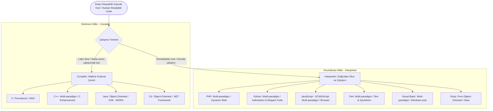

# Mesleki Yabancı Dil I | Unit 9: Top 10 Most Popular Programming Languages


> [!tip] Sınav Tüyoları ve Çeldiriciler
> 1. **Compiler vs. Interpreter Ayrımı (En Kritik Fark):**
>    - **Compiler (Derleyici):** İnsan tarafından okunabilir kodu alır ve **daha sonraki bir zamanda çalıştırmak üzere** (*for running at a later time*) makine koduna dönüştürür. (Java, C, C++, C#)
>    - **Interpreter (Yorumlayıcı):** Kodu satır satır okur, makine koduna çevirir ve **anında / hemen çalıştırır** (*immediately runs that code*), bu yüzden genellikle derlenen dillerden daha yavaştır. (PHP, VB, Python, JavaScript, Perl, Ruby)
> 2. **Java vs. JavaScript Tuzağı:** İsim benzerliğine rağmen **JavaScript'in Java ile hiçbir ilgisi yoktur** (*has nothing whatsoever to do with Java*). JavaScript'in resmî adı ve standardı **ECMAScript**'tir.
> 3. **Dilleri Tanımlarda Tek Kelimede Yakalama İpuçları (Hoca Tüyoları):**
>    - `C` $\rightarrow$ **UNIX** & **Procedural** (*1972, Dennis Ritchie*)
>    - `C++` $\rightarrow$ **Enhancement to C** (*C'nin geliştirilmiş/nesne yönelimli hali, Bjarne Stroustrup*)
>    - `C#` $\rightarrow$ **.NET Framework** (*Microsoft'un temel nesne yönelimli dili*)
>    - `Java` $\rightarrow$ **Sun Microsystems** & **WORA** (*Write Once, Run Anywhere* / **JVM** sayesinde **Portability**)
>    - `Python` $\rightarrow$ **Netherlands (CWI)** / **Monty Python** (*Yılan değil komedi grubu! Girinti/indentation & elegant code*)
>    - `Ruby` $\rightarrow$ **Japanese programmer (Yukihiro Matsumoto)** (*Her şeyin nesne olduğu dil*)
>    - `JavaScript` $\rightarrow$ **Netscape** / **Web browser** (*Client-side interactivity*)
>    - `PHP` $\rightarrow$ **Dynamic web applications** (*Rasmus Lerdorf*)
>    - `Perl` $\rightarrow$ **System administration** & **Text processing** (*Larry Wall, 1986*)
>    - `VB (Visual Basic)` $\rightarrow$ **Windows-only** / **Beginners or casual use**
> 4. **Sınav Kapsamı Hatırlatması:** Final sınavında **7. haftadan dönem sonuna kadar olan** ünitelerin odak kelimeleri (*vocabulary*) ağırlıklı olarak sorulacaktır.

---

## 1. Okuma Metni ve Birebir Akademik Çevirisi

| İngilizce Orijinal Metin | Birebir Türkçe Çevirisi |
| :--- | :--- |
| **Top 10 Most Popular Programming Languages** | **En Popüler 10 Programlama Dili** |
| There are hundreds of programming languages in use today. How can you know which one to learn first? | Günümüzde kullanımda olan yüzlerce programlama dili vardır. İlk olarak hangisini öğreneceğinizi nasıl bilebilirsiniz? |
| How do you know which ones are the best for your IT field of choice? | Seçtiğiniz bilişim teknolojileri (BT) alanı için hangilerinin en iyisi olduğunu nereden bilebilirsiniz? |
| Well, I can't answer that question for you. But why not start by learning one of the top 10 most popular ones? That way you will always be able to get a job in the IT industry. | Eh, bu soruyu sizin yerinize yanıtlayamam. Fakat neden en popüler ilk 10 dilden birini öğrenerek başlamayasınız? Bu sayede BT sektöründe her zaman iş bulabilirsiniz. |
| Learning a programming language is not easy, but it can be very rewarding. You will have a lot of questions at first. Just remember to get help when you need it! | Bir programlama dili öğrenmek kolay değildir ancak çok tatmin edici/kazançlı olabilir. Başlangıçta pek çok sorunuz olacaktır. Sadece ihtiyacınız olduğunda yardım almayı unutmayın! |
| You can find out the answer to almost everything on Google nowadays.... so there is no excuse for failure. | Günümüzde Google'da neredeyse her şeyin cevabını bulabilirsiniz... dolayısıyla başarısızlık için hiçbir bahane yoktur. |
| Also remember that it takes years to become an expert programmer. Don't expect to get good overnight. Just keep learning something new every day and eventually you will be competent enough to get the job done ;) | Ayrıca uzman bir programcı olmanın yıllar aldığını da unutmayın. Bir gecede ustalaşmayı beklemeyin. Her gün yeni bir şeyler öğrenmeye devam edin; sonunda işi tamamlayacak kadar yetkin hale geleceksiniz ;) |
| This article covers the top 10 most popular programming languages as ranked by Tiobe.com in June 2009. I have added some general reviews and comments about each language they listed. Remember these are my own personal opinions. Other IT professionals might have different opinions. | Bu makale, Haziran 2009'da Tiobe.com tarafından sıralanan en popüler 10 programlama dilini kapsamaktadır. Listeledikleri her dil hakkında bazı genel değerlendirme ve yorumlar ekledim. Bunların benim kişisel görüşlerim olduğunu unutmayın. Diğer BT uzmanlarının farklı fikirleri olabilir. |
| **1. Java** | **1. Java** |
| Java uses a compiler, and is an object-oriented language released in 1995 by Sun Microsystems. Java is the number one programming language today for many reasons. | Java bir derleyici kullanır ve 1995 yılında Sun Microsystems tarafından piyasaya sürülmüş nesne yönelimli bir dildir. Java bugün pek çok nedenden dolayı bir numaralı programlama dilidir. |
| First, it is a well-organized language with a strong library of reusable software components. | İlk olarak, yeniden kullanılabilir yazılım bileşenlerinden oluşan güçlü bir kütüphaneye sahip, iyi organize edilmiş bir dildir. |
| Second, programs written in Java can run on many different computer architectures and operating systems because of the use of the JVM (Java virtual machine). Sometimes this is referred to as code portability or even WORA (write once, run anywhere). | İkincisi, Java'da yazılan programlar, JVM (Java Sanal Makinesi) kullanımı sayesinde pek çok farklı bilgisayar mimarisinde ve işletim sisteminde çalışabilir. Bu durum bazen kod taşınabilirliği (*portability*) veya hatta WORA (bir kez yaz, her yerde çalıştır) olarak adlandırılır. |
| Third, Java is the language most likely to be taught in university computer science classes. A lot of computer science theory books written in the past decade use Java in the code examples. So learning Java syntax is a good idea even if you never actually code in it. | Üçüncüsü, Java üniversitelerin bilgisayar bilimleri derslerinde öğretilme olasılığı en yüksek dildir. Son on yılda yazılan birçok bilgisayar bilimleri kuram kitabı kod örneklerinde Java kullanmaktadır. Dolayısıyla gerçekte Java ile hiç kod yazmasanız bile Java sözdizimini (*syntax*) öğrenmek iyi bir fikirdir. |
| Java Strengths: WORA, popularity. Java Weaknesses: Slower than natively compiled languages. | Java'nın Güçlü Yönleri: WORA, popülerlik. Java'nın Zayıf Yönleri: Doğrudan/yerel olarak derlenen dillerden daha yavaş olması. |
| **2. C** | **2. C** |
| C is a compiled, procedural language developed in 1972 by Dennis Ritchie for use in the UNIX operating system. | C; 1972 yılında Dennis Ritchie tarafından UNIX işletim sisteminde kullanılmak üzere geliştirilmiş, derlenen, yordamsal (*procedural*) bir dildir. |
| Although designed to be portable in nature, C programs must be specifically compiled for computers with different architectures and operating systems. This helps make them lightning fast. | Doğası gereği taşınabilir olmak üzere tasarlanmış olsa da C programları farklı mimarilere ve işletim sistemlerine sahip bilgisayarlar için özel olarak derlenmelidir. Bu da onları yıldırım hızında yapar. |
| Although C is a relatively old language, it is still widely used for system programming, writing other programming languages, and in embedded systems. | C nispeten eski bir dil olmasına rağmen; sistem programlamada, diğer programlama dillerini yazmada ve gömülü sistemlerde (*embedded systems*) hâlâ yaygın olarak kullanılmaktadır. |
| Strengths: Speed. Weaknesses: Memory management can be difficult to master. | Güçlü Yönleri: Hız. Zayıf Yönleri: Bellek yönetiminde ustalaşmak zor olabilir. |
| **3. C++** | **3. C++** |
| C++ is a compiled, multi-paradigm language written as an update to C in 1979 by Bjarne Stroustrup. | C++; 1979 yılında Bjarne Stroustrup tarafından C diline bir güncelleme olarak yazılmış, derlenen, çoklu paradigmalı bir dildir. |
| It attempts to be backwards-compatible with C and brings object-orientation, which helps in larger projects. Despite its age, C++ is used to create a wide array of applications from games to office suites. | C ile geriye dönük uyumlu olmaya çalışır ve daha büyük projelerde yardımcı olan nesne yönelimliliği (*object-orientation*) getirir. Yaşına rağmen C++, oyunlardan ofis yazılımlarına kadar geniş bir yelpazede uygulamalar oluşturmak için kullanılır. |
| Strengths: Speed. Weaknesses: C++ is older and considered more clumsy than newer object-oriented languages such as Java or C#. | Güçlü Yönleri: Hız. Zayıf Yönleri: C++ daha eskidir ve Java veya C# gibi daha yeni nesne yönelimli dillere kıyasla daha hantal (*clumsy*) kabul edilir. |
| **4. PHP** | **4. PHP** |
| PHP uses a run-time interpreter, and is a multi-paradigm language originally developed in 1996 by Rasmus Lerdorf to create dynamic web pages. | PHP bir çalışma zamanı yorumlayıcısı (*run-time interpreter*) kullanır ve aslen 1996'da Rasmus Lerdorf tarafından dinamik web sayfaları oluşturmak için geliştirilmiş çoklu paradigmalı bir dildir. |
| At first it was not even a real programming language, but over time it eventually grew into a fully featured object-oriented programming language. | Başlangıçta gerçek bir programlama dili bile değildi, ancak zamanla tam özellikli nesne yönelimli bir programlama diline dönüştü. |
| Although PHP has been much criticized in the past for being a bit sloppy and insecure, it's been pretty good since version 5 came out in 2004. It's hard to argue with success. | PHP geçmişte biraz özensiz ve güvensiz olduğu için çok eleştirilmiş olsa da 2004'te sürüm 5 çıktığından beri oldukça iyidir. Başarıya itiraz etmek zordur. |
| Today, PHP is the most popular language used to write web applications. Even English 4 IT, the program you are currently using, is written in PHP ;) | Bugün PHP, web uygulamaları yazmak için kullanılan en popüler dildir. Şu anda kullanmakta olduğunuz English 4 IT programı bile PHP ile yazılmıştır ;) |
| Strengths: Web programming, good documentation. Weaknesses: Inconsistent syntax, too many ways to do the same thing, a history of bizarre security decisions. | Güçlü Yönleri: Web programlama, iyi dokümantasyon. Zayıf Yönleri: Tutarsız sözdizimi, aynı şeyi yapmanın çok fazla yolu olması, tuhaf güvenlik kararları geçmişi. |
| **5. VB (or Visual Basic)** | **5. VB (veya Visual Basic)** |
| Visual Basic is an interpreted, multi-paradigm language developed by Microsoft Corporation for the Windows platform. | Visual Basic, Microsoft Corporation tarafından Windows platformu için geliştirilmiş, yorumlanan, çoklu paradigmalı bir dildir. |
| It has been evolving over the years and is seen as a direct descendant of Microsoft's old BASIC from the 1970's. Visual Basic is a good language for scripting Windows applications that do not need the power and speed of C#. | Yıllar içinde evrimleşmiştir ve Microsoft'un 1970'lerdeki eski BASIC dilinin doğrudan devamı/torunu olarak görülür. Visual Basic, C#'ın güç ve hızına ihtiyaç duymayan Windows uygulamalarında betik yazmak için iyi bir dildir. |
| Strengths: None. Weaknesses: Only runs in Windows. | Güçlü Yönleri: Yok. Zayıf Yönleri: Yalnızca Windows'ta çalışır. |
| **6. Python** | **6. Python** |
| Python is an interpreted, multi-paradigm programming language written by Guido van Rossum in the late 1980's and intended for general programming purposes. Python was not named after the snake but actually after the Monty Python comedy group. | Python; 1980'lerin sonlarında Guido van Rossum tarafından yazılmış ve genel programlama amaçlarına yönelik, yorumlanan, çoklu paradigmalı bir programlama dilidir. Python adını yılandan değil, aslında Monty Python komedi grubundan almıştır. |
| Python is characterized by its use of indentation for readability, and its encouragement for elegant code by making developers do similar things in similar ways. Python is used as the main programming choice of both Google and Ubuntu. | Python, okunabilirlik için girinti (*indentation*) kullanımıyla ve geliştiricilerin benzer şeyleri benzer şekillerde yapmasını sağlayarak zarif kodu (*elegant code*) teşvik etmesiyle karakterize edilir. Python hem Google'ın hem de Ubuntu'nun ana programlama tercihi olarak kullanılır. |
| Strengths: Excellent readability and overall philosophy. Weaknesses: None. | Güçlü Yönleri: Mükemmel okunabilirlik ve genel felsefe. Zayıf Yönleri: Yok. |
| **7. C#** | **7. C#** |
| C# is a compiled, object-oriented language written by Microsoft. It is an open specification, but rarely seen on any non-Windows platform. | C#, Microsoft tarafından yazılmış, derlenen, nesne yönelimli bir dildir. Açık bir standarttır (*open specification*), ancak Windows dışı platformlarda nadiren görülür. |
| C# was conceived as Microsoft's premium language in its .NET Framework. It is very similar to Java in both syntax and nature. | C#, Microsoft'un .NET Framework altyapısındaki amiral/seçkin dili olarak tasarlanmıştır. Hem sözdizimi hem de doğası bakımından Java'ya çok benzer. |
| Strengths: Powerful and pretty fast. Weaknesses: Only really suitable for Windows. | Güçlü Yönleri: Güçlü ve oldukça hızlı. Zayıf Yönleri: Gerçek anlamda yalnızca Windows için uygundur. |
| **8. JavaScript** | **8. JavaScript** |
| JavaScript is an interpreted, multi-paradigm language. A very strange one too. Despite its name, it has nothing whatsoever to do with Java. You will rarely, if ever, see this language outside of a web browser. | JavaScript yorumlanan, çoklu paradigmalı bir dildir. Üstelik oldukça tuhaf bir dildir. Adına rağmen Java ile uzaktan yakından hiçbir ilgisi yoktur. Bu dili bir web tarayıcısının dışında neredeyse hiç görmezsiniz. |
| It is basically a language meant to script behaviors in web browsers and used for things such as web form validation and AJAX style web applications. | Temel olarak web tarayıcılarındaki davranışları yönetmek (*script*) için tasarlanmış bir dildir ve web formu doğrulama ile AJAX tarzı web uygulamaları gibi işlerde kullanılır. |
| The trend in the future seems to be building more and more complex applications in JavaScript, even simple online games and office suites. The success of this trend will depend upon advancements in the speed of a browser's JavaScript interpreter. | Gelecekteki eğilim, basit çevrimiçi oyunlar ve ofis paketleri dahil olmak üzere JavaScript ile giderek daha karmaşık uygulamalar geliştirmek yönünde görünmektedir. Bu eğilimin başarısı, tarayıcıların JavaScript yorumlayıcılarının hızındaki gelişmelere bağlı olacaktır. |
| If you want to be correct, the real name of this programming language is ECMAScript, although almost nobody actually calls it this. | Doğrusunu söylemek gerekirse, neredeyse hiç kimse bu şekilde çağırmasa da bu programlama dilinin gerçek adı ECMAScript'tir. |
| Strengths: It's the only reliable way to do client-side web programming. Weaknesses: It's only really useful in a web browser. | Güçlü Yönleri: İstemci taraflı (*client-side*) web programlama yapmanın tek güvenilir yoludur. Zayıf Yönleri: Gerçekten yalnızca bir web tarayıcısında işe yarar. |
| **9. Perl** | **9. Perl** |
| Perl is an interpreted, multi-paradigm language written by Larry Wall in 1986. It is characterized by a somewhat disorganized and scary-looking syntax which only makes sense to other PERL programmers ;) | Perl, 1986 yılında Larry Wall tarafından yazılmış, yorumlanan, çoklu paradigmalı bir dildir. Yalnızca diğer Perl programcılarına anlamlı gelen, biraz dağınık ve korkutucu görünen bir sözdizimiyle karakterize edilir ;) |
| However, a lot of veteran programmers love it and use it every day as their primary language. 10 years ago, Perl was more popular than it is today. What happened? A lot of newer programmers and even old Perl programmers (such as myself) have switched to other languages such as PHP, Python, and Ruby. | Bununla birlikte, birçok kıdemli programcı onu sever ve her gün birincil dili olarak kullanır. 10 yıl önce Perl bugünkünden daha popülerdi. Ne oldu? Birçok yeni programcı ve hatta (benim gibi) eski Perl programcıları PHP, Python ve Ruby gibi diğer dillere geçti. |
| Perl is perhaps still the best language for text processing and system administration scripting. I personally do not recommend it however as a primary programming language. | Perl, metin işleme (*text processing*) ve sistem yönetimi betikleri (*system administration scripting*) için belki de hâlâ en iyi dildir. Ancak ben şahsen birincil bir programlama dili olarak tavsiye etmiyorum. |
| Strengths: Text processing and system administration. Weaknesses: Strange syntax, and perhaps too many ways to do the same thing. | Güçlü Yönleri: Metin işleme ve sistem yönetimi. Zayıf Yönleri: Garip sözdizimi ve belki de aynı şeyi yapmanın çok fazla yolu olması. |
| **10. Ruby** | **10. Ruby** |
| Ruby is an interpreted, object-oriented language written by Yukihiro Matsumoto around 1995. It is one of the most object-oriented languages in the world. Everything is an object in Ruby, even letters and numbers can have method calls. | Ruby, 1995 civarında Yukihiro Matsumoto tarafından yazılmış, yorumlanan, nesne yönelimli bir dildir. Dünyadaki en nesne yönelimli dillerden biridir. Ruby'de her şey bir nesnedir; harfler ve sayılar bile metot çağrılarına sahip olabilir. |
| It's a great language to learn if you love objects. The only negative is that its love of object-orientation makes it a bit slow, even for an interpreted language. | Nesneleri seviyorsanız öğrenmek için harika bir dildir. Tek olumsuz yanı, nesne yönelimliliğe olan bu aşırı düşkünlüğünün, yorumlanan bir dil için bile onu biraz yavaş kılmasıdır. |
| Strengths: Perhaps the world's most object-oriented language. Weaknesses: Its superior object model comes at a price... namely speed. | Güçlü Yönleri: Belki de dünyanın en nesne yönelimli dili olması. Zayıf Yönleri: Üstün nesne modelinin bir bedeli vardır... o da hızdır. |
| Okay! Those are the top 10 programming languages in use today and some personal comments about them. Remember that opinions are like noses, everyone has one and they all smell ;) If you disagree, please feel free to email me or write your own opinions on the forum. | Pekâlâ! Günümüzde kullanımda olan en popüler 10 programlama dili ve bunlar hakkındaki bazı kişisel yorumlarım bunlardı. Fikirlerin burun gibi olduğunu unutmayın; herkesin bir tane vardır ve hepsi kokar ;) Katılmıyorsanız lütfen bana e-posta göndermekten veya forumda kendi fikirlerinizi yazmaktan çekinmeyin. |

---

## 2. Programlama Dilleri Çalışma Mekanizması ve Paradigma Şeması



---

## 3. Haftanın Odak Kelimeleri (Unit 9 Vocabulary)

### 1. .NET Framework
* **Resmî Tanım:** `A software framework by Microsoft which executes code via a virtual machine.`
* **Türkçe Anlamı:** Microsoft tarafından geliştirilen ve sanal makine aracılığıyla kod yürüten yazılım çerçevesi/altyapısıdır.
* **Örnek Cümle:** *"The .NET Framework is Microsoft's premium solution for programming applications, and supports over 20 languages including C#, VB.NET, and IronRuby."*
* **Sınav Tetikleyicisi (Trigger Words):** **`SOFTWARE FRAMEWORK BY MICROSOFT`**, **`VIRTUAL MACHINE`**, **`C#`**, **`VB.NET`**.

### 2. C
* **Resmî Tanım:** `A low-level, compiled programming language developed in the early 1970s by Dennis Ritchie for use on the UNIX operating system.`
* **Türkçe Anlamı:** 1970'lerin başında Dennis Ritchie tarafından UNIX işletim sisteminde kullanılmak üzere geliştirilen düşük seviyeli, derlenen programlama dilidir.
* **Örnek Cümle:** *"C is still a popular programming language 40 years after it was created, mainly due to its minimalism and extreme speed."*
* **Sınav Tetikleyicisi (Trigger Words):** **`UNIX OPERATING SYSTEM`**, **`DENNIS RITCHIE`**, **`LOW-LEVEL, COMPILED`**, **`1970s`**.

### 3. C#
* **Resmî Tanım:** `Microsoft's premier object-oriented, compiled programming language used with the .NET framework.`
* **Türkçe Anlamı:** Microsoft'un .NET framework ile birlikte kullanılan birincil nesne yönelimli, derlenen programlama dilidir.
* **Örnek Cümle:** *"The .NET programmer used C# as his primary programming language."*
* **Sınav Tetikleyicisi (Trigger Words):** **`MICROSOFT'S PREMIER`**, **`WITH THE .NET FRAMEWORK`**, **`OBJECT-ORIENTED, COMPILED`**.

### 4. C++
* **Resmî Tanım:** `An "enhancement" to the C language providing object-oriented programming features.`
* **Türkçe Anlamı:** C diline nesne yönelimli programlama özellikleri kazandıran bir "geliştirme/iyileştirme" dilidir.
* **Örnek Cümle:** *"The young programmer decided to learn C++ because he heard it was very popular in game development."*
* **Sınav Tetikleyicisi (Trigger Words):** **`ENHANCEMENT TO THE C LANGUAGE`**, **`OBJECT-ORIENTED FEATURES`**, **`GAME DEVELOPMENT`**.

### 5. compiler
* **Resmî Tanım:** `A program that takes human readable code and turns it into machine readable code for running at a later time.`
* **Türkçe Anlamı:** Derleyici; insan tarafından okunabilen kodu alıp daha sonraki bir zamanda çalıştırmak üzere makinenin okuyabileceği koda dönüştüren programdır.
* **Örnek Cümle:** *"The students liked programming python more than C because they didn't have to use a compiler before execution."*
* **Sınav Tetikleyicisi (Trigger Words):** **`HUMAN READABLE CODE`**, **`MACHINE READABLE CODE`**, **`RUNNING AT A LATER TIME`**.

### 6. ECMAScript
* **Resmî Tanım:** `The official name and standard for the commonly known JavaScript language.`
* **Türkçe Anlamı:** Yaygın olarak JavaScript adıyla bilinen dilin resmî adı ve standardıdır.
* **Örnek Cümle:** *"The professor told us that officially JavaScript should be called ECMAScript, but that few people do so in practice."*
* **Sınav Tetikleyicisi (Trigger Words):** **`OFFICIAL NAME AND STANDARD`**, **`JAVASCRIPT`**.

### 7. elegant code
* **Resmî Tanım:** `Concise, clean, and clear code which allows other developers to understand and extend it.`
* **Türkçe Anlamı:** Zarif kod; diğer geliştiricilerin kolayca anlamasına ve genişletmesine olanak tanıyan özlü, temiz ve anlaşılır koddur.
* **Örnek Cümle:** *"The junior programmer wrote elegant code and used variable names with a clear meaning."*
* **Sınav Tetikleyicisi (Trigger Words):** **`CONCISE, CLEAN, AND CLEAR CODE`**, **`UNDERSTAND AND EXTEND IT`**.

### 8. interpreter
* **Resmî Tanım:** `A program that reads a high-level programming language, converts it into machine code, and then immediately runs that code.`
* **Türkçe Anlamı:** Yorumlayıcı; yüksek seviyeli bir programlama dilini okuyan, makine koduna dönüştüren ve bu kodu hemen/anında çalıştıran programdır.
* **Örnek Cümle:** *"Computer languages that require an interpreter often run slower than languages that require a compiler."*
* **Sınav Tetikleyicisi (Trigger Words):** **`IMMEDIATELY RUNS THAT CODE`**, **`READS A HIGH-LEVEL`**, **`SLOWER THAN A COMPILER`**.

### 9. Java
* **Resmî Tanım:** `A high-level, compiled, object-oriented programming language developed by Sun Microsystems.`
* **Türkçe Anlamı:** Sun Microsystems tarafından geliştirilen yüksek seviyeli, derlenen, nesne yönelimli programlama dilidir.
* **Örnek Cümle:** *"The computer science professor predicted that as processor speeds increased, Java would eventually replace C++ in application development."*
* **Sınav Tetikleyicisi (Trigger Words):** **`SUN MICROSYSTEMS`**, **`WORA`**, **`JVM`**, **`HIGH-LEVEL, COMPILED, OBJECT-ORIENTED`**.

### 10. JavaScript
* **Resmî Tanım:** `A popular web page scripting language created by Brendan Eich at Netscape to provide client-side interactivity in Web pages.`
* **Türkçe Anlamı:** Web sayfalarında istemci taraflı etkileşim sağlamak amacıyla Netscape'te Brendan Eich tarafından oluşturulan popüler web betik dilidir.
* **Örnek Cümle:** *"The web programmer used JavaScript to alert the user about invalid data entered in a required field."*
* **Sınav Tetikleyicisi (Trigger Words):** **`BRENDAN EICH`**, **`NETSCAPE`**, **`CLIENT-SIDE INTERACTIVITY`**, **`WEB PAGES`**.

### 11. multi-paradigm language
* **Resmî Tanım:** `A programming language that supports both procedural and object-oriented programming philosophies.`
* **Türkçe Anlamı:** Çoklu paradigma dili; hem yordamsal (procedural) hem de nesne yönelimli (object-oriented) programlama felsefelerini destekleyen programlama dilidir.
* **Örnek Cümle:** *"PHP started out as a procedural language, but grew into a multi-paradigm language when it added support for objects in version 4."*
* **Sınav Tetikleyicisi (Trigger Words):** **`SUPPORTS BOTH PROCEDURAL AND OBJECT-ORIENTED`**, **`PHILOSOPHIES`**.

### 12. object-oriented language
* **Resmî Tanım:** `Any programming language optimized for modeling real-world objects and concepts.`
* **Türkçe Anlamı:** Nesne yönelimli dil; gerçek dünyadaki nesneleri ve kavramları modellemek için optimize edilmiş herhangi bir programlama dilidir.
* **Örnek Cümle:** *"Java is the most popular object-oriented language."*
* **Sınav Tetikleyicisi (Trigger Words):** **`MODELING REAL-WORLD OBJECTS AND CONCEPTS`**.

### 13. Perl
* **Resmî Tanım:** `A high-level, interpreted programming language written by Larry Wall in 1986 and typically used for a wide variety of programming tasks including system administration.`
* **Türkçe Anlamı:** 1986'da Larry Wall tarafından yazılan ve genellikle sistem yönetimi de dahil çok çeşitli görevlerde kullanılan yüksek seviyeli, yorumlanan programlama dilidir.
* **Örnek Cümle:** *"Larry Wall is the inventor of Perl, a widely used programming language that has a very devout following."*
* **Sınav Tetikleyicisi (Trigger Words):** **`LARRY WALL`**, **`1986`**, **`SYSTEM ADMINISTRATION`**, **`TEXT PROCESSING`**.

### 14. PHP (PHP Hypertext Preprocessor)
* **Resmî Tanım:** `A high-level, interpreted programming language written by Rasmus Lerdorf in 1995 and aimed mainly at web developers creating dynamic applications.`
* **Türkçe Anlamı:** 1995 yılında Rasmus Lerdorf tarafından yazılan ve esas olarak dinamik uygulamalar oluşturan web geliştiricilerine yönelik yüksek seviyeli, yorumlanan programlama dilidir.
* **Örnek Cümle:** *"The professor said that PHP is the most popular web scripting language in the world and supports many advanced object-oriented programming techniques."*
* **Sınav Tetikleyicisi (Trigger Words):** **`RASMUS LERDORF`**, **`DYNAMIC APPLICATIONS`**, **`WEB DEVELOPERS`**.

### 15. portability
* **Resmî Tanım:** `A measure of how easily programs can be moved to a new system without having to make any changes.`
* **Türkçe Anlamı:** Taşınabilirlik; programların herhangi bir değişiklik yapılmadan yeni bir sisteme ne kadar kolay taşınabileceğinin ölçüsüdür.
* **Örnek Cümle:** *"Java and ANSI C are two attempts at making software portability a priority."*
* **Sınav Tetikleyicisi (Trigger Words):** **`MOVED TO A NEW SYSTEM`**, **`WITHOUT HAVING TO MAKE ANY CHANGES`**.

### 16. procedural language
* **Resmî Tanım:** `Any programming language that is based on a step-by-step approach to solving a problem.`
* **Türkçe Anlamı:** Yordamsal dil; bir problemi çözmek için adım adım yaklaşıma dayanan herhangi bir programlama dilidir.
* **Örnek Cümle:** *"C is the standard example of a procedural language."*
* **Sınav Tetikleyicisi (Trigger Words):** **`STEP-BY-STEP APPROACH`**, **`SOLVING A PROBLEM`**.

### 17. Python
* **Resmî Tanım:** `A high-level, interpreted programming language developed by Guido van Rossum at CWI in the Netherlands.`
* **Türkçe Anlamı:** Hollanda'daki CWI enstitüsünde Guido van Rossum tarafından geliştirilen yüksek seviyeli, yorumlanan programlama dilidir.
* **Örnek Cümle:** *"The motto of Python is 'there should be one- and preferably only one- obvious way to do it'."*
* **Sınav Tetikleyicisi (Trigger Words):** **`GUIDO VAN ROSSUM`**, **`CWI IN THE NETHERLANDS`**, **`INDENTATION`**, **`MONTY PYTHON`**.

### 18. Ruby
* **Resmî Tanım:** `An object-oriented, high-level, interpreted programming language developed in the 1990's by ace Japanese programmer Yukihiro Matsumoto.`
* **Türkçe Anlamı:** 1990'larda usta Japon programcı Yukihiro Matsumoto tarafından geliştirilen nesne yönelimli, yüksek seviyeli, yorumlanan programlama dilidir.
* **Örnek Cümle:** *"The creator of Ruby wanted a scripting language that was more elegant than Perl, and more object-oriented than Python."*
* **Sınav Tetikleyicisi (Trigger Words):** **`JAPANESE PROGRAMMER`**, **`YUKIHIRO MATSUMOTO`**, **`EVERYTHING IS AN OBJECT`**.

### 19. syntax
* **Resmî Tanım:** `Rules governing the structure of a programming language.`
* **Türkçe Anlamı:** Sözdizimi; bir programlama dilinin yapısını yöneten kurallar bütünüdür.
* **Örnek Cümle:** *"The basic concepts of all programming languages are quite similar, even if the syntax can be quite different."*
* **Sınav Tetikleyicisi (Trigger Words):** **`RULES GOVERNING THE STRUCTURE`**.

### 20. VB (Visual Basic)
* **Resmî Tanım:** `A Windows-only, multi-paradigm programming language developed by Microsoft and intended for beginners or casual use.`
* **Türkçe Anlamı:** Microsoft tarafından geliştirilen, yeni başlayanlar veya gündelik kullanım için tasarlanmış yalnızca Windows'a özel çoklu paradigmalı programlama dilidir.
* **Örnek Cümle:** *"The high school programming teacher taught his students Visual Basic in his Introduction to Programming class."*
* **Sınav Tetikleyicisi (Trigger Words):** **`WINDOWS-ONLY`**, **`BEGINNERS OR CASUAL USE`**, **`DESCENDANT OF BASIC`**.

---

## 4. Kritik Karşılaştırma ve Tuzak Tabloları

### Karşılaştırma 1: Compiler vs. Interpreter

| Özellik | Compiler (Derleyici) | Interpreter (Yorumlayıcı) |
| :--- | :--- | :--- |
| **Çalışma Zamanı** | Kodu çevirir ve **daha sonra çalıştırır** (*running at a later time*). | Kodu okur, çevirir ve **anında çalıştırır** (*immediately runs*). |
| **Hız Performansı** | Genellikle **çok daha hızlıdır**. | Derlenen dillere göre genellikle **daha yavaştır**. |
| **Örnek Diller** | Java, C, C++, C# | PHP, VB, Python, JavaScript, Perl, Ruby |

### Karşılaştırma 2: Programlama Paradigmaları

| Paradigma | Temel Mantık (Trigger Phrase) | Örnek Dil(ler) |
| :--- | :--- | :--- |
| **Procedural Language** | **Step-by-step approach** (Adım adım yaklaşım) | C |
| **Object-Oriented Language (OOP)** | **Modeling real-world objects and concepts** | Java, C#, Ruby |
| **Multi-Paradigm Language** | **Both procedural and object-oriented** (Her ikisini de destekler) | C++, PHP, VB, Python, JavaScript, Perl |

### Karşılaştırma 3: İlk 10 Programlama Dili Özet Tablosu

| Sıra | Dil | Yaratıcı / Kurum & Yıl | Türü | Güçlü Yönü | Zayıf Yönü |
| :--- | :--- | :--- | :--- | :--- | :--- |
| **1** | **Java** | Sun Microsystems (1995) | Compiled / OOP | WORA (Portability), popülerlik | Yerel derlenen dillerden yavaş |
| **2** | **C** | Dennis Ritchie (1972) | Compiled / Procedural | Yıldırım hızı (*Speed*) | Bellek yönetimi (*Memory management*) zor |
| **3** | **C++** | Bjarne Stroustrup (1979) | Compiled / Multi-paradigm | Hız, C ile geriye dönük uyumlu | Java/C#'a göre eski ve hantal (*clumsy*) |
| **4** | **PHP** | Rasmus Lerdorf (1995/96) | Interpreted / Multi-paradigm | Web programlama, iyi dokümantasyon | Tutarsız sözdizimi, güvenlik geçmişi |
| **5** | **VB** | Microsoft | Interpreted / Multi-paradigm | Yok (*None*) | Yalnızca Windows'ta çalışır |
| **6** | **Python** | Guido van Rossum (1980'ler) | Interpreted / Multi-paradigm | Okunabilirlik (*Indentation*), felsefe | Yok (*None*) |
| **7** | **C#** | Microsoft | Compiled / OOP (.NET) | Güçlü ve oldukça hızlı | Yalnızca Windows için uygun |
| **8** | **JavaScript**| Brendan Eich / Netscape | Interpreted / Multi-paradigm | İstemci taraflı (*client-side*) tek yol | Yalnızca tarayıcıda faydalı |
| **9** | **Perl** | Larry Wall (1986) | Interpreted / Multi-paradigm | Metin işleme ve sistem yönetimi | Garip sözdizimi |
| **10**| **Ruby** | Yukihiro Matsumoto (1995) | Interpreted / OOP | En saf nesne yönelimli dil | Hız (*Speed*) |

---

## 5. Sınav Simülatörü: Çoktan Seçmeli Sorular

```quiz
{
  "title": "Unit 9 - Programming Languages Çoktan Seçmeli Test",
  "description": "Derleyiciler, yorumlayıcılar, programlama paradigmaları ve popüler dillerin temel özelliklerine yönelik 5 soruluk sınav simülatörü.",
  "questions": [
    {
      "id": 1,
      "question": "Which term refers to \"a program that reads a high-level programming language, converts it into machine code, and then immediately runs that code\"?",
      "options": [
        {
          "key": "A",
          "text": "Compiler",
          "isCorrect": false,
          "explanation": "Yanlış. Compiler (derleyici) kodu daha sonraki bir zamanda çalıştırmak (running at a later time) üzere makine koduna çevirir."
        },
        {
          "key": "B",
          "text": "Interpreter",
          "isCorrect": true,
          "explanation": "Doğru! Tetikleyici: \"immediately runs that code\" (kodu anında çalıştırır) ifadesi doğrudan Interpreter (Yorumlayıcı) tanımıdır."
        },
        {
          "key": "C",
          "text": "Syntax",
          "isCorrect": false,
          "explanation": "Yanlış. Syntax bir programlama dilinin yapısını yöneten kurallardır."
        },
        {
          "key": "D",
          "text": ".NET Framework",
          "isCorrect": false,
          "explanation": "Yanlış. .NET Framework Microsoft tarafından geliştirilen bir yazılım çerçevesidir."
        },
        {
          "key": "E",
          "text": "Portability",
          "isCorrect": false,
          "explanation": "Yanlış. Portability yazılımın yeni bir sisteme değişiklik yapılmadan taşınabilme ölçüsüdür."
        }
      ]
    },
    {
      "id": 2,
      "question": "What is \"the official name and standard for the commonly known JavaScript language\"?",
      "options": [
        {
          "key": "A",
          "text": "Java Virtual Machine",
          "isCorrect": false,
          "explanation": "Yanlış. JVM Java kodlarını çalıştıran sanal makinedir; JavaScript'in Java ile hiçbir ilgisi yoktur."
        },
        {
          "key": "B",
          "text": "Visual Basic",
          "isCorrect": false,
          "explanation": "Yanlış. Visual Basic Microsoft'un Windows tabanlı dilidir."
        },
        {
          "key": "C",
          "text": "ECMAScript",
          "isCorrect": true,
          "explanation": "Doğru! Tetikleyici: JavaScript'in resmî adı ve standardı ECMAScript'tir."
        },
        {
          "key": "D",
          "text": "Hypertext Preprocessor",
          "isCorrect": false,
          "explanation": "Yanlış. Bu ifade PHP'nin açılımıdır."
        },
        {
          "key": "E",
          "text": "ANSI C",
          "isCorrect": false,
          "explanation": "Yanlış. ANSI C, C dilinin taşınabilirlik standardıdır."
        }
      ]
    },
    {
      "id": 3,
      "question": "Which programming language is defined as \"a low-level, compiled programming language developed in the early 1970s by Dennis Ritchie for use on the UNIX operating system\"?",
      "options": [
        {
          "key": "A",
          "text": "C++",
          "isCorrect": false,
          "explanation": "Yanlış. C++, 1979'da Bjarne Stroustrup tarafından C'ye nesne yönelimli özellikler eklemek için geliştirilmiştir."
        },
        {
          "key": "B",
          "text": "Python",
          "isCorrect": false,
          "explanation": "Yanlış. Python 1980'lerin sonunda Hollanda'da Guido van Rossum tarafından geliştirilmiştir."
        },
        {
          "key": "C",
          "text": "Perl",
          "isCorrect": false,
          "explanation": "Yanlış. Perl 1986'da Larry Wall tarafından yazılmıştır."
        },
        {
          "key": "D",
          "text": "C",
          "isCorrect": true,
          "explanation": "Doğru! Tetikleyici: \"UNIX operating system\" ve \"Dennis Ritchie\" ifadeleri doğrudan C dilini işaret eder."
        },
        {
          "key": "E",
          "text": "C#",
          "isCorrect": false,
          "explanation": "Yanlış. C#, Microsoft tarafından .NET Framework için geliştirilmiştir."
        }
      ]
    },
    {
      "id": 4,
      "question": "A programming language that \"supports both procedural and object-oriented programming philosophies\" is called a:",
      "options": [
        {
          "key": "A",
          "text": "Procedural language",
          "isCorrect": false,
          "explanation": "Yanlış. Procedural language yalnızca adım adım (step-by-step) yaklaşıma dayanır."
        },
        {
          "key": "B",
          "text": "Multi-paradigm language",
          "isCorrect": true,
          "explanation": "Doğru! Tetikleyici: Hem procedural hem de object-oriented felsefeleri destekleyen diller Multi-paradigm language olarak adlandırılır."
        },
        {
          "key": "C",
          "text": "Object-oriented language",
          "isCorrect": false,
          "explanation": "Yanlış. Object-oriented language gerçek dünya nesnelerini modellemeye odaklanır."
        },
        {
          "key": "D",
          "text": "Low-level language",
          "isCorrect": false,
          "explanation": "Yanlış. Low-level donanıma yakınlık seviyesini ifade eder."
        },
        {
          "key": "E",
          "text": "Elegant code",
          "isCorrect": false,
          "explanation": "Yanlış. Elegant code temiz, özlü ve anlaşılır kod yazım stilidir."
        }
      ]
    },
    {
      "id": 5,
      "question": "Which language was developed by Guido van Rossum in the Netherlands, is characterized by its use of indentation for readability, and was named after a comedy group?",
      "options": [
        {
          "key": "A",
          "text": "Ruby",
          "isCorrect": false,
          "explanation": "Yanlış. Ruby Japon programcı Yukihiro Matsumoto tarafından geliştirilmiştir."
        },
        {
          "key": "B",
          "text": "PHP",
          "isCorrect": false,
          "explanation": "Yanlış. PHP Rasmus Lerdorf tarafından dinamik web sayfaları için geliştirilmiştir."
        },
        {
          "key": "C",
          "text": "Python",
          "isCorrect": true,
          "explanation": "Doğru! Tetikleyici: \"Guido van Rossum\", \"Netherlands\", \"indentation\" ve \"Monty Python comedy group\" ifadeleri Python'ı tanımlar."
        },
        {
          "key": "D",
          "text": "Java",
          "isCorrect": false,
          "explanation": "Yanlış. Java Sun Microsystems tarafından geliştirilmiştir."
        },
        {
          "key": "E",
          "text": "Perl",
          "isCorrect": false,
          "explanation": "Yanlış. Perl karmaşık sözdizimiyle bilinen ve Larry Wall tarafından yazılan dildir."
        }
      ]
    }
  ]
}
```

---

## 6. Kelime Avı Bulmacası (Word Search Puzzle)

```puzzle
{
  "title": "Unit 9 - Programming Languages Word Search",
  "dimensions": {
    "rows": 15,
    "cols": 15
  },
  "grid": [
    [" ", " ", " ", " ", " ", " ", " ", " ", " ", " ", " ", " ", " ", " ", " "],
    [" ", "P", "O", "R", "T", "A", "B", "I", "L", "I", "T", "Y", " ", " ", "I"],
    ["P", " ", " ", " ", " ", " ", " ", " ", " ", " ", " ", " ", " ", " ", "N"],
    ["R", " ", "J", "A", "V", "A", "S", "C", "R", "I", "P", "T", " ", " ", "T"],
    ["O", " ", " ", " ", " ", " ", " ", " ", " ", " ", " ", " ", " ", " ", "E"],
    ["C", " ", " ", "E", "C", "M", "A", "S", "C", "R", "I", "P", "T", " ", "R"],
    ["E", " ", " ", " ", " ", " ", " ", " ", " ", " ", " ", " ", "P", " ", "P"],
    ["D", " ", "C", "O", "M", "P", "I", "L", "E", "R", " ", " ", "E", " ", "R"],
    ["U", " ", " ", " ", " ", " ", " ", " ", " ", " ", " ", " ", "R", " ", "E"],
    ["R", " ", " ", " ", "P", "Y", "T", "H", "O", "N", " ", " ", "L", " ", "T"],
    ["A", " ", " ", " ", " ", " ", " ", " ", " ", " ", " ", " ", " ", " ", "E"],
    ["L", " ", " ", " ", "S", "Y", "N", "T", "A", "X", " ", " ", " ", " ", "R"],
    [" ", " ", " ", " ", " ", " ", " ", " ", " ", " ", " ", " ", " ", " ", " "],
    [" ", " ", "R", "U", "B", "Y", " ", " ", " ", " ", " ", " ", " ", " ", " "],
    [" ", " ", " ", " ", " ", " ", " ", " ", " ", " ", " ", " ", " ", " ", " "]
  ],
  "words": [
    {
      "word": "PORTABILITY",
      "direction": "EAST",
      "start": [1, 1],
      "end": [1, 11],
      "path": [
        [1, 1], [1, 2], [1, 3], [1, 4], [1, 5], [1, 6],
        [1, 7], [1, 8], [1, 9], [1, 10], [1, 11]
      ]
    },
    {
      "word": "INTERPRETER",
      "direction": "SOUTH",
      "start": [1, 14],
      "end": [11, 14],
      "path": [
        [1, 14], [2, 14], [3, 14], [4, 14], [5, 14], [6, 14],
        [7, 14], [8, 14], [9, 14], [10, 14], [11, 14]
      ]
    },
    {
      "word": "PROCEDURAL",
      "direction": "SOUTH",
      "start": [2, 0],
      "end": [11, 0],
      "path": [
        [2, 0], [3, 0], [4, 0], [5, 0], [6, 0],
        [7, 0], [8, 0], [9, 0], [10, 0], [11, 0]
      ]
    },
    {
      "word": "JAVASCRIPT",
      "direction": "EAST",
      "start": [3, 2],
      "end": [3, 11],
      "path": [
        [3, 2], [3, 3], [3, 4], [3, 5], [3, 6],
        [3, 7], [3, 8], [3, 9], [3, 10], [3, 11]
      ]
    },
    {
      "word": "ECMASCRIPT",
      "direction": "EAST",
      "start": [5, 3],
      "end": [5, 12],
      "path": [
        [5, 3], [5, 4], [5, 5], [5, 6], [5, 7],
        [5, 8], [5, 9], [5, 10], [5, 11], [5, 12]
      ]
    },
    {
      "word": "COMPILER",
      "direction": "EAST",
      "start": [7, 2],
      "end": [7, 9],
      "path": [
        [7, 2], [7, 3], [7, 4], [7, 5],
        [7, 6], [7, 7], [7, 8], [7, 9]
      ]
    },
    {
      "word": "PYTHON",
      "direction": "EAST",
      "start": [9, 4],
      "end": [9, 9],
      "path": [
        [9, 4], [9, 5], [9, 6], [9, 7], [9, 8], [9, 9]
      ]
    },
    {
      "word": "SYNTAX",
      "direction": "EAST",
      "start": [11, 4],
      "end": [11, 9],
      "path": [
        [11, 4], [11, 5], [11, 6], [11, 7], [11, 8], [11, 9]
      ]
    },
    {
      "word": "PERL",
      "direction": "SOUTH",
      "start": [6, 12],
      "end": [9, 12],
      "path": [
        [6, 12], [7, 12], [8, 12], [9, 12]
      ]
    },
    {
      "word": "RUBY",
      "direction": "EAST",
      "start": [13, 2],
      "end": [13, 5],
      "path": [
        [13, 2], [13, 3], [13, 4], [13, 5]
      ]
    }
  ]
}
```