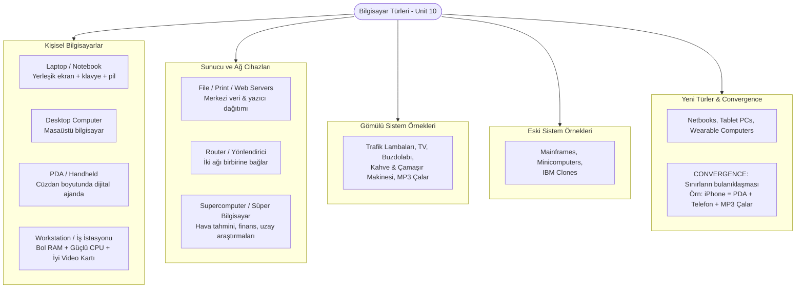

# Mesleki Yabancı Dil I | Unit 10: Recognizing Different Types of Computers

> [!tip] Sınav Tüyoları ve Çeldiriciler
> 1. **PC Yanılgısı (Desktop + Windows Tuzağı):** İnsanlar yanlışlıkla `PC` (*Personal Computer*) teriminin yalnızca **Windows çalıştıran bir masaüstü bilgisayarla** (*desktop computer running Windows*) eş anlamlı olduğunu düşünür. Oysa tek bir kişinin genel amaçlar için kullandığı her türlü bilgisayar (`laptop`, `desktop`, `PDA`, `workstation`) birer PC'dir.
> 2. **Notebook (Laptop) vs. Netbook Ayrımı:** Hoca derste *"Yukarıdaki notebook'tu, bunu sınavda karıştırmayın; aşağıda bir de netbook var"* uyarısında bulundu:
>    - `Laptop` $=$ `Notebook` (*yerleşik ekran, entegre klavye ve pil gücüne sahip taşınabilir tam bilgisayar*)
>    - `Netbook` $\rightarrow$ Laptop'un **daha küçük ve daha az güçlü bileşenlere sahip** (*small laptop with less powerful components*) versiyonudur; yalnızca internette gezinme ve e-posta okuma gibi temel görevler içindir.
> 3. **Tablet PC Tuzağı:** Hoca *"Bu konuda yanılmayın lütfen sınavda"* diyerek vurguladı: `Tablet PC` de bir `portable computer`dır ve görünüm olarak `notebook` formundadır (*shaped in the form of a notebook*); ancak onu diğerlerinden ayıran en net sınav tetikleyicisi **gelişmiş el yazısı tanıma (`advanced handwriting recognition`)**, **`stylus`** (ekran kalemi) veya **`on-screen keyboard`** (ekran klavyesi) kullanımıdır.
> 4. **Convergence (Yakınsama):** Cihazların ortak bir işlevselliğe doğru evrimleşmesi (*evolution of devices towards common functionality*) ve bilgisayar türleri arasındaki sınırların sürekli bulanıklaşması (*lines between computer types are constantly being blurred*) olgusudur. Eskiden ses kaydı, kamera, MP3 çalar, telefon ve el bilgisayarı (PDA) ayrı cihazlarken günümüzde hepsinin tek bir cihazda (örneğin iPhone/akıllı telefonlarda) toplanması buna en iyi örnektir.
> 5. **Legacy Systems (Eski Sistemler):** 20. yüzyılda (1900'ler) popüler olup günümüzde yerini yenilerine bırakan ancak **değiştirme maliyeti çok yüksek olduğu için (`high cost of replacing it`)** kullanılmaya devam edilen eski sistemlerdir (`mainframes`, `minicomputers`, `IBM clones`).
> 6. **Embedded Systems (Gömülü Sistemler):** Masaüstü veya sunucular gibi dışarıdan bakıldığında bilgisayar olduğu hemen belli olmayan (*not so obvious*), başka cihazların içine yerleşip onları kontrol eden sistemlerdir (*traffic lights, TV sets, refrigerators, coffee machines, washing machine, MP3 player*). Pahalı olmayan, özel görevlere adanmış yavaş işlemciler ve ROM çipi kullanırlar.

---

## 1. Okuma Metni ve Birebir Akademik Çevirisi

| İngilizce Orijinal Metin | Birebir Türkçe Çevirisi |
| :--- | :--- |
| **Recognizing Different Types of Computers** | **Farklı Bilgisayar Türlerini Tanımak** |
| In this unit you will learn about different types of computers and what makes them unique. | Bu ünitede farklı bilgisayar türlerini ve onları benzersiz kılan şeyleri öğreneceksiniz. |
| Computers were not always things you could carry around with you, or even have in your bedroom. | Bilgisayarlar her zaman yanınızda taşıyabileceğiniz, hatta yatak odanızda bulundurabileceğiniz şeyler değildi. |
| Sixty years ago, computers (such as ENIAC) were as big as entire apartments. | Altmış yıl önce, (ENIAC gibi) bilgisayarlar koca bir apartman dairesi kadar büyüktü. |
| They were difficult to use and not very powerful by today's standards. | Kullanımları zordu ve bugünün standartlarına göre pek güçlü değillerdi. |
| They also cost a lot of money to build and operate. | Ayrıca inşa edilmeleri ve işletilmeleri çok maliyetliydi. |
| So computers were only used by large organizations such as governments, international corporations, and universities. | Bu yüzden bilgisayarlar yalnızca hükümetler, uluslararası şirketler ve üniversiteler gibi büyük kuruluşlar tarafından kullanılıyordu. |
| Throughout the 1950s and 1960s, computers captured the public's imagination in literature, films, and TV. | 1950'ler ve 1960'lar boyunca bilgisayarlar; edebiyat, sinema ve televizyonda halkın hayal gücünü ele geçirdi. |
| More and more companies wanted computers, even if they didn't always have a good reason to own one. | Her zaman sahip olmak için iyi bir sebepleri olmasa bile, giderek daha fazla şirket bilgisayar sahibi olmak istedi. |
| As a result, computers gradually became smaller, cheaper, and more practical to own. | Sonuç olarak bilgisayarlar giderek daha küçük, daha ucuz ve sahip olunması daha pratik hale geldi. |
| This was thanks in part to companies like IBM, which mass-produced computers for the first time and promoted them to medium and large businesses to do things like payroll, accounting, and other number-crunching tasks. | Bu gelişme kısmen; bilgisayarları ilk kez seri olarak üreten ve onları bordro, muhasebe ve diğer sayısal hesaplama görevlerini yapmaları için orta ve büyük ölçekli işletmelere tanıtan IBM gibi şirketler sayesinde gerçekleşti. |
| In the 1970s and 1980s a new type of computer started to gain in popularity. | 1970'lerde ve 1980'lerde yeni bir bilgisayar türü popülerlik kazanmaya başladı. |
| It was called the PC or personal computer. | Buna PC veya kişisel bilgisayar adı verildi. |
| For the first time in history, computers were now for everyone. | Tarihte ilk defa, bilgisayarlar artık herkes içindi. |
| The PC started a revolution which affects nearly everything we do today. | PC, bugün yaptığımız neredeyse her şeyi etkileyen bir devrim başlattı. |
| The ways we work, play, communicate, and access information have all been radically reshaped due to the invention and evolution of the PC. | Çalışma, oyun oynama, iletişim kurma ve bilgiye erişme biçimlerimizin tamamı, PC'nin icadı ve evrimi sayesinde köklü bir şekilde yeniden şekillendirildi. |
| PCs are everywhere you look today. At home, at the office, and everywhere in between. | PC'ler bugün baktığınız her yerdedir: Evde, ofiste ve ikisinin arasındaki her yerde. |
| Many people still mistakenly believe the term PC is synonymous with a desktop computer running Windows. This is not really true. | Pek çok kişi hâlâ yanlışlıkla PC teriminin Windows çalıştıran bir masaüstü bilgisayarla eş anlamlı olduğuna inanmaktadır. Bu aslında doğru değildir. |
| Really, any computer you use by yourself for general purposes could be called a PC. | Gerçekte, genel amaçlar doğrultusunda tek başınıza kullandığınız herhangi bir bilgisayar PC olarak adlandırılabilir. |
| You probably already own at least one of these types of PCs: laptop, desktop computer, PDA or personal digital assistant, workstation. | Muhtemelen şu PC türlerinden en az birine halihazırda sahipsinizdir: dizüstü bilgisayar (laptop), masaüstü bilgisayar, PDA (kişisel dijital asistan), iş istasyonu (workstation). |
| Besides PCs, there are other types of computers you probably see at work or school. These include: file servers, print servers, web servers. | PC'lerin yanı sıra muhtemelen işte veya okulda gördüğünüz başka bilgisayar türleri de vardır. Bunlar şunları içerir: dosya sunucuları, baskı sunucuları, web sunucuları. |
| But not all types of computers are so obvious as the ones above. | Fakat tüm bilgisayar türleri yukarıdakiler kadar açık/görünür değildir. |
| There are still other kinds of computers that fit inside of other devices and control them. | Başka cihazların içine sığan ve onları kontrol eden farklı bilgisayar türleri de vardır. |
| These computers are known as embedded systems. | Bu bilgisayarlar gömülü sistemler (*embedded systems*) olarak bilinir. |
| Embedded systems can be found in traffic lights, TV sets, refrigerators, coffee machines and many more devices. | Gömülü sistemler trafik lambalarında, televizyonlarda, buzdolaplarında, kahve makinelerinde ve daha birçok cihazda bulunabilir. |
| Embedded systems are typically controlled by inexpensive, specialized processors which can only handle very specific tasks. | Gömülü sistemler genellikle yalnızca çok belirli görevleri yürütebilen, ucuz ve özelleştirilmiş işlemciler tarafından kontrol edilir. |
| Types of computers go in and out of fashion as times changes. | Zaman değiştikçe bilgisayar türleri de modaya girer ve modadan düşer. |
| Older kinds of computers which were very popular in the 20th century (1900's) are now referred to as legacy systems. These include: mainframes, minicomputers, IBM clones. | 20. yüzyılda (1900'lerde) çok popüler olan daha eski bilgisayar türleri artık eski sistemler (*legacy systems*) olarak adlandırılmaktadır. Bunlar: ana bilgisayarlar (mainframes), mini bilgisayarlar ve IBM klonlarıdır. |
| New types of computers are always coming out and replacing or augmenting existing computer types. | Her zaman yeni bilgisayar türleri ortaya çıkmakta ve mevcut bilgisayar türlerinin yerini almakta ya da onları geliştirmektedir. |
| Examples of new types of computers emerging would be netbooks, tablet PCs, and even wearable computers. | Ortaya çıkan yeni bilgisayar türlerine örnek olarak netbook'lar, tablet PC'ler ve hatta giyilebilir bilgisayarlar verilebilir. |
| As you complete this unit, you will learn to differentiate between different computer types. | Bu üniteyi tamamladığınızda, farklı bilgisayar türleri arasında ayrım yapmayı öğreneceksiniz. |
| Keep in mind that the lines between computer types are constantly being blurred. This phenomenon is known as convergence. | Bilgisayar türleri arasındaki sınırların sürekli olarak bulanıklaştığını unutmayın. Bu olgu yakınsama (*convergence*) olarak bilinir. |

---

## 2. Bilgisayar Türleri Taksonomisi ve Mimari Şema



---

## 3. Haftanın Odak Kelimeleri

### 1. Convergence
* **Resmî Tanım:** `The evolution of devices towards common functionality.`
* **Türkçe Anlamı:** Yakınsama; cihazların ortak işlevselliğe doğru evrimleşerek birden fazla cihazın özelliklerini tek bir cihazda toplamasıdır.
* **Örnek Cümle:** *"The iPhone is a good example of convergence, because it has all the features of a PDA, mobile phone, and an MP3 player in one package."*
* **Sınav Tetikleyicisi (Trigger Words):** **`EVOLUTION OF DEVICES`**, **`COMMON FUNCTIONALITY`**, **`LINES BEING BLURRED`**, **`ONE PACKAGE`**.

### 2. Embedded System
* **Resmî Tanım:** `A computer using a relatively slow and specialized processor and ROM chip, normally used to control a particular device such as a washing machine or an MP3 player.`
* **Türkçe Anlamı:** Gömülü Sistem; belirli bir cihazı kontrol etmek amacıyla o cihazın içine yerleştirilen, görece yavaş ve özelleşmiş işlemci ile ROM çipi kullanan bilgisayardır.
* **Örnek Cümle:** *"Nearly all electronics you can buy today are controlled by embedded systems."*
* **Sınav Tetikleyicisi (Trigger Words):** **`SLOW AND SPECIALIZED PROCESSOR`**, **`ROM CHIP`**, **`CONTROL A PARTICULAR DEVICE`**, **`FIT INSIDE`**.

### 3. Laptop
* **Resmî Tanım:** `A portable computer with a built-in screen, integrated keyboard, and battery power; also called a 'notebook'.`
* **Türkçe Anlamı:** Dizüstü Bilgisayar; yerleşik ekranı, entegre klavyesi ve batarya gücü olan, 'notebook' olarak da adlandırılan taşınabilir bilgisayardır.
* **Örnek Cümle:** *"As laptop computers have become more powerful and affordable, they are steadily replacing the more traditional desktop computer."*
* **Sınav Tetikleyicisi (Trigger Words):** **`BUILT-IN SCREEN`**, **`INTEGRATED KEYBOARD`**, **`BATTERY POWER`**, **`ALSO CALLED A NOTEBOOK`**.

### 4. Legacy System
* **Resmî Tanım:** `An older device or application that continues to be used because of the high cost of replacing it.`
* **Türkçe Anlamı:** Eski Sistem; değiştirilmesinin yüksek maliyeti nedeniyle günümüzde kullanılmaya devam edilen eski cihaz veya uygulamadır.
* **Örnek Cümle:** *"Mainframes and minicomputers used to be cutting edge; now they are known as legacy systems."*
* **Sınav Tetikleyicisi (Trigger Words):** **`OLDER DEVICE OR APPLICATION`**, **`HIGH COST OF REPLACING IT`**, **`MAINFRAMES AND MINICOMPUTERS`**.

### 5. Netbook
* **Resmî Tanım:** `A small laptop with less powerful components meant for surfing the web, reading email, and other basic tasks.`
* **Türkçe Anlamı:** Netbook; internette gezinmek, e-posta okumak ve diğer temel görevler için tasarlanmış, daha az güçlü bileşenlere sahip küçük dizüstü bilgisayardır.
* **Örnek Cümle:** *"I wanted to play Call of Duty 4 while I was traveling, but the graphics card in my netbook could only handle Solitaire."*
* **Sınav Tetikleyicisi (Trigger Words):** **`SMALL LAPTOP`**, **`LESS POWERFUL COMPONENTS`**, **`SURFING THE WEB`**, **`BASIC TASKS`**.

### 6. PC (Personal Computer)
* **Resmî Tanım:** `A computer designed for use by one person at a time.`
* **Türkçe Anlamı:** Kişisel Bilgisayar; aynı anda bir kişi tarafından kullanılmak üzere tasarlanmış bilgisayardır.
* **Örnek Cümle:** *"When people use the term 'PC', they are often referring to a desktop computer running Windows."*
* **Sınav Tetikleyicisi (Trigger Words):** **`ONE PERSON AT A TIME`**, **`BY YOURSELF`**, **`GENERAL PURPOSES`**.

### 7. PDA (Personal Digital Assistant)
* **Resmî Tanım:** `A handheld computer about the size of wallet used as an organizer, web browser, game machine, mobile phone, or message recorder; also known as a hand-held computer.`
* **Türkçe Anlamı:** Kişisel Dijital Asistan; ajanda, tarayıcı, oyun veya mesaj kaydedici olarak kullanılan cüzdan boyutundaki el bilgisayarıdır.
* **Örnek Cümle:** *"The modern traveling businessman depends on his PDA to organize all his contacts and appointments."*
* **Sınav Tetikleyicisi (Trigger Words):** **`HANDHELD COMPUTER`**, **`SIZE OF WALLET`**, **`ORGANIZER`**, **`CONTACTS AND APPOINTMENTS`**.

### 8. Print Server
* **Resmî Tanım:** `A physical or software device connecting and facilitating a network with a printer.`
* **Türkçe Anlamı:** Baskı Sunucusu; bir ağı bir yazıcıya bağlayan ve ağ üzerinden yazdırma işlemini yönetip kolaylaştıran fiziksel veya yazılımsal aygıttır.
* **Örnek Cümle:** *"The secretary could not get a hard copy because the print server was broken."*
* **Sınav Tetikleyicisi (Trigger Words):** **`CONNECTING AND FACILITATING`**, **`NETWORK WITH A PRINTER`**, **`HARD COPY`**.

### 9. Router
* **Resmî Tanım:** `A specialized computer which connects two networks.`
* **Türkçe Anlamı:** Yönlendirici; iki ağı birbirine bağlayan özelleştirilmiş bilgisayardır.
* **Örnek Cümle:** *"The DSL router allowed the entire office to share a single Internet connection."*
* **Sınav Tetikleyicisi (Trigger Words):** **`SPECIALIZED COMPUTER`**, **`CONNECTS TWO NETWORKS`**, **`SHARE INTERNET CONNECTION`**.

### 10. Server
* **Resmî Tanım:** `A type of computer intended primarily for central distribution of data to other computers on the same network.`
* **Türkçe Anlamı:** Sunucu; aynı ağdaki diğer bilgisayarlara verilerin merkezi olarak dağıtılması amacıyla tasarlanmış bilgisayar türüdür.
* **Örnek Cümle:** *"Because servers hold large amounts of centralized data, it is critical to have daily backup routines in place."*
* **Sınav Tetikleyicisi (Trigger Words):** **`CENTRAL DISTRIBUTION OF DATA`**, **`ON THE SAME NETWORK`**, **`CENTRALIZED DATA`**.

### 11. Supercomputer
* **Resmî Tanım:** `Refers to only the most powerful class of computer, typically designed to perform specialized tasks such as weather prediction, governmental financial calculations, or space research.`
* **Türkçe Anlamı:** Süper Bilgisayar; hava durumu tahmini, devletin finansal hesaplamaları veya uzay araştırmaları gibi özel görevler için tasarlanan en güçlü bilgisayar sınıfıdır.
* **Örnek Cümle:** *"A typical supercomputer may have up to 100 processors and have speeds measured in tens of gigaflops."*
* **Sınav Tetikleyicisi (Trigger Words):** **`MOST POWERFUL CLASS`**, **`WEATHER PREDICTION`**, **`SPACE RESEARCH`**, **`GIGAFLOPS`**.

### 12. Tablet PC
* **Resmî Tanım:** `A portable computer shaped in the form of a notebook and capable of advanced handwriting recognition via use of a stylus or on-screen keyboard.`
* **Türkçe Anlamı:** Tablet Bilgisayar; defter/notebook formunda tasarlanmış, ekran kalemi (stylus) veya ekran klavyesi aracılığıyla gelişmiş el yazısı tanıma özelliğine sahip taşınabilir bilgisayardır.
* **Örnek Cümle:** *"Bill Gates predicted the rise of the tablet PC in 2001, but not much happened until Apple announced the iPad in 2010."*
* **Sınav Tetikleyicisi (Trigger Words):** **`SHAPED IN THE FORM OF A NOTEBOOK`**, **`HANDWRITING RECOGNITION`**, **`STYLUS`**, **`ON-SCREEN KEYBOARD`**.

### 13. Workstation
* **Resmî Tanım:** `A high quality computer, typically with lots of RAM, plenty of CPU power, and a high quality video card.`
* **Türkçe Anlamı:** İş İstasyonu; genellikle çok yüksek miktarda RAM'e, bol işlemci gücüne ve yüksek kaliteli bir ekran kartına sahip üst düzey bilgisayardır.
* **Örnek Cümle:** *"The engineer's latest 3d modeling project was so processor intensive, that he wouldn't even begin it until his new workstation arrived."*
* **Sınav Tetikleyicisi (Trigger Words):** **`LOTS OF RAM`**, **`PLENTY OF CPU POWER`**, **`HIGH QUALITY VIDEO CARD`**, **`3D MODELING`**.

---

## 4. Kritik Karşılaştırma ve Tuzak Tabloları

### Karşılaştırma 1: Taşınabilir Bilgisayarlar (Laptop vs. Netbook vs. Tablet PC vs. PDA)

| Cihaz Türü | Form / Boyut | Donanım ve Giriş Yöntemi | Sınavda Ayırt Edici İfade |
| :--- | :--- | :--- | :--- |
| **Laptop (Notebook)** | Taşınabilir tam boyut | Yerleşik ekran, entegre klavye, pil gücü | `also called a 'notebook'` |
| **Netbook** | Küçük laptop | Daha az güçlü bileşenler (*less powerful*) | `surfing the web, reading email, basic tasks` |
| **Tablet PC** | Notebook formunda | **`Stylus`** veya **`on-screen keyboard`** | **`advanced handwriting recognition`** |
| **PDA** | Cüzdan boyutunda (*wallet size*) | El bilgisayarı (*handheld*) | `organizer, contacts and appointments` |

### Karşılaştırma 2: Güç ve Ağ Rolüne Göre Sistemler

| Sistem Türü | Temel Rolü | Donanım / Mimari Özelliği | Tipik Kullanım Alanı |
| :--- | :--- | :--- | :--- |
| **Workstation** | Tek kişilik ağır iş istasyonu | Bol RAM, güçlü CPU, kaliteli ekran kartı | 3D modelleme, mühendislik |
| **Server** | Merkezi veri dağıtımı | Aynı ağdaki cihazlara veri sağlar | Dosya, baskı, web sunucuları (Yedekleme kritik) |
| **Print Server** | Ağı yazıcıya bağlama | Fiziksel cihaz veya yazılım olabilir | Ofis yazıcı paylaşımı |
| **Router** | Ağları birbirine bağlama | Özelleşmiş ağ bilgisayarı | İki ağı bağlama, tek interneti paylaştırma |
| **Supercomputer** | En güçlü bilgisayar sınıfı | Yüzlerce işlemci, gigaflop hızları | Hava tahmini, uzay araştırması, devlet finansmanı |

### Karşılaştırma 3: Dönemsel ve Mimari Kavramlar

| Kavram | Görünürlük / Konum | İşlemci / Maliyet Özelliği | Örnekler |
| :--- | :--- | :--- | :--- |
| **Embedded System** | Başka cihazların **içine gizli** (*fit inside*) | Yavaş, özelleşmiş işlemci + ROM çipi (Ucuz) | Trafik lambası, TV, buzdolabı, kahve/çamaşır makinesi |
| **Legacy System** | 20. yy'dan kalma eski sistemler | Değiştirme maliyeti yüksek (*high cost of replacing*) | Mainframes, Minicomputers, IBM Clones |
| **Convergence** | Sınırların bulanıklaşması olgusu | Birden fazla işlevin tek cihazda birleşmesi | iPhone (PDA + Cep telefonu + MP3 çalar) |

---

## 5. Sınav Simülatörü: Çoktan Seçmeli Sorular

```quiz
{
  "title": "Unit 10 - Recognizing Different Types of Computers Testi",
  "description": "Bilgisayar türleri, yakınsama (convergence), gömülü sistemler ve eski sistemler üzerine 5 soruluk sınav simülatörü.",
  "questions": [
    {
      "id": 1,
      "question": "Which type of computer is defined as \"a portable computer shaped in the form of a notebook and capable of advanced handwriting recognition via use of a stylus or on-screen keyboard\"?",
      "options": [
        {
          "key": "A",
          "text": "Netbook",
          "isCorrect": false,
          "explanation": "Yanlış. Netbook, web'de gezinme ve e-posta gibi temel işler için üretilmiş daha az güçlü küçük bir dizüstü bilgisayardır."
        },
        {
          "key": "B",
          "text": "Tablet PC",
          "isCorrect": true,
          "explanation": "Doğru! Tetikleyici: \"handwriting recognition\", \"stylus\" ve \"on-screen keyboard\" ifadeleri şaşmaz biçimde Tablet PC tanımıdır."
        },
        {
          "key": "C",
          "text": "Workstation",
          "isCorrect": false,
          "explanation": "Yanlış. Workstation bol RAM, güçlü CPU ve yüksek kaliteli ekran kartına sahip yüksek kaliteli bilgisayardır."
        },
        {
          "key": "D",
          "text": "PDA",
          "isCorrect": false,
          "explanation": "Yanlış. PDA cüzdan boyutunda (size of wallet) bir el bilgisayarıdır."
        },
        {
          "key": "E",
          "text": "Laptop",
          "isCorrect": false,
          "explanation": "Yanlış. Laptop (notebook), yerleşik ekran ve entegre fiziksel klavyeye sahip standart taşınabilir bilgisayardır."
        }
      ]
    },
    {
      "id": 2,
      "question": "Mainframes and minicomputers continue to be used in some organizations despite being outdated, primarily because of the high cost of replacing them. What are these older devices referred to as?",
      "options": [
        {
          "key": "A",
          "text": "Embedded systems",
          "isCorrect": false,
          "explanation": "Yanlış. Embedded systems başka cihazların içine yerleştirilip onları kontrol eden sistemlerdir."
        },
        {
          "key": "B",
          "text": "Print servers",
          "isCorrect": false,
          "explanation": "Yanlış. Print server bir ağı yazıcıya bağlayan cihaz veya yazılımdır."
        },
        {
          "key": "C",
          "text": "Supercomputers",
          "isCorrect": false,
          "explanation": "Yanlış. Supercomputer hava tahmini veya uzay araştırmaları gibi işler yapan en güçlü bilgisayar sınıfıdır."
        },
        {
          "key": "D",
          "text": "Legacy systems",
          "isCorrect": true,
          "explanation": "Doğru! Tetikleyici: \"older devices\", \"high cost of replacing\" ve \"mainframes and minicomputers\" doğrudan Legacy Systems (Eski Sistemler) kavramını işaret eder."
        },
        {
          "key": "E",
          "text": "IBM clones",
          "isCorrect": false,
          "explanation": "Yanlış. IBM clones legacy system örneklerinden yalnızca biridir; genel kategorinin adı Legacy Systems'dır."
        }
      ]
    },
    {
      "id": 3,
      "question": "Which phenomenon describes \"the evolution of devices towards common functionality\", where the lines between different computer types are constantly being blurred?",
      "options": [
        {
          "key": "A",
          "text": "Convergence",
          "isCorrect": true,
          "explanation": "Doğru! Tetikleyici: \"evolution of devices towards common functionality\" ve \"lines constantly being blurred\" ifadeleri doğrudan Convergence (Yakınsama) tanımıdır."
        },
        {
          "key": "B",
          "text": "Central distribution",
          "isCorrect": false,
          "explanation": "Yanlış. Central distribution sunucuların (server) veriyi ağa dağıtma görevidir."
        },
        {
          "key": "C",
          "text": "Mass production",
          "isCorrect": false,
          "explanation": "Yanlış. Mass production IBM gibi şirketlerin bilgisayarları ilk kez seri üretmesini ifade eder."
        },
        {
          "key": "D",
          "text": "Virtualization",
          "isCorrect": false,
          "explanation": "Yanlış. Virtualization bu ünitenin kavramlarından biri değildir."
        },
        {
          "key": "E",
          "text": "Number-crunching",
          "isCorrect": false,
          "explanation": "Yanlış. Number-crunching bordro ve muhasebe gibi yoğun sayısal hesaplama görevlerini ifade eder."
        }
      ]
    },
    {
      "id": 4,
      "question": "A computer using a \"relatively slow and specialized processor and ROM chip, normally used to control a particular device such as a washing machine or traffic light\" is called a(n):",
      "options": [
        {
          "key": "A",
          "text": "Router",
          "isCorrect": false,
          "explanation": "Yanlış. Router iki ağı birbirine bağlayan özelleştirilmiş bilgisayardır."
        },
        {
          "key": "B",
          "text": "Embedded system",
          "isCorrect": true,
          "explanation": "Doğru! Tetikleyici: \"slow and specialized processor\", \"ROM chip\" ve \"control a particular device\" (çamaşır makinesi, trafik ışığı) doğrudan Embedded System (Gömülü Sistem) tanımıdır."
        },
        {
          "key": "C",
          "text": "Workstation",
          "isCorrect": false,
          "explanation": "Yanlış. Workstation yavaş değil, aksine çok güçlü CPU ve bol RAM'e sahip masaüstü iş istasyonudur."
        },
        {
          "key": "D",
          "text": "File server",
          "isCorrect": false,
          "explanation": "Yanlış. File server ağdaki bilgisayarlara merkezi dosya dağıtımı yapar."
        },
        {
          "key": "E",
          "text": "Personal digital assistant",
          "isCorrect": false,
          "explanation": "Yanlış. PDA cüzdan boyutunda kişisel ajanda ve el bilgisayarıdır."
        }
      ]
    },
    {
      "id": 5,
      "question": "Which of the following statements about the term 'PC' is TRUE according to the reading text?",
      "options": [
        {
          "key": "A",
          "text": "It is strictly synonymous with a desktop computer running Microsoft Windows.",
          "isCorrect": false,
          "explanation": "Yanlış. Metin bunun insanların düştüğü yaygın bir yanılgı (mistakenly believe) olduğunu özellikle belirtir."
        },
        {
          "key": "B",
          "text": "Supercomputers and file servers are considered standard types of PCs.",
          "isCorrect": false,
          "explanation": "Yanlış. Sunucular ve süper bilgisayarlar PC kategorisi dışındaki (besides PCs) türlerdir."
        },
        {
          "key": "C",
          "text": "Any computer used by one person at a time for general purposes can be called a PC.",
          "isCorrect": true,
          "explanation": "Doğru! Tetikleyici: Metne göre tek bir kişinin genel amaçlarla kullandığı her bilgisayar (laptop, desktop, PDA, workstation dahil) PC olarak adlandırılabilir."
        },
        {
          "key": "D",
          "text": "ENIAC was the very first PC marketed to home users in the 1970s.",
          "isCorrect": false,
          "explanation": "Yanlış. ENIAC 60 yıl önce apartman dairesi büyüklüğünde olan ve yalnızca büyük kurumların kullandığı ilk dönem bilgisayarıdır."
        },
        {
          "key": "E",
          "text": "Workstations cannot be classified as PCs because they have too much RAM.",
          "isCorrect": false,
          "explanation": "Yanlış. Metinde workstation açıkça PC türleri listesi (laptop, desktop, PDA, workstation) içinde verilmiştir."
        }
      ]
    }
  ]
}
```

---

## 6. Kelime Avı Bulmacası (Word Search Puzzle)

```puzzle
{
  "title": "Unit 10 - Computer Types Word Search",
  "dimensions": {
    "rows": 15,
    "cols": 15
  },
  "grid": [
    [" ", " ", " ", " ", " ", " ", " ", " ", " ", " ", " ", " ", " ", " ", " "],
    [" ", "S", "U", "P", "E", "R", "C", "O", "M", "P", "U", "T", "E", "R", " "],
    ["W", " ", " ", " ", " ", " ", " ", " ", " ", " ", " ", " ", " ", " ", " "],
    ["O", " ", "C", "O", "N", "V", "E", "R", "G", "E", "N", "C", "E", " ", " "],
    ["R", " ", " ", " ", " ", " ", " ", " ", " ", " ", " ", " ", " ", " ", "T"],
    ["K", " ", " ", "M", "A", "I", "N", "F", "R", "A", "M", "E", " ", " ", "A"],
    ["S", " ", " ", " ", " ", " ", " ", " ", " ", " ", " ", " ", " ", " ", "B"],
    ["T", " ", "E", "M", "B", "E", "D", "D", "E", "D", " ", " ", "R", " ", "L"],
    ["A", " ", " ", " ", " ", " ", " ", " ", " ", " ", " ", " ", "O", " ", "E"],
    ["T", " ", " ", "N", "E", "T", "B", "O", "O", "K", " ", " ", "U", " ", "T"],
    ["I", " ", " ", " ", " ", " ", " ", " ", " ", " ", " ", " ", "T", " ", "P"],
    ["O", " ", " ", " ", "L", "E", "G", "A", "C", "Y", " ", " ", "E", " ", "C"],
    ["N", " ", " ", " ", " ", " ", " ", " ", " ", " ", " ", " ", "R", " ", " "],
    [" ", " ", "S", "E", "R", "V", "E", "R", " ", " ", " ", " ", " ", " ", " "],
    [" ", " ", " ", " ", " ", " ", " ", " ", " ", " ", " ", " ", " ", " ", " "]
  ],
  "words": [
    {
      "word": "SUPERCOMPUTER",
      "direction": "EAST",
      "start": [1, 1],
      "end": [1, 13],
      "path": [
        [1, 1], [1, 2], [1, 3], [1, 4], [1, 5], [1, 6], [1, 7],
        [1, 8], [1, 9], [1, 10], [1, 11], [1, 12], [1, 13]
      ]
    },
    {
      "word": "WORKSTATION",
      "direction": "SOUTH",
      "start": [2, 0],
      "end": [12, 0],
      "path": [
        [2, 0], [3, 0], [4, 0], [5, 0], [6, 0], [7, 0],
        [8, 0], [9, 0], [10, 0], [11, 0], [12, 0]
      ]
    },
    {
      "word": "CONVERGENCE",
      "direction": "EAST",
      "start": [3, 2],
      "end": [3, 12],
      "path": [
        [3, 2], [3, 3], [3, 4], [3, 5], [3, 6], [3, 7],
        [3, 8], [3, 9], [3, 10], [3, 11], [3, 12]
      ]
    },
    {
      "word": "MAINFRAME",
      "direction": "EAST",
      "start": [5, 3],
      "end": [5, 11],
      "path": [
        [5, 3], [5, 4], [5, 5], [5, 6], [5, 7],
        [5, 8], [5, 9], [5, 10], [5, 11]
      ]
    },
    {
      "word": "EMBEDDED",
      "direction": "EAST",
      "start": [7, 2],
      "end": [7, 9],
      "path": [
        [7, 2], [7, 3], [7, 4], [7, 5],
        [7, 6], [7, 7], [7, 8], [7, 9]
      ]
    },
    {
      "word": "TABLETPC",
      "direction": "SOUTH",
      "start": [4, 14],
      "end": [11, 14],
      "path": [
        [4, 14], [5, 14], [6, 14], [7, 14],
        [8, 14], [9, 14], [10, 14], [11, 14]
      ]
    },
    {
      "word": "NETBOOK",
      "direction": "EAST",
      "start": [9, 3],
      "end": [9, 9],
      "path": [
        [9, 3], [9, 4], [9, 5], [9, 6],
        [9, 7], [9, 8], [9, 9]
      ]
    },
    {
      "word": "LEGACY",
      "direction": "EAST",
      "start": [11, 4],
      "end": [11, 9],
      "path": [
        [11, 4], [11, 5], [11, 6], [11, 7], [11, 8], [11, 9]
      ]
    },
    {
      "word": "ROUTER",
      "direction": "SOUTH",
      "start": [7, 12],
      "end": [12, 12],
      "path": [
        [7, 12], [8, 12], [9, 12], [10, 12], [11, 12], [12, 12]
      ]
    },
    {
      "word": "SERVER",
      "direction": "EAST",
      "start": [13, 2],
      "end": [13, 7],
      "path": [
        [13, 2], [13, 3], [13, 4], [13, 5], [13, 6], [13, 7]
      ]
    }
  ]
}
```