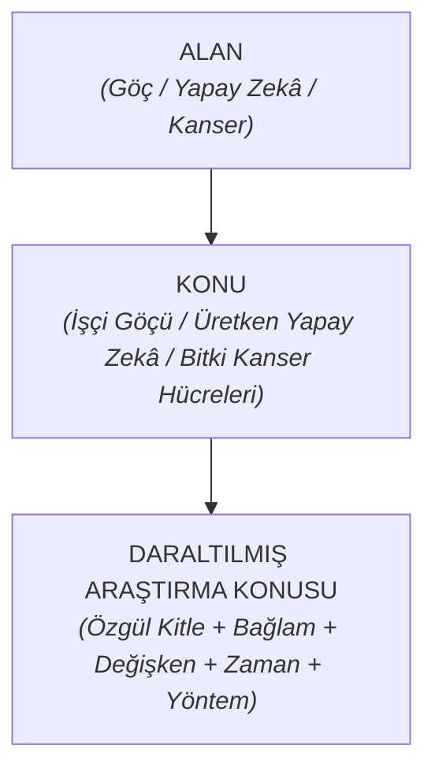
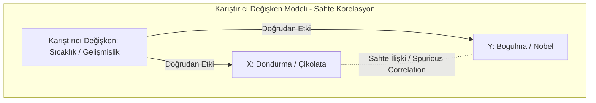
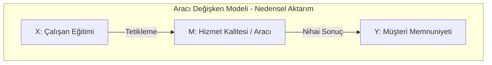
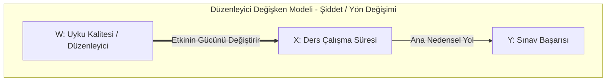
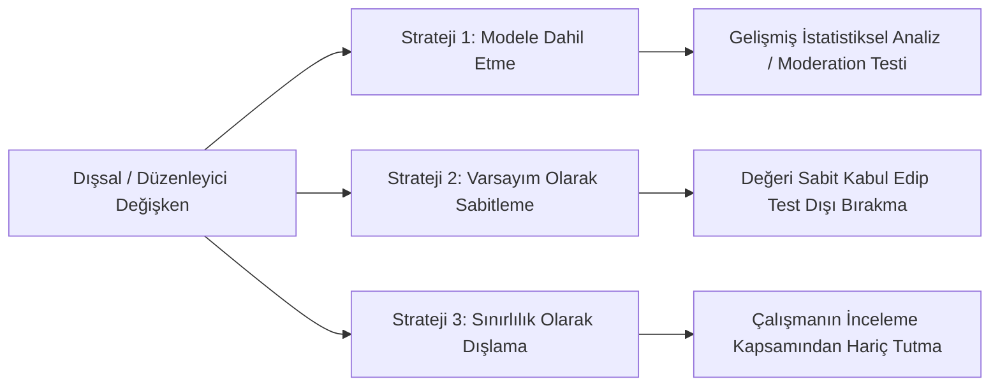
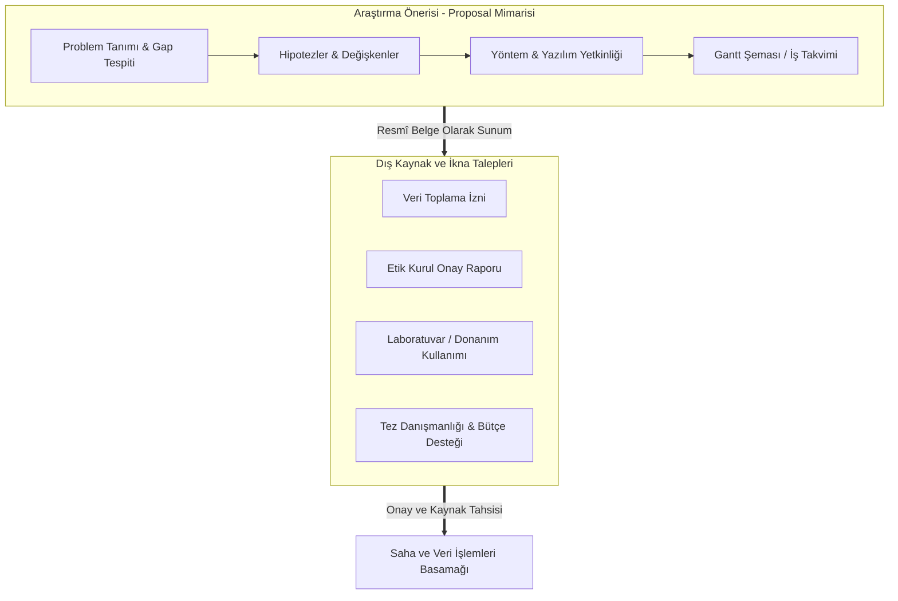

## Kavramsal Çerçeve

### Konu Daraltma Aşamaları ve Boyutları
Araştırma konusu seçimi, genel bir ilgi alanından hareketle ampirik olarak incelenebilir sınırların çizilmesini gerektirir. Süreç üç basamaklı bir daraltma piramidiyle yapılandırılır:

1. **Alan**: Geniş ve sınırları belirsiz disipliner çerçevedir. Örneğin *Göç, Yapay Zekâ, Kanser*.
2. **Konu**: Alanın belirli bir tematik parçaya indirgenmiş hâlidir. Örneğin *İşçi Göçü, Üretken Yapay Zekâ, Bitki Kanser Hücreleri*.
3. **Daraltılmış Araştırma Konusu**: Kapsam, hedef kitle, kurumsal bağlam, zaman aralığı ve ölçülecek değişkenlerin netleştirildiği operasyonel odak alanıdır.

Konu daraltma işlemi beş temel boyutta gerçekleştirilir:

- **Kapsam Boyutu (Teknoloji/Olay)**: İncelenecek tekniğin veya olgunun sınırlandırılmasıdır. Salt "Yapay zekâ" yerine "Üretken yapay zekâ destekli kod öneri sistemleri" ifadesinin seçilmesidir.
- **Kitle Boyutu (Örneklem)**: Veri toplanacak insan veya nesne kümesinin sınırlandırılmasıdır. Salt "Göçmenler" yerine "Türkiye'den Almanya'ya göç eden 3. nesil işçiler" veya "Yönetim Bilişim Sistemleri lisans öğrencileri" kümesinin belirlenmesidir.
- **Bağlam Boyutu (Sektör/Kurum)**: Araştırmanın yürütüldüğü mekânsal ve kurumsal vasatın/ortamın tayinidir (Özel sektör yazılım şirketleri, üniversite hastaneleri).
- **Zaman Boyutu (Dönem)**: İncelemenin kapsadığı tarihsel aralıktır (1950 sonrası işçi göçü nesilleri, son bir yıllık kullanım verileri).
- **Değişken Boyutu (Ölçüm Odağı)**: Olguda merak edilen somut niteliktir (Psikolojik adaptasyon problemleri, teknoloji kabul niyeti, kod güven algısı).

**Örnek - Biyoloji Alanında Yüksek Lisans Başvurusu**: Bir lisansüstü adayının Almanya'daki bir profesöre "*Kanser hücresi üzerine çalışmak istiyorum*" şeklinde başvurması kabul görmemiştir. Profesör kanser hücrelerinin bitkisel ve hayvansal ayrımını vurgulayarak, bitki kanser hücrelerindeki organel (mitokondri) düzeyinde spesifik bir araştırma odağı sunulmasını şart koşmuştur.

**Örnek - YBS Disiplininde Konu Başlığı İnşası**: Salt "Yapay zekâ öğrencilere yararlı mıdır?" ifadesi belirsizdir. Bu ifade beş boyutlu daraltma süzgecinden geçirilerek; "*YBS Öğrencilerinin Üretken Yapay Zekâ Kullanım Niyetlerini Etkileyen Faktörlerin İncelenmesi: [[UTAUT]] (Birleştirilmiş Teknoloji Kabul ve Kullanım Teorisi) Modeli Uygulaması*" biçiminde ampirik ve bilimsel bir başlıpa dönüştürülmüştür.

### Araştırma Probleminin Nitelikleri: FINER Modeli
Yetkin bir bilimsel araştırma problemi, kuramsal değer taşıyan beş temel kriteri bünyesinde toplar:

| Kriter Kodu | Kriter Adı                                 | Kuramsal Tanım                                                                                                          | Örnekler                                                                                                                                                                                                      |
| :---------- | :----------------------------------------- | :---------------------------------------------------------------------------------------------------------------------- | ------------------------------------------------------------------------------------------------------------------------------------------------------------------------------------------------------------- |
| **F**       | **[[Feasible]]** (Uygulanabilirlik)        | Araştırmacının mevcut maliyet, insan gücü, zaman ve veri erişim olanaklarıyla problemi çözebilme kapasitesidir.         |                                                                                                                                                                                                               |
| **I**       | **[[Interesting]]** (İlginçlik/Değerlilik) | Problemin çözüldüğünde bilimsel, yönetsel veya sektörel bir değer üretme potansiyeli.                                   |                                                                                                                                                                                                               |
| **N**       | **[[Novel]]** (Özgünlük)                   | Literatürdeki mevcut boşlukları ([[Research Gap]]) tespit ederek daha önce çalışılmamış bir boyutu aydınlatma niteliği. |                                                                                                                                                                                                               |
| **E**       | **[[Ethical]]** (Etik)                     | İnsana, canlıya ve toplumsal normlara zarar vermeme; verilerin gizliliğini koruma standardıdır.                         | İşçi performansını analiz etmek amacıyla iş yerine kameralar yerleştirip, görüntüleri ve WhatsApp iletişim loglarını yöneticilere anlık bildiren bir yazılım geliştirmek KVKK mevzuatını doğrudan ihlal eder. |
| **R**       | **[[Relevant]]** (İlgililik)               | Problemin hem genel bilim dünyasıyla hem de araştırmacının kendi yetkinlik/merak alanıyla doğrudan örtüşmesidir.        | **Genel Ölçütler:** Araştırmanın özgünlüğü ve uygulanabilirliğidir. **Özel Ölçütler:** Araştırmacının bilgi/beceri düzeyi (SPSS, R veya Python uzmanlığı) ve konuya duyduğu kişisel ilgidir.               |

### Araştırma Amacının Nitelikleri: [[SMART]] Modeli
Bilimsel amaç ifaddleri, muğlaklığı bertaraf eden beş yapısal sütun üzerinden formüle edilir:

- **Specific (Özelleştirilmiş/Belirgin)**: Amacın sınırları kesin çizgilerle belirlenir. Araştırmanın kime ve neye odaklandığı açıktır.
- **Measurable (Ölçülebilir)**: Ampirik veri toplama araçlarıyla sayısal veya niteliksel olarak gözlemlenebilir parametrelere dayanır.
- **Achievable (Ulaşılabilir)**: Mevcut örneklem ve bütçe sınırları dahilinde hedeflenen sonuca erişim kabiliyetidir.
- **Realistic (Gerçekçi)**: Olguların ampirik tabiatına ve bilimsel mantığa uygun rasyonel hedefleri temsil eder.
- **Time-bound (Zaman Odaklı)**: Sürecin ne kadarlık bir takvim diliminde (ay, dönem, yıl) icra edileceği baştan tayin edilir.

### Araştırma Önerisi (Research Proposal)
[[Araştırma Önerisi]], planlanan çalışmanın henüz saha ve analiz safhasına geçirilmeden önce yazıya dökülen kapsamlı taslak projesidir. İki temel işlevi yerine getirir:

- **Tasarım İşlevi**: Araştırmanın başlıklarını, test edilecek hipotezlerini, kullanılacak veri analiz yöntemlerini (SPSS, R, Python) ve iş paketlerini içeren [[Gantt Şeması]] üzerinden sürecin iç planlamasını kurar.
- **İkna İşlevi**: Kurumlardan veri toplama izni, üniversitelerden laboratuvar cihazı/makine kullanım hakkı, sponsorlardan araştırma bütçesi ve hocalardan tez danışmanlığı alabilmek adına karşı tarafa sunulan kurumsal taahhüt belgesidir.

### Değişkenler ve Nedensellik

- **[[Korelasyon]] ve [[Nedensellik]] Ayrımı** İki değişkenin eşzamanlı olarak birlikte değişmesi ([[Korelasyon]]), değişkenlerden birinin diğerinin sebebi olduğu anlamına gelmez. Aralarında hiçbir mantıksal nedensellik bulunmayan fakat istatistiki olarak birlikte hareket eden durumlar [[sahte korelasyon|Sahte Korelasyon]] (Spurious Correlation) kavramıyla açıklanır.

![[cs1.png]]

- **Karıştırıcı Değişken (Confounding Variable)**: Birbiriyle doğrudan nedensel bağı bulunmayan iki değişken ($X$ ve $Y$) ile ayrı ayrı ilişkili olan ve bu iki değişken arasında sahte bir ilişki üreten dışsal faktördür. ($Z$)
	- **Dondurma ve Boğulma Vakası**: Dondurma tüketim oranı ($X$) ile havuzda boğulma vakaları ($Y$) arasında yüksek pozitif korelasyon bulunmaktadır. Bu durumun arkasındaki neden sıcaklık ve yaz mevsimidir ($Z$ - Karıştırıcı Değişken). Sıcaklık arttıkça hem dondurma tüketimi hem de havuza giren insan sayısı ayrı ayrı artmaktadır.
	- **Çikolata ve Nobel Ödülü Vakası**: Ülkelerin kişi başı çikolata tüketimi ($X$) ile kazandıkları Nobel ödülü sayısı ($Y$) arasında yüksek korelasyon mevcuttur. İlişkinin temelinde ülkelerin ekonomik gelişmişlik düzeyi ($Z$ - Karıştırıcı Değişken) yer alır. Gelişmişlik seviyesi yüksek ülkelerde hem temel ihtiyaç dışı çikolata tüketimi artmakta hem de eğitim ve araştırma kurumlarının kalitesi yükselmektedir.

- **Aracı Değişken (Mediator Variable)**: Bağımsız değişken ($X$) ile bağımlı değişken ($Y$) arasındaki nedensel etkiyi doğrudan kendi üzerinden aktaran, araya giren süreç değişkenidir ($M$). Bağımsız değişken aracı değişkeni tetikler, aracı değişken de nihai bağımlı değişkeni şekillendirir.
	- **Kurumsal Hizmet Örneği**: Çalışanlara verilen hizmet içi eğitim ($X$), müşteri memnuniyetini ($Y$) doğrudan etkilemez. Eğitim faaliyeti, çalışanların hizmet ve iletişim kalitesini ($M$ - Aracı Değişken) yükseltir. Yükselen hizmet kalitesi de müşteri memnuniyetini artırır ($X \to M \to Y$).

- **Düzenleyici Değişken (Moderator Variable)**: Bağımsız değişkenin bağımlı değişken üzerindeki etkisinin gücünü, büyüklüğünü veya yönünü değiştiren koşul değişkenidir ($W$).
	- **Uyku Kalitesi Örneği**: Ders çalışma süresi ($X$) ile sınav notu ($Y$) arasındaki başarı ilişkisinde, öğrencinin uyku kalitesi ($W$ - Düzenleyici Değişken) belirleyicidir. Yüksek uyku kalitesi ders çalışmanın başarı üzerindeki pozitif etkisini güçlendirirken, düşük uyku kalitesi bu etkinin şiddetini zayıflatır.

---

Bir araştırma modelinde bağımsız değişkenin bağımlı değişken üzerindeki etkisi test edilirken, sürece tesir eden üçüncü değişkenler karşısında araştırmacı üç kuramsal yoldan birini seçer:

1. **Ölçümleme Stratejisi**: Değişken modele düzenleyici veya kontrol değişkeni sıfatıyla dahil edilir. Düzenleme analizleri üzerinden [[ampirik]] olarak test edilir.
2. **Varsayım ([[Varsayım|Sayıltı]]) Stratejisi**: Değişken ampirik teste sokulmaz, değeri peşinen sabit kabul edilir. "*Bu araştırmada tüm deneklerin günlük sekiz saat kaliteli uyku uyuduğu varsayılmıştır*" denilerek jüri eleştirileri kuramsal bir kabule bağlanır.
3. **Sınırlılık ([[Sınırlılık|Kısıt]]) Stratejisi**: İlgili etki doğrudan araştırmanın kapsam sınırlarının dışına itilir. "*Uyku kalitesinin ve mevsimsel etkilerin sonuçlar üzerindeki rolü bu araştırmanın kapsamı dışında bırakılmıştır. Gelecek çalışmalar bu parametreyi modele ekleyebilir*" denilerek alan diğer araştırmacılara devredilebilir.

----

## Şemalar

### Değişken Rolleri ve Nedensellik Karşılaştırma Matrisi
Araştırma modellerinde yer alan değişken tiplerinin yapısal özellikleri ve analitik işlevleri:

| Değişken Türü                      | Modeldeki Konumu                 | Temel Metodolojik Rolü                                                                                    | Karakteristik Belirteç             |
| :--------------------------------- | :------------------------------- | :-------------------------------------------------------------------------------------------------------- | :--------------------------------- |
| **[[Bağımsız Değişken]] ($X$)**    | Nedensel hattın başlangıcı       | Bağımlı değişken üzerinde değişim yaratan, manipüle edilen öncül faktör.                                  | Açıklayan / Etkileyen              |
| **[[Bağımlı Değişken]] ($Y$)**     | Nedensel hattın varış noktası    | Bağımsız değişkenlerin etkisiyle biçimlenen, araştırmacının tahminlediği sonuç.                           | Açıklanan / Etkilenen              |
| **[[Aracı Değişken]] ($M$)**       | $X$ ile $Y$ arasındaki ara durak | Nedensel etkinin aktarılmasını sağlayan mekanizmayı oluşturan süreç unsuru.                               | Aktarıcı / İletken                 |
| **[[Düzenleyici Değişken]] ($W$)** | $X \to Y$ bağının üzerinde       | $X$ ile $Y$ arasındaki ilişkinin şiddetini artıran, zayıflatan veya yönünü değiştiren faktör.             | Koşul Belirleyici / Modifiye Edici |
| **[[Karıştırıcı Değişken]] ($Z$)** | Modelin dışındaki ortak kaynak   | Hem $X$ hem $Y$ ile ilişkilenerek aralarında sahte korelasyon ([[Spurious Correlation]]) üreten değişken. | Yanıltıcı / Sahte İlişki Üretici   |

### Gantt Şeması Metodolojik İş Akışı Modeli
Bir araştırma önerisinde yer alması gereken asgari zaman planlaması yapısı:

| İş Paketi / Süreç                           | 1. Ay | 2. Ay | 3. Ay | 4. Ay | 5. Ay | 6. Ay |
| :------------------------------------------ | :---: | :---: | :---: | :---: | :---: | :---: |
| **Problem Tanımı ve Literatür Taraması**    |   X   |   X   |       |       |       |       |
| **Öneri Hazırlığı ve Etik Kurul Başvurusu** |       |   X   |   X   |       |       |       |
| **Örneklem Belirleme ve Veri Toplama**      |       |       |   X   |   X   |       |       |
| **Veri Temizleme ve Düzenleme**             |       |       |       |   X   |   X   |       |
| **İstatistiksel Analiz (SPSS / Python)**    |       |       |       |       |   X   |   X   |
| **Bilimsel Raporlama ve Tez/Makale Yazımı** |       |       |       |       |       |   X   |
