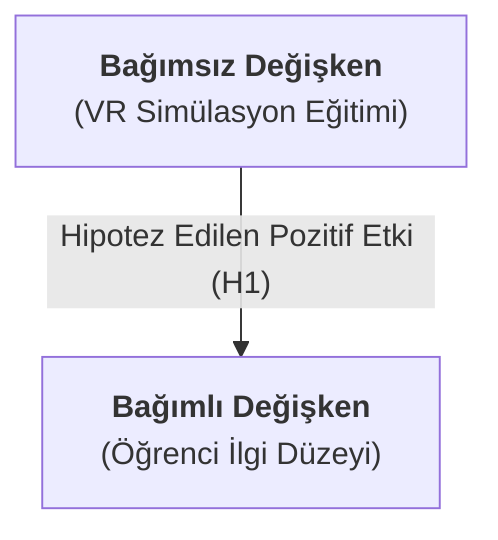
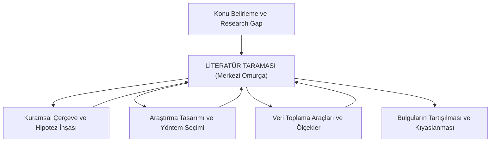

# Kavramsal Çerçeve

## [[Hipotez]] (Denence) Üzerine
Araştırma problemini çözüme kavuşturmak amacıyla öne sürülen, henüz doğrulanmamış fakat ampirik verilerle test edilmeye açık olan geçici çözüm önerisidir. 

**Bilimsel bir hipotez kesin bir yargı bildiren bildirim kipiyle kurulur**. İçerisinde sınanabilir bir ilişki, fark veya etki barındırır

#### Örnek: Turizm İşletmelerinde Temizlik Algısı
Bir turizm işletmesinde veya otelde kalan misafirlerin ortak alanlardaki temizlik algısı araştırma konusu yapıldığında hipotez şu şekilde formüle edilir:

$$
\Large
H_1 = \mu_{\text{kadın}} > \mu_{\text{erkek}}
$$

Bu formülasyon, "*Kadın müşterilerin otel temizlik algısı puan ortalaması, erkek müşterilerin puan ortalamasından anlamlı düzeyde yüksektir.*" önermesine tekabül eder. Araştırmacı, bu iddiayı anket yoluyla topladığı veriler üzerinden parametrik veya non-parametrik hipotez testleriyle sınar.

#### Örnek: Sivil Havacılık Eğitiminde Sanal Gerçeklik
Sivil havacılık eğitiminde sanal gerçeklik ve oyunlaştırma teknolojilerinin öğrenci tutumlarına etkisini inceleyen bir tez çalışmasında araştırmacı şu hipotezi kurar:

> $\mathbf{H_1 :}$ VR destekli simülasyon eğitimi alan deney grubunun ilgi düzeyi, geleneksel eğitim alan grubunun ilgi düzeyinden yüksektir.

Burada eğitim teknolojisi türü [[bağımsız değişken]], öğrencilerin ilgi düzeyi ise [[bağımlı değişken]] parametresine tekabül eder.

### İspat Yükü ([[ispat yükü|Burden of Proof]])
İspat yükümlülüğü **bir etkinin, farkın veya ilişkinin varlığını öne süren araştırmacıya aittir**. Bilimsel araştırma tasarımı, olgular arasındaki varlık ve değişim iddiaları üzerine inşa edilir. Bir etkinin mevcudiyetini savunan taraf, bu savı metodolojik araçlarla, veri toplama teknikleriyle ve istatistiki analizlerle kanıtlamakla yükümlüdür.

### **Boş Hipotez** (Null Hipotezi / Farksızlık Hipotezi $H_0$)
[[Boş Hipotez]]; incelenen değişkenler, gruplar veya popülasyon parametreleri arasında istatistiksel açıdan anlamlı bir farkın, etkinin veya ilişkinin bulunmadığını bildiren ön tanımlı (default) durumdur. Hukuktaki *[[masumiyet karinesi|masumiyet karinesi]]* ilkesiyle doğrudan örtüşür; **aksi ampirik verilerle ispat edilene kadar değişkenler arasında fark yahut ilişki olmadığı kabul edilir**. 

$H_0$ sembolüyle gösterilir. **Araştırmanın amacı boş hipotezi doğrulamak değil, toplanan verilerle çürütmeye çalışmaktır**. Veriler, $H_0$ doğruymuş gibi beklenecek sonuçlardan anlamlı biçimde sapıyorsa $H_0$ reddedilir; sapma yoksa $H_0$ reddedilemez. $H_0$'ın reddedilememesi onun doğru olduğunu kanıtlamaz, yalnızca elde yeterli kanıt bulunmadığını gösterir.

### **Alternatif Hipotez** (Araştırma Hipotezi - $H_1$)
[[Alternatif hipotez]]; araştırmacının kurumsal temellere dayanarak gerçekleşmesini beklediği, değişkenler arasında anlamlı bir farkın veya nedensel etkinin var olduğunu bildiren temel araştırma savıdır.

Boş hipotezin antisi zıddı olan kuramsal beklentiyi yansıtır. Tek yönlü alternatif hipotezler etkinin yönünü (büyüktür, küçüktür, pozitif yönde etkiler) açıkça ilan ederken, çift yönlü alternatif hipotezler yön belirtmeksizin gruplar arasında anlamlı bir farkın varlığına odaklanır.

### Literatür Taraması (Yazın Taraması)
Literatür taraması; seçilen araştırma problemi etrafında üretilmiş kuramsal ve ampirik çalışmaların (tezler, kitaplar, hakemli makaleler, konferans bildirileri, proje raporları) sistematik olarak taranması, sentezlenmesi ve mevcut bilgi birikiminin ortaya konulması sürecidir. 

* **Araştırma Boşluğu ([[Research Gap]]):** Literatürdeki kuramsal, yöntemsel veya bağlamsal eksikliklerin teşhis edilmesidir. Bilimsel bir araştırmanın gerekçesi ve özgün değeri, literatürde saptanan bu boşluğun doldurulması esasına dayanır.
* **Kartopu Tekniği ([[Snowballing]])**: İlgili alanda tespit edilen nitelikli ve öncü bir bilimsel kaynağın kaynakçasında yer alan referansların adım adım incelenerek diğer ilgili temel yayınlara ulaşılması ve literatür hacminin bu yolla genişletilmesi yöntemi.

### Hipotez İnşa Kuralları

1. **Yargı Bildirme İlkesi:** **Hipotezler soru cümleleri yerine kesin bildirim kipleriyle formüle edilir.**
2. **Tekil İlişki Odaklılığı:** Her bir hipotez tekil ve bağımsız bir etkiyi ölçmeye odaklanır. Birden fazla kuramsal yapıyı aynı cümlenin içerisine dahil etmek ölçümleme hatası yaratır. Örneğin *duygusallık düzeyi* ile *temizlik hassasiyeti* ayrı kavramlar olup müstakil hipotezler ($H_1$ ve $H_2$) olarak kurgulanmalıdır.
3. **Sınanabilirlik ve Yanlışlanabilirlik:** Bir hipotezin bilimsellik vasfı, ampirik verilerle yanlışlanabilme potansiyeline sahip olmasıyla doğrudan ilişkilidir (Karl Popper epistemolojisi). Yanlışlanamadığı sürece kuramsal güç kazanır.

### Hipotez Kurgusunun Dışlandığı Araştırma Desenleri
Modern bilişim ve veri odaklı araştırma ortamlarında hipotez kurgusu her nicel model için geçerli bir zorunluluk teşkil etmez:

- **Birliktelik Kural Madenciliği (Association Rule Mining)**: Veri madenciliği algoritmalarının veri setine doğrudan uygulanarak önceden tanımlanmış bir kuramsal iddia veya bağımlı-bağımsız değişken modeli olmaksızın gizli örüntülerin ve kuralların algoritma tarafından keşfedildiği desenlerde hipotez yer almaz. Bkz. [[veri-madenciligi-7#1. Birliktelik Kuralları ve Apriori Felsefesi|Birliktelik Kuralları ve Apriori Algoritması, Veri Madenciliği]]
* **Keşifçi Nitel Desenler:** Belirli bir kuramı ampirik olarak test etmek yerine, derinlemesine mülakat ve odak grup görüşmeleriyle sahadan yeni kavram ve kuram üretmeyi amaçlayan nitel desenlerde önsel hipotezler yerine keşifçi araştırma soruları merkeze alınır.

### Literatür Taramasının Araştırma Sürecindeki Konumu
Geleneksel çizgisel anlayış literatür taramasını yalnızca konu tespitinin ardından gelen geçici bir basamak olarak konumlandırırken, bilimsel araştırma metodolojisinde literatür taraması, sürecin tüm basamaklarını çevreleyen ve sürekli besleyen dinamik bir omurgadır:

* **Yöntemsel Rehberlik:** Önceki araştırmacıların kullandığı ölçeklerin, anket sorularının, veri analizi yöntemlerinin tespit edilmesini sağlar.
* **Bulguların Tartışılması:** Araştırma sonucunda elde edilen veriler doğrudan literatürdeki çalışmalarla kıyaslanır; örtüşen ve ayrışan yönler kuramsal zeminde açıklanır.

### Akademik İndeks Hiyerarşisi ve Bilimsel Ürün Türleri
Bilimsel araştırmalar sonucunda beş temel ürün ortaya çıkar: [[Tez]], [[Kitap]], [[Makale]], [[Bildiri]] ve [[Poster]]. Makalelerin bilimsel geçerliliği ve etki gücü, tarandıkları indekslerin niteliğiyle ölçülür.

| Düzey                          | İndeks Adı                      | Açıklama ve Kapsam                                                                            |
| :----------------------------- | :------------------------------ | :-------------------------------------------------------------------------------------------- |
| **Uluslararası En Üst Düzey**  | [[Web of Science]] (WoS)        | [[SSCI]] (Social Sciences Citation Index), [[SCI]] (Science Citation Index), [[SCI-Expanded]] |
| **Uluslararası Gelişen Düzey** | [[ESCI]] / [[Scopus]]           | Emerging Sources Citation Index ve Elsevier bünyesindeki Scopus veri tabanı                   |
| **Disipliner Teknik Düzey**    | [[IEEE Xplore]] / ScienceDirect | Mühendislik, bilişim, yazılım ve yönetim bilişim sistemleri odaklı teknik literatür           |
| **Ulusal En Üst Düzey**        | [[TR Dizin]]                    | TÜBİTAK ULAKBİM tarafından taranan yüksek standartlı ulusal hakemli dergiler                  |
| **Ulusal Dergi Platformu**     | [[DergiPark]]                   | Türkiye'deki akademik dergilerin dijital süreç yönetimini sağlayan açık erişim merkezi        |

---

| Parametre                 | Boş Hipotez ($H_0$)                              | Alternatif Hipotez ($H_1$)                               |
| :------------------------ | :----------------------------------------------- | :------------------------------------------------------- |
| **Kavramsal Anlamı**      | Farksızlık, etkisizlik ve ilişkisizlik durumu    | Farkın, ilişkinin ve nedenselliğin varlığı               |
| **Metodolojik Statüsü**   | Sistemin öntanımlı (default) kabülü              | Araştırmacının kanıtlamakla yükümlü olduğu sav           |
| **Hukuksal Karşılığı**    | Masumiyet Karinesi (ispatlanana kadar suçsuzluk) | İddia makamının ortaya koyduğu suçlama                   |
| **Matematiksel Gösterim** | $\mu_1 = \mu_2$ veya $\mu_1 - \mu_2 = 0$         | $\mu_1 \neq \mu_2$, $\mu_1 > \mu_2$ veya $\mu_1 < \mu_2$ |
| **Test Edilme Amacı**     | Analiz yoluyla reddedilmeye çalışılır            | Analiz yoluyla desteklenmeye çalışılır                   |
| **Araştırma Başlangıcı**  | Araştırma farksızlık üzerine inşa edilmez        | Araştırma doğrudan $H_1$ doğrultusunda yapılandırılır    |
