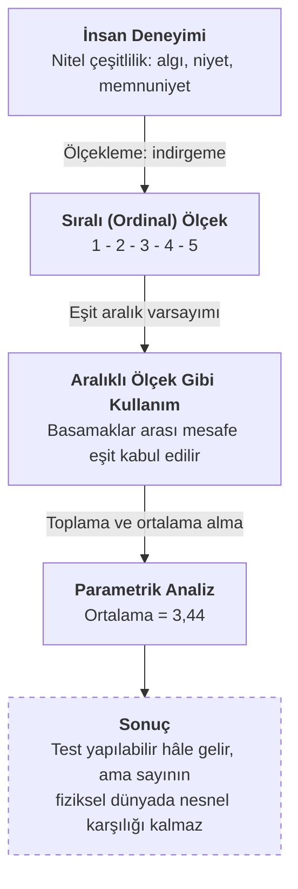
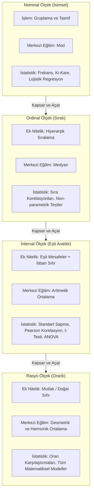
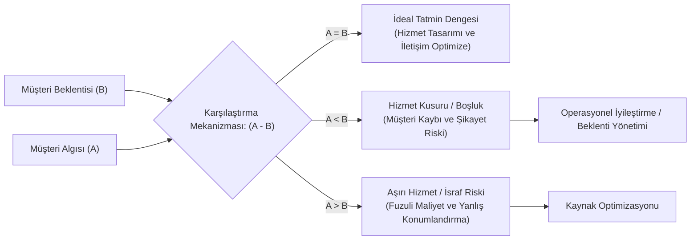

# Kavramsal Çerçeve

## Ölçme Kuramı ve Sembolik Atama (Measurement Theory)

**Ölçme, bir nesneye, niteliğe veya kavrama belirli kurallar uyarınca sembol atama sürecidir.** Bu semboller sayısal, sözel veya görsel formlar alır. Bir bireyin ikamet ettiği ilçenin kaydedilmesi ile boy uzunluğunun metre cinsinden kaydedilmesi, kavrama önceden tanımlanmış bir sembolün tahsis edilmesi yönüyle özdeş bir ölçme işlemi niteliği taşır. Sayısal veri varlığı, daha derin parametrik istatistiksel testlerin yürütülmesine zemin hazırlar; sözel sembol atamaları ise kategorik ve frekans temelli çözümlemelerin yürütülmesini sağlar.

## Değişken ve Değer Tipolojisi (Variables and Values)
[[kavram-degisken|Değişken]], birden fazla değer alabilen, durağanlıktan uzak her türlü kavramsal veya fiziksel unsuru ifade eder. Değer ise ilgili değişkenin alabileceği her bir gözlemi veya sembolü tanımlar:

- **Nitel Değişkenler**: Sayısal hiyerarşi barındırmayan, durum ve kategori bildiren yapılardır (cinsiyet, ikamet yeri).
- **Nicel Değişkenler**: Sayısal büyüklük bildiren, miktar belirten yapılardır (yaş, gelir, boy uzunluğu).
- **[[kesikli değişken|Kesikli Değişkenler]]**: Belirli tam sayı basamaklarını alan, iki değer arasında sonsuz parçalanma göstermeyen yapılardır (Hane halkı sayısı gibi).
- [[sürekli değişken|Sürekli Değişkenler]]: Belirli bir aralıkta sonsuz sayıda değer alabilen, hassas ara birimlere bölünebilen yapılardır (zaman, uzunluk, ağırlık gibi).

## Nominal Ölçek (Nominal Scale)
Bkz. [[nominal]] **:)**

Nominal (isimsel) ölçek, değişkenlerin aldığı değerlerin yalnızca gruplanabildiği, kategorilere ayrılabildiği en temel ölçüm basamağıdır. Değerler arasında büyüklük, küçüklük veya hiyerarşik üstünlük bulunma durumu söz konusu değildir, sadec *string* türünde ölçüme tabi tutulamayan bir değerdir. Cinsiyet ve ikâmetgah gibi.

- **İstatistiksel İşlem Sınırı**: Sayısal büyüklük eksikliği sebebiyle bu ölçükte frekans dağılımları ve yüzdelikler hesaplanır. Merkezi eğilim ölçüsü olarak en çok tekrar eden değeri veren mod (tepe değer) kullanılır. İki kategorili (binomial) bağımlı değişkenlerin modellenmesinde ([[veri-madenciligi-9#D. Lojistik Regresyon|lojistik regresyon analizi]]) tercih edilir.
	- Bkz. [[veri-madenciligi-9#Regresyonun Temel Mantığı ve Makine Öğrenmesindeki Yeri|veri madenciliğinde regresyon]]

## Ordinal Ölçek (Ordinal Scale)
Bkz. [[ordinal]]

Ordinal (sıralı) ölçek, değişkenin aldığı değerlerin belirli bir hiyerarşik kritere göre büyükten küçüğe veya üstten alta doğru sıralanabildiği ölçüm düzeyidir. Bu ölçekte değerlerin sırası bilinir; ancak basamaklar arasındaki mesafelerin mutlak büyüklüğü ve eşitliği belirsizliğini korur:

- **Örnek**: Askerî unvanlar (Albay > Çavuş), Akademik sınıflar (4. Sınıf > 2. Sınıf), Müşteri memnuniyet derecesi (1 Yıldız - 5 Yıldız)
- **İstatistiksel İşlem Sınırı**: Basamaklar arasındaki aralıkların matematiksel eşitlikten yoksun oluşu, **aritmetik ortalama ve standart sapma işlemlerini geçersiz kılar**. Kullanılabilen merkezî eğilim ölçüleri mod ve medyan değerleridir. 

## İnterval Ölçek (Interval Scale)
Bkz. [[interval]]

**İnterval (eşit aralıklı) ölçek, birimler arasındaki mesafelerin birbirine tam olarak eşitlendiği ve uzlaşımsal (itibarî) bir başlangıç noktasının tanımlandığı ölçüm yapısıdır**. Bu düzeyde bulunan sıfır noktası mutlak yokluk bildiriminden uzaktır; toplumun veya bilimsel otoritenin belirlediği bir referans hizasını temsil eder.

Örneğin, *Celcius* termometresi ($0^\circ\text{C}$ sıcaklığın yokluğu anlamına gelmez, suyun donma çizgisini gösterir), Takvim yılları.

- **İstatistiksel İşlem Sınırı**: Aralıkların eşitliği sayesinde toplama, çıkartma, aritmetik ortalama ve standart sapma işlemleri meşruiyet kazanır. Mutlak bir başlangıç noktasının eksikliği sebebiyle çarpma, bölme, oranlama ve üstel çarpım gerektiren geometrik ortalama hesaplamaları olanaksızlaşır.

## Rasyo Ölçek (Ratio Scale)
Rasyo (<ratio; **oran**) ölçeği, eşit aralık özelliğine ek olarak mutlak ve doğal bir sıfır noktası barındıran en gelişmiş ölçüm düzeyidir. Bu ölçekteki sıfır değeri, ölçülen niteliğin tam olarak yokluğunu ifade eder. Örneğin yaş, boy uzunluğu, ağırlık, cüzdandaki nakit para miktarı.

- **İstatistiksel İşlem Sınırı**: Matematiksel ve istatistiksel işlemlerin tümü (çarpma, bölme, oranlama, geometrik ortalama, harmonik ortalama vs.) tam geçerlilik taşır. 40 yaşındaki bir bireyin 20 yaşındaki bir bireyin iki katı süre dünyada bulunduğu kesin bir oranla ifade edilir.

## Skala Ölçek Bütünleşmesi
İstatistiksel analiz yazılımlarında (SPSS, R vb.) ve veri bilimi mimarilerinde aralıklı ([[interval|interval]]) ve oranlı (ratio/rasyo) ölçekler arasındaki sıfır noktası ayrımı pratik modellemelerde çoğu kez tek bir çatı altında birleştirilerek "Scale" değişken türü olarak kodlanır. Her iki ölçek türü de sürekli veri karakteri taşır ve parametrik istatistik testlerinin yürütülmesine zemin hazırlar.

## Puanlandırma ve Sıralama Ölçekleri (Rating and Ranking Scales)
- **Sabit Toplamlı Ölçek (Constant Sum Scale)**: Katılımcıya belirli bir toplam puan tahsis edilir ve bu puanı sunulan kriterler arasında paylaştırması istenir. Yanıtlayıcıyı kriterler arasında [[ödünleşim]] yapmaya zorlayarak her kritere peşinen yüksek puan verilmesini engeller.
- **İzafi/Ağırlıklandırma Ölçeği (Comparative Rating Scale)**: Katılımcının kriterleri 100 baz puanı üzerinden birbirinden bağımsız olarak derecelendirdiği yöntemdir.
- **Sıralama Ölçeği (Rank-Order Scale)**: Katılımcıdan seçenekleri tercih sırasına göre dizmesi talep edilir. Bu yöntem doğrudan sıra verisi üretir ve analizinde sıra sayıları istatistiği işletilir.

![[Pasted image 20261027080630.png]]
## Semantik Farklılık ve Stapel Ölçekleri
- **Semantik Farklılık Ölçeği (Osgood)**: Ölçülmek istenen kavramın iki zıt kutbuna antonim sıfatlar (Hızlı-Yavaş, İlkel-Modern, Pahalı-Ucuz) yerleştirilir; araya 5 veya 7 basamaklı eşit aralıklı alanlar konarak katılımcının algı düzeyi tespit edilir. İki farklı markanın veya ürün prototipinin karşılaştırılmasında profil analizine imkân tanır. **Nesnenin ya da kişinin algılanışını zıt anlamlı sıfat çiftleri arasında konumlandırarak ölçen ölçek**.
- **Stapel Ölçeği**: Zıt sıfat çiftleri yerine merkezde tek bir sıfat yer alır. Bu sıfatın altına ve üstüne $+5$ ile $-5$ arasında değişen basamaklar yerleştirilerek nötr sınıf noktası dışarıda tutulur.

![[str.png]]

## Grafiksel ve İkonik Ölçekler 
**Okuma-yazma yetkinliği bulunmayan kitlelerde, çocuklarda veya uluslararası geçiş noktalarında dil bariyerini aşmak amacıyla gülen yüzlerden ağlayan yüzlere doğru sıralanan görsel ikonlar veya kesintisiz doğru çizgileri kullanılır.** Doğru çizgisi üzerinde işaretlenen nokta cetvelle milimetrik olarak ölçülerek [[sürekli değişken|sürekli]] bir sayısal değere dönüştürülür.

## Likert Tipi Ölçek
Bireylerin tutum, algı, niyet ve davranış sıklıklarını önceden belirlenmiş yargı cümlelerine katılım dereceleri üzerinden ölçer (1: Hiç Katılmıyorum  5: Tamamen Katılıyorum):
* **Kategori Sayısı Seçimi:** Literatürde 2 ile 11 basamak arasında değişen skalalar uygulanır.
* **Kaçış Rampası Sorunu:** Tek sayılı ölçeklerde (5'li, 7'li) yer alan nötr orta basamak, bilişsel zahmetten kaçınan yanıtlayıcılar için sığınak oluşturur. Bireyi kesin tutum bildirmeye yöneltmek isteyen araştırmacılar nötr noktayı kaldırarak çift sayılı (4'lü veya 6'lı) zorlamalı seçim ölçeklerini tercih eder.
* **Ayrım Hassasiyeti Riski:** Ölçek basamağının 11'e çıkarılması matematiksel süreklilik hissi verir; ancak insan zihninin 9 ile 10 puan arasındaki farkı bilişsel olarak ayrıştırma kabiliyeti zayıflar.

## Hizmet Kalitesi Modeli
**Hizmet kalitesini** tekil bir çıktı algısı üzerinden ölçmek yerine **bireyin deneyim öncesi beklentisi ($B$) ile deneyim sonrası algısı ($A$) arasındaki fark eskseninde tanımlar**:

$$
\text{Hizmet Kalitesi Skoru} = \text{Algı (A)} - \text{Beklenti (B)}
$$

 - $A=B$: İdeal tatmin dengisi.
 - $A \lt B$: Hizmet kusuru veya müşteri tatminsizliği.
 - $A \gt B$: Müşteri süprizi, beklentiyi aşan hizmet (Operasyonel maliyet fazlalığı ve aşırı kaynak tahsisi riski barındırır).

Bkz. [[Müşteri Tatmini]]

---

# Sebep-Sonuç zincirleri falan.

Beşerî ve yönetsel bilimlerde doğrudan gözlemlenemeyen soyut yapılar (algı, niyet, memnuniyet), yapay ölçekleme araçları vasıtasıyla sayısallaştırılır. Bu sayısallaştırma süreci indirgeme yapmay zorunlu kılar. Bireylerin bir mobil uygulamaya verdikleri 1 ile 5 arasındaki puanlar sıralı ([[ordinal]]) bir nitelik taşırken, araştırmacılarrın bu verileri toplayıp aritmetik ortalama alarak $3,44$ gibi küsuratlı değerler üretmesi, eşit aralık varsayımının yapay olarak kabul edilmesinden kaynaklanır. Bu varsayım araştırmacıya parametrik test yapma imkânı sağlamasına karşın elde edilen sonucun fiziksel dünyada somut bir nesnel karşılık bulmasını engeller.

## Öz-bildirim yanlılığına ve kesin veri toplama kısıtına dair
Bir enformasyon sisteminde kullanıcı davranışını ölçerken araştırmacının karşısına iki temel kısıt çıkar:

1. **Donanıma/yazılıma dair kesin veri toplama kısıtı**: Kullanıcının sistemde geçirdiği süreyi arka plan sevisleriyle milisaniye düzeyinde loglamak, kesin rasyo verisi üretir. Bu durum yüksek yazılım geliştirme maliyeti, sistem kaynak tüketimi, veri güvenliği yükümlülüğü ve kullanıcı rızası bariyeri oluşturur.
2. **Öz-bildirim maliyeti** Ankete dayalı geri toplama süreci maliyetleri minimize eder ancak insanın kendini değerlendirme konusundaki subjektif yanlılıkları, zamanı algılama hataları ve sosyal beğenilirlik kaygıları sebebiyle verinin güvenilirlik katsayısını düşerir.

## analiz kasalım...
İşletmeler açısından hizmet kalitesi, tüketici beklentisinin yönetilmesiyle doğrudan bağlantılıdır, salt operasyonel çıktının kalitesi ile değil. Hizmet işletmelerinin pazarlama iletişiminde aşırı vaatlerde bulunması, müşterinin zihnindeki beklenti eşiğini yükseltir. Operasyonel performans ne kadar yüksek olursa olsun algının beklentinin altında kalması ($A < B$) neticesinde hizmet kalitesi skoru negatife düşer. Algının beklentiyi aşması ($A > B$) tüketici nezdinde geçici bir memnuniyet üretir; ancak işletme açısından ihtiyaç fazlası kaynak tahsisine ve maliyet artışına yol açarak uzun vadeli kârlılığı zedeler. Yönetsel optimizasyon, beklenti ile algının tam eşitlendiği ($A = B$) noktada gerçekleşir.

---

# Diyagramlar falan.

## SERVQUAL

