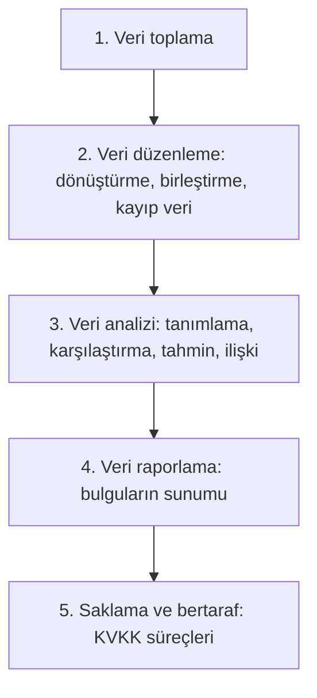
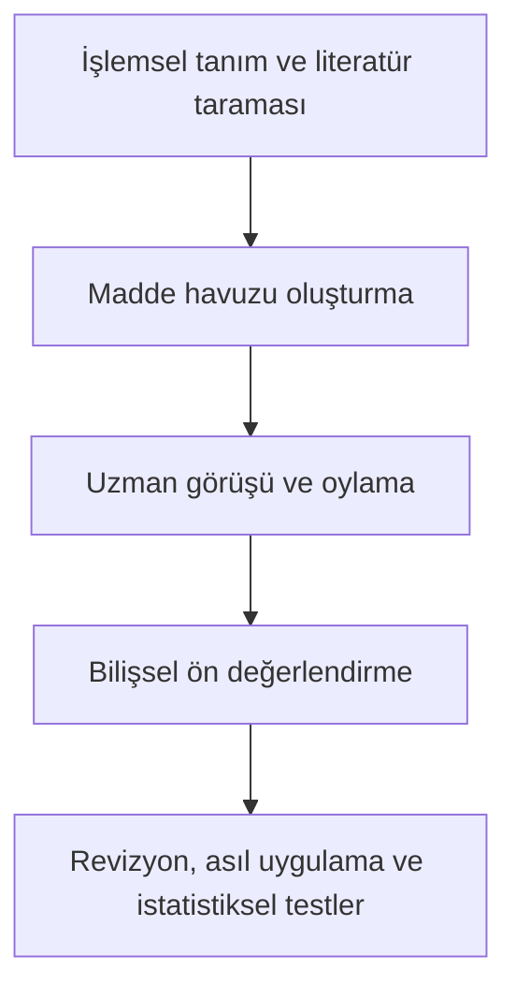

Bilimsel araştırma süreci birbirini izleyen dört ana basamaktan oluşur.

1. **Problemin tanımlanması**: Amaç ve önemin ortaya koyulması; araştırma önerisinin, problem cümlesinin ve araştırma sorularının yazılması bu aşamada tamamlanır.
2. **Araştırma tasarımı**: Değişkenlerin ve ölçeklerin seçilmesi, neyin nasıl ölçüleceğine karar verilmesi burada yapılır. Kimin veya neyin inceleneceğini belirleyen [[ATLAS/0-ybs-notlari/YBS3005-teknolojik-arastirma-yontemleri/ders-6#Örneklem ve Örnekleme Birimi (Sampling Unit)|Örneklem Belirleme]], hem tasarımla hem de veri işleriyle bağlantılı olmaklarla beraber ağırlıklı olarak tasarım basamağı altında konumlanır.
3. **Veri işlemleri**: Sahadan veya mevcut kaynaklardan verinin toplanması, analize hazır hâle getirilmesi, çözümlenmesi, bulguların çıkarılması ve verinin güvenle saklanıp imha edilmesi bu basamağın konusudur.
4. **Raporlama**: Yapılan tüm çalışmanın bilimsel kurallara uygun bir yazılı metne dönüştürülmesidir.

Araştırmanın çıktısı olarak ortaya konan beş temel [[ATLAS/0-ybs-notlari/YBS3005-teknolojik-arastirma-yontemleri/ders-4#Akademik İndeks Hiyerarşisi ve Bilimsel Ürün Türleri|Bilimsel Ürün]] türü vardır: **makale, tez, kitap, bildiri** ve **poster**. Bir yazılım veya sistem geliştirilmiş olsa dahi bu beş ürünün tamamı **yazılı doküman** hâline getirilmek zorundadır. Standart bir bilimsel raporlama akışı şöyle bir sıra izler: **Özet $\to$ Giriş $\to$ Metot $\to$ Bulgular $\to$ Sonuç ve Değerlendirme $\to$ Kaynakça**.

## Veri işlemleri döngüsü
Veri işlemleri tek bir analiz adımından ibaret değildir. Ham verinin toplanmasından sonlandırılmasına kadar uzanan beş halkalı bir döngüdür.

## Veri düzenleme: dönüştürme, birleştirme ve kayıp veriler

Toplanan ham veri doğrudan analize girmez. Bilişim perspektifinden bakıldığında farklı ortamlardaki veya veri tabanlarındaki kayıtların bir araya getirilmesi gerekir; bu işleme **[[Veri Birleştirme]] (Aggregation)** denir. Hatalı kayıtlar ayıklanır, tutarsızlıklar giderilir ve veri analiz formatına uyarlanır.

**[[Veri Dönüştürme]] (Transformasyon / Recoding)**, toplanan veriyi doğrudan kendi yapısıyla değil, analizin gerektirdiği yeni bir biçimde kullanmak için yeniden kodlamak veya ondan yeni veri türetmektir. İki temel biçimde uygulanır:

- **Ölçek düzeyi düşürerek gruplama:** Gerçek sayısal değerleri taşıyan ve matematiksel işlem yapılabilen **[[ders-5#Rasyo Ölçek (Ratio Scale)|Oran Ölçeği]]** (ratio scale) verileri, daha alt bir ölçek olan **[[ders-5#Ordinal Ölçek (Ordinal Scale)|Sıralama Ölçeği]]** (ordinal scale) gruplarına çevrilebilir. Örneğin `18, 19, 20` gibi yaş verileri `18-25`, `25-40`, `40 ve üstü` biçiminde kategorilere bölünebilir. Benzer şekilde mutlak sıfırın *"hiçbir bilgi sunulmaması"* anlamına geldiği sayısal sınav puanları transkripte `AA, BA, BB` harf notları olarak işlenir.
  - **Sınır ve bilgi kaybı:** Oran ölçeğinde 40 yaş 20 yaşın tam iki katıdır. Ancak yaş gruplarına veya harf notlarına dönüştürüldüğünde kimin kimden büyük ya da başarılı olduğu bilinse de aradaki farkın *ne kadar* olduğu bilgisi kaybolur ve matematiksel işlem yapılamaz.
- **Ölçek değiştirmeden veri türetme:** Katılımcıdan alınan doğum yılı bilgisinden yaş değerinin hesaplanması gibi, mevcut değişken kendi ölçeği içinde analiz edilebilir başka bir değişkene dönüştürülür.

**[[Kayıp Veri]] (Missing Values) Yönetimi:** Anket veya veri tabanında bazı gözlemler eksik kaldığında (örneğin 20 sütunlu bir kayıtta yaş hücresinin boş olması) araştırmacının önünde iki yol vardır:

1. **Kaydı çıkarma:** Tutarsızlık görülüyorsa veya eksik veri oranı yüksekse ilgili kayıt veri setinden tamamen atılır.
2. **Değer atama:** Kaydın diğer sütunlarını kaybetmemek için boş alana uygun bir değer atanır. İstatistiksel yöntem seçildiğinde atanacak merkezi eğilim ölçüsü **değişkenin ölçek düzeyine** bağlıdır:

| Ölçek Düzeyi                                                                | Temel Özelliği                                     | Kayıp Veride Kullanılacak Ölçü     | Örnek Değişken              |
| :-------------------------------------------------------------------------- | :------------------------------------------------- | :--------------------------------- | :-------------------------- |
| **[[ders-5#Nominal Ölçek (Nominal Scale)\|Adlandırma Ölçeği]] (Nominal)]]** | Yalnızca kategori belirtir, sıralama yok           | **Mod** (en sık tekrarlanan değer) | Cinsiyet, bölüm             |
| **[[ders-5#Ordinal Ölçek (Ordinal Scale)\|Sıralama Ölçeği]] (Ordinal)**     | Sıra bildirir, farklar eşit veya ölçülebilir değil | **Medyan** (ortanca değer)         | Harf notu, memnuniyet grubu |
| **[[ders-5#Rasyo Ölçek (Ratio Scale)\|Oran Ölçeği]] (Ratio)**               | Eşit aralıklı, mutlak sıfırlı, işlem yapılabilir   | **Aritmetik ortalama**             | Yaş, gelir, süre            |

İstatistiksel atama dışında araştırmacı, hedef kitleye dair mevcut bilgisine dayanarak bağlamsal bir tahmin değeri de atayabilir (örneğin üniversite sınıfından toplanan yaş verisinde eksik kayda `55` değil `20-21` aralığında bir değer yazılması).

## Veri analizi yöntemlerine genel bakış

Düzenlenmiş veriler, yapılarına göre farklı analiz kulvarlarına girer. Sosyal medyadaki ya da e-ticaret pazaryerlerindeki (örneğin Trendyol'daki 1000 ürün yorumunun yapay zekâ ile özetlenmesi) metinlerin çözümlenmesine **[[Metin Analizi]] / [[Metin Madenciliği]]**; görüntülerin işlenmesine **görsel analiz**; Excel ya da SPSS'teki satır-sütun verilerinin incelenmesine ise **tabular veri analizi** denir. İstatistiksel yöntemler temel olarak dört amaçla kullanılır:

1. **Tanımsal (Betimsel) İstatistik:** Örneklemin genel profilini çıkarır (*"Sınıfın yaş ortalaması 21,5; %60'ı erkek, %40'ı kadındır."*).
2. **Ortalama Karşılaştırması:** İki veya daha fazla grubun belirli bir değişkendeki ortalamalarını kıyaslar (*"Kadın öğrencilerin ders başarısı erkeklerden yüksektir"* veya *"2026 ihracat rakamları 2025'e göre %10 artmıştır"*).
3. **Tahminleme:** Geçmiş verilerden bir denklem kurarak gelecek değerleri kestirir; bu amaçla **[[Doğrusal Regresyon]]** gibi modeller kullanılır.
4. **Birlikte Hareket (İlişki) Analizi:** İki değişkenin değişim yönünü inceler. Ekonomi dersinde görüldüğü üzere fiyat arttıkça talebin azalması gibi ters yönlü hareketler negatif **[[ders-3#Değişkenler ve Nedensellik|Korelasyon]]** üretir.

## Raporlama, saklama ve bertaraf (KVKK)

Bilimsel bir metinde analizlerden elde edilen sayısal çıktılar **Bulgular** bölümünde tarafsızca sunulur; bu çıktıların ne anlama geldiği ise **Sonuç ve Değerlendirme** bölümünde yorumlanır.

Günümüzde **KVKK** çerçevesinde araştırmacı, topladığı verinin ne kadarını kullanacağını, araştırma dışında başka bir amaçla kullanmayacağını, veriyi nasıl saklayacağını ve işlem bitiminde nasıl imha edeceğini baştan ilan etmek zorundadır. Resmî kurumlarda bu süreç sıkı prosedürlere bağlıdır: Üniversite sınav notlarının fiziksel olarak 5 yıl saklanıp ardından imha edilmesi veya askerî yazışmaların gizlilik/aciliyet derecesine göre belirli süreler tutulup kâğıt kesme makinelerinde yok edilmesi bunun somut örnekleridir.

# Veri kaynakları ve sosyal bilimlerde veri toplama

### Birincil veri ve ikincil veri ayrımı

Araştırmada kullanılan veri, elde ediliş biçimine göre ikiye ayrılır:

- **[[Birincil Veri]]:** Doğrudan yürütülen araştırmaya özgü olarak, araştırmacının kendi bilimsel süreçleriyle (örneğin deney veya anket yaparak) sıfırdan topladığı veridir.
- **[[İkincil Veri]]:** Başka bir araştırmada ya da kurum tarafından önceden toplanıp raporlanmış verinin (örneğin TÜİK enflasyon verilerinin) kullanılmasıdır.

| Karşılaştırma Ölçütü | Birincil Veri                                 | İkincil Veri                                                      |
| :------------------- | :-------------------------------------------- | :---------------------------------------------------------------- |
| **Güvenilirlik**     | Daha yüksektir; süreç doğrudan kontrol edilir | Başka kaynağın çarpıtma veya hata riskini taşır                   |
| **Güncellik**        | Araştırma anına özgü olduğu için günceldir    | Geçmişte toplandığı için güncelliğini yitirmiş olabilir           |
| **Hız ve Maliyet**   | Toplama süreci uzun ve zahmetlidir            | Hazır olduğu için hızlı erişilir                                  |
| **Teknik Kapsam**    | Araştırmacının gücü yetmeyebilir              | Tekil araştırmacının toplayamayacağı makro verilere erişim sağlar |

**Temel Ayrım:** Birincil veri doğruluk ve güncellik kazandırırken, ikincil veri hız ve kapsam yetersizliğini aşma avantajı sağlar.

## Disiplinlere göre teknikler ve sosyal bilimlerde deney

Veri toplama teknikleri çalışılan bilim dalına göre şekillenir: Mühendis ölçüm cihazıyla, tarihçi arşiv araştırmasıyla, editör içerik analiziyle veri toplar. Sosyal bilimlerde ise temel olarak dört teknikten söz edilir: **[[Anket]]**, **[[Deney]]**, **[[Gözlem]]** ve **[[Mülakat]] (Görüşme)**. (Mühendislerin cihazla yaptığı ölçümler sosyal bilim şablonunda deney başlığı altına yerleştirilebilir.)

Deney kavramı yalnızca laboratuvarda tüplerin karıştırılması anlamına gelmez. Sosyal bilimlerde de doğal akışa müdahale edilip **kurgulanmış bir ortam** yaratılıyor ve katılımcıların tepkisi ölçülüyorsa bu bir deneydir. Örneğin bir markette abur cubur vitrininin önüne kilolu bir kişinin yerleştirilmesiyle müşterilerin satın alma davranışındaki değişimi ölçmek veya 6-10 yaş arası çocuklar için sanal bir mağaza kurgulayıp tepkilerini kaydetmek sosyal bilim deneyleridir.

# Anket tasarımı: soru formu, ölçek ve uygulama yöntemleri

## Soru formu ve ölçek farkı

Öğrenci memnuniyetini ölçmek için *"Memnun musunuz? Evet/Hayır"* diye tek bir soru sormak ya da akla gelen birkaç maddeyi (*"Kaynaklar güncel mi?", "Hoca adaletli mi?"*) alt alta sıralamak **[[Soru Formu]]** oluşturmaktır. Soru formu basit bilgiler verir ancak kavramı kuramsal olarak tüm yönleriyle yakalayamaz.

**Ölçek** ise ölçülmek istenen soyut kavramın tüm **alt boyutlarını** kapsayan, önceden bilimsel ve istatistiksel süreçlerden geçirilerek doğrulanmış ölçme aracıdır. Tıpta sağlığı ölçmek için yalnızca boy ve kiloya bakmak yerine kan tahlilinden akciğer filmine kadar tam bir check-up yaptırmak buna benzer. Örneğin hizmet kalitesini ölçen **[[ders-5#Hizmet Kalitesi Modeli|SERVQUAL]]** ölçeği beklenti ile algı arasındaki farkı tek bir soruda sormaz; kavramı **fiziksel özellikler, empati, güvenilirlik, heveslilik ve güvence** olmak üzere beş alt boyutta ölçer.

**Temel Ayrım:** Soru formu pratik ve yüzeysel veri toplarken, ölçek bir yapıyı kuramsal alt boyutlarıyla eksiksiz ölçer.

## Ölçek geliştirme, uyarlama ve izin süreçleri

Sıfırdan ölçek geliştirmek başlı başına bir tez konusu olabilecek kadar uzun soluklu bir araştırma sürecidir.

Yeni bir ölçek yazmadan önce mutlaka literatür taranmalıdır. Türkiye'de geliştirilmiş ölçeklere **[[TOAD]] (Türkiye Ölçek Dizini)** üzerinden erişilebilir. Örneğin *"Öğrenci Memnuniyeti"* aramasında ısıtma-soğutma hizmetinden öğretmenlerin adil davranmasına kadar uzanan 42 maddelik hazır ölçekler bulunabilir.

- **Ölçek kullanım izni:** Öğrenci ödevlerinde şart olmasa da tez, proje, makale veya bildiri gibi bilimsel çalışmalarda kullanılacak ölçek için **etik kurul** onayı gerekir. Bu nedenle ölçeği geliştiren yazara e-posta gönderilip yazılı kullanım izni alınır ve bu yazışmanın ekran görüntüsü etik kurula sunulur.
- **Bağlam uyarlama:** Otel ve restoranlar için geliştirilmiş SERVQUAL ölçeğini okul veya hastaneye uyarlarken hizmet alan kişinin *"müşteri"* değil *"öğrenci"* ya da *"hasta"* olması nedeniyle mevcut ölçek yetersiz kalır; uzman görüşüyle yeni maddeler eklenip çıkarılarak uyarlama yapılır.
- **Yabancı ölçek çevirisi ve geri çeviri (Back-Translation):** Yabancı dildeki bir ölçek Türkçeye çevrildiğinde anlam kayması (*"lost in translation"*) yaşanabilir. Bunu önlemek için A kişisi metni İngilizceden Türkçeye, B kişisi ise oluşan Türkçe metni yeniden İngilizceye çevirir. Üçüncü bir kişi iki İngilizce metni kıyaslayarak çeviri hatası olup olmadığını denetler.
## Soru yazım kuralları ve Likert tipi skalalar

Anketlerde açık uçlu, kapalı uçlu, tek yanıtlı, çoktan seçmeli ve demografik sorular yer alabilir. Madde yazımının en kritik kuralı **tek bir maddede tek bir kavramı ölçmektir**. *"Hocamız dersi iyi anlatmaktadır ve adildir"* veya *"Sistem hızlı ve kullanışlıdır"* gibi ifadeler iki farklı boyutu tek soruda birleştirdiği için hatalıdır (sistem hızlı olabilir ama kullanışlı olmayabilir). *Ek örnek:* Bir ERP arayüzü değerlendirmesinde *"Arayüz anlaşılır ve raporlama modülü hatasızdır"* sorusu iki ayrı maddeye bölünmelidir.

En yaygın ölçekleme biçimi 1950'lerde geliştirilen **[[ders-5#Likert Tipi Ölçek|Likert Ölçeği]]dir**. Yalnızca katılım düzeyi (*"Kesinlikle katılmıyorum - Kesinlikle katılıyorum"*) değil, davranış sıklığı (*"Asla, bazen, zaman zaman, sık sık, her zaman"*) veya beğeni (*"Çok kötü - Çok iyi"*) ifadeleriyle de kurulabilir. Genellikle **5'li** veya **7'li** tercih edilir; 9 ve 11 dereceli skalalarda katılımcının seçenekler arasındaki farkı ayırt etmesi zorlaşır. Katılımcıyı ortadaki *"kararsızım"* seçeneğine sığınmaktan alıkoyup taraf seçmeye zorlamak istendiğinde **çift sayılı skalalar** (örneğin 6'lı ölçek) kullanılır.

## Anket uygulama türleri ve saha riskleri

Anketler sahaya dört farklı yolla uygulanır: **yüz yüze, telefon, posta ve çevrim içi**. Günümüzde posta neredeyse yalnızca fiziksel bir ürünün veya numunenin uzak mesafeye ulaştırılıp denetilmesi gerektiğinde kullanılır. **Google Forms** basit ve ücretsiz toplama sunarken, **SurveyMonkey** gelişmiş kurgular için ücretli özellikler barındırır.

| Uygulama Türü  | Güçlü Yönü                                                                                   | Temel Risk ve Sınırlılıkları                                                                                                                                                            |
| :------------- | :------------------------------------------------------------------------------------------- | :-------------------------------------------------------------------------------------------------------------------------------------------------------------------------------------- |
| **Yüz yüze**   | Anketör anlaşılmayan kavramları açıklayabilir (ör. *"mobbing nedir?"*); yaşlı kitleye ulaşır | Sosyal beğenirlik baskısı (hassas konularda veya nezaketen yanlış beyan), anketör yönlendirmesi, kâğıt verilerin SPSS/Excel'e girişinde yüksek iş yükü ve hata riski                    |
| **Telefon**    | Yüz yüzeye kıyasla sosyal baskı daha düşüktür                                                | Katılımcıların telefonu kapatması nedeniyle düşük yanıt oranı, görsel/yazılı yönlendirme zorluğu                                                                                        |
| **Çevrim İçi** | Düşük maliyet; CSV çıktısıyla Excel ve SPSS'e hızlı ve hatasız aktarım                       | **Örneklem kontrolsüzlüğü**, sosyal medya platformlarının kitle ayrışması (60+ yaşa ulaşamama; Twitter, Instagram, Facebook, TikTok kitle farkları), sahte beyan ve **bot yanıt** riski |

Çevrim içi anketlerin hız avantajı ciddi geçerlik ve güvenirlik tehditlerini beraberinde getirir. Katılımcılar video önü anketlerde gerçek yaşlarını gizleyebildiği gibi, yanıt başına ücret ödenen yurt dışı platformlarda bot yazılımlarla 20 yanıtın 19'unun yapay olarak üretildiği durumlar yaşanabilmektedir.
