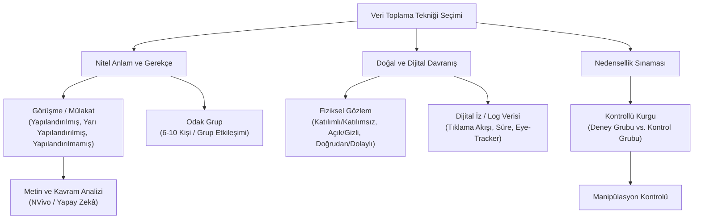

Bilimsel araştırmada veri yalnızca sayısal tablolardan oluşmaz. Bilişim ve Yönetim Bilişim Sistemleri (YBS) araştırmalarında ses, görüntü ve metin gibi yapılandırılmamış veriler de insan davranışını anlamak için sıkça işlenir. [[ders-7#Veri işlemleri döngüsü|Veri işlemleri döngüsü]] içinde küçük projelerde toplama, düzenleme, analiz, raporlama ve bertaraf adımlarını araştırmacının kendisi yürütür; büyük kurumsal projelerde ise her aşamadan sorumlu ayrı ekipler görev alır. Önceki haftada incelenen anket tekniğinin ardından bu oturum, diğer üç temel veri toplama tekniğini (**görüşme**, **gözlem** ve **deney**) araştırma tasarımındaki yerleri, uygulama mekanizmaları ve ürettikleri veri düzeyleriyle ele alır.

## Nitel Metin Verisi ve Kavram Çıkarma Mantığı

Anketlerden elde edilen satır-sütun biçimindeki tablo (*tabular*) verilerinin aksine görüşmelerden, açık uçlu yanıtlardan ya da ses kayıtlarının dökümünden elde edilen metin verisi doğrudan istatistiksel işleme girmez. Araştırmacı ham metni okuyup örüntüleri, tekrar eden ifadeleri ve alt boyutları yakalamaya çalışır.

Süreç üç adımda ilerler:

1. **Kavram Çıkarma (Kodlama):** Katılımcı yanıtlarındaki temel kavramlar ayıklanır. Örneğin dört kişiye *"Yapay zekâ nedir?"* diye sorulduğunda alınan *"insan tarafından oluşturulan araç"*, *"kendi başına bilgi üreten makine"*, *"birden fazla teknolojinin yanıt üretmesi"* ve *"insana yardımcı bilgi sistemi"* cevaplarından `insan`, `bilgi üretme`, `makine`, `teknoloji` ve `yardım` kavramları çıkarılır.
2. **İlişkilendirme ve Literatür Kıyaslaması:** Çıkarılan kavramların sıklığı ölçülür ve bu kavramların alanyazındaki çalışmalarla örtüşüp örtüşmediğine bakılır. Gerçek bir çalışmada yapay zekâyı tanımlarken uzmanların sıkça `taklit` kavramına vurgu yaptığı görülebilir; aynı görüşmenin devamında riskler ve fırsatlar gibi alt boyutlar da benzer biçimde kodlanır.
3. **Sınıflama ve Hiyerarşi Kurma:** İlişkili kavramlar çatı başlıklar altında toplanıp kelime ağaçları oluşturulur. Eskiden kâğıt üzerinde elle yapılan bu kodlama ve sınıflama işleri günümüzde **NVivo** gibi nitel analiz paket programlarıyla veya büyük dil modeli tabanlı araçlarla hızlandırılmaktadır.

## [[Görüşme]] (Mülakat) Tekniği

Görüşme, araştırmacının katılımcıyla doğrudan iletişim kurarak tutum, deneyim ve gerekçeleri derinlemesine öğrendiği nitel veri toplama tekniğidir.

**Avantajları ve Sınırlılıkları:** Ankette yer almayan takip sorularının sorulabilmesi görüşmeye esneklik ve yüksek doğruluk kazandırır. Buna karşın uygulama ve deşifre süresi uzundur, ses veya görüntü kaydının maliyeti yüksektir ve [[ders-6#Örneklem Hatası ve Temsil Yeteneği|örneklem]] küçük kaldığı için sonuçların evrene genellenebilirliği düşüktür.

### Yapılandırma Düzeyine Göre Görüşme Türleri

Görüşme seçimi, araştırmacının çalışılan kavramın boyutlarına ne kadar hâkim olduğuna bağlıdır:

| Görüşme Türü | Hazırlık Aracı | Esneklik ve Sondaj | Kullanım Koşulu | Analiz ve Kıyaslama |
| :--- | :--- | :--- | :--- | :--- |
| **Yapılandırılmış** | Kesinleşmiş soru formu | Form dışına çıkılmaz | Kavramın tüm boyutları literatürden biliniyorsa | Sorular aynı olduğu için kodlama ve kıyas kolaydır; alan dışı görüşmeci de uygulayabilir |
| **Yarı Yapılandırılmış** | Çerçeve soru formu | Cevaba göre ek soru sorulabilir | Ana boyutlar biliniyor ama yeni detaylar aranıyorsa | Konuya hâkim araştırmacının yönetmesi gerekir |
| **Yapılandırılmamış** | Yalnızca ana çatı başlık | Tamamen görüşmenin akışına bağlı | Konunun boyutları bilinmiyor, keşif amaçlanıyorsa | Yanıtlar paralel olmadığı için kıyas ve analiz zordur |

### Uygulama Teknikleri ve Odak Grup Görüşmesi

Görüşmenin verimli geçmesi, soru biçimine ve görüşmecinin iletişimi yönetmesine bağlıdır. Süreç kısa bir giriş sohbetiyle (*small talk*) açılır. Katılımcıyı tek kelimelik yanıtlara kapatmamak için *"Evet/Hayır"* soruları yerine *"nasıl"* veya *"anlatır mısınız"* kalıpları tercih edilir.

- **Sondaj (Probing):** Yanıtta geçen ilginç bir ifadeyi açmak için yöneltilen takip sorusudur (*"Birden fazla teknoloji derken hangilerini kastediyorsunuz?"*).
- **Yankı (Echoing):** Katılımcının kurduğu ifadeyi tekrarlayarak düşüncesini genişletmesini sağlamaktır.
- **Sessizlik:** Yanıt bittikten sonra kısa süre susup karşı tarafın sessizliği bozmak adına ek açıklama yapmasına alan açmaktır.

Görüşmelerde katılımcı sayısı önceden katı biçimde sabitlenmez; yeni tema veya kavram çıkmadığını fark ettiğiniz doygunluk noktasında veri toplama sonlandırılır. Görüşmenin toplu biçimi olan **[[Odak Grup Görüşmesi]]** ise genellikle 6-10 kişilik gruplarla 60-90 dakika sürer ve grup içi etkileşimi ölçer. Ancak gruptaki hiyerarşik ast-üst ilişkileri veya hassas konular katılımcıların açık konuşmasını engeller.

**Temel Ayrım:** Yapılandırılmış görüşme standart yanıtlarla kıyaslama olanağı verirken, yarı yapılandırılmış ve yapılandırılmamış görüşmeler sondajla yeni boyutlar keşfetmeyi sağlar.

## [[Gözlem]] Tekniği ve Dijital İz Verileri

Gözlem; insan, hayvan, nesne veya olay birimlerinin davranışlarını belirli bir kontrol listesi (*check-list*) aracılığıyla ya da serbest biçimde izleyerek veri toplama tekniğidir. İşletme, pazarlama ve örgütsel davranış çalışmalarında yaygın kullanılan bu teknik, beş ayrı eksende sınıflandırılır:

1. **Katılımlı vs. Katılımsız Gözlem:** Araştırmacı grubun doğal bir üyesi gibi davranıp içeri giriyorsa **katılımlı gözlem** yapar (örneğin bir siyasi mitinge, taraftar grubuna ya da toplu işe alımda adayların bekleme odasına gizli bir gözlemci yerleştirmek). Grubun dışında kalıp uzaktan izliyorsa **katılımsız gözlem** uygular.
2. **Açık vs. Gizli Gözlem:** Örnekleme izlendiği bildiriliyorsa **açık gözlem**, bilgi verilmeden izleniyorsa **gizli gözlem** söz konusudur. Gizli gözlem doğal davranışı yakalasa da günümüzde KVKK ve etik kurallar nedeniyle kullanım alanı oldukça daralmıştır. Açık gözlemin en büyük riski ise **[[Hawthorne Etkisi]]** ve sosyal kabul eğilimidir. Örneğin tanıtım filmi çekimi için sınıfa kamera girdiğini gören öğrencilerin ve hocanın bir anda olağan sınıf davranışını bırakıp son derece ilgili, ideal bir ders ortamı sergilemesi gözlemlendiğini bilmekten kaynaklanan davranış değişikliğidir.
3. **Doğrudan vs. Dolaylı Gözlem:** Bir davranış olay gerçekleşirken izleniyorsa **doğrudan gözlem** (konser sırasında katılımcıların tüketim tercihlerini kaydetmek), olay bittikten sonra geride kalan izlerden çıkarım yapılıyorsa **dolaylı gözlem** (konser bitiminde alanı dolaşıp boş kutu ve şişe dağılımına bakmak) yapılır.
4. **Yapılandırılmış vs. Yapılandırılmamış Gözlem:** İzlenecek davranışları belirleyen bir kontrol listesi varsa **yapılandırılmış**, belirli bir şablon veya tema verilmeden gözlem yapılıyorsa **yapılandırılmamış** sayılır. Sınıf içinde tema bildirilmeden uygulanan **sessiz gözlem** buna örnektir.
5. **Yapay vs. Doğal Gözlem:** Araştırmacı gözlem için kurgusal bir ortam kurduysa (örneğin laboratuvarda market rafı hazırlayıp göz izleme cihazı yerleştirdiyse) **yapay gözlem**, müdahalesiz gerçek ortamda izliyorsa **doğal gözlem** gerçekleşir.

### Bilişimde Gözlem: Dijital İz (Log) Verileri

YBS araştırmalarında doğrudan insan beyanına dayanan anketlerin yerini giderek sistem logları, tıklama akışları, oturum süreleri, sepet terk oranları ve fare izleme kayıtları almaktadır. Fiziksel ya da dijital ortamlarda kullanılan `eye-tracker` (göz izleme) cihazları, kullanıcının bir ürüne ya da ekrana ilk baktığı noktayı tespit ederek uyarıların veya sürdürülebilirlik etiketlerinin nereye yerleştirileceğini belirler.

E-ticaret sitelerindeki log analizleri doğrudan tasarıma yön verir. Örneğin bir hava yolu şirketinin (Pegasus) 7-8 adımlı bilet satın alma sürecinde, son ödeme ekranında seçilen biletin tarih bilgisi gösterilmediği için kullanıcıların tereddüde düşüp sepeti terk ettiği loglardan fark edilmiştir. Adım sayısı azaltılıp son ekrana uçuş özetini gösteren bir açılır liste eklendiğinde satın alma oranı yükselmiştir.

Dijital iz verileri [[ders-5#Rasyo Ölçek (Ratio Scale)|ölçek düzeyleri]] açısından da anketten ayrılır. Kullanıcıya *"Günde kaç kez Instagram'a bakarsınız?"* diye sorulduğunda alınan *"4-5 kez"* yanıtı tahmine dayandığı için **[[ders-5#Ordinal Ölçek (Ordinal Scale)|sıralı (ordinal) ölçek]]** düzeyinde kabaca bir büyüklük verir. Buna karşın sistem loglarından çekilen `4 saat 32 dakika 43 saniye` verisi gerçek sıfır noktasına sahip, matematiksel işlem yapılabilen **[[ders-5#Rasyo Ölçek (Ratio Scale)|oran (ratio) ölçeği]]** verisidir.

### Gözlem Notlarının Analiz Süreci

Serbest (sessiz) gözlem yoluyla toplanan çok sayıda not doğrudan bulguya dönüşmez; üç aşamalı bir ayıklama ve gruplama sürecinden geçer:

1. **Öznel Yorumların Ayıklanması:** Gözlenebilir olgu ile araştırmacının niyet okuması ayrılır. *"Hoca rahatsız oldu"*, *"süre ilerledikçe odak dağılıyor"* veya *"sıkıldığı için kalemle oynuyor"* gibi ifadeler yorum içerdiği için elenir. Buna karşılık *"Sınıfın bir kısmı yoklamadan sonra çıktı"*, *"ikinci derste PDF açıldı"* ve *"kalemle oynayanlar var"* gibi doğrudan gözlenen olgular tutulur.
2. **Örüntü ve Çatı Kavram (Tema) Oluşturma:** Kalan nesnel gözlemler ortak başlıklarda kümelenir. Örneğin birinci ve ikinci dersin süresini kıyaslayan notlar `dersler arası kıyas`, PDF kullanımına ilişkin notlar `ders tekniği ve araçları`, kalemle oynama veya uyuma notları ise `fiziksel gözlemler` teması altında toplanır.
3. **Derinlemesine Analiz ve Karar Alma:** Kümelere ayrılan temalar üzerinden problemin kök nedeni ve riskleri değerlendirilir. Yoklamadan sonra sınıftan ayrılanların dışarıda adli bir olaya karışması hâlinde yoklama listesinde var görünmelerinin yaratacağı kurumsal risk tespit edilince, keyfî bir yasak yerine veriye dayalı olarak ders sonunda ikinci yoklama alma kararına ulaşılır.

## [[Deney]] Tekniği

Deney, araştırmacının kurguladığı yapay bir ortamda bağımsız değişkene müdahale edip bağımlı değişkendeki değişimi ölçtüğü ve **nedensellik** kurmaya çalıştığı tekniktir. Sosyal bilimlerde deneyin yalnızca yapay gözlemden ibaret olduğunu savunan yaklaşımlar bulunsa da davranışsal iktisat ve kullanıcı deneyimi araştırmaları deneysel tasarımı yaygın biçimde kullanır.

- **Kahve Kartı Deneyi (*Dürtme* Örneği):** Bir kafede müşterilerin bir kısmına 8 boş damga alanlı (8 kahvede 1 bedava), diğer kısmına ise 10 damga alanlı ama ilk 2 damgası önceden basılmış kart verilir. İki gruptaki müşterilerin bedava kahveye ulaşmak için alması gereken sayı aynıdır (8 kahve). Ancak başlangıçta iki damgası dolu verilen grup, ödüle daha yakın hissettiği için diğer gruba kıyasla daha fazla satın alma davranışı sergiler.
- **Kullanılabilirlik Deneyi:** Yeni geliştirilen bir mobil uygulama veya oyunun kullanıcı dostu olup olmadığını görmek için arayüzü hiç tanımayan kullanıcılara belirli görevler verilir (*"birebir kapışma moduna git"*, *"bonusu al"*) ya da kullanıcının kendi hâlinde uygulamayı kurcalaması istenir.

### Sosyal Etki ve Kıtlık Etkisi Deney Tasarımı

E-ticaret sitelerindeki *"Bu ürüne bakanların %75'i satın aldı"* uyarısı **sosyal etki** (*peer pressure* / akran baskısı), *"Stokta son 3 ürün"* uyarısı ise **kıtlık etkisi** yaratır. Bu iki uyaranın satın alma davranışını gerçekten artırıp artırmadığını sınamak için 30 kişilik bir örneklem aynı ürün ekranı ve eşit bütçeyle 10'arlı üç gruba ayrılabilir:

1. **Deney Grubu 1 (Sosyal Etki):** Ürün sayfasında *"Kullanıcıların %75'i bu ürünü aldı"* ifadesini görür.
2. **Deney Grubu 2 (Kıtlık Etkisi):** Ürün sayfasında *"Stokta son 3 ürün kaldı"* ifadesini görür.
3. **Kontrol Grubu:** Tüm tasarımı aynı olan ekranda hiçbir uyarı yazısı görmez.

Satın alma oranları kontrol grubuyla kıyaslandığında uyaranların nedensel etkisi ortaya çıkar. Bu aşamada **manipülasyon kontrolü** (*manipulation check*) yapılması gerekir: Katılımcıya deney sonrasında *"Ekranda hangi uyarıyı gördünüz?"* diye sorulmazsa, davranış değişiminin gerçekten o yazıdan mı kaynaklandığı yoksa katılımcının yazıyı hiç fark etmediği hâlde başka bir nedenle mi satın aldığı anlaşılamaz.

## Veri Toplama Tekniklerinin Karşılaştırması

| Teknik | Temel Ölçüm Odağı | Güçlü Yönü | Temel Zayıflık ve Risk |
| :--- | :--- | :--- | :--- |
| **[[Anket]]** | Beyan edilen tutum ve niyet | Büyük örneklemden hızlı ve düşük maliyetle veri toplama | Beyan-davranış farkı; katılımcının kavramı (ör. mobbing, sürdürülebilirlik) bilmemesi veya çarpıtması |
| **[[Görüşme]]** | Anlam, gerekçe ve derin deneyim | Esneklik, sondajla konuyu açma | Zaman yoğunluğu, analiz maliyeti, küçük örneklem nedeniyle dar genelleme |
| **Odak Grup** | Ortak deneyim ve tartışma | Grup etkileşimiyle zengin veri üretimi | Hiyerarşik ilişkiler ve hassas konularda oto-sansür |
| **[[Gözlem]]** | Doğal ortamdaki gerçek davranış | Beyan yanlılığından bağımsız olması | Gözlenen kişinin davranış değiştirmesi (Hawthorne etkisi), KVKK sınırı |
| **Dijital İz / Log** | Gerçek zamanlı sistem etkileşimi | Nesnel, büyük hacimli ve oran ölçekli veri üretimi | Davranışın gerçekleştiğini gösterir ama *neden* gerçekleştiğini açıklamaz |
| **[[Deney]]** | Değişkenler arası nedensellik | Etki-tepki bağını kontrollü biçimde sınama | Kurgulanan ortamın yapaylığı nedeniyle gerçek hayatı tam yansıtamaması |

