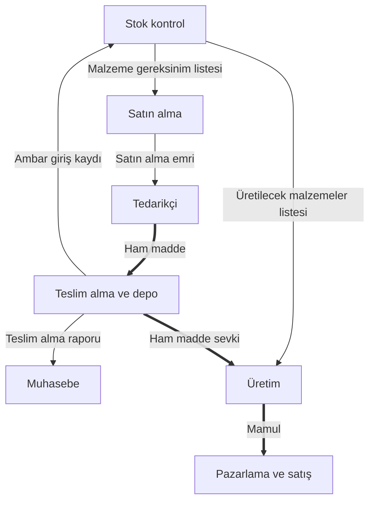

# Sistem Analizi ve Tasarımı — Çalışma Kâğıdı

**Kapsam:** Yalnızca gönderilen dört Markdown'ın ders içeriği kullanılmıştır. Tanımlar, örnekler, sayısal ifadeler ve açıklamalar bu metinlerden yeniden düzenlenmiştir. Çalışma soruları aynı içerik üzerinde cevap kurma alıştırmalarıdır; kesin sınav sorusu tahmini değildir. “Derse Aşkın” başlıklı bölümler bu çalışma kâğıdına alınmamıştır.

## 1. Cevabın kuruluşu ve işletmenin amaçları

*Dayanak: 1. ders — İşletme Üzerine, Kavramsal Çerçeveler; 5. ders — Ölçme, Değerlendirme ve Sınav Usulleri, Müşteri Talebi ve Değer Zinciri Entegrasyonu.*

### Gerekçeyi kurarak sonuca ulaşma

Sınav cevabında kavramı yalnızca adlandırmakla yetinilmez; olayın hangi ilişkilerle ortaya çıktığı açıklanır. Başlangıç koşulu belirtilir, ilgili süreçler birbirine bağlanır ve sonuç bu bağlantıların ardından yazılır. Bireysel sezginin yerine kavramsal dayanak ve neden-sonuç ilişkisi konur.

Tedarik gecikmesinin işletmeye etkisi, 5. dersteki anlatım üzerinden şöyle açıklanabilir:

> İşletme, müşterinin ihtiyaç duyduğu ürünü doğru zamanda, doğru kalitede ve taahhüt ettiği sürede karşılamak zorundadır. Ham maddenin gecikmesi üretimin gerçekleştirilmesini, üretimdeki aksama ise siparişin zamanında teslimini etkiler. Teslim taahhüdünün karşılanamaması yalnızca ilgili siparişin gelirini değil, işletmenin itibarını da etkiler. İhtiyacı karşılanmayan müşterinin rakip işletmeye yönelmesi pazar payının rakibe geçmesine neden olur. Bu nedenle tedarik süreci, işletmenin gelir, itibar ve süreklilik amaçlarıyla birlikte değerlendirilmelidir.

**Gerekçe zinciri:** Ham madde gecikmesi → üretim ve teslimatın aksaması → müşteri ihtiyacının karşılanamaması → itibar ve pazar payı üzerindeki etki.

### İşletmenin tanımı ve üç boyutu

**İşletme**, üretim faktörlerini planlı bir organizasyon içinde bir araya getirerek insan gereksinimlerini karşılayan mal veya hizmetler üreten, bunları piyasaya sunan ve sürdürülebilir katma değer oluşturan bağımsız iktisadi-teknik birimdir. Kâr elde etmek, kârın devamlılığını sağlamak ve varlığını sürdürmek temel amaçları arasındadır.

İktisadi boyut, kıt kaynaklarla azami fayda ve çıktının elde edilmesini; teknik boyut, girdilerin süreçler aracılığıyla mamul veya hizmete dönüştürülmesini; toplumsal boyut ise tüketici ihtiyaçlarının karşılanmasını ve ekonomik çevreye değer katılmasını ifade eder.

### İşletmenin amaçlar sistemi

| Amaç | İçeriği | Diğer amaçlarla bağlantısı |
| --- | --- | --- |
| Kâr elde etme | Öz kaynakları ve yatırım imkânını geliştirme | Faaliyetlerin sürdürülmesi için finansal kaynak sağlar. |
| Süreklilik | Dalgalanma ve krizlere rağmen faaliyetleri sürdürme | İşletmeyi tek bir satış başarısına indirgemeden ele almayı gerektirir. |
| Büyüme | Pazar payını, işlem hacmini ve ölçeği genişletme | İşlem ve veri hacmini artırarak bilişim altyapısının kapasitesini önemli kılar. |
| Toplumsal fayda | İstihdam, vergi ve toplumsal refaha katkı | Kurumsal meşruiyet, güven ve müşteri sadakatiyle ilişkilidir. |

Kâr yeni yatırımların finansmanını destekler. Süreklilik, işletmenin faaliyetlerini koruyarak büyümenin zeminini oluşturur. Büyüme, istihdam ve vergi gibi toplumsal çıktıları genişletir. Toplumsal güven ve kurumsal meşruiyet de müşteri sadakatiyle işletmenin devamlılığını besler. Amaçlar bu nedenle birbirinden kopuk değil, ilişkili bir yapı oluşturur.

Süreçlerin kişilere bağımlı olmaktan çıkarılıp bilgi sistemleriyle standartlaştırılması, sürekliliğin teknik dayanağıdır. İşlem hacminin büyümesi veri hacmini de artırdığından, büyüme ile bilişim mimarisinin taşıyıcı kapasitesi birlikte ele alınmalıdır.

### Kaynak tüketimi, harcama ve gider

Bedeli ödenmiş ve işletmeye ayrılmış bir kaynağın planlanandan önce atıl bırakılması kazanç olarak değerlendirilmez. Bu durum kapasite kullanımını düşürerek zamanın ve operasyonel girdilerin israfına yol açar.

**Harcama**, varlık, mal veya hizmet edinmek için nakit çıkışı yapılması ya da borçlanılmasıdır. **Gider**, edinilen varlık veya hizmetin işletme faaliyetlerinde tüketilmesi ve ilgili muhasebe kayıtlarıyla ilişkilidir. Harcama nakit akışı ve likiditeyi; gider ise dönemin kâr-zarar sonucunu etkileyen boyutuyla ele alınır.

### Strateji, taktik ve geriye doğru kurgu

**Stratejik planlama**, işletmenin uzun vadeli vizyonunu; **taktiksel planlama**, bu vizyona ulaşmak için yürütülen kısa ve orta vadeli eylemleri kapsar. Pazar payı hedefi, yeni tesis yatırımı ve uluslararası ortaklık stratejik düzeyde; eğitim, teknoloji yatırımı ve süreç iyileştirmeleri taktiksel düzeyde ele alınır.

Faaliyetler bugünden geleceğe doğru gerçekleşir. Sistem kurgusunda ise önce ulaşılacak nihai hedef belirlenir; ardından bu hedefe götürecek aşamalar geriye doğru türetilir. Sistem analisti işletmenin amacını ve stratejisini bilerek kritik patikaları, zamanlamayı ve taktiksel adımları düzenler. PERT/CPM ağları, Gantt şemaları ve karar ağaçları bu kurgu içinde yer alır. Beklenmeyen aksaklıklarda taktiksel katman güncellenir.

## 2. Sistem, organizasyon ve ilişkiler

*Dayanak: 2. ders — Kavramsal Çerçeve, Organizasyon, Üretim ve Yönetim; 5. ders — Sistem Kavramı ve Hudutları, Sistem İçi İlişki Türleri, Alt Sistem Hiyerarşisi.*

### Sistem ve organizasyonun tanımı

**Sistem**, tanımlanmış bir amacı gerçekleştirmek üzere aralarında belirli ilişkiler bulunan ögelerin oluşturduğu dinamik bütündür. Girdiler dönüşüm süreçlerinden geçirilerek hedeflenen mal veya hizmet çıktılarına dönüştürülür. Ham madde, iş gücü, sermaye, enerji ve bilgi sistemin girdileri arasında yer alır.

**Organizasyon**, ortak bir amaç doğrultusunda iki veya daha fazla bireyin çabalarını birleştirdiği; iş bölümü, rol dağılımı, kurallar ve hiyerarşik yapı içeren iş birliği sistemidir. Tek bir bireyin kendi gereksinimlerini karşılamak için üretmesi ile ortak amaç doğrultusunda oluşan yönetim ve üretim ilişkileri ayrılır. Birden fazla bireyin birlikte çalışması, iş bölümü ve koordinasyon ihtiyacını ortaya çıkarır.

### Sistemin dört boyutu

| Boyut | Tanım | Markdown'lardaki örnekler |
| --- | --- | --- |
| Öge | Sistemi oluşturan fiziksel veya kavramsal varlık | Öğretim üyesi, öğrenci, amfi, projeksiyon; tezgâh, operatör, ham madde |
| Özellik | Ögenin niteliğini ve çalışma kapasitesini belirleyen parametre | Operatörün uzmanlığı, tezgâhın modernliği, sıranın ergonomisi |
| Etkinlik | Girdileri çıktılara dönüştüren ve sistem içinde değişim yaratan eylem | Ham maddenin mamule dönüştürülmesi; yolcu ve yükün taşınması |
| Durum | Sistemin belirli bir zamandaki öge, özellik ve etkinlik koşullarının görünümü | Dönem sonu başarı yüzdesi; yıl sonu kârlılık, likidite ve borçluluk göstergeleri |

Ögelerin varlığı, sistemin bütün işleyişini açıklamaz. Ögelerin özellikleri hangi kapasiteyle çalışılacağını, etkinlikler hangi dönüşümün gerçekleştirileceğini, durum ise belirli bir zamanda nasıl bir görünüm ortaya çıktığını gösterir. Sistem bu nedenle nesneleri saymakla sınırlı biçimde incelenemez.

### Sistem içi ilişki türleri

| İlişki | İçeriği | Metindeki örnek |
| --- | --- | --- |
| Mekânsal | Ögelerin fiziksel konumlanması | Depo ile tezgâh arasındaki mesafenin taşıma süresi ve maliyetine etkisi |
| Zaman | Faaliyetlerin takvimsel dönemleri | Vardiyalar ve haftalık planlama |
| Neden-sonuç | Bir ögedeki değişimin diğer ögedeki sonuçla bağlantısı | Arz ve talep ilişkisinde piyasa fiyatının oluşması |
| Enerjinin korunumu | Enerji sarfiyatının fiziksel dönüşümle ilişkisi | Kömür yakılarak tuğla fırınının sıcaklığının yükseltilmesi |
| Matematiksel | Değişkenler arasındaki ölçülebilir fonksiyonel bağ | $y=ax+b$ |
| Yapısal | Üretimin fiziksel doğasından kaynaklanan koşullar | Tamamlanmış otomobil veya buzdolabının kesirli üretilememesi |
| İşlemsel | Ürünün ortaya çıkmasını sağlayan operasyonlar | Montaj, cila, zımpara, pres |
| Sıra | Öncülük-ardıllık bağımlılığı | Alt dönem derslerinin tamamlanması ile üst dönem derslerine geçiş ilişkisi |

İşlemsel ilişkide hangi faaliyetlerin yürütüldüğü; sıra ilişkisinde ise faaliyetler arasındaki öncelik ve sonralık bağı ele alınır.

### Alt sistem ve üst sistem

Bir sistem daha büyük bir sistemin parçası olurken kendi içinde de alt sistemler barındırır. YÖK, Dokuz Eylül Üniversitesi, İİBF ve YBS bölümü arasındaki ilişki bu hiyerarşiyi gösterir. Üniversite YÖK'ün alt sistemi, fakülte üniversitenin alt sistemi, bölüm de fakültenin alt sistemidir.

Kaynakların alt sistemler arasında orantısız dağıtılması, yeterli kaynak alamayan birimin faaliyetlerini aksatır. Bu aksama üst sistemin performansına da yansır. Dolayısıyla kaynak dağıtımı ve bilgi aktarımı, bütünün performansı bakımından değerlendirilmelidir.

## 3. Yönetim bilişim sistemleri ve veri-bilgi dönüşümü

*Dayanak: 1. ders — Veri, Bilgi, Rapor ve Yönetim Hiyerarşisi, Kurumsal Ölçek ile Donanım ve Yazılım Mimarisi; 2. ders — Kavramsal Çerçeve, Bilgisayar Donanımı ve Bilişim Sistemi; 5. ders — Süreç Yaklaşımı.*

### Temel kavramlar

**Yönetim bilişim sistemleri**, işletmenin operasyonel, taktik ve stratejik süreçlerini rasyonelleştiren; karar alma mekanizmalarını veri temelli raporlarla destekleyen bütüncül yönetim ve analiz metodolojisidir. Organizasyonel entegrasyon ve kurallı bilgi üretimi bu çerçevenin merkezindedir.

**Veri**, henüz işlenmemiş ham gözlem ve kayıtlardır. **Bilgi**, bu verilerin belirli işlem ve analizlerden geçirilerek karar verici için anlamlı, amaçla ilişkili ve eyleme dönüştürülebilir hâle gelmiş çıktısıdır. **Bilişim**, üretilen bilginin paydaşlar ve birimler arasında erişilebilir, paylaşılabilir ve bütünleşik biçimde kullanılmasını sağlar.

Veri tabanındaki kayıtlar sorgulama, filtreleme, gruplama ve anlamlandırma işlemlerinden geçirilir. Elde edilen bilgi rapora dönüştürülür. Rapor karar vericiye sunulur ve kaynak dağıtımı, fiyatlandırma veya kapasite artırımı gibi yönetim kararlarına dayanak olur.

### Bilgisayar olmadan bilgi sistemi

Manuel bilgi sisteminde saklama, dosyalama, arama ve raporlama; fiziksel klasörler, defterler, yazılı kurallar ve insan emeğiyle gerçekleştirilir. Bilgisayara dayalı bilgi sisteminde artan veri hacmi ve işlem sıklığı donanım, yazılım, veri tabanı ve ağ altyapısıyla karşılanır.

Defter kayıtlarının asistan tarafından taranması, son altı ayın verilerinin ayrıştırılması, kritik eşiklerin işaretlenmesi ve özet raporun yöneticiye sunulması bilgi sistemi işleyişidir. Yönetici bu rapordan hareketle karar verir. Dolayısıyla veri toplama ve işleme süreci karar desteğine bağlanmaktadır. Bilgisayar, bu mimaride hız ve hacim sağlayan araçtır.

### Fonksiyonel ve bütünleşik sistemler

Fonksiyonel bilişim sistemleri, yalnızca muhasebe veya stok gibi tek bir departmanın ihtiyacına yönelen bağımsız uygulamalardır. Bütünleşik sistemler ise üretim, satın alma, stok, finans, muhasebe, pazarlama ve diğer birimler arasında veri bağı kurar. ERP, bu birimleri merkezî veri tabanı üzerinden birbirine bağlayan kurumsal kaynak planlama mimarisidir.

İşletmenin temel fonksiyonları yönetim, pazarlama, üretim ve finansmandır. İnsan kaynakları, muhasebe, Ar-Ge ve bilgi teknolojileri bu işleyişi destekler. Bütünleşik mimaride birimler üretim bilgi sistemi, stok bilgi sistemi ve muhasebe bilgi sistemi gibi alt modüller olarak bağlantılı çalışır.

### Otomasyon, sayısallaştırma ve dijitalleşme

**Otomasyon**, üretim ve yönetim süreçlerinin önceden belirlenmiş prosedürler ve akış doğrultusunda, insan müdahalesi en aza indirilerek yürütülmesidir. Yönetim karar mekanizması, üretim ise eylem mekanizması olarak ele alınır.

**Sayısallaştırma**, verilerin bilgisayara kaydedilmesidir. **Dijitalleşme**, bu verilerin departmanlar arasında bütünleştirilerek anlamlı kararlara dönüştürülmesidir. Kayıtların bilgisayarda bulunmasıyla bütünleşik işletme kararlarında kullanılması bu şekilde ayrılır.

### Raporlama ve yönetim hiyerarşisi

| Rapor | Özelliği |
| --- | --- |
| Periyodik | Önceden belirlenmiş zaman aralıklarında düzenli hazırlanır. |
| İstatistiki | Dağılım, oran, eğilim ve korelasyon gibi analizleri içerir. |
| Olağanüstü / istisnai | Belirlenmiş tolerans veya kritik eşik aşıldığında oluşur. |
| Rutin | Standart günlük işleyiş için üretilen operasyonel dökümdür. |

Operasyonel düzeyde işlem destek sistemleri rutin ve yapılandırılmış işlemlerle; taktik düzeyde karar destek sistemleri ve YBS orta vadeli, yarı yapılandırılmış kararlarla; stratejik düzeyde üst yönetim destek sistemleri uzun vadeli, yapılandırılmamış kararlarla ilişkilendirilir. Ofis otomasyon sistemleri büro yönetimi ve yazışma işlevleriyle ele alınır.

### Ölçek, yazılım ve kaynak kullanımı

İşletmenin hacmi ile bilişim sisteminin ölçeği uyumlu olmalıdır. Küçük bir yapıya yüksek lisans, donanım ve danışmanlık maliyeti yükleyen sistemin tercih edilmesi kaynakları zorlar. Veri tabanı tasarımı ve sorgulama hataları da gereksiz donanım tüketimine yol açar.

Kayıtlar dizinlenmiş anahtarlarla aranmak yerine tekrar tekrar bütün tablolar taranarak aranırsa işlemci, bellek ve alan kullanımı artar. Bu tüketim yavaşlık ve yetersizlik algısı oluşturur. Sorunun kaynağı yazılım tasarımı olduğu hâlde yeni donanım alınması, kurumsal kaynağın gereksiz harcanmasına neden olur. Bu nedenle bilişim mimarisi, işletmenin hacmi ve veri işleme mantığıyla birlikte değerlendirilmelidir.

## 4. Sistem yaklaşımının değişimi ve modelleme

*Dayanak: 5. ders — Yapay Sentez, Bilimsel Öngörü ve Bayes Mantığı, Doğrusal Programlama ve Kısıt Yönetimi, Sistem Dengesi ve Kapasite Optimizasyonu, Süreç Yaklaşımı.*

### Yapay sentez ve süreç yaklaşımı

| Boyut | Yapay sentez | Süreç yaklaşımı |
| --- | --- | --- |
| İlke | Sistemi ögelerin sabit ve değişmeyen bütünü olarak ele almak | Sistemi süreçlerin bütünü olarak ele almak |
| Amaç | Operasyonel değerleri kesin biçimde öngörmek | Sistem davranışını belirlemek ve uygun dinamik politikalar geliştirmek |
| Yöntem | Sistemi parçalarına ayırarak çözümlemek | Matematiksel model, prototip ve bilgisayar simülasyonuyla tasarlamak |

Sabit öge varsayımı; aşınma, öğrenme, teknolojik eskime ve yorulma gibi değişmeleri açıklamakta yetersiz kalır. Bir sınıfta dönem boyunca öğrencilerin bilgi birikimi artarken donanımın çalışma süresi ilerler ve bina yıpranır. Dolayısıyla başlangıçtaki koşullar dönem boyunca aynı kalmaz. Sistemi durağan kabul etmek, değişen özelliklerin işleyişe etkisini gözden kaçırır.

Süreç yaklaşımı, kurumsal yapıyı yalnızca departman kutuları üzerinden değil, iş akışları üzerinden ele alır. Dönüşüm ve davranış üzerinde durulması, sistemin değişen koşullara göre düzenlenmesini sağlar. ERP'nin bütünleşik işleyişi de bu süreç bağlantılarıyla ilişkilidir.

**Tasarım**, gerçeğin prototipini kurma eylemidir. Büyük tesisler kurulmadan pilot sondajla çalışma yapılması örneğinde olduğu gibi, işletme süreçleri de operasyonel yatırım öncesinde modellenir ve simüle edilir.

### Kestirim, öngörü ve Bayes mantığı

Bu kavramlar çalışma kâğıdında 5. ders metnindeki ayrımla kullanılmıştır. **Kestirim**, bireysel kanaat ve sezgiye dayanan değerlendirmedir. **Öngörü**, geçmiş istatistiklere, matematiksel bağıntılara ve saha verilerine dayanan analitik tahminleme sürecidir.

Bayes mantığı, yeni veri ve kanıtlar geldikçe öncül olasılıkların güncellenmesini ifade eder. Metindeki örnekte başlangıçta yüzde 80 olarak belirlenen olasılık, yeni ölçümler doğrultusunda yüzde 60'a revize edilir. Buradaki bağlantı, kararın ilk değerlendirmede bırakılmaması ve yeni verinin değerlendirmeye katılmasıdır.

### Doğrusal modelin temel kavramları

İşletmeler kıt kaynaklarla maksimum kazanç veya minimum maliyet amaçladığında matematiksel modeller kurar.

**Amaç fonksiyonu**, enbüyüklenmek veya enküçüklenmek istenen hedefin matematiksel ifadesidir. Metindeki genel ifade:
$$
\max Z=c_1x_1+c_2x_2
$$
**Karar değişkenleri**, miktarı model tarafından belirlenecek üretim kalemleridir. **Parametreler**, birim katkı payı ve kaynak tüketim katsayılarıdır. **Kısıtlar**, kaynakların üst ve alt sınırlarını gösterir. **İşaret kısıtı**, üretim miktarının negatif olamayacağını belirtir:
$$
x_1,x_2\geq 0
$$
5. derste verilen ham madde kısıtı:
$$
x_1+2x_2\leq 1000
$$
Bu ifadede toplam kaynak kullanımı, mevcut ham madde sınırını aşamaz. Eşitsizlik aylak değişkenle eşitliğe dönüştürülür:
$$
x_1+2x_2+s_1=1000
$$
**Aylak değişken**, kullanılmayan kaynak miktarını gösterir. Metindeki orijin örneğinde $x_1=0$ ve $x_2=0$ olduğundan üretimde kaynak tüketilmez ve $s_1=1000$ olur. Böylece aylak değişken, modelde kalan atıl ham maddeyi ifade eder.

### Kapasite ve sistem dengesi

| Kapasite | İçeriği |
| --- | --- |
| Teorik | Duruş, bakım veya aksama olmadan ulaşılabilecek üst düzey |
| Fiilî | Mevcut pazar, ham madde ve çalışma koşullarında gerçekleşen üretim |
| Atıl | Talep yetersizliği veya planlama hataları nedeniyle kullanılmayan potansiyel |
| Zorlanmış | Bakım aralarının atlanması ve aşırı mesaiyle elde edilen geçici düzey |

Tek bir dönemin kârı, işletmenin durumunu açıklamak için yeterli görülmez; son üç ila beş yıllık eğilimlerin incelenmesi gerekir. Aynı şekilde üretim miktarının artırılması, sistemin dengesiyle birlikte ele alınır. Bakımın atlanması ve iş gücünün zorlanması geçici üretim artışı sağlarken uzun vadede arızalara yol açar.

Birim maliyeti düşük olduğu için bütün siparişlerin tek tezgâha yüklenmesi yerine montaj hattı dengelemesi ve Toplam Verimli Bakım ilkeleriyle planlı çalışma düzenlenir. Tezgâhların dinlendirilmesi, üretim sisteminin sürekliliğiyle ilişkilidir.

## 5. Açık sistem, çevre ve işletmenin odağı

*Dayanak: 6. ders — Açık Sistem Modeli ve Makro-Mikro Çevre Etkileşimi, Tasarım Odaklı Rekabet, Kurumsal Etik ve İtibar-İmaj Ayrımı.*

### Açık sistem modeli

İşletme, çevresinden girdi alan, bunları alt sistemleriyle işleyerek çıktılara dönüştüren ve çevresiyle sürekli etkileşen açık sistemdir. Dış çevreyle madde, enerji ve bilgi alışverişi bulunur.

**Odak**, işletmenin temel amaçlarının bulunduğu merkezdir. Kâr maksimizasyonu, maliyet minimizasyonu, pazar liderliği, müşteri tatmini ve çalışan memnuniyeti bu merkezde yer alır.

**Mikro çevre**, 6. ders şemasında işletmenin doğrudan yönetebildiği üretim programları, stok politikaları, iç planlar ve departmanlar arası eşgüdüm alanıdır. **Makro çevre**, işletmenin tek başına yönlendiremediği politik, ekonomik, askerî, hukuki, sosyal, eğitimsel ve teknolojik koşullardır.

**Makro farkındalık, mikro analiz**, çalışanın kendi uzmanlık alanını yürütürken işletmenin bütünleşik yapısını ve bu yapıyı kuşatan çevresel koşulları bilmesini ifade eder. İşletme, büyüklüğünden bağımsız olarak kanunlar ve makroekonomik sınırlar içinde faaliyet gösterir.

### Çift yönlü etkileşim

| Çevresel taraf | İşletmeye sağlanan | İşletmenin karşılığı |
| --- | --- | --- |
| Devlet | Faaliyet alanı, mülkiyet güvencesi, güvenlik | Vergi ve istihdam |
| Emek piyasası | Fiziksel emek ve zihinsel yetkinlik | Ücret, prim, sosyal haklar |
| Sermayedarlar | Ayni ve nakdi öz sermaye | Kâr payı |
| Finansal kurumlar | Kredi ve fon | Faiz ve anapara ödemesi |
| Rakipler | Rekabet ve yenilik etkisi | Karşılıklı tasarım ve farklılaşma etkisi |

Çevresel okların yalnızca işletmeye yönelmesi, gerçek ilişkilerin tamamını açıklamaz. İşletme kaynak alırken karşılığında ekonomik ve toplumsal çıktılar verir. Örneğin çalışanların emeği üretime katılır; işletme bunun karşılığında ücret ve sosyal haklar sağlar. Bu nedenle çevre ilişkisi tek yönlü etki olarak değil, karşılıklı alışveriş olarak açıklanmalıdır.

### Rekabet, tasarım ve kurumsal devamlılık

Benzer sermaye gücüne sahip işletmelerin ürünleri teknolojik donanım açısından yakınlaşır. Otomotivde klima gibi donanımların zamanla yaygınlaşması, farklılaşmada tasarımın önemini artırır. Rakipler birbirlerinin estetik, aerodinamik ve ergonomik çizgilerini izleyerek ürünlerini değiştirir. Bu etkileşim, işletmenin çevresinden aldığı yenilik etkisini kendi ürününe yansıtmasıdır.

**İmaj**, reklam ve halkla ilişkiler gibi faaliyetlerle oluşturulan anlık algıdır. **İtibar**, dürüstlük, kalite, sözünü tutma ve kurumsal etik üzerinden zaman içinde biriken güven sermayesidir. Bireyin sınırlı ömrü içinde kısa vadeli kazanç aramasıyla işletmenin uzun süre yaşaması arasında vade farkı bulunur. Bireysel çıkar uğruna etik ilkelerden uzaklaşılması kurumsal yapıyı zayıflatır. Bu nedenle kurumsal devamlılık, anlık imaj kadar uzun dönemde biriken itibarla ilişkilidir.

## 6. Departmanlar arası bütünleşik işleyiş

*Dayanak: 2. ders — İşletme Bilgi Sistemi ve Dönüşüm Süreci; 6. ders — Veri-Bilgi Dönüşümü ve Departmanlar, Fonksiyonel Alt Sistemlerin Entegre İşleyiş Döngüsü, 49 Düğümlü Entegre İş Süreci ve Çift Akış Mimarisi.*

### Müşteri talebinden iş emrine

Müşterinin işletmeyle temas ettiği satış birimi sistem arayüzüdür. Müşterinin ilettiği ham sipariş ifadesi satış temsilcisi için veridir. Temsilci bu talebi müşteri geçmişi ve şirket kurallarıyla değerlendirdiğinde bilgi üretir.

Satışın stok birimine ilettiği malzeme sorgusu, stok yöneticisi için yeni bir veridir. Stok yöneticisi ambar kayıtlarını inceleyerek mevcudiyeti belirler ve bilgi üretir. Stoktan üretim planlamaya gelen malzeme durumu da imalat yöneticisinin değerlendireceği girdidir. İmalat yöneticisi tezgâh çizelgelerini ve Ana Üretim Planı'nı inceleyerek yapılabilirlik kararı verir.

Departmanlar arası değerlendirmeler tamamlandığında müşteriye resmî taahhüt verilir ve kurumsal yazılımda iş emri açılır. Bu kayıt ERP modüllerini birlikte harekete geçirir.

**Temel bağlantı:** Her departman, kendisine gelen girdiyi kendi kayıt ve işlemleriyle değerlendirir; ürettiği çıktı sonraki departmanın değerlendirmesine girer. Satışın siparişi tek başına onaylayamaması, bu bağımlılıktan kaynaklanır.

### Stok kontrol

Stok kontrol, gelecek dönemin malzeme ihtiyaçlarını ve satış projeksiyonlarını ele alır. Sevke hazır mamuller, üretimi devam eden yarı mamuller ve kesin siparişler birlikte değerlendirilir. Geçmiş üç ila beş yıllık eğilimler doğrusal regresyon analiziyle ilişkilendirilir.

Stok ana dosyasının incelenmesiyle iki çıktı oluşturulur:

| Çıktı | İşlevi |
| --- | --- |
| Malzeme ve Gereksinim Listesi | Eksik ve dışarıdan satın alınması gereken ham maddeleri gösterir. |
| Üretilecek Malzemeler Listesi | Ham maddesi hazır olan ve imalata sevk edilecek işleri gösterir. |

Bu iki liste, stok kontrolün satın alma ve üretimle bağlantısını kurar. Eksik malzeme tedarike, hazır malzeme ise imalata ilişkin işlemleri yönlendirir.

### Satın alma ve tedarik

Satın alma, eksik ham maddelerin dış kaynaklardan sağlanmasını koordine eder. Satıcı Referans Dosyası, tedarikçilerin geçmiş başarı ve teslimat performanslarını içerir. Böylece satıcı seçimi performans kayıtları üzerinden gerçekleştirilir.

Sözleşmedeki hata toleransı, kabul edilebilir kusur sınırını gösterir. Metindeki binde beş toleransı, hata ve istisna değerlendirmesinin örneğidir. Sınırın aşılması iade ve yaptırım mekanizmasıyla ilişkilidir.

Satın alma emri onaylandığında satıcıya sipariş listesi gönderilir. Devam eden siparişler Açık Alış Emirleri Dosyası'nda izlenir ve stok yöneticisine Stok Durum Raporu iletilir. Tedarik işlemi bu nedenle yalnızca dışarıya sipariş vermeyi değil, işletmenin diğer birimlerini bilgilendirmeyi de içerir.

### Teslim alma ve depolama

Malzemeler fiziksel olarak ambar raflarına alınırken miktar ve kalite yönünden kontrol edilir. Barkodlama, firma kaşesi ve ambar giriş fişiyle kaydi işlemler gerçekleştirilir. Böylece malzemenin fiziksel girişiyle kayıt işlemi birlikte yürür.

Toleransı aşan defolu ürünler Karşılanamayan Siparişler Dosyası'na işlenir ve iade işlemiyle ilişkilendirilir. Metindeki örnekte 300 kayıtlı eksiğe 50 hatalı parçanın eklenmesiyle dosyadaki miktar 350'ye ulaşır.

Teslim Alma Raporu, nakliyeci ve depo görevlisi arasında iki nüsha imzalanır. Bir nüsha nakliyeciye verilir; diğer nüsha muhasebenin borç hesaplarına iletilir. Böylece malzeme kabulü muhasebe sürecine bağlanır.

### Üretim, pazarlama ve satış

Ana Üretim Planı ve tezgâh çizelgeleri kapasite değerlendirmesinde kullanılır. Üretilecek malzemeler listesi imalatın yürütülmesine bağlanır. Tezgâhlar yük dengelemesi ve planlı bakım doğrultusunda çalıştırılır.

İmalatı tamamlanan mamuller ambalajlanıp etiketlenerek satış kanallarına devredilir. Pazarlama; pazar araştırması, tutundurma, reklam bütçesi, dağıtım kanalları ve 4P stratejileriyle ilgilenir. Satışın ardından müşteri ilişkileri ve geri bildirim işletmenin diğer süreçlerine bağlanır.

### Ar-Ge ve yönetim kararı

Ar-Ge'nin iki temel girdi kanalı müşteri kullanım şikâyetleri ve talepleri ile pazar ve rakip analizleridir. CRM kayıtları ve metin madenciliği bu girdilerle ilişkilendirilir. Ar-Ge, tüm işletmeye katma değer ve lisans üreten bağımsız işlev olarak ele alınır.

İşleyiş; fikir, laboratuvar testi, prototip veya demo üretimi ve yönetim kararı aşamalarından oluşur. Yönetim onay verirse yeni tasarım imalat planına aktarılır; ret verirse proje iptal edilir. Eşkenar dörtgen biçimindeki düğüm bu onay-ret kararını temsil eder.

### Finansman ve muhasebe

Likidite, kısa vadeli borçları ödeyebilme yeteneğidir. Uzun vadeli fon kaynakları arasında hisse senedi, tahvil ve banka kredileri yer alır. Finansman gücü; şirket satın alma, fabrika büyütme, ERP'ye geçiş ve makine yatırımı gibi sermaye bütçelemesi kararlarıyla ilişkilidir.

Ham madde tedarikinde finans birimi nakit, çek veya senet akışını onaylar. Kıymetli evrak ve nakit hareketleri muhasebe kayıtlarına bağlanır. Mizan, bilanço ve gelir tablosu işletmenin mali özetini oluşturur. Böylece satın alma ve üretim gibi operasyonel işlemler finansman ve muhasebe süreçlerinden bağımsız yürütülmez.

### Bilgi ve malzeme akışının ayrılması

**Bilgi akışı**, belgeleri, emirleri, onayları ve elektronik veri aktarımını kapsar. Sipariş talebi, malzeme gereksinim listesi, satın alma emri ve teslim alma raporu bu akışa aittir.

**Malzeme akışı**, ham maddenin depoya, depodan tezgâha ve nihai ürünün müşteriye hareketidir. Bir akış kurumsal karar ve kayıtları, diğeri fiziksel dönüşüm ve taşımayı gösterir.

49 adımlı süreç çiziminde büyük kareler departmanları, numaralı düğümler alt işlemleri ve birimler arası geçişleri temsil eder. İnce oklar bilgi akışını, kalın ve gövdeli oklar malzeme akışını gösterir. Süreç çizimi aynı zamanda birimlerin ve taşıma koridorlarının kuş bakışı yerleşimiyle ilişkilendirilir.

### Bağlantıları birlikte okuma

| Başlangıç | Aktarılan | Sonraki birim veya işlem |
| --- | --- | --- |
| Müşteri | Sipariş talebi | Satış |
| Satış | Talep ve malzeme sorgusu | Stok kontrol |
| Stok kontrol | Malzeme durumu | Üretim planlama |
| Stok kontrol | Malzeme gereksinim listesi | Satın alma |
| Satın alma | Fon talebi | Finansman |
| Satın alma | Satın alma emri | Tedarikçi |
| Tedarikçi | Fiziksel ham madde | Teslim alma ve depo |
| Teslim alma | Ambar giriş kaydı | Stok ana dosyası |
| Teslim alma | Teslim alma raporu | Muhasebe |
| Stok / depo | Malzeme ve üretilecek işler | Üretim |
| Üretim | Mamul | Pazarlama ve satış |
| Müşteri | Şikâyet ve kullanım bildirimi | CRM ve Ar-Ge |
| Ar-Ge | Onaylanan tasarım | Ana Üretim Planı |

### Notlardaki ana akışların birlikte gösterimi

İnce oklar bilgi ve belge aktarımını, kalın oklar fiziksel malzeme hareketini gösterir. Çizim, 6. dersteki bağlantıların sadeleştirilmiş gösterimidir.

## 7. Aynı içerikten çalışma soruları ve formal cevaplar

Bu bölüm yeni konu veya vaka eklemez. Yukarıdaki bilgilerin sınav cevabına nasıl dönüştürüleceğini gösterir.

### Soru 1 — İşletmenin amaçları neden birlikte değerlendirilmelidir?

**Cevap:** İşletmenin kâr, süreklilik, büyüme ve toplumsal fayda amaçları birbirini besleyen ilişkiler oluşturur. Kâr, öz kaynakların ve yatırım imkânının gelişmesini destekleyerek faaliyetlerin sürdürülmesine kaynak sağlar. Süreklilik, işletmenin tek bir satış başarısının ötesinde varlığını korumasını sağlar ve büyümenin zeminini oluşturur. Büyüme işlem hacmini ve veri miktarını artırdığından bilişim mimarisinin taşıyıcı kapasitesinin geliştirilmesini gerektirir. İstihdam ve vergi gibi toplumsal çıktılar ise meşruiyet ve güvenle bağlantılıdır. Bu nedenle bilişim sistemleri yalnızca tek bir işlemin yürütülmesine değil, işletmenin amaçlar sistemine hizmet edecek biçimde ele alınmalıdır.

*Kaynak: 1. ders — İşletmenin Amaçlar Sistemi.*

### Soru 2 — Sistem hangi boyutlar üzerinden açıklanır? Üniversite örneğinde gösteriniz.

**Cevap:** Sistem, belirli bir amacı gerçekleştirmek üzere ilişkili ögelerden oluşan dinamik bütündür. Üniversite örneğinde öğrenci, öğretim üyesi, amfi ve projeksiyon cihazı sistemin ögeleridir. Öğrencilerin bilgi birikimi, donanımın niteliği ve sıraların ergonomisi ögelerin özellikleriyle ilgilidir. Dönem boyunca yürütülen öğretim, sistemde değişim yaratan etkinliktir. Dönem sonunda ortaya çıkan başarı yüzdesi ise belirli bir zamandaki sistem durumunu gösterir. Öğrencilerin bilgi birikimi artarken donanım ve bina da zaman içinde yıprandığından sistemin başlangıç koşulları değişmeden kalmaz. Bu nedenle sistem, ögeleriyle birlikte özellikleri, etkinlikleri ve durumu üzerinden incelenmelidir.

*Kaynak: 5. ders — Sistem Kavramı ve Hudutları, Yapay Sentez.*

### Soru 3 — Yapay sentez yaklaşımındaki sabitlik varsayımı neden eleştirilmektedir?

**Cevap:** Yapay sentez, sistemi ögelerin sabit ve değişmeyen bütünü olarak ele alır. Ancak işletme ve eğitim gibi sistemlerde aşınma, öğrenme, eskime ve yorulma meydana gelir. Bu değişmeler ögelerin özelliklerini ve sistemin işleyişini etkiler. Örneğin dönem boyunca öğrencilerin bilgisi artarken kullanılan donanımın çalışma süresi ve yıpranması da artar. Ögeleri sabit kabul etmek, bu değişimlerin sonuçlarını açıklamayı sınırlar. Süreç yaklaşımı ise sistemi süreçler bütünü olarak değerlendirir; davranışı belirleme ve dinamik politika geliştirme amacı taşır. Böylece parçaların varlığı kadar işleyiş ve değişim de açıklamanın konusu olur.

*Kaynak: 5. ders — Yapay Sentez, Süreç Yaklaşımı.*

### Soru 4 — Bilgisayar olmadan yönetim bilişim sistemi bulunabilir mi?

**Cevap:** Manuel sistemlerde veri saklama, arama ve raporlama fiziksel dosyalar, defterler ve insan emeğiyle yürütülür. Asistanın defterleri taraması, son altı ayın kayıtlarını ayrıştırması, kritik eşikleri işaretlemesi ve özet raporu yöneticiye sunması bu işleyişi gösterir. Yönetici rapordaki ciro düşüşüne göre karar verdiğinde veri işleme süreci karar desteğine bağlanır. Dolayısıyla bilgi sisteminin varlığı, yalnızca bilgisayar donanımının varlığıyla açıklanamaz. Süreç mantığı, veri düzeni ve raporun yönetsel kararla ilişkisi belirleyicidir. Bilgisayar bu yapıya hız, hacim ve verimlilik kazandıran araçtır.

*Kaynak: 2. ders — Bilgisayar Donanımı ve Bilişim Sistemi.*

### Soru 5 — Bir departmanın çıktısı başka bir departmanda nasıl veri olur?

**Cevap:** Müşterinin siparişi satış temsilcisine başlangıçta ham veri olarak ulaşır. Temsilci bu talebi müşteri geçmişi ve şirket kurallarıyla değerlendirerek bilgi üretir. Satışın stok yöneticisine ilettiği sorgu, stok biriminin değerlendireceği yeni veridir. Stok yöneticisi ambar kayıtlarını inceleyerek mevcudiyet bilgisini oluşturur. Bu çıktı üretim planlamaya aktarıldığında imalat yöneticisi için girdi niteliği kazanır. İmalat yöneticisi malzeme durumunu tezgâh çizelgeleri ve Ana Üretim Planı ile değerlendirerek yapılabilirlik bilgisine ulaşır. Bu nedenle veri-bilgi dönüşümü, bütünleşik işletmede departmanlar boyunca devam eder.

*Kaynak: 6. ders — Veri-Bilgi Dönüşümü ve Departmanlar.*

### Soru 6 — Satış neden tek başına sipariş taahhüdünde bulunamaz?

**Cevap:** Müşterinin talebinin alınması, talebin işletme tarafından karşılanabileceğini tek başına göstermez. Stok biriminin ambar kayıtlarını inceleyerek malzeme durumunu belirlemesi, üretim biriminin ise tezgâh çizelgeleri ve Ana Üretim Planı üzerinden kapasiteyi kontrol etmesi gerekir. Bu değerlendirmeler siparişin yapılabilirliğini ortaya koyar. Departmanlar arası zincir tamamlandığında müşteriye resmî taahhüt verilir ve iş emri açılır. Satışın tek başına onayı, stok ve üretim bilgisini değerlendirme dışında bırakacağından bütünleşik işleyişe uygun olmaz. Dolayısıyla taahhüt, ilgili alt sistemlerin değerlendirmelerinin sonucuna dayanmalıdır.

*Kaynak: 6. ders — Veri-Bilgi Dönüşümü ve Departmanlar.*

### Soru 7 — Çevre-işletme ilişkisi neden çift yönlüdür?

**Cevap:** İşletme çevresinden girdi alıp bunları işleyerek çıktı üreten açık sistemdir. Devlet faaliyet alanı ve güvenlik sağlarken işletme vergi ve istihdamla karşılık verir. Çalışanlar fiziksel emek ve zihinsel yetkinlik sunarken işletme ücret ve sosyal haklar tahsis eder. Sermayedarlar öz sermaye sağlar; faaliyetlerin sonucunda kâr payı alır. Finansal kurumlar fon sağlarken işletme anapara ve faiz öder. Bu ilişkiler çevrenin işletmeye yalnızca dışarıdan etki etmediğini, işletmenin de çevresine çıktı verdiğini gösterir. Bu nedenle diyagramdaki tek yönlü oklar, karşılıklı alışveriş dikkate alınarak yorumlanmalıdır.

*Kaynak: 6. ders — Açık Sistem Modeli ve Makro-Mikro Çevre Etkileşimi.*

### Soru 8 — Makro farkındalık ile mikro analiz arasındaki ilişki nedir?

**Cevap:** İşletmenin çalışanı kendi uzmanlık alanında görev yaparken daha geniş işletme sisteminin parçasıdır. Üretim programları, stok politikaları ve departmanlar arası eşgüdüm işletmenin yönetebildiği mikro işleyişi oluşturur. Bu işleyiş ekonomik, hukuki, politik, teknolojik ve toplumsal koşullarla çevrilidir. İşletme bu makro koşullardan bağımsız hareket edemez. Dolayısıyla yalnızca birimin kendi işlemlerini bilmek, bütünleşik yapıyı açıklamak için yeterli değildir. Mikro analiz, ilgili birimin işleyişini ayrıntılı incelemeyi; makro farkındalık ise bu işleyişin işletmenin bütünü ve dış çevresiyle ilişkisini gözetmeyi gerektirir.

*Kaynak: 6. ders — Açık Sistem Modeli, Sonsöz.*

### Soru 9 — Stok kontrolü satın alma ve üretime nasıl bağlanır?

**Cevap:** Stok kontrol, stok ana dosyasını inceleyerek malzeme mevcudiyeti ve gereksinimini belirler. Eksik ham maddeler Malzeme ve Gereksinim Listesi üzerinden satın alma birimine yönlendirilir. Ham maddesi hazır olan işler ise Üretilecek Malzemeler Listesi aracılığıyla imalata bağlanır. Satın alma birimi satıcı referans dosyasını kullanarak tedarikçiyi değerlendirir ve satın alma emri oluşturur. Gelen malzemeler teslim alma ve depolama işlemlerinden geçirilerek stok kayıtlarına bağlanır. Böylece stok kontrolün ürettiği bilgiler, hem dış kaynaklardan malzeme sağlanmasını hem de hazır girdilerin üretime yönlendirilmesini sağlar.

*Kaynak: 6. ders — Stok Kontrol, Satın Alma ve Tedarik, Teslim Alma ve Depolama.*

### Soru 10 — Teslim alma işlemi neden muhasebeyle ilişkilidir?

**Cevap:** Teslim alma aşaması, malzemenin yalnızca fiziksel olarak depoya konulmasından oluşmaz. Gelen malın miktar ve kalite kontrolü yapılır; barkodlama, kaşe ve ambar giriş fişiyle kaydi işlemler yürütülür. Teslim alma raporunun iki nüsha düzenlenmesi, bu işlemi taraflar ve ilgili birimler arasında belgelendirir. Bir nüsha nakliyeciye verilirken diğer nüsha muhasebenin borç hesaplarına iletilir. Bu nedenle fiziksel mal girişiyle muhasebe kaydı birbirine bağlanır. Entegre süreç, malzemenin hareketi kadar bu hareketi temsil eden rapor ve kayıtların aktarılmasını da içerir.

*Kaynak: 6. ders — Teslim Alma ve Depolama Alt Sistemi.*

### Soru 11 — Müşteri şikâyetleri Ar-Ge ve üretime nasıl bağlanır?

**Cevap:** Müşteri kullanım şikâyetleri ve talepleri, Ar-Ge'nin temel girdi kaynaklarından biridir. CRM kayıtları ve metin madenciliği çıktıları bu girdileri Ar-Ge'ye taşır. Pazar ve rakip analizleri de geliştirme çalışmasını besler. Fikir laboratuvar testleriyle incelenir, prototip veya demo hazırlanır ve yönetimin kararına sunulur. Yönetim onay verirse tasarım imalat planına aktarılır; ret verirse proje iptal edilir. Böylece müşterinin ürünle ilgili geri bildirimi işletme dışındaki bir bildirim olarak kalmaz; geliştirme kararı ve üretim planına uzanan bir sürece dâhil olur.

*Kaynak: 6. ders — Ar-Ge Alt Sistemi ve ilgili süreç çizimleri.*

### Soru 12 — Birim maliyeti düşük tezgâha bütün siparişlerin yüklenmesi neden uygun değildir?

**Cevap:** Üretim sistemi yalnızca tek tezgâhın birim maliyeti üzerinden değerlendirilmez. Makinenin bakım ihtiyacı ve çalışma düzeni de üretimin sürekliliğiyle ilişkilidir. Bakım aralarının atlanması ve sistemin zorlanması geçici üretim artışı sağlasa da uzun vadede arızalara yol açar. Bu nedenle tezgâhlar montaj hattı dengelemesi ve Toplam Verimli Bakım ilkeleri doğrultusunda planlı olarak çalıştırılır ve dinlendirilir. Sistem düzeyinde uygunluk, tek tezgâhta düşük maliyet elde edilmesinin yanında bütün üretim işleyişinin sürdürülmesini gerektirir.

*Kaynak: 5. ders — Sistem Dengesi ve Kapasite Optimizasyonu; 6. ders — Sonsöz ve üretim çizimleri.*

### Soru 13 — Aylak değişken neyi gösterir?

**Cevap:** Kaynak kısıtı, üretimde kullanılabilecek miktarın sınırını ifade eder. $x_1+2x_2\leq 1000$ kısıtında kullanım 1.000 birimi aşamaz. Eşitsizliğin $x_1+2x_2+s_1=1000$ biçiminde yazılmasında $s_1$, tüketilmeyen kaynak miktarını gösterir. Orijinde üretim miktarları sıfır olduğu için kaynak kullanılmaz ve aylak değişken 1.000 olur. Böylece aylak değişken, mevcut kaynak ile üretimde tüketilen kaynak arasındaki atıl miktarı modelde görünür kılar.

*Kaynak: 5. ders — Doğrusal Programlama ve Kısıt Yönetimi.*

### Soru 14 — İmaj ile itibar neden aynı kavram değildir?

**Cevap:** İmaj, müşterinin ve kamuoyunun zihninde reklam veya halkla ilişkilerle oluşan anlık algıdır. İtibar ise dürüst çalışma, kaliteli üretim, verilen sözün tutulması ve etik ilkelerle uzun dönemde biriken güven sermayesidir. Bireyin kısa vadeli kazanç arayışı işletmenin uzun vadeli varlığıyla çatışabilir. Etik temellerin zayıflaması kurumsal yapının devamlılığını etkilediği için yalnızca anlık algı oluşturmak yeterli değildir. İşletmenin sürekliliği, zaman içinde güven üreten davranışlarla bağlantılıdır.

*Kaynak: 6. ders — Kurumsal Etik ve İtibar-İmaj Ayrımı.*

## 8. Tekrar kâğıdı

### Tanımını kurabilmen gereken ayrımlar

| Kavram çifti | Ayrımın dayanağı |
| --- | --- |
| Strateji / taktik | Uzun vadeli vizyon / bu vizyona yönelik kısa ve orta vadeli eylemler |
| Veri / bilgi | Ham girdi / işlem ve analiz sonucu oluşan anlamlı çıktı |
| Manuel / bilgisayara dayalı sistem | Fiziksel dosya ve insan emeği / donanım, yazılım ve ağ altyapısı |
| Fonksiyonel / bütünleşik sistem | Tek departmanın bağımsız uygulaması / departmanlar arası ortak veri bağlantısı |
| Sayısallaştırma / dijitalleşme | Veriyi bilgisayara kaydetme / departmanlar arasında bütünleştirerek karara dönüştürme |
| Öge / özellik | Sistemdeki varlık / o varlığın niteliği |
| Etkinlik / durum | Dönüşümü gerçekleştiren faaliyet / belirli zamandaki sistem görünümü |
| Yapay sentez / süreç yaklaşımı | Sabit ögeler bütünü / süreçler ve dinamik davranış |
| Kestirim / öngörü | Sezgisel değerlendirme / istatistik ve modele dayalı değerlendirme |
| Bilgi akışı / malzeme akışı | Belge, emir ve onay / fiziksel ham madde, yarı mamul ve mamul hareketi |
| İmaj / itibar | Anlık algı / zaman içinde biriken güven |

### Cevabı kapatarak anlatılacak bağlantılar

Önce sistemin tanımını ve dört boyutunu aynı üniversite örneğiyle açıkla. Ardından müşteri talebinin satış, stok ve üretim boyunca nasıl değerlendirildiğini anlat. Her birimin hangi kaydı incelediğini ve ne ürettiğini söyle.

Sonra stok kontrolün iki listesini, satın almanın üç temel dosya ve rapor bağlantısını, mal kabulünün kontrol ve muhasebe ilişkisini yeniden kur. Ar-Ge'nin müşteri ve pazar girdilerinden yönetim kararına, oradan imalat planına uzanan işleyişini anlat.

Son tekrarda açık sistem ve çift yönlü çevre ilişkisini işletmenin amaçlarına bağla. Yapay sentez ile süreç yaklaşımını ilke, amaç ve yöntem üzerinden karşılaştır. Matematiksel ifadelerde amaç fonksiyonu, karar değişkeni, parametre, kısıt ve aylak değişkenin hangisi olduğunu göster.

### Cevabı kontrol etme

- Kavramın tanımını ve ayırıcı unsurunu yazdım mı?
- Yalnızca sonucu belirtmek yerine o sonuca götüren ilişkileri açıkladım mı?
- Departman isimlerini sıralamakla kalmayıp aralarında ne aktarıldığını gösterdim mi?
- Fiziksel hareketle belge ve kayıt hareketini ayırdım mı?
- Açıklamamı gönderilen Markdown'lardaki kavram ve örneklerle sınırladım mı?

**Cevap kurma hatırlatıcısı:** İlgili kavram → nottaki işleyiş → birimler veya değişkenler arasındaki bağ → bu bağdan çıkan sonuç.

