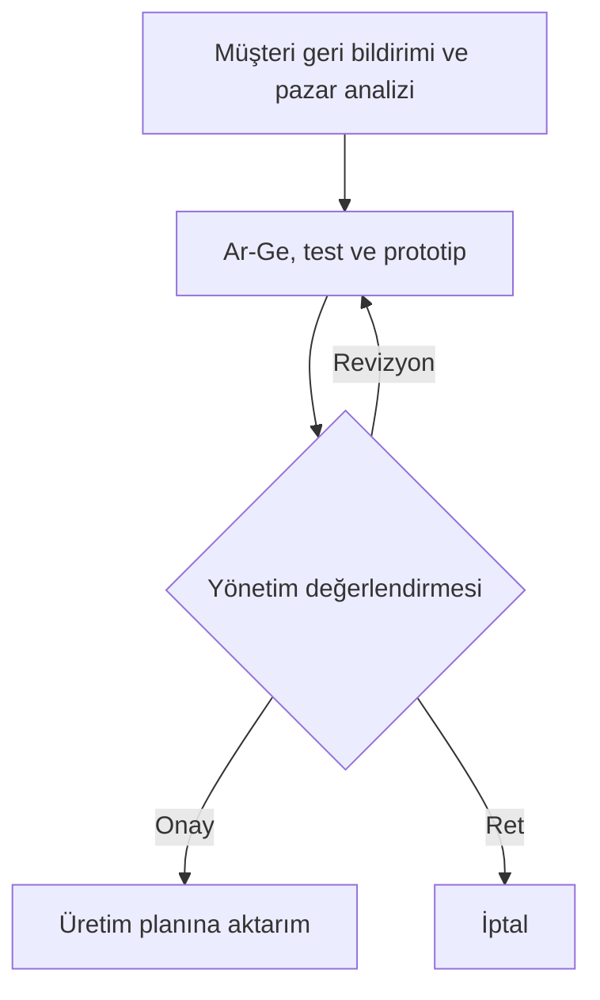

# Sistem Analizi ve Tasarımı — Tam Konu Anlatımı ve 10 Saatlik Çalışma

Bu dosya, paylaşılan beş transkript, dört ders notu ve üç görsel üzerinden hazırlanmıştır. Konuların tekrarları birleştirildi; kavramlar, nedenleri ve örnekleriyle birbirine bağlandı. Açıklamalar boyunca aynı örneği kullanacağız: **Müşterisinden 19 Aralık’ta teslim edilmek üzere bardak siparişi alan bir üretim işletmesi.** Tarih ve ürün, ilişkileri anlamayı kolaylaştıran örneklerdir.

**Çalışma hedefi:** Tanımı hatırlamak, kavramı örnekte göstermek, ilişkileri gerekçelendirmek ve notlara bakmadan düzenli bir sınav cevabı yazabilmek. Bu dosya bir konu anlatımıdır; soru sayısı veya puan garantisi değildir.

## 1. İşletmeyi ve amacını anlamak

### İşletme nedir? Neden “iktisadi ve teknik birim” denir?

İnsanların bardak, giysi, ulaşım veya eğitim gibi ihtiyaçları vardır. İşletme, bu ihtiyaçları karşılayacak mal veya hizmeti üretmek için kaynakları planlı biçimde bir araya getirir. Bardak fabrikası yalnızca makinelerden oluşmaz: Hammadde, çalışan, enerji, sermaye, teknoloji ve bunları düzenleyen bir organizasyon gerekir.

**İşletme; üretim faktörlerini planlı biçimde bir araya getirerek insan ihtiyaçlarını karşılayan mal veya hizmetleri üreten iktisadi ve teknik birimdir.** Derste ele alınan ticari işletmede üretim ve pazarlama, kâr elde etme ve işletmenin devamını sağlama amacıyla yürütülür.

İşletmenin **iktisadi** yönü, kaynakların sınırlı olmasından doğar. Eldeki para, hammadde ve zaman sınırsız değildir. Bu kaynaklarla uygun sonucu elde etmek gerekir. **Teknik** yönü, girdilerin belirli yöntem ve işlemlerle ürüne dönüştürülmesidir. **Toplumsal** yönü ise insanların ihtiyaçlarını karşılaması, istihdam sağlaması ve içinde bulunduğu toplumla ilişki kurmasıdır.

Örneğin bardak fabrikasında hammaddenin gereksiz tüketilmesini önlemek iktisadi; malzemeyi biçimlendirmek teknik; çalışanlara iş sağlamak ve müşterinin ihtiyacını karşılamak toplumsal boyuttur. Aynı işletmeye üç farklı açıdan bakıyoruz.

### Amaçlar neden birbirine bağlıdır?

| Amaç | Sade anlamı | Diğer amaçlarla ilişkisi |
|---|---|---|
| Kâr elde etme | Gelirlerin ilgili maliyetleri aşması. | Faaliyetin devamı ve yeni yatırımlar için kaynak sağlayabilir. |
| Süreklilik | İşletmenin faaliyetlerini zaman içinde sürdürebilmesi. | Tek seferlik satış yerine tekrar eden üretim ve müşteri ilişkisi gerektirir. |
| Büyüme | Kapasite, satış, pazar payı veya faaliyet alanının genişlemesi. | Daha fazla koordinasyon, finansman ve bilgi işleme ihtiyacı doğurabilir. |
| Toplumsal fayda | İhtiyaçları karşılama, istihdam ve vergi gibi katkılar. | İşletmenin çevresiyle ilişkisini ve kabul görmesini destekler. |

Bir siparişten kâr etmek, işletmenin geleceğinin güvence altında olduğunu göstermez. Fabrika bugün çok kazanıp müşterisini yanlış teslimatla kaybederse yarın aynı geliri elde edemeyebilir. Bu nedenle **kârın devamlılığı**, müşteri memnuniyeti ve kaynakların sürdürülebilir kullanımıyla ilişkilidir.

**Müşteri sadakati**, müşterinin ihtiyacı tekrarlandığında aynı işletmeyi tercih etmeye devam etmesidir. Üründen, hizmetten veya verilen sözün tutulmasından duyulan memnuniyet bunu destekler. Dersteki insanlar arası bağlılık örneği, işletme düzeyinde bu ilişkiyi anlatır. Müşteri yalnızca para veren bir kişi değil, tekrar eden ilişkinin tarafıdır.

### Kâr, gelir, harcama ve gider neden aynı şey değildir?

Bu kavramları karıştırırsan işletmedeki para hareketlerini yanlış açıklarsın. **Satış geliri**, satıştan sağlanan tutardır. **Kâr** ise ilgili gelirler ile maliyet ve giderler arasındaki olumlu farktır. Örneğin satış geliri 300, bu gelire ilişkin toplam maliyet ve giderler 220 ise aradaki 80 kârdır. Vergi gibi diğer kalemler de veriliyorsa net sonuç buna göre değerlendirilir.

**Harcama**, bir mal veya hizmet edinmek için ödeme yapılması ya da borç altına girilmesidir. **Gider**, yararın ilgili dönemin faaliyetlerinde tüketilen ve o dönemin sonucuna yansıtılan kısmıyla ilgilidir. Harcama ile gider aynı zamanda ortaya çıkabilir; her durumda aynı anda olmak zorunda değildir.

Örneğin üretimde kullanmak üzere hammadde alındığında bir edinme işlemi gerçekleşir. Malzemenin depoda beklemesiyle üretimde tüketilmesi aynı aşama değildir. Temel ayrım budur: **Kaynağın edinilmesi ile yararının tüketilmesini ayır.** Transkriptteki kredi kartı ve bütçe örnekleri, para hareketinin sonradan bütçede görünür hâle gelmesini anlatır. Fatura veya ekstre gelmesi, tek başına her harcamayı gider yapan genel bir kural değildir. Notta geçen “giderin aktifleştirilmesi” ifadesini de tanım olarak kullanma; giderle varlığın aktifleştirilmesi farklı işlemlerdir.

**Kaynak israfı** da tasarrufla karıştırılmamalıdır. Bir makine için kapasite ayırmış ve maliyetine katlanmışsan, makineyi gereksiz yere boş bırakmak otomatik olarak kazanç değildir. Aynı şekilde bir işin erken bitmesi, hedeflenen sonuç üretilmemişse başarı sayılmaz. Önce hangi kaynağın hangi amaç için kullanıldığına bakılır.

### Strateji ve taktik: Önce hedef, sonra ona götüren adımlar

Strateji, işletmenin uzun vadede hangi yönde ilerleyeceğine ilişkin genel tercihleridir. Taktikler, bu yönelimi gerçekleştirmek için yapılan daha somut düzenleme ve eylemlerdir. Örneğin “Beş yılda yeni bir pazarda yer edinmek” hedefi doğrultusunda üretim kapasitesini artırmak, dağıtım ortaklığı kurmak ve çalışanları eğitmek gibi adımlar planlanabilir.

Hocanın “Hayat soldan sağa yaşanır, kurgu sağdan sola yapılır” anlatımı şunu ifade eder: **Zaman bugünden geleceğe akar; planlama ise ulaşılmak istenen sonuçtan bugünkü gereklere doğru kurulabilir.** Önce varılacak yer belirlenir, ardından bunun için bugün ne yapılması gerektiği düşünülür. Koşullar değiştiğinde adımlar güncellenir. Büyük değişimler stratejinin de gözden geçirilmesini gerektirebilir.

PERT/CPM, Gantt ve karar ağacı örneklerinin buradaki ortak işlevi, işleri, zamanlamayı, bağımlılıkları veya karar seçeneklerini görünür kılmaktır. Kaynaklarda ayrıntılı hesapları verilmediğinden burada yeni hesap yöntemleri eklemiyoruz.

**Kendini kontrol et:** Bir fabrikanın satış gelirinin artması neden tek başına başarılı olduğunu kanıtlamaz? Cevabında maliyet, süreklilik ve müşteri ilişkisini birbirine bağlayabilmelisin.

## 2. Sistem kavramı ve sistem yaklaşımı

### Sistem neden bir “parçalar toplamından” fazlasıdır?

**Sistem, belirli bir amaca yönelen, aralarında ilişkiler bulunan ve karşılıklı etkileşim içinde çalışan ögelerin oluşturduğu bütündür.** Bu tanımın üç temel dayanağı vardır: **Amaç, ögeler ve etkileşim.**

Bir binaya makine, çalışan ve hammadde yerleştirmek yeterli değildir. Çalışanların hangi işi yapacağı, malzemenin hangi makineye gideceği ve üretimin neye göre başlayacağı belirlenmelidir. Bir arada bulunmak mekânsal yakınlıktır; sistemin işleyebilmesi için amaca yönelik ilişkiler gerekir.

Bardak fabrikasında amaç siparişi karşılamaktır. Ögeler, çalışanlar ve makineler gibi unsurlardır. Stoktan üretime malzeme verilmesi, üretimin ihtiyaç bildirmesi ve finansın ödeme sağlaması etkileşimi gösterir. **Öge “kim/ne var?”, ilişki “aralarında ne oluyor?”, amaç ise “bütün bunlar ne için?” sorusunun karşılığıdır.**

### Alt sistem ve üst sistem: Neye baktığına göre ölçek değişir

İşletmeyi inceliyorsan üretim onun alt sistemidir. Üretim birimini inceliyorsan makineler, çalışanlar ve üretim aşamaları öne çıkar. Üniversiteyi inceliyorsan fakülte alt sistem; fakülteyi inceliyorsan bölüm alt sistem olarak ele alınabilir.

Buradaki önemli nokta, bir yapının kendi içinde incelenebilirken daha büyük bir yapıyla da ilişkili olmasıdır. İnceleme sınırını sorunun amacına göre belirlersin. Bir departmanın kendi amacını gerçekleştirmesi, işletmenin genel amacıyla uyumlu olmalıdır. Satın alma en ucuz malzemeyi bulmuş olabilir; malzeme geç geldiği için sipariş yetişmiyorsa yalnızca satın alma fiyatına bakarak bütünün başarılı olduğu söylenemez.

### Öge, özellik, etkinlik ve durum

Bu dört kavram aynı şeyi dört farklı yönden anlatır. Bir makineyi düşün: Makinenin kendisi, kapasitesi, yaptığı iş ve belirli bir andaki çalışma durumu farklıdır.

| Kavram | Sorduğu soru | Fabrika örneği | Eğitim örneği |
|---|---|---|---|
| **Öge** | Sistemde ne/kim var? | Makine, çalışan, hammadde. | Öğrenci, öğretim elemanı, projeksiyon. |
| **Özellik** | Bu öge nasıl bir şey? | Makinenin kapasitesi; çalışanın yetkinliği. | Öğrencinin hazırlığı; cihazın görüntü kalitesi. |
| **Etkinlik** | Hangi faaliyet değişim yaratıyor? | İşleme, biçimlendirme, montaj. | Anlatma, soru sorma, öğrenme. |
| **Durum** | Sistem belirli bir anda nasıl? | Saat 14.00’te bir makine bakımda, 500 bardak tamamlanmış. | Dönem sonunda öğrencilerin başarı düzeyi ve araçların kullanılabilirliği. |

**Durumda zaman belirtmek önemlidir.** Aynı sistemin sabahki ve akşamki durumu farklı olabilir. Etkinlik, değişimi yaratan faaliyettir; durum ise belirli bir zamandaki görünümüdür. “Üretim yapılıyor” etkinliği; “Bugün saat 17.00 itibarıyla 1.000 bardak tamamlandı” durumu açıklamaya katkı sağlar.

### Girdi, dönüşüm, çıktı ve geri bildirim

İşletme çevresinden kaynak alır, bu kaynakları faaliyetleriyle dönüştürür ve çıktılar üretir. Bardak fabrikasında hammadde, enerji, emek, sermaye ve teknoloji girdilerdir. Malzemenin işlenmesi dönüşüm; ortaya çıkan bardak üründür. Hizmet işletmesinde çıktı hizmet olabilir.

Müşterinin “Bardak kolay kırılıyor” demesi **geri bildirimdir**. Bu bilgi değerlendirilerek malzeme veya tasarım değiştirilirse, çıktı hakkındaki bilgi sonraki faaliyetleri etkilemiş olur. Geri bildirim, sonuçların amaçlarla karşılaştırılıp işleyişin düzenlenmesine yardımcı olur.

İlk görseli okurken şu ayrımı koru: **Ürün ve hizmet çıktıdır; kâr faaliyetin ekonomik sonucudur; müşteriler, tedarikçiler ve devlet ise çevredeki aktörlerdir.** Görselde aynı bölgede yazılmaları hepsinin aynı tür kavram olduğu anlamına gelmez.

### İşletme neden açık, dinamik ve karmaşık sistemdir?

**Açıktır**, çünkü çevresinden madde, enerji ve bilgi alır; çevresine ürün, hizmet ve bilgi verir. Tedarikçi, müşteri, devlet ve bankayla ilişki kurar. Açıklık, çevreyle alışverişi ifade eder; bir yazılımın kaynak kodunun açıklığıyla ilgili değildir.

**Dinamiktir**, çünkü zaman içinde değişir. Çalışanlar öğrenir, makineler yıpranır, müşteri talebi ve teknoloji değişir. **Karmaşıktır**, çünkü çok sayıda unsur ve ilişki birlikte işler. İnsanların farklı davranışları ve kararları da bu karmaşıklığa katılır. Karmaşık olması, mutlaka düzensiz veya yönetilemez olduğu anlamına gelmez.

**Dinamik denge**, değişim sürerken işleyişi koruyacak uyumun kurulmasıdır. Bir makine bakımdayken işi uygun başka makineye aktarmak buna örnektir. Denge, her şeyin sabit kalması değildir.

### Ögeler arasındaki ilişki türleri

| İlişki | Anlamı | Açıklayıcı örnek |
|---|---|---|
| **Mekânsal** | Ögelerin konumları ve mesafeleri. | Depo ile üretim arasındaki gereksiz uzaklık taşıma süresini artırır. |
| **Zamansal** | Faaliyetin hangi zamanda ve süre içinde yürüdüğü. | Malzemenin üretimin başlayacağı tarihten önce gelmesi gerekir. |
| **Neden–sonuç** | Bir koşul veya değişimin başka bir sonuca etkisi. | Hammadde gecikmesi üretimi, üretim gecikmesi teslimatı etkiler. |
| **Enerjiye ilişkin** | Enerjinin sistemde kullanılması ve dönüşmesi. | Makine elektrik tüketerek üretim yapar; enerji maliyeti oluşur. |
| **Matematiksel** | Büyüklükler arasındaki sayısal bağıntı. | Üretim miktarı arttıkça toplam malzeme tüketimi değişir. |
| **Yapısal** | İncelenen işin doğasından gelen koşullar. | Tamamlanmış bardak adedi negatif veya yarım adet olamaz. |
| **İşlemsel** | İşin hangi operasyonlarla yerine getirildiği. | Biçimlendirme, işleme, kontrol ve paketleme. |
| **Sıra** | Hangi işlemin hangisinden önce/sonra yapılacağı. | Ürünü üretmeden tamamlanmış ürün olarak sevk edemezsin. |

İşlemsel ilişki işlemlerin ne olduğuyla, sıra ilişkisi bunların öncelik ve ardıllığıyla ilgilidir. Zaman ilişkisi de ne zaman ve ne kadar sürede yapıldığını ele alır. Aynı olay farklı ilişki türleriyle incelenebilir. Ayrıca bütün üretimler tam sayılı değildir; burada kesirli miktar yasağı **adetle sayılan tamamlanmış ürün** örneği içindir.

### Sistem yaklaşımının üç ilkesi

**Sistem yaklaşımı**, sorunları çözmek veya mevcut durumu iyileştirmek için sistemin bütününden ve parçalar arasındaki ilişkilerden yararlanan anlayıştır.

**Bütünsellik:** Sorunu ve çözümü işletmenin geneli bakımından değerlendir. Teslimatın gecikmesi doğrudan üretimin hatası olmayabilir. Stok kaydı yanlışsa, tedarik gecikmişse veya satış gerçekçi olmayan söz vermişse aynı sonuç ortaya çıkabilir. Bir yerde yapılan iyileştirme başka yerdeki sonucu da etkiler.

**Disiplinler arası yaklaşım:** İhtiyaç duyulan farklı bilgi alanlarını bir araya getir. Gecikmeyi anlamak için organizasyon bilgisiyle görevleri, sayısal yöntemlerle kapasiteyi, bilişim bilgisiyle kayıt ve iletişimi incelersin. Bunun anlamı her soruda bütün bilimleri saymak değildir; ilgili alanın katkısını göstermektir.

**Bilimsellik:** İddiayı gözlem, kayıt ve tutarlı gerekçelerle destekle. “Çalışanlar umursamıyor” demek yerine sipariş tarihi, malzemenin geliş tarihi ve üretimin başlama tarihini karşılaştır. Böylece açıklaman kontrol edilebilir bir temele dayanır. Bilimsel cevap, ağır kelimelerden çok **kanıt ve neden–sonuç düzeni** gerektirir.

### Sistem yaklaşımının dört aşaması

| Ana süreç | Aşama | Temel soru | Stok sorunu örneği |
|---|---|---|---|
| **Kuramsal** | Analiz | Mevcut durum ve sorun nedir? | Malzeme girişleri niçin geç kaydediliyor? |
| **Kuramsal** | Tasarım | Nasıl bir işleyiş kurulmalı? | Girişte kayıt ve ilgili birimlere güncel bilgi paylaşımı planlanır. |
| **Uygulama** | Hazırlama | Tasarımı nasıl çalışabilir hâle getiririz? | Kayıt ekranları, yetkiler ve görev düzeni hazırlanır. |
| **Uygulama** | İşletim | Yapı gerçek faaliyetlerde nasıl çalışıyor? | Malzemeler kaydedilir, bilgiler kullanılır ve sonuçlar izlenir. |

Analiz, mevcut yapıyı anlamaya; tasarım, kurulacak işleyişi belirlemeye yöneliktir. Hazırlama uygulamaya geçişi mümkün kılar; işletim gerçek kullanımdır. İşletimde sorun görülürse önceki aşamalar gözden geçirilebilir. **Sorunu anlamadan doğrudan program yazmaya başlamak bu sırayı atlamak olur.**

**Kendini kontrol et:** “Depo bilgisini herkes göremiyor; hemen yeni bilgisayar alalım” önerisinde hangi analiz eksiktir? Sorunun cihaz kapasitesinden mi, yetkilerden mi, kayıt düzeninden mi kaynaklandığının henüz belirlenmediğini açıklayabilmelisin.

## 3. Veri, bilgi, bilişim ve yönetim ilişkisi

### Veri ile bilgi nasıl ayrılır?

**Veri**, incelenen konuya ilişkin kayıt veya gözlemdir. **Bilgi**, verinin belirli bir ihtiyaç ve bağlam için değerlendirilerek anlam kazanmış hâlidir. “1.000” tek başına karar vermeye yetmez. “Müşteri 1.000 bardak istiyor; depoda 600 hazır bardak var” açıklaması, karşılanacak eksik miktarın değerlendirilmesine olanak verir.

Veri mutlaka düzensiz veya yanlış olmak zorunda değildir. Düzenli bir tabloda tutulan kayıtlar da veri olabilir. Önemli olan, hangi soruya karşılık nasıl kullanıldığıdır.

Transkriptteki departmanlar arası veri–bilgi anlatımında, bir birimin ürettiği bilgi diğer birimin değerlendirmesine girdi olur. Satış müşterinin isteğini açıklığa kavuşturur; stok birimi bunu kendi kayıtlarıyla karşılaştırır; üretim de malzeme durumunu üretim takvimiyle değerlendirir. **Bilgi fiziksel olarak “bozulup veriye dönüşmez”; farklı birimin yeni değerlendirmesi için girdi işlevi görür.**

### Bilgi sisteminin parçaları ne yapar?

| Unsur | İşlevi | Örnek |
|---|---|---|
| **Donanım** | İşlemleri fiziksel olarak yürütür. | Bilgisayar ve sunucu. |
| **Yazılım** | İşlemlerin kurallarını uygular. | Stok sorgulama ve raporlama programı. |
| **Dosya/veri tabanı** | Kayıtları düzenli tutar. | Malzeme, sipariş ve müşteri kayıtları. |
| **Prosedür** | İşin nasıl yapılacağını belirler. | Malzeme tesliminde kimin hangi kaydı açacağı. |
| **İnsan** | Sistemi kurar, kullanır ve sonuçlarını değerlendirir. | Depo görevlisi, analist ve yönetici. |

Veri girdidir; bu düzen içinde işlenir ve bilgi çıktısına dönüşür. Donanım ve yazılım mevcut olsa bile kayıtlar güncel tutulmuyorsa sistem beklenen bilgiyi üretmeyebilir. İnsan ve prosedür, teknik unsurların işletmenin amacına hizmet etmesini sağlar.

### Bilgisayar olmadan bilgi sistemi olabilir mi?

Olabilir. Müşteri kayıtlarını klasörlerde tutan bir çalışan, yöneticinin talebi üzerine son altı ayın satışlarını bulup bir rapor hazırlayabilir. Yönetici raporu değerlendirerek müşterinin azalan alımları için görüşme kararı verebilir. Kayıt, arama yöntemi, işleme, raporlama ve karar desteği vardır.

Bilgisayar bu işlevlere hız, işlem kapasitesi ve paylaşım kolaylığı kazandırır. **Bilgi sistemi daha geniş kavramdır; bilgisayara dayalı bilgi sistemi bunun teknolojik biçimidir.**

### Fonksiyonel sistem ile bütünleşik sistem

Fonksiyonel bilgi sistemi, stok veya muhasebe gibi belirli bir işlevin ihtiyacına odaklanır. Bütünleşik sistem ise birden fazla birimin faaliyetlerini ve verilerini ilişkilendirir. Fonksiyonel bir sistemin hiçbir bağlantı kuramayacağını düşünme; ayrım, kapsam ve bütünleşmenin nasıl kurulduğudur.

**Kurumsal Kaynak Planlaması — ERP**, işletmenin farklı kaynak ve süreçlerini bütünleşik biçimde planlama ve yönetme yaklaşımıyla ilişkilidir. ERP yazılımları bunu destekleyen araçlardır. Bir yazılımı satın almak, süreçlerin kendiliğinden doğru kurulacağı anlamına gelmez. Ortak kayıtlar, yetkiler, görevler ve güncelleme kuralları belirlenmelidir.

Örneğin satış siparişi açıldığında stok, üretim ve finansın aynı siparişi ilişkilendirebilmesi gerekir. Her birimin farklı müşteri veya ürün tanımı kullanması yanlış eşleştirmeler doğurabilir. **Bütünleşme yalnızca bağlantı kablosu değil, ortak anlam ve tutarlı işleyiş gerektirir.**

### Yönetim ve YBS ne yapar?

Yönetim, amaçlara ulaşmak için kaynakları ve faaliyetleri düzenleme sürecidir. Dersteki temel işlevler **planlama, örgütleme, koordinasyon, yöneltme ve denetimdir**.

| İşlev | Bardak fabrikasında karşılığı |
|---|---|
| Planlama | Hangi siparişin ne zaman üretileceğini belirleme. |
| Örgütleme | İşleri, görevleri ve yetkileri düzenleme. |
| Koordinasyon | Stok, üretim ve finansın faaliyetlerini uyumlaştırma. |
| Yöneltme | Çalışanları belirlenen işlere yönlendirme. |
| Denetim | Gerçekleşen sonuçları hedeflerle karşılaştırma. |

**YBS**, işletmenin faaliyetlerine ilişkin verilerin bilgiye dönüştürülmesini, paylaşılmasını ve yönetsel kararların desteklenmesini sağlayan düzen ve yaklaşımla ilgilidir. Derste YBS’nin disiplinler arası metodoloji niteliği vurgulanır: Organizasyonu, sayısal düşünmeyi ve bilişim araçlarını birlikte kullanırsın. Bu ders anlatımını, YBS’nin akademik statüsüne ilişkin tartışmasız evrensel bir hüküm gibi sunmak gerekmez.

YBS’nin sınav cevabındaki temel rolünü şöyle kurabilirsin: İşletmenin işleyişi anlaşılır; bilgi gereksinimleri belirlenir; ilgili veriler ortak bir düzen içinde işlenip raporlanır; yönetici bu bilgiyi kararlarında kullanır. **YBS’yi yalnızca bir program adıyla tanımlamak açıklamayı eksik bırakır.**

### Yönetim karar seviyeleri ve raporlar

| Seviye | Kararın odağı | Örnek |
|---|---|---|
| **Operasyonel** | Günlük ve tekrarlanan işler. | Bugün hangi sipariş üretilecek? |
| **Taktik** | Kaynakları hedeflere göre düzenleme. | Gelecek dönem vardiya ve üretim yükü nasıl dağıtılacak? |
| **Stratejik** | Uzun vadeli yön ve büyük tercihler. | Yeni tesis veya yeni pazar gerekli mi? |

İşlem sistemleri günlük kayıtları; YBS raporları yönetsel bilgi ihtiyacını; karar destek sistemleri seçeneklerin değerlendirilmesini; üst yönetim destek sistemleri daha genel kararları destekler. Bunlar her durumda tek bir seviyeye kapatılmış kutular değildir. Dersteki piramidi, bilgi ihtiyacı ile yönetim seviyesi arasındaki ilişkiyi anlamak için kullan.

| Rapor türü | Temel özellik | Örnek |
|---|---|---|
| **Periyodik** | Belirli aralıklarla hazırlanır. | Aylık satış raporu. |
| **Rutin** | Standart işleyişte tekrar kullanılır. | Günlük sevk edilecek siparişler. |
| **İstatistiki** | Verileri özetleyen sayısal analiz içerir. | Hata oranları ve geçmiş dönem eğilimleri. |
| **İstisnai** | Belirlenmiş sınırın dışındaki durumu gösterir. | Stok düzeyinin belirlenen sınırın altına düşmesi. |

Bu sınıflar birbirini bütünüyle dışlamaz. Aylık düzenlenen bir rapor istatistiki içerik de taşıyabilir. Önemli olan, raporun hangi ihtiyacı karşıladığını açıklamaktır.

### Teknoloji, otomasyon, sayısallaştırma ve dijitalleşme

Teknoloji, yalnızca bilgisayar değildir; iş yapmayı mümkün kılan veya geliştiren araçları ve yöntemleri de kapsar. Dersteki vurgu, **birim zamanda sağlanan faydayı ve iş yapabilme gücünü artırmasıdır**. Bir aracın yeni olması, işletmeye mutlaka uygun olduğu anlamına gelmez. Sağladığı katkı ve maliyet birlikte değerlendirilir.

**Otomasyon**, üretim ve yönetim faaliyetlerinin insan müdahalesini azaltan önceden kurulmuş düzenlerle yürütülmesidir. Malzeme çıkışı kaydedilince stok miktarının otomatik güncellenmesi buna örnektir. Kuralları ve kayıtları hatalı bir işi otomatikleştirmek, yanlışın daha hızlı tekrarlanmasına yol açabilir.

**Sayısallaştırma**, mevcut kayıt veya içeriği dijital biçime aktarmayı anlatır. **Dijitalleşme**, dijital araç ve verilerle iş yapma biçiminin geliştirilmesini anlatır. Sipariş defterini bilgisayara aktarmak ile sipariş bilgisini stok, üretim ve satın alma arasında işleyen bir düzene dönüştürmek aynı kapsamda değildir.

### Ölçek ve doğru teknoloji seçimi

Küçük bir işletme ile çok sayıda şubesi bulunan işletmenin veri hacmi, kullanıcı sayısı ve koordinasyon ihtiyacı farklı olabilir. Çözüm buna göre seçilmelidir. Gereğinden büyük sistem gereksiz maliyet; yetersiz sistem ise gecikme ve kontrol sorunu doğurabilir.

Yavaşlığın nedeni de araştırılmalıdır. Gereksiz tekrarlar ve kötü sorgu düzeni kaynak tüketiyorsa hemen donanım değiştirmek doğru teşhis olmayabilir. Buradaki ders, belirli bir programın kapasite sayılarını ezberlemekten önce **ihtiyaç–tasarım–kaynak uyumunu** kurmaktır. Notlardaki ürün kapasitesi sayıları genel tasarım kuralı olarak kullanılmamalıdır.

### Yapay zekâ tartışmasında nasıl gerekçe kurulur?

Transkriptte yapay zekânın raporlama, analiz ve karar desteğini nasıl değiştirebileceği tartışmaya açılır. Buradan “Bütün yönetim seviyeleri kesin ortadan kalktı” sonucu çıkmaz. Araçların yetenekleri ve görev dağılımı değişebilir; işletmenin amacı, doğru veri ihtiyacı, koordinasyon ve karar sorumluluğu ayrıca ele alınmalıdır.

Sınavda tartışma istenirse sıran şöyle olmalı: Mevcut bilgi ve karar düzenini açıkla; teknolojinin hangi işi değiştirebileceğini göster; bunun insan ve organizasyon üzerindeki etkisini değerlendir; sonucunu koşullarıyla belirt. **Gerekçesiz teknoloji övgüsü veya korkusu yerine, organizasyonel etkiyi açıkla.**

**Kendini kontrol et:** “ERP aldık, bütünleşme tamamlandı” ifadesi neden eksiktir? Ortak veri tanımı, görev, prosedür, güncelleme ve karar desteğini açıklayabilmelisin.

## 4. Sistem anlayışının gelişimi ve modelleme

### Tarihsel anlatının asıl bağlantısı

Transkriptlerdeki tarihsel yolculuk, bugünkü işletme anlayışının bir anda ortaya çıkmadığını göstermek içindir. Bilimsel bilgi, teknoloji, uzmanlaşma, verimlilik, kalite ve otomasyon birbirinden kopuk başlıklar değildir. İnsanlar iş yapma yöntemlerini geliştirdikçe kaynakları, üretim hacmini ve organizasyonu farklı biçimlerde düzenler.

**Bilgi**, yöntemin geliştirilmesine; **teknoloji**, yöntemin uygulanmasına; **uzmanlaşma**, yapılan işte yetkinliğin artmasına katkı sağlar. Kaynakların sınırlılığı **verimlilik** sorusunu doğurur: Aynı girdilerle ne kadar çıktı elde ediliyor? Müşterinin beklentisi ise **kaliteyi** gündeme getirir: Ürün, istenen nitelikleri taşıyor mu? **Etkinlik** açısından da amaca ne ölçüde ulaşıldığı değerlendirilir. Çok bardak üretmek, yanlış tür bardak üretildiyse müşteri ihtiyacını karşılamayabilir.

Aşağıdaki dönemler, **ders anlatımındaki sıralamayı** özetler. Tablo, bilim ve teknolojinin bütün tarihini tek bir başlangıç yılına indirgeyen genel bir tarih şeması olarak okunmamalıdır.

| Anlatımdaki dönem | Öne çıkan başlık | Öğrenilecek bağlantı |
|---|---|---|
| 1400 öncesi | Felsefi açıklama | Olgulara farklı açılardan bakma ve düşünme. |
| 1600’ler | Temel bilimler | Gözlem ve sayısal açıklama. |
| 1750’ler | Sanayi Devrimi | Üretimin ölçeğinin ve örgütlenmesinin değişmesi. |
| 1880’ler | Bilimsel yönetim ve uzmanlaşma | İş bölümü ve kaynak kullanımının düzenlenmesi. |
| 1910’lar | Otomasyon vurgusu | Üretim ve yönetimde insan müdahalesinin azaltılması. |
| 1940’lar çevresi | Yöneylem araştırması | Kaynak ve operasyon sorunlarının sayısal incelenmesi. |
| 1960’lar | Yapay sentez | Sistemi açıklamada öge ve değişmezlik yaklaşımı. |
| 1980’ler | Süreç yaklaşımı | Değişim, davranış ve süreç tasarımının öne çıkması. |
| 1995 ve sonrası | İnternet ve ağların yaygınlaşması | Bilgi paylaşımının daha geniş ağlara taşınması. |

Matbaa, sermaye birikimi ve teknoloji sahipliği örneklerinin ortak sorusu da budur: **Bilgiye ve teknolojiye erişim, üretim ve yönetim gücünü nasıl etkiler?** Matbaa örneğinde bilginin çoğaltılıp yayılması; Sanayi Devrimi örneğinde sermaye ile üretim gücü; internet örneğinde uzak noktaların haberleşmesi vurgulanır. Transkriptteki çelişkili tarih ve büyüklüklerden kesin nicel hükümler çıkarmak yerine bu neden–sonuç bağlantısını öğren.

### Yapay sentez ile süreç yaklaşımı

| Boyut | Yapay sentez | Süreç yaklaşımı |
|---|---|---|
| **İlke** | Sistemi ögelerin değişmez bütünü olarak anlamak. | Sistemi süreçlerin bütünü olarak anlamak. |
| **Amaç** | Sisteme ilişkin değerleri öngörmek. | Sistemin davranışını belirleyip uygun politikalar geliştirmek. |
| **Yöntem** | Sistemi çözümlemek. | Sistemi tasarlamak. |

Yapay sentez için derste yöneltilen eleştiri şudur: Sistem gerçek hayatta değişiyorsa, onu değişmez kabul eden açıklama nasıl yeterli olacaktır? Öğrenci öğrenir, makine yıpranır, kaynak tüketilir ve talep değişir. Değişmezlik kabulü, bu farklılaşmayı açıklamakta sorun yaratır. Anlatımda ayrıca değişmez bir yapıda değerleri öngörme ihtiyacının nasıl temellendirileceği sorgulanır.

Süreç yaklaşımı, yalnızca departmanları saymaktan **faaliyetlerin birbirine nasıl bağlandığına** yönelir. “Satın alma var, üretim var, satış var” demek yapıyı listeler. “Eksik malzeme tedarik edilir, üretime alınır, ürün hazırlanır ve müşteriye teslim edilir” demek işleyişi açıklar.

**Operasyon**, süreç içindeki belirli iş veya adımdır. **Süreç**, bir sonuca ulaşmak için ilişkili faaliyetlerin bütünüdür. Malzemeyi saymak bir operasyon; siparişi karşılamak, çok sayıda operasyonu kapsayan süreçtir. Süreç yaklaşımı parçaları yok saymaz; parçaların sonuca nasıl birlikte ulaştığını inceler.

### Model, tasarım ve simülasyon

Bir işletmeyi gerçek koşullarda değiştirmek pahalı ve riskli olabilir. Önce işleyişin incelenebilir bir temsilini kurarız. **Model**, gerçeğin belirli amaçla sadeleştirilmiş temsilidir. **Tasarım**, amaca uygun işleyişin oluşturulmasıdır. **Simülasyon**, bir model üzerinden sistemin işleyişini ve olası sonuçlarını incelemeye yardımcı olabilir.

Örneğin yeni makine almadan önce mevcut siparişler, işlem süreleri ve kapasiteyle hangi üretim düzeninin uygun olduğu araştırılır. Sonuçlar yeterliyse uygulamaya geçilir. Model, gerçeğin bütün ayrıntılarını aynen taşımak zorunda değildir; incelenen sorun açısından gerekli özellikleri temsil etmelidir. Model sonucu, kullanılan veri ve varsayımlarla birlikte anlamlıdır.

### Öngörü, kestirim ve Bayes anlatımı

Derste **kestirim**, sezgisel tahmin; **öngörü**, bilgi ve analizle desteklenen değerlendirme anlamında karşılaştırılıyor. Bu kullanım üzerinden sorulursa “Bence satış artar” ile “Geçmiş satışlar ve mevcut siparişler artışı destekliyor” ifadelerini ayır. Bu ders içi ayrımı, kestirim kelimesinin her bilimsel alanda sezgisel olduğu şeklinde genelleme.

**Bayes mantığı**, yeni kanıt geldikçe önceki olasılık değerlendirmesinin güncellenmesi bağlamında anlatılır. Yağmur bilgisi geldikten sonra kıyafet seçimini yeniden değerlendirmek bunun sezgisel örneğidir. Yüzde 80’i yüzde 60’a değiştirmek tek başına Bayes hesabı değildir; örneğin vurgusu **yeni bilginin önceki değerlendirmeyi değiştirmesidir**. Kaynaklarda kurallı bir hesap sorusu kurulmadığı için yeni bir formül konusu eklemiyoruz.

### Bileşen, değişken, parametre, kısıt ve ölçüt

Bu kavramlarla bir sistemi analiz ederken önce amacını belirle. Sonra şu soruları sor:

| Kavram | Sade soru | Bardak fabrikasında karşılığı |
|---|---|---|
| **Bileşen** | Sistemi neler oluşturuyor? | Makine, çalışan, üretim ve stok birimleri. |
| **Değişken** | Hangi büyüklük farklı değerler alıyor? | Üretilecek bardak miktarları. |
| **Parametre** | Bu modelde hangi değerleri veri kabul ediyoruz? | Bir bardak için gereken malzeme ve birim katkı. |
| **Kısıt** | Kararları hangi koşullar sınırlandırıyor? | Mevcut malzeme ve çalışma süresi. |
| **Ölçüt** | Başarıyı neyle değerlendiriyoruz? | Toplam katkı, maliyet veya zamanında teslimat oranı. |

**Özellik ile parametre ilişkili olabilir ama aynı sınıflandırma değildir.** Makinenin hızı bir özelliktir; bu hız modelde veri kabul edilen katsayı olarak kullanılıyorsa parametre rolü de taşır. Kavramın hangi analizde hangi işlevi gördüğünü belirtmek gerekir.

### Sayısal bir modeli okuyabilmek

Aşağıdaki sayılar, kaynaklardaki model mantığını açıklamak için kurulmuş örnektir. İki çeşit bardak üretilecek olsun. Küçük bardak miktarı **x₁**, büyük bardak miktarı **x₂** olsun. Birim katkıları sırasıyla 2 ve 3 para birimi kabul edilirse:

**Amaç: Z = 2x₁ + 3x₂ → maksimum.**

Burada x₁ ve x₂ karar değişkenleridir; ne kadar üretileceği araştırılır. 2 ve 3 birim katkı parametreleridir. Z toplam katkıyı ifade eder. Maliyeti düşürmeyi amaçlayan başka bir modelde amaç fonksiyonu minimum yapılmaya çalışılır.

Bir küçük bardak 1, bir büyük bardak 2 birim malzeme tüketiyor ve elde 1.000 birim varsa:

**Hammadde kısıtı: x₁ + 2x₂ ≤ 1.000.**

Sol taraf seçilen üretimin malzeme tüketimidir. Sağ taraf kullanılabilecek miktardır. x₁ = 100 ve x₂ = 200 seçilirse tüketim 100 + 400 = 500 birimdir. Malzeme sınırı aşılmamıştır. Fakat bu, bütün modelin uygun olduğu anlamına gelmez; iş gücü veya makine süresi gibi diğer kısıtlar da sağlanmalıdır.

**Negatif olmama koşulu: x₁ ≥ 0 ve x₂ ≥ 0.** Negatif miktarda bardak üretilemez. Bu örnekte tamamlanmış bardak adedi söz konusu olduğundan tam sayılı miktar gerekir. İki değişkenin negatif olmadığı grafik bölge, eksenler dâhil birinci bölgedir.

**Aylak değişken**, kullanılmayan kaynak miktarını gösterebilir. Hammadde kısıtını **x₁ + 2x₂ + s₁ = 1.000** olarak yazarsak yukarıdaki seçimde s₁ = 500 olur. Hiç üretim yoksa s₁ = 1.000’dir. “≤” biçimini eşitliğe dönüştürürken kalan miktar eklenir. “≥” biçiminde ise fazla miktarı temsil eden değişken çıkarılır; bazı çözüm yöntemlerinde ayrıca yapay değişken kullanılabilir. Dersin buradaki ana vurgusu katsayıların ve kaynak sınırlarının anlamıdır.

**Parametre, sonsuza kadar değişmeyen değer demek değildir.** İncelenen model ve koşullar için sabit kabul edilir. Malzeme tüketimi veya kapasite değişirse model yeni koşullara göre güncellenir. Eski koşullarda bulunan sonuç, yenilerde sorgulanmadan kullanılamaz. Transkriptteki 1.457 saat gibi değerler de örnekteki çalışma süresi kabulüdür; her çalışan için genel ve değişmez bir yasal sayı olarak ezberlenmemelidir.

### Maksimizasyon, minimizasyon ve optimizasyon

Maksimizasyon seçilen değeri en büyük, minimizasyon en küçük yapma yönelimidir. **Optimizasyon**, belirlenen amaç ve kısıtlar altında en uygun çözümün aranmasıdır. Maksimizasyon ve minimizasyon optimizasyonun biçimleri olabilir. Optimizasyonu yalnızca “ortalama bir denge bulmak” diye tanımlama.

Hocanın denge vurgusu, tek departmanın veya tek siparişin sonucuyla işletmenin bütününe hükmetmemekle ilişkilidir. Bir siparişten yüksek kazanç sağlanırken diğer siparişler aksıyorsa toplam sonuç ayrıca değerlendirilmelidir. **Alt optimizasyon**, belirli alt sistem veya karar alanındaki iyileştirmedir; bütün işletmenin en iyi sonucu verdiğini kendiliğinden kanıtlamaz.

Bir dönemin sonucunu geçmiş dönemlerle karşılaştırmak gelişimi anlamaya yardımcı olur. Ancak yalnızca yükselen bir kâr grafiği görmek de matematiksel olarak bütün olası seçeneklerin en iyisinin bulunduğunu kanıtlamaz. Ölçütü, amacı ve karşılaştırma koşullarını açık tut.

### Kapasite türleri

| Tür | Anlamı | Örnek |
|---|---|---|
| **Teorik kapasite** | İdeal koşullarda düşünülen üst üretim miktarı. | Duruş ve aksama olmadan makinenin üretebileceği miktar. |
| **Fiilî kapasite/üretim** | Gerçekte gerçekleşen üretim düzeyi. | Bugün tamamlanan 800 bardak. |
| **Atıl kapasite** | Kullanılabilir olduğu hâlde kullanılmayan üretim potansiyeli. | Üretim imkânı varken talep veya malzeme sorunu nedeniyle boş kalma. |
| **Zorlanmış kapasite** | Normal ve sürdürülebilir işleyişin üzerinde zorlamayla sağlanan üretim. | Aşırı mesai ve bakım ertelemesiyle geçici artış. |

Bir makinenin bakımını atlayıp bugün daha fazla üretmek, yarınki arıza nedeniyle toplam sonucu kötüleştirebilir. Bu, sistemin zaman içindeki etkilerini birlikte düşünme örneğidir.

**Kendini kontrol et:** x₁ + 2x₂ ≤ 1.000 ifadesindeki “2”, “x₂” ve “≤ 1.000” neyi anlatır? Katsayıyı, karar değişkenini ve kaynak sınırını birbirinden ayırabilmelisin.

## 5. Siparişin departmanlar arasındaki yolculuğu

Bu bölümde fabrikanın içini adım adım gezeceğiz. **Amaç, müşterinin istediği bardakları uygun miktar ve nitelikte, söz verilen zamanda teslim etmektir.** Her bölümün kendi işi vardır; siparişin tamamlanması bu işlerin birbirine bağlanmasına bağlıdır.

### Önce işletmenin ana ve destek fonksiyonlarını ayır

Ders anlatımında **yönetim, pazarlama, üretim ve finansman ana fonksiyonlar** olarak ele alınır. Muhasebe, insan kaynakları, Ar-Ge ve bilgi teknolojileri destek fonksiyonları arasında sayılır. “Destek” önemsiz demek değildir. Bir işlevin aksaması, işletmenin bütününü etkileyebilir.

**Stok**, hangi malzeme ve ürünün bulunduğunu; **üretim**, neyin nasıl ve ne zaman üretileceğini; **satın alma**, dışarıdan neyin kimden alınacağını; **finans**, gerekli kaynağın nasıl sağlanacağını; **muhasebe**, işlemlerin nasıl kayda alınacağını ele alır. Pazarlama müşteri ve pazarla ilişkiyi yürütür; Ar-Ge ürün ve yöntem geliştirmeye katkı sağlar.

### Siparişi almak ile karşılayabileceğini söylemek farklıdır

Müşteri 19 Aralık için 1.000 bardak istediğinde satış temsilcisi önce türü, miktarı, niteliği ve teslim tarihini açıklığa kavuşturur. Bu, müşterinin ne istediğinin anlaşılmasıdır. Henüz işletmenin bunu karşılayabileceği kanıtlanmış değildir.

Stok birimi gerekli malzemenin durumunu kontrol eder. Üretim birimi kapasiteyi ve mevcut işleri inceler. **Ana Üretim Planı**, hangi ürün veya siparişlerin hangi zamanlarda üretileceğini planlamaya yarar. Malzeme mevcutken makine dolu olabilir; makine müsaitken malzeme eksik olabilir. Bu nedenle bu kontroller birbirinin yerine geçmez.

İlgili değerlendirme ve onaylardan sonra müşteriye taahhüt verilir. Transkriptte iş emri bununla ilişkilendirilir. **İş emri**, belirli işin gerçekleştirilmesine yönelik kayıt ve talimattır. Müşteriye verilen söz ile içeride işi başlatan kayıt aynı süreçte ilişkilidir; kavramsal olarak tamamen aynı belge olmak zorunda değildir.

### Stok kontrolü hangi bilgileri üretir?

Stok birimi mevcut malzemeyi ve ihtiyacı karşılaştırır. Hangi malzemenin hazır, hangisinin eksik olduğunu belirler. Stok değerlendirmesi geçmiş satışlar, mevcut ürünler, üretimi süren işler ve alınan siparişler gibi farklı verilerden yararlanabilir. Bunları her durumda basitçe toplamak, genel bir satış tahmini formülü değildir.

| Liste/rapor | Ne anlatır? | İlgili birim |
|---|---|---|
| **Malzeme Gereksinim Listesi** | Tedarik edilmesi gereken eksik malzemeler. | Satın alma. |
| **Üretilecek Malzemeler Listesi** | Malzemesi hazır, üretime yönlendirilecek işler. | Üretim. |
| **Satışa Hazır Ürünler** | Tamamlanmış ve satış/sevk aşamasına uygun ürünler. | Pazarlama ve satış. |

Stok yalnızca bir depo rafı değildir; fiziksel varlıkla birlikte onu gösteren kayıt düzenini de düşünmelisin. Kayıtta var görünen malzeme depoda yoksa plan yanlış bilgiye dayanır.

### Satın alma ve tedarik

Satın alma, gelen gereksinimi ayrıntılandırır: Hangi malzeme, hangi miktar ve nitelikte, ne zaman gereklidir? Sonra uygun tedarikçiyi seçer. **Satıcı Referans Dosyası**, geçmiş tedarikçilere ve performanslarına ilişkin değerlendirmeyi destekler. Düşük fiyat kadar zamanında ve uygun teslim de önemlidir.

Tedarikçiyle fiyat, teslim ve kabul koşulları belirlenir. Dersteki **Hata ve İstisna Raporu** anlatımında kabul edilebilir kusur sınırıyla teslim edilen ürünlerin uygunluğu karşılaştırılır. Örneğin binde beş tolerans verilmişse bu, o örnekteki anlaşmanın sınırıdır; bütün tedariklerde geçerli bir standart değildir.

Sipariş verildiğinde ürün henüz gelmemiştir. **Açık Alış Emirleri Dosyası**, tamamlanması beklenen alımları izlemeye yarar. Stok birimine iletilen **Stok Durum Raporu**, beklenen malzemenin ne zaman ve hangi koşullarda geleceğine ilişkin bilgi sağlar. Satın alma emrinin ilgili nüshaları, hem tedarikçinin hem işletmenin aynı işi izlemesine yardımcı olur.

### Teslim alma: Fiziksel giriş ile kayıt girişini birlikte düşün

Hammadde fabrikaya geldiğinde miktar ve uygunluk kontrolü yapılır. Kabul edilenler planlanan raflara alınır; ilgili kayıtlar güncellenir. **Ambar fişi**, giriş işlemini belgelendirmeye yardımcı olur. Malın fiziksel olarak içeri alınması ile bilgisayarda miktarın artırılması birbirini doğrulamalıdır.

Uygun olmayan veya eksik karşılanan miktarlar ayrıca izlenir. Transkriptte bunlar **Karşılanamayan Siparişler Dosyası** ile ilişkilendirilir. İade, değiştirme veya tamamlama işlemleri izlenerek tedarikin durumu açık tutulur. “50 hatalı ürün” her zaman “50 ayrı kayıt satırı” demek değildir; ürün miktarı ile veri tabanı kayıt sayısını karıştırma.

**Teslim Alma Raporu**, teslimin belgelendirilmesini ve ilgili birimlere bildirilmesini sağlar. Rapordaki bilgiler muhasebe ve ödeme süreçlerine de girdi olur. Böylece teslim alma yalnızca depoyu değil, satın alma, finans ve muhasebeyi de ilgilendirir.

### Üretim: Yapılabilirlik, planlama ve uygulama

Ürünün istenen nitelikte üretilebilirliği, makine ve çalışanların yetkinliğiyle birlikte incelenir. **Ürün tasarımı**, üretilecek ürünün özelliklerinin ve uygulanabilirliğinin belirlenmesine katkı sağlar. Üretime ilişkin dosyalar, hangi ürünün hangi işlemlerle üretildiği konusunda bilgi içerir.

Malzeme gereksinimi stokla karşılaştırılır; eksikler satın almaya iletilir. Uygun işler üretim emirleri ve çizelgeler doğrultusunda makinelere yönlendirilir. Üretim tamamlandığında ürün miktarı ve ilgili kayıtlar güncellenir; sonraki aşamaya bilgi aktarılır.

Siparişleri makinelere dağıtırken yalnızca en düşük birim maliyete bakılmaz. Makinelerin doluluğu, kapasitesi ve bakım durumu da önemlidir. Tek makineye aşırı yük vermek arıza ve gecikme yaratabilir. **Toplam Verimli Bakım** anlatımı, ekipmanın çalışabilirliğini ve üretim sürekliliğini destekleyen bakım düzeniyle ilişkilidir. Bakım sırasında uygun başka makinenin devreye alınması planlanabilir. İş yükü dağıtımı ile montaj hattındaki iş istasyonlarının dengelenmesi ilişkili planlama konularıdır; her makine dağıtımını otomatik olarak aynı teknik sayma.

### Pazarlama, satış ve müşteri ilişkileri

Pazarlama, müşterilerin ve pazarın ihtiyaçlarını anlamayı; ürün, fiyat, dağıtım ve tutundurma kararlarını kapsar. Derste anılan **4P** bu dört unsurdur. Satış, müşteriye ulaşma ve satış işlemini gerçekleştirme boyutunda rol alır.

Ürün müşteriye ulaştığında ilişki bitmez. Memnuniyet, şikâyet, iade ve yeni talepler izlenir. **CRM**, müşteri ilişkilerinin yönetilmesiyle ilgilidir; yalnızca sevkiyat anında başlayan tek bir işlem olarak düşünülmemelidir. Teslim sonrası geri bildirim, sonraki ürün ve hizmet kararlarına katkı sağlar.

### Ar-Ge: Şikâyet nasıl tasarıma dönüşür?

Ar-Ge iki önemli kanaldan beslenir: Müşterilerin kullanım deneyimleri ve pazar/rakip araştırmaları. Bardak kolay kırılıyorsa veya rakip ürün farklı kullanım kolaylığı sunuyorsa geliştirme ihtiyacı ortaya çıkabilir.

Önce fikir ve yapılabilirlik incelenir. Ardından testler ve prototipler hazırlanır. Yönetim seçenekleri değerlendirir; uygun tasarım onaylanarak üretim planına aktarılır. Revizyon istenirse çalışma yeniden düzenlenir; uygun bulunmazsa iptal edilebilir.

Akış şemasındaki eşkenar dörtgen karar noktasını gösterir. Ayrıca Ar-Ge’nin pazarlamadan veri alması, zorunlu olarak pazarlamanın alt birimi olduğu anlamına gelmez. Dersin vurgusu, Ar-Ge’nin bütün işletmeye katkı sağlayan bağımsız bir işlev olarak değerlendirilmesidir. **Bağımsız işlev olması, işletmenin üzerinde bir üst sistem olduğu anlamına gelmez.**

### Finans ve muhasebe neden ayrı ama ilişkilidir?

**Finans**, fonların sağlanması, kullanılması ve nakit düzeniyle; **muhasebe**, ekonomik işlemlerin kayıt ve raporlanmasıyla ilgilidir. Hammadde için paranın sağlanması finansı, işlemin belgelere dayalı kaydı muhasebeyi ilgilendirir.

**Likidite**, kısa vadeli yükümlülükleri karşılayabilme gücüyle ilgilidir. Uzun vadeli fonlar ve işletmenin mevcut kaynakları da yatırım seçeneklerini etkiler. Yeni makine, fabrika alanı veya yazılım yatırımı yapılacaksa finansal olanaklar değerlendirilir. “Finansman gücü” anlatımını tek bir evrensel toplama formülü olarak değil, kaynak olanaklarının yatırım kararını sınırlandırması şeklinde öğren.

Muhasebe, farklı departmanların işlemlerini ilgili kayıt düzenine alır. Dönem sonunda bilanço ve gelir tablosu gibi raporlarla mali durum ve faaliyet sonucu görünür olur; mizan ise hesapların kontrolüne yardımcı olan dökümdür. Transkriptteki departmanlar arası borç–alacak benzetmesi, bir işlemdeki değişimin diğer kayıtlarla ilişkisini anlatır. Her iç kaynak aktarımı bağımsız bir dış borç, her kasaya giren para da kâr değildir.

### İnsan kaynakları ve bilgi teknolojileri

İnsan kaynakları, çalışanların temini, yetkinlikleri, görevleri ve gelişimiyle ilişkilidir. Üretim için gerekli sayıda ve nitelikte çalışan bulunmaması, makine ve malzeme hazır olsa bile işi aksatabilir.

Bilgi teknolojileri, birimlerin kullandığı teknik altyapıyı ve uygulamaları destekler. Ancak iş kurallarını işletmenin ilgili birimleriyle birlikte anlamlandırmak gerekir. Bilgi teknolojileri tek başına bütün organizasyonel kararların sahibi değildir.

### Üç görselin nasıl okunacağı

**Girdi–işletme–çıktı görseli**, büyük resmi verir. Solda kaynaklar, ortada dönüşüme katılan birimler, sağda sonuçlar bulunur. Ortadaki oklar birimler arası ilişkileri hatırlatır. Bunları yalnızca çizildikleri yönlerde çalışan eksiksiz bir iş akışı gibi yorumlama; örneğin finans sadece çizimdeki komşularıyla ilişkili değildir.

**Fabrika akış görseli**, satış planı, ana üretim planı, malzeme gereksinimi, tedarik, teslim alma, stok, üretim, kalite ve sevkiyat bağlantılarını gösterir. İnce oklarla bilgi, çift çizgili oklarla malzeme hareketi ayrılır. Kutular ve numaralar üzerinden önce “Ne iş yapılıyor?”, sonra “Nereye ne aktarılıyor?” sorusunu sor.

Transkriptteki **49 operasyon**, hocanın anlattığı belirli şemaya aittir. Ekteki İngilizce fabrika görselinin numaralandırması aynı değildir. Buradan “Her işletmenin her siparişi 49 adım sürer” sonucu çıkmaz. Ayrıca bir süreç haritası, üzerinde açıkça fiziksel yerleşim belirtilmedikçe tek başına gerçek fabrika krokisi değildir. Hocanın kuş bakışı benzetmesi, bütünü görmeyi kolaylaştırır.

**İşletme ekosistemi görseli**, dış ilişkileri katmanlar hâlinde gösterir; ayrıntısı sonraki bölümdedir. Üç görsel birlikte okunduğunda sırasıyla dönüşümün bütünü, işleyişin ayrıntısı ve çevreyle ilişkiler anlaşılır.

**Kendini kontrol et:** Bir sipariş için malzeme eksikse hangi birim, hangi listeyle haberdar edilir? Malzeme gelince fiziksel olarak ve kayıtlarda ne değişir? Bu değişiklikten finans ve muhasebe neden etkilenir?

## 6. İşletmenin çevresi, rekabet ve kurumsal süreklilik

### Merkez, yakın çevre ve makro çevre

İşletme yalnızca iç departmanlarından oluşan kapalı bir dünya değildir. Müşteri satın almazsa satış, tedarikçi getirmezse malzeme, finansman bulunmazsa ödeme düzeni etkilenir. Hukuki ve ekonomik koşullar da işletmenin faaliyet sınırlarına katılır.

| Alan | Örnek | İşletmenin yönetme gücü |
|---|---|---|
| **İç yapı** | Görevler, üretim planı, stok kayıtları. | Doğrudan düzenleme gücü daha yüksektir. |
| **Yakın ilişkiler** | Müşteriler, tedarikçiler, dağıtım ortakları. | Etkileyebilir ve anlaşma yapabilir; tüm davranışlarını kontrol edemez. |
| **Makro çevre** | Genel ekonomi, hukuk, politika, toplumsal yapı ve teknoloji. | Tek başına belirleme gücü sınırlıdır; izleme ve uyum gerekir. |

Notlarda mikro çevre “kontrol edilebilir” diye özetlenir. Sınavda bunu daha dikkatli kur: **İç süreçler doğrudan yönetilebilirken dış aktörler üzerindeki kontrol sınırlıdır.** Yakınlık, tam egemenlik demek değildir. İşletme kendi üretim programını değiştirebilir; müşteriyi satın almaya veya ülke ekonomisini belirli yönde gitmeye zorlayamaz.

### Çevreyle ilişki neden çift yönlüdür?

| İlişki | İşletmeye gelen | İşletmeden çevreye giden |
|---|---|---|
| Çalışanlar | Emek ve yetkinlik. | Ücret ve çalışma olanakları. |
| Sermayedarlar | Sermaye. | Koşullara göre kâr payı ve yatırımın sonucu. |
| Finansal kurumlar | Kredi ve diğer fon olanakları. | Anapara ve ilgili finansman ödemeleri. |
| Müşteriler | Talep, ödeme ve geri bildirim. | Ürün ve hizmet. |
| Tedarikçiler | Malzeme ve tedarik bilgisi. | Ödeme ve sipariş bilgisi. |
| Devlet/kamu | Hukuki çerçeve ve kamusal hizmetler. | Vergi ve yasal yükümlülüklerin yerine getirilmesi. |

Bunlar her bir işlemi basit bir birebir takas olarak açıklamaz; ilişki kanallarını gösterir. Şemada yalnızca merkeze yönelen ok çizilse bile gerçek ilişkide karşılıklı etkiler bulunabilir.

### Ekosistem görselinin katmanları

| Görseldeki katman | Görselde yer alan örnekler | Çıkarılacak anlam |
|---|---|---|
| **Core business — çekirdek iş** | Doğrudan tedarikçiler, çekirdek katkı sağlayanlar ve dağıtım kanalları. | Temel değerin üretilmesi ve ulaştırılmasıyla yakından ilişkili yapı. |
| **Extended enterprise — genişletilmiş işletme** | Müşteriler, müşterilerin müşterileri, tedarikçilerin tedarikçileri, tamamlayıcılar ve standart kuruluşları. | İşletmenin doğrudan iç yapısını aşan ilişkiler zinciri. |
| **Business ecosystem — işletme ekosistemi** | Yatırımcılar, rakipler, kamu kuruluşları, üniversiteler, araştırma kurumları, sendikalar ve diğer paydaşlar. | İşletmeyi etkileyen daha geniş aktörler bütünü. |

Buradaki çemberler, doğrudan makro–mikro çevre sınıflandırmasının aynısı değildir; belirli bir ekosistem modelidir. Öğrenilecek temel düşünce, ilişkinin yalnızca “ben ve müşterim” ile sınırlı olmamasıdır. Tedarikçinin tedarikçisindeki aksama da senin üretimini etkileyebilir. Dış çemberde bulunmak da otomatik olarak önemsiz veya etkisiz olmak demek değildir.

### Rekabet ve tasarım farklılaştırması

Benzer ürünler arasında müşteri tercihi yalnızca fiyatla açıklanmaz. Kullanım kolaylığı, görünüş, kalite ve algılanan değer de etkili olabilir. Dersteki otomobil örnekleri, bir zamanlar ayırt edici olan donanımın zamanla yaygınlaşmasını ve firmaların yeni farklılıklar aramasını anlatır.

Bardak örneğinde herkes benzer ürünü satıyorsa daha rahat tutulan veya kullanım ihtiyacına daha uygun bir tasarım fark yaratabilir. Ancak yenilik, üretim olanakları ve maliyetle birlikte değerlendirilmelidir. Pazarlama ihtiyacı belirlerken Ar-Ge ve üretim bu değişimin uygulanabilirliğine katkı sağlar.

### İmaj, itibar ve etik

**İmaj**, işletmeye ilişkin oluşan algıdır. **İtibar**, davranışlar ve deneyimler boyunca biriken güven ve değerlendirmeyle ilişkilidir. Reklam iyi izlenim sağlayabilir; verilen sözlerin tutulması, kaliteli ürün ve tutarlı davranış güvenin sürekliliğine katkıda bulunur. Bu ayrımı “İmaj her zaman sahte, itibar her zaman değişmez” şeklinde katılaştırma.

İnsan kısa vadeli kişisel çıkarını kurumun uzun vadeli yararının önüne koyabilir. Yanlış kayıt, kusurlu ürünü gizleme veya yetkiyi kötüye kullanma bugün bir kişinin işine yarasa bile işletmeye zarar verebilir. Etik, bu nedenle sistemin işleyişinden ayrı bir süs konusu değildir; bilgi güvenilirliği, müşteri ilişkisi ve süreklilikle bağlantılıdır.

### Makro farkındalık, mikro analiz

**Makro farkındalık**, işletmenin bütününü ve çevresel ilişkilerini bilmek; **mikro analiz**, çalışılan bölüm veya sorunu ayrıntılı incelemektir. Satışta çalışan biri, üretimin kapasitesini ve tedarikin etkisini hesaba katmalıdır. Fakat incelemesi satıştaki sipariş kaydı sorununa odaklanabilir.

Bu ilke, her soruya bütün çevre aktörlerini doldurmak demek değildir. **Sorunu ayrıntılı çöz; çözümün bütün üzerindeki etkisini gözden kaçırma.**

**Kendini kontrol et:** Fabrika teslim tarihini tutturmak için kusuru gizlerse kısa vadede hangi sonucu hedefler, uzun vadede hangi ilişkileri tehlikeye atar? Müşteri, itibar, bilgi doğruluğu ve süreklilik arasında bağ kurabilmelisin.

## 7. Bildiklerini sınav cevabına dönüştürmek

### Bilimsel ve ardışık cevap nasıl kurulur?

Hocanın transkriptte açıkça istediği şey, bilginin tutarlı bir açıklama sırasına yerleştirilmesidir. Kanıtsız bir sonuca atlamak yerine, sonuca hangi kavram ve ilişkilerle ulaştığını göster.

1. **İlgili kavramı tanımla.** Sistem sorusunda amaç, öge ve etkileşimle başla.
2. **Sorudaki amacı ve sorunu belirle.** Ne başarılmak isteniyor, ne aksıyor?
3. **İlgili unsurları seç.** Her soruda bütün departmanları saymak zorunda değilsin.
4. **İlişkileri açıkla.** Kim, kime, neyi, hangi nedenle aktarıyor?
5. **Nedenleri ayır ve dayanak göster.** Verilen olguyu kullan; veri verilmemişse hangi kaydı inceleyeceğini söyle.
6. **Sonuca veya çözüme ulaş.** Öneriyi önceki analizinden çıkar.
7. **Uygunsa ölçüt belirt.** Çözümün işe yaradığını neyle anlayacaksın?

Bu sıra bir düşünme yardımcısıdır; her sorunun cevabını aynı uzunluğa zorlayan kalıp değildir. Karşılaştırma sorusunda tanım ve karşılaştırma boyutları; süreç sorusunda faaliyet ve aktarım sırası daha çok yer tutar. Soruya uygun cevap yaz.

**Zayıf ifade:** “İletişim kötü olduğu için ERP alınmalıdır.”

**Geliştirilmiş ifade:** “Üretim, stoktaki malzeme miktarını güncel göremiyorsa planlama yanlış veriye dayanabilir. Önce malzeme giriş ve çıkışlarının ne zaman kaydedildiği ve üretimle nasıl paylaşıldığı incelenmelidir. Sorun kayıtların ayrı tutulmasından kaynaklanıyorsa ortak ve güncel bilgi paylaşımı tasarlanmalıdır. Teknoloji seçimi bu gereksinime göre yapılmalıdır.”

İkinci cevapta sebep, inceleme ve çözüm birbirine bağlanır. Ayrıca sorunda bulunmayan bir nedeni kesinmiş gibi ilan etmek yerine koşullu değerlendirme yapılır.

### Çözümlü örnek 1: Geciken sipariş

**Soru:** Bir işletmede stokta yeterli hammadde görünmesine rağmen müşteri siparişleri zamanında teslim edilememektedir. Sorunu sistem yaklaşımıyla değerlendiriniz.

**Örnek cevap:**

Sistem, belirli bir amaca yönelen ve karşılıklı ilişkiler içinde çalışan ögelerin bütünüdür. İşletmede sipariş karşılama amacı, müşterinin istediği ürünü uygun miktar, nitelik ve zamanda teslim etmektir. Bu amacın gerçekleştirilmesi stok, üretim, satın alma, satış ve ilgili mali birimlerin uyumlu çalışmasını gerektirir.

Stokta yeterli hammadde görünmesi, siparişin teslim tarihinde tamamlanabileceğini tek başına kanıtlamaz. Öncelikle kayıtların fiziksel stokla tutarlı olup olmadığı araştırılmalıdır. Kayıtlar doğru olsa bile ana üretim planının doluluğu, makinelerin bakım durumu, iş gücü ve verilen teslim taahhüdü incelenmelidir. Dolayısıyla gecikmeyi doğrudan üretim biriminin hatası olarak kabul etmek bütünsellik ilkesine uygun değildir.

Bilimsel incelemede stok giriş ve çıkışları, üretim çizelgeleri, sipariş kabul tarihleri ve gerçekleşen teslim tarihleri birlikte değerlendirilir. Görev ve bilgi paylaşımı organizasyon bilgisiyle; kapasite ve süreler sayısal yöntemlerle; kayıtların erişilebilirliği bilişim bilgisiyle incelenir. Bu, disiplinler arası yaklaşımın soruna uygulanmasıdır.

Neden belirlendikten sonra uygun çözüm tasarlanmalıdır. Sorun güncel olmayan kayıtlarsa malzeme hareketlerinin zamanında kaydedilmesi; sorun kapasite kontrolü yapılmadan verilen teslim sözüyse sipariş kabul sürecinin stok ve üretim değerlendirmesiyle ilişkilendirilmesi gerekir. Gerekli düzenlemeler hazırlanıp işletime alındıktan sonra zamanında teslimat oranı ve sipariş karşılama süreleri izlenir. Böylece çözüm, varsayıma dayalı bir öneri olmaktan çıkar ve tespit edilen nedenle ilişkilendirilir.

**Bu cevapta ne var?** Tanım, amaç, ilgili alt sistemler, alternatif nedenler, üç ilkenin uygulanması, gerekçeli çözüm ve ölçüt. “Kesin stok yanlış” gibi verilmeyen bir bilgiyi uydurmuyor.

### Çözümlü örnek 2: Yeni yazılım neden yetmedi?

**Soru:** Bir işletme yeni bir kurumsal yazılım satın almış, ancak departmanlar arasındaki sorunlar devam etmiştir. Durumu YBS ve sistem yaklaşımı bakımından açıklayınız.

**Örnek cevap:**

YBS, işletme faaliyetlerine ilişkin verilerin anlamlı bilgiye dönüştürülmesini, paylaşılmasını ve yönetsel kararların desteklenmesini sağlayan düzenle ilgilidir. Bu düzenin başarısı yalnızca yazılıma değil; insan, kayıtlar, donanım ve prosedürlerin birlikte işlemesine bağlıdır.

Bir işletmede önce amaçlar, iş süreçleri, görevler ve bilgi gereksinimleri analiz edilmelidir. Örneğin stok hareketlerinin hangi aşamada ve kimin tarafından kaydedileceği belirlenmemişse yazılım alınması, kayıtların güncel olmasını kendiliğinden sağlamaz. Satış ile üretim aynı ürünü farklı tanımlarla izliyorsa teknik bağlantı bulunmasına rağmen ortak anlam oluşmayabilir.

Sistem yaklaşımının bütünsellik ilkesi gereği, yazılımın her bir departmandaki kullanımı kadar departmanlar arasındaki etkileşim de değerlendirilmelidir. Bilimsellik kapsamında hatalı veya geciken kayıtların hangi işlemlerde ortaya çıktığı incelenmelidir. Disiplinler arası yaklaşım ise organizasyonel görev düzeni, bilgi teknolojileri ve süreç ölçümlerini birlikte kullanmayı gerektirir.

Bu nedenle çözüm, öncelikle mevcut aksaklığın kaynağını ortaya koymak; ardından ortak veri tanımlarını, güncelleme kurallarını, yetkileri ve bilgi akışını düzenlemektir. İşletmenin ölçeğine uygun teknoloji bu tasarımı desteklemelidir. Yeni işleyişin başarısı, raporların doğruluğu ve zamanında hazırlanması ile hatalı işlem ve gecikmelerin değişimi üzerinden değerlendirilebilir. Yazılım, doğru kurulmuş organizasyonel düzenin uygulanmasını destekleyen araçtır.

### Önceki dokuz soruyu nasıl kuracağını hatırla

| Olası soru | Cevabın omurgası |
|---|---|
| **İşletmeyi sistem olarak açıklayınız.** | Sistem tanımı → işletmenin amacı → girdiler/dönüşüm/çıktılar → alt sistemlerin etkileşimi → açık ve dinamik yapı. |
| **Siparişin karşılanmasını açıklayınız.** | Talebin anlaşılması → stok ve kapasite kontrolü → tedarik/teslim alma → üretim → sevk/tahsilat/kayıt → geri bildirim. Faaliyetler gerektiğinde eş zamanlı yürüyebilir. |
| **Sorunu sistem yaklaşımıyla değerlendiriniz.** | Sorun ve amaç → bütünsel analiz → ilgili disiplinlerin katkısı → kayıtlarla inceleme → uygun çözüm ve ölçüt. |
| **Sistem yapısını analiz ediniz.** | Amaç → bileşenler → değişkenler → parametreler → kısıtlar → değerlendirme ölçütü. |
| **YBS’nin rolünü açıklayınız.** | Bilgi ihtiyacı → kayıt ve işleme → paylaşım → rapor/karar desteği → insan ve prosedür → uygun teknoloji. |
| **Yapay sentez ve süreç yaklaşımını karşılaştırınız.** | İlke, amaç, yöntem tablosu → değişmezlik eleştirisi → süreç, davranış ve tasarım. |
| **Öge, özellik, etkinlik ve durumu örnekleyiniz.** | Aynı sistemde unsur → unsurun niteliği → değişim yaratan faaliyet → belirli zamandaki görünüm. |
| **Sistem yaklaşımının aşamalarını açıklayınız.** | Kuramsal: analiz–tasarım. Uygulama: hazırlama–işletim. Her birini aynı örnekle ayır. |
| **Teknoloji ve yapay zekânın etkisini tartışınız.** | Yönetim/bilgi ihtiyacı → değişebilecek faaliyetler → insan ve organizasyon etkisi → koşullu, gerekçeli sonuç. |

### Kısa tekrar soruları

Cevap anahtarını kapatıp her birine bir veya iki cümleyle yanıt ver. Bunlar kendini sınamak içindir; kesin sınav soruları değildir.

1. Makinelerle çalışanların aynı binada olması neden tek başına yeterli değildir?
2. Makine ile makinenin saatte ürettiği miktar hangi iki kavramdır?
3. Etkinlik ile durum arasındaki temel fark nedir?
4. İşletmenin açık sistem oluşunu bir örnekle göster.
5. Satın almanın daha ucuz malzeme seçmesi nasıl bütün işletmeye zarar verebilir?
6. Satış temsilcisi siparişi alır almaz neden kesin teslim sözü vermemelidir?
7. Stok yeterliyken üretim neden yine de gecikebilir?
8. Malzeme gereksinim listesi ile üretilecek malzemeler listesi nasıl ayrılır?
9. Malın depoya alınması ile kaydının güncellenmesi neden birlikte gerekir?
10. Satıcı referans dosyası ile açık alış emirleri dosyası neyi izler?
11. Finans ile muhasebenin işini aynı satın alma örneğinde ayır.
12. Ar-Ge neden yalnızca pazarlamanın işi olarak görülmemelidir?
13. Bilgisayar olmadan bilgi sistemi örneği ver.
14. Fonksiyonel sistem ile bütünleşik sistemin farkı nedir?
15. Strateji ile taktiği işletme örneğinde ayır.
16. Parametre ile karar değişkenini ayır.
17. Bir kaynağın kendisi ile kaynak kısıtı arasındaki fark nedir?
18. Tek siparişten kazanmak neden bütün işletmenin en iyi sonucu verdiğini kanıtlamaz?
19. Yakın çevredeki tedarikçi neden tamamen kontrol edilebilir sayılmaz?
20. Makro farkındalık ile mikro analizi tek cümlede birleştir.

**Kısa cevap anahtarı:**

1. Ortak amaç ve amaca yönelik ilişkiler gerekir.
2. Makine öge; kapasitesi özelliktir.
3. Etkinlik değişim yaratan faaliyet; durum belirli zamandaki sistem görünümüdür.
4. Tedarikçiden malzeme alıp müşteriye ürün verir; çevreyle alışveriş yapar.
5. Geç veya kusurlu teslim üretimi ve müşteri ilişkisini aksatabilir.
6. Stok, kapasite, takvim ve ilgili onaylar değerlendirilmelidir.
7. Makine doluluğu, bakım, iş gücü veya gerçekçi olmayan teslim tarihi etkili olabilir.
8. İlki tedarik eksiğini, ikincisi malzemesi hazır üretim işlerini bildirir.
9. Planlamanın dayandığı bilgi fiziksel durumla tutarlı olmalıdır.
10. İlki tedarikçi geçmişi ve performansını; ikincisi tamamlanmamış alımları izler.
11. Finans ödeme kaynağını sağlar; muhasebe işlemi ilgili belgelerle kaydeder.
12. Tasarım ve geliştirme üretim, maliyet ve başka işlevleri de etkiler.
13. Klasörden satış kayıtlarını bulup elle rapor hazırlamak.
14. Belirli işlev odağı ile birden fazla işlevin ilişkili ortak işleyişi ayrılır.
15. Uzun vadeli pazar yönelimi stratejik; ona ulaşmak için dönemlik kaynak düzenlemesi taktikseldir.
16. Parametre modelde veri kabul edilen değer; karar değişkeni değeri seçilen/aranan büyüklüktür.
17. Hammadde kaynaktır; toplam tüketimin mevcut miktarı aşamaması kısıttır.
18. Diğer siparişler, birimler, dönemler ve kaynak etkileri ayrıca değerlendirilmelidir.
19. Anlaşmayla etkilenebilir ama bütün davranışları işletme tarafından belirlenemez.
20. Kendi sorunumun ayrıntısını incelerken bütün işletme ve çevre üzerindeki etkisini dikkate alırım.

## 8. On saatte çalışma ve son kontrol

### Çalışma sırası

| Çalışma bloğu | Süre | Ne yapacaksın? | Bitirme ölçütü |
|---|---|---|---|
| İşletme ve sistemin temeli | 90 dk | Bölüm 1 ve bölüm 2’nin ilk yarısı. | İşletmenin amacı, üç boyutu ve sistem oluşunu örnekle anlat. |
| Sistem yaklaşımı | 90 dk | Bölüm 2’nin kalanı. | Dört kavramı, ilişkileri, üç ilkeyi ve dört aşamayı ayır. |
| Sipariş ve departmanlar | 120 dk | Bölüm 5. | Siparişi notsuz takip et; temel rapor ve dosyaların görevini söyle. |
| YBS, teknoloji ve gelişim | 90 dk | Bölüm 3 ve bölüm 4’ün tarihsel/modelleme başlangıcı. | Bilgi–veri, manuel–bilgisayarlı, fonksiyonel–bütünleşik ayrımlarını ve iki yaklaşımı açıkla. |
| Sayısal model ve kapasite | 60 dk | Bölüm 4’ün model ve kapasite kısmı. | Modeli okuyup değişken, parametre, kısıt ve aylak miktarı yorumla. |
| Çevre ve süreklilik | 30 dk | Bölüm 6. | Çevre ilişkilerini, ekosistemi ve imaj–itibar ayrımını örnekle anlat. |
| Yazılı deneme ve düzeltme | 60 dk | Bölüm 7. | İki cevabı süre tutarak yaz; eksikleri belirle ve düzelt. |
| Bölüştürülmüş molalar | 60 dk | Blokların arasına yerleştir. | Toplam çalışma ve mola süresi 10 saat olur. |

Her blokta yalnızca okuma yapma. **Oku → dosyayı kapat → kendi cümlenle anlat/yaz → açıp karşılaştır → eksiği düzelt.** Aynı paragrafı tekrar tekrar tanımak yerine bilgiyi kendin üretmeye çalış. Bir konuyu doğru anlatabiliyorsan, sırf süre dolmadı diye aynı yere dönme; eksik konuya zaman aktar.

Son denemede 5 dakika soruları çözümle, iki cevabın her biri için yaklaşık 20 dakika yaz, kalan 15 dakikada kontrol ve düzeltme yap. Bu süreler çalışma denemesi içindir; gerçek sınavın süresi ve soru sayısı olarak yorumlanmamalıdır.

### Cevabını değerlendirirken kullanacağın kontrol listesi

- Sorudaki kavramı doğru tanımladım mı?
- Amacı açıkça belirttim mi?
- Örneklerim kavramı gerçekten gösteriyor mu?
- İlgili alt sistemleri ve aralarındaki aktarımı açıkladım mı?
- Sonucu gerekçelerimden çıkardım mı?
- Verilmeyen bir olguyu kesinmiş gibi yazdım mı?
- Yerel başarıyla bütünün başarısını karıştırdım mı?
- Çözüm isteniyorsa incelemeye uygun çözüm ve ölçüt verdim mi?

### Son tekrar için kavram eşleştirmeleri

| Karıştırılanlar | Ayırıcı soru |
|---|---|
| Amaç / ölçüt | Neyi istiyorum / ulaştığımı neyle değerlendireceğim? |
| Öge / özellik | Ne var / nasıl bir niteliği var? |
| Etkinlik / durum | Ne yapılıyor / belirli anda ne hâlde? |
| Analiz / tasarım | Mevcut yapı nasıl / kurulacak yapı nasıl olmalı? |
| Hazırlama / işletim | Çalışabilir hâle getirmek / gerçek işte kullanmak. |
| Veri / bilgi | İnceleme girdisi / bağlam için anlamlandırılmış sonuç. |
| Malzeme / bilgi akışı | Fiziksel olarak ne hareket ediyor / hangi kayıt ve bildirim aktarılıyor? |
| Finans / muhasebe | Kaynak ve ödeme / kayıt ve mali raporlama. |
| Harcama / gider | Kaynağı edinme / tüketilen yararın dönem sonucuna yansıması. |
| Strateji / taktik | Genel uzun vadeli yön / bu yönü gerçekleştiren düzenlemeler. |
| Parametre / karar değişkeni | Modelde veri kabul edilen / değeri seçilen veya aranan. |
| Alt optimizasyon / bütünün sonucu | Bir parçadaki iyileşme / diğer etkilerle birlikte genel sonuç. |
| İmaj / itibar | Oluşan algı / deneyimler boyunca biriken güven ve değerlendirme. |

### Dersin işleyişine ilişkin kısa not

Paylaşılan notlarda başarı değerlendirmesi vize, proje ve final üzerinden açıklanır; proje katkısı %40 olarak yazılmıştır. Transkriptte bu oran hatırlamaya bağlı bir ifadeyle aktarılır. Proje grupları 3–4 kişi; teslimler yazılı doküman ve sunum; hedef ise gerçek işletmede somut sorunu çözmek veya mevcut durumu iyileştirmektir. Ölçeğe uygunluk ve yeterli süreç içeriği önemlidir. Basit randevu uygulamaları özellikle uygun bulunmamaktadır.

Sunumlar için yaklaşık 20 dakika ve sonrasında sorular anlatılır. Finalin onaylanan/beğenilen proje içerikleriyle ilişkili olacağı belirtilir; bir yerde geçen 20/80 ifadesi, kesinleşmiş puan dağılımı olarak alınmamalıdır. Vizenin sayı ve formatına ilişkin notlar ile transkriptteki ifadeler uyuşmadığından buradan kesin “tek soru”, “iki soru” veya “çevrim içi test” hükmü çıkarılmaz. Açık biçimde doğrulanan beklenti, **bilgiyle desteklenen ve ilişkileri adım adım kuran açıklamadır**.

---

### Kullanılan kaynaklar

- **Transkriptler:** `Yapıştırılan metin(20261102-122341).txt`, `Yapıştırılan metin (2)(3).txt`, `Yapıştırılan metin (3).txt`, `Yapıştırılan metin (4).txt`, `Yapıştırılan metin (5).txt`.
- **Ders notları:** `ybs3023-1(1).md`, `ybs3023-2(1).md`, `ybs3023-5(1).md`, `ybs3023-6(1).md`.
- **Görseller:** `sistemanalizi1.png`, `factory_img06.gif`, `The-layers-of-a-business-ecosystem.png`.

*Tarihsel dönemlendirme ve yapay sentez karşılaştırması ders kapsamındaki sunumları temsil eder. Sayısal modeller ve bardak fabrikası üzerinden yapılan uygulamalar, kaynaklardaki kavramları açıklamak için kurulmuştur. Kaynaklardaki belirsiz veya aşırı genelleyici ifadeler açıklamalar içinde sınırlandırılmış; ayrı bir ders konusu veya dış kaynak okuması eklenmemiştir.*
