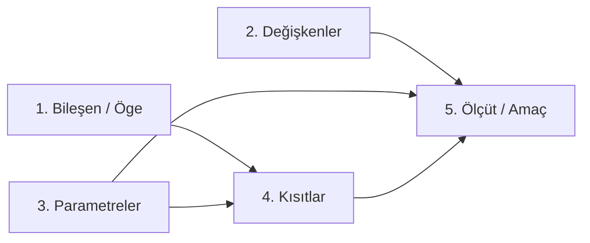

# Bürokrasiye Değgin
### 1. Ölçme, Değerlendirme ve Sınav Usulleri
Dönem içi ve dönem sonu sınavlarında ezbere dayalı, tanımsal aktarımlar ve bireysel sezgilere dayalı anlatılar değerlendirme dışı tutulur. Sınav kâğıtlarında "bence" ifadesiyle başlayan, kuramsal dayanağı bulunmayan ve olayları ardışık nedensellik bağıyla açıklamayan yanıtlar doğrudan iptal edilir. Öğrenciden beklenen temel yaklaşım; iktisadi, yönetsel ve operasyonel olguları bilimsel bir metodolojiyle, biçimsel (formatif) bir kurgu içinde, neden-sonuç zincirini adım adım kurarak analiz etmektir. Bir sorunun nihai sonucunu gerekçelendirmeden doğrudan kâğıdın başında belirtmek not kaybına yol açar; analitik kurgunun başlangıçtan sonuca doğru evrilmesi esastır.

----

# Derse Değgin

## Kavramsal Çerçeve

### Sistem Kavramı ve Hudutları
Sistem; tanımlanmış bir amacı gerçekleştirmek için aralarında belirli ilişkiler bulunan ögelerin birleşiminden oluşan dinamik bir bütündür. Hangi çalışma alanı olursa olsun; imalar, lojistik, finans, savunma, eğitim... Her alanda açığa çıkan sistemlerin dört evrensel boyut üzerinden varlık kazanır:

1. **Öge (Bileşen/Nesne)**: Sistemi oluşturan fiziksel veya kavramsal varlıkların tamamı. Bir üniversite sisteminde öğretim üyesi, öğrenci, amfi ve projeksiyon cihazı birer ögedir. İmalat sisteminde tezgâh, operatör, ham madde ve nihai mamul de bu cümledendir.
2. **Özellik (Nitelik)**: Ögeleri tanımlayan; onların çalışma kapasitesini, durumunu, neliğini belirleyen parametrelerdir. Operatörün uzmanlık düzeyi, tezgâhın modern veya demode oluşu, amfideki sıraların ergonomik yapısı veya mamulün tolerans sınırları bu cümledendir.
3. **Etkinlik (Dönüşüm Süreci)**: **Sistem içinde değişim yaratan, girdileri çıktılara dönüştüren operasyonel eylemlerdir**; sistem şemasında bunu **süreç** yahut **process** ile ifade ederiz. İmalat sisteminde ham maddenin fiziksel değişime uğratılarak mamul hâline getirilmesi; taşımacılık sisteminde yolcu ve yükün bir noktadan diğerine nakledilmesi bu cümledendir.
4. **Durum (Sistem Durumu)**: Sistemin belirli bir zaman kesitinde öge, özellik ve etkinlik parametreleri üzerinden sergilediği anlık performans fotoğrafıdır. Durum zaten, dinamik anın belirli bir zamandaki dondurulmuş hâlidir. Dönem sonunda sınıftaki öğrencilerin başarı yüzdesi veya bir işletmenin mâlî yıl sonundaki kârlılık, likidite ve borçluluk göstergeleri sistemin durumunu tanımlar.

### Yapay Sentez (Artificial Synthesis) ve Statik Sistem Paradigması
1960'lı yıllarda örgüt kuramcıları tarafından geliştirilen *Yapay Sentez* yaklaşımı; sistemleri durağan, sabit ve kapalı bir mantıkla ele almıştır. Bu model üç temel kaideye dayanmaktaydı:

- **İlke**: Sistemi, ögelerin sabit ve değişmeyen bir bütünü olarak anlamak.
- **Amaç**: Sisteme ilişkin operasyonel değerleri kesin biçimde öngörmek.
- **Yöntem**: Sistemi mekanik parçalarına ayırarak çözümlemek (analiz).

Bu kuramsal yapı içsel çelişkiler barındırır. Ögelerin sabitliği varsayımı, gerçek hayattaki aşınma, bilgi birikimi, teknolojik eskime ve yorulma dinamikleriyle uyuşmaz. Bir sınıfta 14 hafta boyunca ders işlendiğinde öğrencilerin zihinsel birikimi artar, donanımların çalışma saati tükenir, binalar yıpranır... Sistemin bileşenleri sürekli devinim ve başkalaşım içindedir. Dolayısıyla değişimin var olduğu bir ekosistemde ögeleri sabit kabul etmek, yönetsel körlüğe yol açar. Bu metodolojik tıkanıklık, Yapay Sentez'in 20 yıllık bir uygulama süresinin ardından yerini dinamik akışları temel alan [[Süreç Yaklaşımı]] modeline bırakmasını zorunlu kılmıştır.

### Bilimsel Öngörü ve Bayes Mantığı (Forecasting vs. Estimation)
Karar alma süreçlerinde geleceğe yönelik kestirimler ile bilimsel öngörüler yöntemsel olarak ayrışır:

- **Kestirim (Estimation)**: Bireysel kanaatlere, subjektif hislere ve sezgisel yargılara dayalı değerlendirmelerdir. Dayandığı nesnel bir veri tabanı ve ölçüm kurgusu bulunmaz.
- **Öngörü (Forecasting)**: Geçmiş dönem istatistiklerine, matematiksel bağıntılara ve [[ampirik]] saha araştırmalarına dayanan analitik tahminleme sürecidir.

Kestirim ile öngörü arasındaki köprüyü kuran temel mekanizma **Bayes Mantığı** (Bayesian Updating) olarak adlandırılır. Bayes yaklaşımı, yeni kanıtlar ve veriler sisteme girdikçe öncül olasılıkların sistematik olarak güncellenmesini sağlar. Söz gelimi, bir karar verici başlangıçta belirli olayın gerçekleşme olasılığını yüzde 80 olarak belirlemişken; sahadan gelen yeni ölçüm ve verilerin ışığında bu olasılığı yüzde 60 seviyesine revize eder. Olasılıkların yeni parametreleri gözden geçirilmesi, sezgisel yaklaşımları matematiksel bir rasyonelliğe kavuşturur.

### Sistem İçi İlişki Türleri ve Operasyonel Etkileşimler
Sistemi oluşturan bileşenlerin bir arada amaca yönelik çalışabilmesi aralarındaki çok boyutlu ilişki ağlarına bağlıdır.

- **Mekânsal İlişki**: Ögelerin fiziksel konumlaanma düzenidir. Depolama alanı ile üretim tezgâhları arasındaki mesafenin daraltılması, taşıma sürelerini ve maliyetlerini asgariye indirir.
- **Zaman İlişkisi**: Faaliyetlerin icra edildiği takvimsel periyotları kapsar (sabah-öğle vardiyaları, haftalık planlama).
- **Neden-Sonuç İlişkisi**: Bir ögedeki değişimin diğer ögeyi zorunlu kılmasıdır. **İktisattaki arz ve talep eğrilerinin kesişmesi sonucunda piyasa fiyatının oluşması tipik bir neden-sonuç bağıntısıdır**.
- **Enerjinin Korunumu İlişkisi**: Sistemdeki enerji sarfiyatının faydaya veya fiziksel dönüşüme evrilmesidir. Tuğla üretiminde kilin preslenmesi için kömür yakılarak fırın sıcaklığının 900 santigrat dereceye çıkarılması bu dönüşümü temsil eder.
- **Matematiksel İlişki**: Değişkenler arasındaki ölçülebilir, fonksiyonel bağlardır ($y = ax+b$).
- **Yapısal İlişki**: Üretimin ve operasyonun fizikî doğasından kaynaklanan kurallardır. Üretim miktarı kesikli tam sayılar üzerinden yürür; yarım buzdolabı veya kesirli otomobil üretimi fiziksel olarak varlık kazanamaz.
- **İşlemsel İlişki**: Bir mamulün ortaya çıkması için gereken montaj, cila, zımpara ve pres gibi ardışık operasyonel adımlardır.
- **Sıra İlişkisi**: Süreçlerin öncülük-ardıllık bağımlılığıdır. Bir lisans programında dördüncü sınıf derslerinin alınabilmesi için alt yarıyıl derserinin başarıyla tamamlanması zorunluluğu bu ilkeye dayanır.

Al pampim, notun o kısmını hocanın ağzından çıkan **"Sistemin Yapısını Analiz Eden 5 Temel Kavram"** ile doğrusal programlamayı kusursuz birleştirecek şekilde en baştan yazdım. 

Bunu doğrudan kopyalayıp notunun yerine yapıştırabilirsin:

---

### Sistemin Yapısal Analizi ve Doğrusal Modelleme (Bileşen, Değişken, Parametre, Kısıt, Ölçüt)

Hangi organizasyon olursa olsun (bir fabrika, bir üniversite, İİBF veya YBS bölümü); sistem analisti **"bu sistemin yapısını analiz edin"** dendiğinde kaotik gerçekliği matematiksel olarak sayısallaştırmak için beş temel yapısal kavramı kullanır:

#### 1. Bileşen (Öge / Component)
Sistemin bünyesinde barındırdığı, dönüşüm sürecine giren veya süreci yürüten tüm fiziksel, beşerî ve kavramsal varlıklardır. 
* *Üretim sisteminde:* Ham madde, elektrik enerjisi, tezgâh parkı, montaj işçisi birer bileşendir.
* *Üniversite sisteminde:* Dekan, öğretim üyesi, öğrenci, amfi ve bilgisayar laboratuvarı sistemin bileşenleridir.

#### 2. Karar Değişkenleri ($x_j$)
Sistemin kontrol edebildiği, değeri modelin çözümü sonucunda aranan ve farklı değerler aldıkça sistemin sonucunu doğrudan değiştiren üretim/faaliyet kalemleridir:
* $x_1$: Üretilecek basketbol topu (veya A tipi ürün) miktarı.
* $x_2$: Üretilecek futbol topu (veya B tipi ürün) miktarı.
* *Yönetsel süreçte:* İşi yürüten karar vericilerin üstlendiği farklı roller ve iş yükleri birer değişkendir.

#### 3. Parametreler ($c_j, a_{ij}$)
Değişkenlerin önünde yer alan, birim ürün başına sağlanan katkı payını veya birim ürünün tükettiği kaynak miktarını gösteren **sabit katsayılardır**. Bir sipariş alındığında veya model kurulduğunda parametreler sabittir; katsayıların değişmesi problemi ve siparişi tamamen başkalaştırır:
* $c_1 = 2$: Bir adet $x_1$ üretildiğinde elde edilen birim kâr/kazanç (2 TL).
* $a_{11} = 1$: Bir adet $x_1$ üretmek için depodaki ham maddeden tüketilen miktar (1 birim/ton).
* *Organizasyonda:* Bir personelin yetkinlik katsayısı veya birim zamanda iş yapma hızı bir parametredir.

#### 4. Kısıtlar (Kaynak Sınırları ve Limitler)
Üretimi gerçekleştirmek için kullanılan bileşenlerin ve girdilerin **sınırsız olmadığını** gösteren yasal, fiziksel ve operasyonel üst/alt sınırlardır:
* **Hammadde Kısıtı:** Depodaki toplam ham maddenin 1.000 tonla sınırlı olması:
  $$1x_1 + 2x_2 \le 1000$$
* **Kapasite ve İş Gücü Kısıtı:** Başbakanlık genelgesi uyarınca bir personelin yıllık azami yasal çalışma süresinin **1.457 saat** olması fiziksel bir kısıttır. İnsana sonsuz iş yüklenemez; gece saat 24.00'te dekanın hocayı arayıp rapor isteyememesi yönetsel bir kapasite kısıtıdır.
* **İşaret Kısıtı (Negatif Olmama Şartı):** Fiziksel dünyada eksi üretim olamaz ($-5$ buzdolabı üretilemez). Dolayısıyla tüm karar değişkenleri sıfıra eşit veya büyük olmak zorundadır ($x_1, x_2 \ge 0$). Çözüm analitik kartezyen düzlemin zorunlu olarak **1. bölgesinde** aranır.
* **Aylak Değişken (Slack Variable - $s_1$):** Küçük-eşittir ($\le$) biçimindeki kısıtları cebirsel olarak çözebilmek amacıyla sol tarafa eklenen pozitif dengeleyicidir ($1x_1 + 2x_2 + \mathbf{s_1} = 1000$). Fabrika hiç üretim yapmadığında ($x_1=0, x_2=0$), $s_1 = 1000$ olur; yani depoda **1.000 ton ham maddenin atıl/kullanılmadan beklediğini** gösterir.

#### 5. Ölçüt (Amaç Fonksiyonu / Performance Criterion)
Sistemin optimize etmeye çalıştığı nihai yönetsel başarı kriteridir. İki yönlü kurulabilir:
* **Enbüyükleme (Kâr / Kazanç Maksimizasyonu):**
  $$\max{Z} = c_1x_1 + c_2x_2$$
* **Enküçükleme (Maliyet / Fire Minimizasyonu):**
  $$\min{Z} = c_1x_1 + c_2x_2$$
*(Primal-Dual ilişkisi gereği, kazancın maksimum olduğu tepe nokta ile maliyetin minimum olduğu dip nokta matematiksel olarak aynı optimum denge noktasına bakar).*

---

> **Sistem Analistinin Temel İlkesi:**  
> Sistem analisti işletmedeki kaotik yapıyı önce bu 5 kavramla matematiksel olarak modeller ve gerçeğin prototipini test eder. Model rasyonel ve tatminkâr sonuç verirse müşteriye taahhüt verilir ve bu matematiksel modelin üzerine kurumsal yazılım (ERP) bir hız ve hacim enstrümanı olarak giydirilir.

### Sistem Dengesi ve Kapasite Optimizasyonu
**İşletme sistemlerinde maksimizasyon kavramı uç bir hedefi temsil ederken, yönetim pratiğinin odaklandığı temel olgu optimizasyondur (denge)**. Bir dönemin kârı tek başına bir başarı göstergesi sayılmaz; anlamlı bir karar için son 3 ila 5 yıllık eğilimlerin (trendlerin) incelenmesi gerekir. Bu süreçte kapasite türleri şu şekilde ayrışır:

Bkz. [[5- Tesis Yerleşimi ve Kapasite Planlaması#Kapasite Türleri|Kapasite Türleri]]

- **Teorik (Maksimum) Kapasite**: Hiçbir aksama, duruş ve bakım olmaksızın ulaşılabilecek en üst kapasitedir.
- **Fiilî Kapasite**: Mevcut pazar koşulları, ham madde arzı ve çalışma saatleri dâhilinde fiilen gerçekleştirilen üretim miktarıdır. 
- **Atıl Kapasite**: Pazar talebinin yetersizliği veya planlama hataları sebebiyle kullanılmayan, boşta kalan üretim potansiyelidir.
- **Zorlanmış Kapasite**: Bakım aralıkları atlanarak, iş gücü aşırı mesaiye maruz bırakılarak elde edilen, uzun vadede sistemik arızalara yol açan geçici kapasite düzeyidir.

### Müşteri Talebi ve Değer Zinciri Entegrasyonu
Talep kavramı iktisadi olarak satın alma gücüyle desteklenmiş edinme arzusunu ifade eder. Müşterinin ihtiyaç duyduğu ürünün doğru zamanda, doğru kalitede ve taahhüt edilen teslim süresinde karşılanması işletmenin varlığını sürdürme şartıdır. Tedarik zincirindeki ham madde gecikmesi sebebiyle siparişi taahhüt edilen sürede teslim edemeyen işletme, yalnızca o siparişin gelirini kaybetmekle kalmaz, kurumsal itibar zedelenmesi de yaşar. İhtiyacını gideremeyen müşteri rakip işletmelere yönelir ve pazar payı doğrudan rakiplere transfer edilir.

### [[Süreç Yaklaşımı]] (Process Approach) ve Sistem Tasarımı
1980'li yıllarda *Yapay Sentez'in* yerini alan Süreç Yaklaşımı, kurumsal yapıları departman kutucukları üzerinden değil, iş akışları üzerinden modeller. **Kurumsal Kaynak Planlaması (ERP)** mantığının omurgasını oluşturan bu yaklaşım üç sacayağına dayanır:

- **İlke**: Sistemi süreçlerin bir bütünü olarak anlamak.
- **Amaç**: Sistemin operasyonel davranışını belirlemek ve buna uygun dinamik politikalar geliştirmek.
- **Yöntem**: Sistemi matematiksel modeller, prototipler ve bilgisayar simülasyonları yoluyla tasarlamak.

**Tasarım, gerçeğin prototipini kurma eylemidir**. Bir maden arama sahasında büyük tesisler inşa edilmeden önce pilot sondaj kuyularının açılması gibi; bir işletmede de operasyonel yatırımlar yapılmadan önce süreçler simüle edilir. Verilerin bilgisayara kaydedilmesi [[Sayısallaştırma]] (Digitization) olarak tanımlanırken; bu verilerin tüm departmanlar arasında entegre edilerek anlamlı kararlara dönüştürülmesi [[Dijitalleşme]] (Digitalization) seviyesini gösterir. 1995 yılında internetin yaygınlaşması, bu süreç odaklı bilgi akışını küresel ağlara taşımıştır.

## Geniş Çerçeve

İşletme sistemlerinin evrimi, insanlığın bilimsel bilgi üretme kapasitesiyle eşzamanlı bir seyir izlemiştir:

| Dönem               | Hâkim Paradigma                                               | Temel Dinamik ve Metodolojik Odak                                                                                                                                     |
| :------------------ | :------------------------------------------------------------ | :-------------------------------------------------------------------------------------------------------------------------------------------------------------------- |
| **1400 Öncesi**     | Felsefe                                                       | Olguları analitik ve felsefi düşünceyle açıklama; pozitif bilimin yokluğunda mutlak dünya algısı.                                                                     |
| **1600'ler**        | Temel Bilimler                                                | Pozitif bilimlerin, gözlemin ve matematiksel düşüncenin doğuşu.                                                                                                       |
| **1750'ler**        | Sanayi Devrimi                                                | Trampa (takas) ekonomisinden fabrikasyona geçiş; sömürge kaynaklarının (İngiltere'nin Hindistan'dan çektiği 40 milyon sterlinlik altın) sermaye birikimine dönüşmesi. |
| **1880'ler**        | Bilimsel Yönetim ([[Bilimsel Yönetim Yaklaşımı\|Taylorizm]]]) | Uzmanlaşma, iş bölümü, insan emeğinin mekanik standartlara bağlanması, kaynak kıtlığı ve verimlilik kaygısı.                                                          |
| **1910'lar**        | Otomasyon                                                     | Üretim ve yönetimin asgari insan müdahalesiyle yürütülmesi standardı.                                                                                                 |
| **1940'lar**        | Yöneylem Araştırması                                          | Dünya savaşlarının lojistik ve balistik problemleri için geliştirilen katı matematiksel modellemeler.                                                                 |
| **1960'lar**        | Yapay Sentez                                                  | Örgütleri ögelerin sabit bir bütünü sayan durağan sistem yaklaşımı.                                                                                                   |
| **1980'ler**        | Süreç Yaklaşımı                                               | Süreç bütünselliği, simülasyon, davranış belirleme ve kurumsal bilgi sistemleri.                                                                                      |
| **1995 ve Sonrası** | İnternet ve Entegre Ağlar                                     | Küresel iletişim altyapısı, e-ticaret, gerçek zamanlı ERP ve dijital dönüşüm ekosistemleri.                                                                           |

### Alt Sistem Hiyerarşisi ve Kaynak Dağıtım Dinamikleri
Her sistem kendisinden daha üst bir üst-sistemin parçasıdır ve kendi bünyesinde alt sistemler barındırır. Dokuz Eylül Üniversitesi; Yükseköğretim Kurulu (YÖK) sisteminin bir alt sistemi iken, İktisadi ve İdari Bilimler Fakültesi (İİBF) üniversitenin bir alt bileşenidir. Yönetim Bilişim Sistemleri (YBS) bölümü ise fakültenin bir alt sistemidir. 

Bu dikey entegrasyonda kaynak dağılımı ve yetki hiyerarşisi kritik bir denge arz eder. Merkezi yönetimden gelen bütçenin alt birimler arasında orantısız dağıtılması, pay alamayan alt sistemin faaliyetlerini durdurur; bu durum zincirleme bir reaksiyonla tüm üniversite sisteminin kurumsal performansını aşağı çeker. Sistem içi entegrasyon; operasyonel, taktik ve stratejik karar seviyelerinin uyumlu bir bilgi mimarisiyle birbirine bağlanmasını zorunlu kılar.

> Bilgisayar teknolojisi ve yazılım, kendi başına bir çözüm aracı olmayıp; doğru tasarlanmış, matematiksel olarak modellenmiş ve optimize edilmiş iş yapma süreçlerinin üzerine giydirilen bir hızlandırıcı donanımdır...

