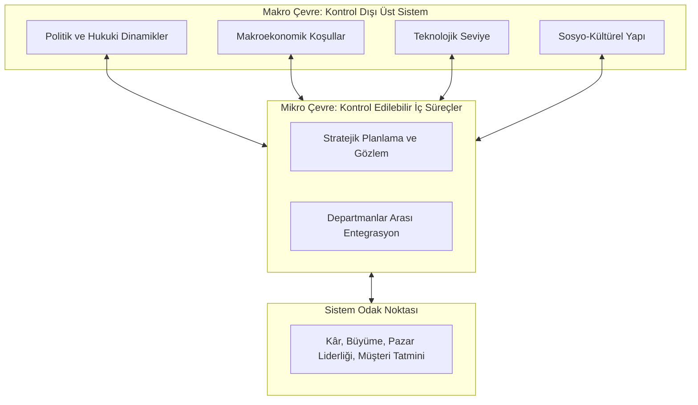
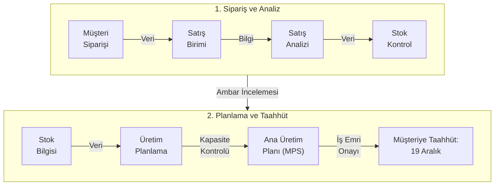
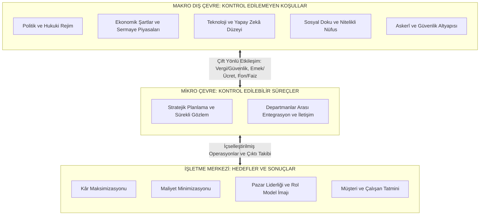

# Kavramsal Çerçeve ve Açıklamalar

## Açık Sistem Modeli ve Makro-Mikro Çevre Etkileşimi

Açık sistem modeli; bir organizasyonu çevresinden yalıtılmış mekanik bir aygıt olarak görmek yerine, dış çevresiyle sürekli madde, enerji ve bilgi alışverişinde bulunan dinamik bir yapı olarak tanımlar. Sistem, merkezinde temel kurumsal hedefleri ve çıktı metriklerini barındırır. Merkezin etrafında işletmenin doğrudan temas kurduğu ve yönetme gücüne sahip olduğu yakın çevre faktörleri yer alır; en dış katmanda ise işletmenin tek başına yönlendirme gücünün bulunmadığı genel makro çevre koşulları hüküm sürer.

İşletme, çevresinden girdi alan, bu girdileri bünyesinde fonksiyonel alt sistemlerle işleyerek çıktıya dönüştüren ve çevresiyle kesintisiz etkileşim kuran dinamik bir [[Açık Sistemler|açık sistemdir]].

#### Odak (Merkez - İşletmenin Varlık Sebebi)
Sistem merkezinde işletmenin stratejik hedefleri ve çıktıları yer alır. Kâr maksimizasyonu, maliyet minimizasyonu, pazar liderliği, müşteri tatmini ve çalışan memnuniyeti bu odağın parametreleridir.

#### Mikro Çevre (Kontrol Edilebilir Alan)
İşletmenin merkezine yakın olan; iç planların uygulamaya konulması, üretim programları, stok politikaları ve departmanlar arası eşgüdüm gibi doğrudan yönetebildiği operasyonel süreçtir.

#### Makro Çevre (Kontrol Edilemeyen Alan)
Dış çemberi oluşturan ve işletmenin tek başına yönlendirme gücünün bulunmadığı üst sistem bileşenleridir. Bu katman **politik**, **ekonomik**, **askerî**, **hukukî**, **sosyal**, **eğitim sistemi**, **teknoloji** gibi birçok parametreyi ihtiva eder. Ülke ekonomisinin genel düzeyi, döviz kuru hareketleri veya yargı kararları münferit bir firmanın kapasitesini açan üst sınırlardır.

---

Şematik gösterimlerde çevresel oklar işletmenin merkezine doğru tek yönlü aksa da, gerçek hayatta sistem ile çevre arasında **çift yönlü karşılıklı bir alışveriş** vardır. 

1. **İşletme - Devlet**: Kamu erki işletmeye yasal faaliyet alanı, mülkiyet güvencesi ve güvenlik altyapısı sağlar; işletme bu edimlerin karşılığını vergi ödemeleri ve istihdam yaratma yoluyla devlete aktarır.
2. **İşletme - Emek Piyasası**: Çalışanlar fiziksel emeklerini ve zihinsel yetkinliklerini kuruma kiralayarak katma değer üretir; işletme bu girdinin karşılığında ücret, prim ve sosyal haklar tahsis eder.
3. **İşletme - Sermayedarlar**: Yatırımcılar işletmeye [[ayni değerler|ayni]] ve nakdi özsermaye koyar; işletme başarılı faaliyet dönemlerinin ardından ortaklarına kâr payı ([[temettü]]) dağıtır.
4. **İşletme - Finansal Kurumlar**: Para ve [[sermaye piyasaları]] işletmeye kredi ve fon sağlar; işletme bu kaynağı faiz ve anapara ödemeleriyle itfa eder.
5. **İşletme - Rakipler**: Sektördeki rakipler, ürün farklılaştırması, pazar payı rekabeti ve endüstriyel tasarım yenilikleri üzerinden birbirlerinin teknolojik ve estetik standartlarını yukarı taşır. Otomotiv sektöründe iklimlendirme sistemlerinin veya gövde hatlarının zamanla tüm üreticilerde standart hâle gelmesi bu karşılıklı etkileşimin sonucudur.

## Tasarım Odaklı Rekabet
Serbest piyasa koşullarında benzer sermaye güçlerine sahip işletmelerin sunduğu ürünler teknolojik donanım açısından birbirine yakınsar. Ürün gamı ve bütçe büyüdükçe karar verme süreci zorlaşır. Otomotiv sanayii bu etkileşimin somut kanıtıdır:
* **Tarihsel Donanım Standartlaşması:** Geçmiş dönemlerde otomobillerde klima donanımı araç fiyatının yüzde onluk dilimini kapsayan ayrıcalıklı bir lüks göstergesi iken; günümüz endüstri standartlarında tüm araçlarda standart bir donanım unsuruna dönüşmüştür.
* **Tasarım Yakınsaması:** Üretici firmalar (örneğin Doğan, Şahin, Tempra modellerinin S, SX, SLX versiyonları veya PSA Grubu ve küresel markaların güncel kasaları) rakiplerin estetik, aerodinamik ve ergonomik çizgilerini takip eder. Rakipler arasındaki çift yönlü etkileşim ana eksende tasarım farklılaştırması üzerinden yürütülür; kasa hatları sertleştirilir veya ovalleştirilerek pazar payı korunur.

## Kurumsal Etik ve İtibar-İmaj Ayrımı
Sistemlerin sürdürülebilirliği, onu işleten insan unsurunun ahlâkî ve kültürel kodlarına bağlıdır.

* **Vade Algısı Paradoksu:** Bireysel insan hayatı yetmiş seksen yıllık sınırlı bir dönemi kapsarken; ulusların, devletlerin ve işletmelerin hayatı yüzyıllarla ifade edilen geniş zaman dilimlerine yayılır. Bireysel refahı sınırlı ömür diliminde gayrimeşru yollarla artırma eğilimi (rüşvet, haksız kazanç, usulsüzlük) kurumsal kültüre sirayet ederek sistemi çürütür.
* **İmaj (Anlık Algı):** Müşterinin ve kamuoyunun zihninde reklam, halkla ilişkiler veya dönemsel kampanyalarla oluşturulan geçici, yüzeysel algıdır.
* **İtibar (Kümülatif Değer):** İşletmenin dürüst çalışma ilkeleri, kaliteli üretim, verilen sözde durması ve kurumsal etik sayesinde on yıllar boyunca ilmek ilmek inşa ettiği sarsılmaz güven sermayesidir. Tarih boyunca Enron örneğinde ve çeşitli kamu bürokrasisi vakalarında görüldüğü üzere; etik temelleri yitiren yapılar kısa vadeli kazanç sağlasalar dahi orta ve uzun vadede yok olmaya mahkûmdur.

## Veri-Bilgi Dönüşümü ve Departmanlar
Bir müşterinin sipariş vermesiyle başlayan yolculuk, departman sınırlarında karşılıklı veri-bilgi dönüşüm mekanizmasını tetikler:

- **Sistem Arayüzü (Kesişim)**: Müşteri ile işletmenin temas ettiği sınır noktasıdır (örn: satış birimi). Müşterinin sunduğu istekler satış temsilcisi için birer **veri** niteliğindedir. Satış temsilcisi bu talebi analiz edip içselleştirdiğinde kendi adına **bilgiye** (information) dönüştürür.
- **Departmanlar Arası Geçişkenlik**: Satış birimi tek başına siparişi onaylama yetkisine sahip değildir. Talebi stok departmanına aktarır. Satıştan gelen bu girdi, stok yöneticisi için yeniden bir ham veridir. Stok yöneticisi ambar kayıtlarını inceleyerek durumu bilgiye çevirir. Ardından üretim birimine aktarır. İmalat yöneticisi elindeki *Ana Üretim Planı* tablosunu açarak kapasite kontrolü yapar. Departmanlar arası zincirleme konuşma tamamlandığında müşteriye resmî taahhüt (iş emri) verilir.

Bir diğer deyişle şöyle açıklayabiliriz:

1. Müşterinin satış temsilcisine ilettiği ham sipariş ifadesi, temsilcinin zihninde başlangıçta salt bir **veri** seviyesindedir. Temsilci bu veriyi müşteri geçmişi ve şirket kurallarıyla değerlendirdiğinde kendi adına **bilgi** üretir.
2. Satış biriminin stok yöneticisine aktardığı malzeme sorgusu, stok birimi için yeni bir **veri** niteliğindedir. Stok yöneticisi ambar kayıtlarını inceleyip mevcudiyeti raporladığında bu girdi **bilgi** seviyesine yükselir.
3. Stok biriminin üretim planlamaya ilettiği malzeme durumu, imalat yöneticisi için bir **veri** teşkil eder. İmalat yöneticisi tezgâh çizelgelerini ve **Ana Üretim Planı** (Master Production Schedule - MPS) kayıtlarını inceleyerek yapılabilirlik kararına vardığında nihai **bilgi** oluşur.
4. Yapılabilirlik kararının kesinleşmesiyle birlikte kurumsal yazılımda bir [[İş Emri]] (Work Order) açılır; bu kayıt kurumsal kaynak planlama (ERP) modüllerini eşzamanlı olarak harekete geçirir.

## Fonksiyonel Alt Sistemlerin Entegre İşleyiş Döngüsü
### A. Stok Kontrol Alt Sistemi Mimarisi
Gelecek dönemin malzeme ihtiyaçlarını ve satış projeksiyonlarını yönetir:

- **Satış Tahminleri**: Üç bileşenin toplamı üzerinden hesaplanır: (1) *Depoda sevk edilmeye hazır bekleyen mamuller* (anlık nakit potansiyeli), (2) *Üretimi devam eden yarı mamuller*, (3) *Alınmış kesin siparişler* (örneğin 1 milyon adet). Bu veriler son 3 ila 5 yıllık trendler üzerinden [[veri-madenciligi-9#A. Basit Doğrusal (Linear) Regresyon|doğrusal regresyon]] analiziyle modellenir.
- **Çıktı Raporları**: *Stok Ana Dosyası* taranarak iki kritik liste üretilir:
	1. **Malzeme ve Gereksinim Listesi**: Eksik olan ve satın alma birimince dışarıdan tedarik edilmesi gereken hammadde dökümüdür.
	2. **Üretilecek Malzemeler Listesi**: Hammaddesi hazır olan ve doğrudan imalat tezgâhlarında sevk edilecek iş emirleridir.

### B. Satın Alma ve Tedarik Alt Sistemi
Eksik hammaddelerin dış kaynaklardan teminini koordine eder:
- **Satıcı Referans Dosyası**: Geçmişte çalışılan tüm tedarikçilerin başarı puanlarını ve teslimat performanslarını içerir. Satıcı seçimi bu nesnel puanlama üzerinden yapılır.
- **Hata ve İstisna Raporu (Tolerans)**: Tedarikçiyle yapılan sözleşmede belirlenen kabul edilebilir kusur sınırıdır (örn: *binde beş oranında defo toleransı*). Kusur oranı bu eşiği aştığında yasal yaptırım ve iade mekanizması devreye girer.
- **Dosya Güncellemeleri**: Satın alma emri onaylandığında, satıcıya sipariş listesi gödnerilir, tedarik sürecindeki siparişler *Açık Alış Emirleri Dosyası* içinde izlenir ve stok yöneticisine *Stok Durum Raporu* iletilir.

### C. Teslim Alma ve Depolama Alt Sistemi
Fabrika kapısına gelen hammaddelerin sisteme fiziksel ve kaydi dâhil edilme aşamasıdır:

- **Çift Yönlü Kontrol**: Gelen koliler fiziksel olarak ambar raflarına istiflenirken; kaydi olarak adet ve kalite kontrolünden geçirilir, barkodlanır, firma kaşesi basılır ve ambar giriş fişi düzenlenir.
- **Karşılanamayan Siparişler Dosyası**: Hata toleransını aşan defolu ürünler (örn: 300 kayıtlı eksik üzerine gelen 50 hatalı parça ile 350 adede ulaşan dosya) tedarikçiye iade edilmek üzere bir kütüğe işlenir.
- **Teslim Alma Raporu**: Malı getiren nakliyeci ile depo görevlisi arasında çift nüsha imzalanır. Bir nüsha nakliyeciye kanıt olarak verilirken diğer nüsha muhasebe borç hesaplarına iletilir.

### D. Araştırma ve Geliştirme (Ar-Ge) Alt Sistemi
Organizasyonel şemalarda zaman zaman pazarlamanın bir alt dalı gibi çizilmesine karşın, Ar-Ge tüm işletmeye **katma değer ve lisans üreten bağımsız bir üst departmandır**:

- **Girdi Kaynakları**: İki kanaldan beslenir: (1) Müşteri kullanım şikâyetleri ve talepleri (CRM kayıtları, [[veri-madenciligi-10#Metin Madenciliği nedir|metin madenciliği]]), (2) Pazar ve rakip analizleri.
- **Ar-Ge Karar Mantığı**: Fikir aşaması $\to$ Laboratuvar testleri $\to$ Prototip/Demo üretimi $\to$ Yönetim Karar Düğümü (eşkenar dörtgen / yan kare). Yönetim onay verirse tasarım doğrudan imalat planına aktarılır, ret verilirse proje iptal edilir. 

### E. Pazarlama ve Satış Alt Sistemi
Pazar araştırması, tutundurma, reklam bütçeleri, dağıtım kanalları ve [[dijital-pazarlama-1#Pazarlama Karması (Marketing Mix - 4P)|4P]] (Product, Price, Place, Promotion) stratejileri bu birimde kurgulanır. İmalatı tamamlanan mamuller ambalajlanıp etiketlendikten sonra satış kanallarına devredilir. Satış kotasını dolduran ürünler sahaya sevk edildiği an Müşteri İlişkileri Yönetimi (CRM) süreci başlar.

### F. Finansman ve Muhasebe Entegrasyonu
- **Finansman Gücü**: Kısa vadeli borçları ödeyebilme yeteneği olan **[[ATLAS/Depo/Eskiler/Linkler/Ekler 2/likidite|likidite]]** ile sağlanan uzun vadeli fon kaynaklarının ([[Hisse Senetleri|hisse senetleri]], [[Tahviller|tahviller]], banka kredileri) toplamıdır. Bu güç işletmenin sermaye bütçelemesi projelerine (şirket satın alma, fabrika büyütme, ERP yazılımına geçiş, makine yatırımı) karar vermesini sağlar.
- **Tekdüzen Muhasebe Sistemi**: Tüm departmanlardaki kıymetli evrak ve nakit hareketleri yasal olarak kayıt altına alınır. Yıl sonunda hazırlanan mizanlar, bilançolar ve gelir tabloları işletmenin mâlî özetini sunar; vergilendirme ve yatırımcı güveni bu tablolar üzerinden şekillenir.

```mermaid
flowchart TD
    classDef default fill:#1e1e2e,stroke:#cdd6f4,stroke-width:1px,color:#cdd6f4;
    classDef dep fill:#181825,stroke:#89b4fa,stroke-width:2px,color:#89b4fa;
    classDef doc fill:#313244,stroke:#f9e2af,stroke-width:1px,color:#f9e2af;
    classDef money fill:#313244,stroke:#a6e3a1,stroke-width:1px,color:#a6e3a1;

    subgraph Müşteri_Arayüzü ["Sistem Arayüzü ve Kesişim Kümesi"]
        Musteri["Müşteri"]
    end

    subgraph Satis_Pazarlama ["Pazarlama ve Satış Alt Sistemi"]
        class Satis_Pazarlama dep;
        Tuana["Satış Birimi (Tuana)"]
        PazarlamaOnay["Pazarlama (4P ve Markalama)"]
        CRM["Müşteri İlişkileri Yönetimi (CRM)"]
    end

    subgraph Stok_Ambar ["Stok Kontrol ve Depolama Alt Sistemi"]
        class Stok_Ambar dep;
        StokKontrol["Stok Yönetimi (Ambar Rezerv Analizi)"]
        StokAnaDosya[("Stok Ana Dosyası")]
        DepoGiris["Teslim Alma ve Depo Giriş Kontrolü"]
        KarsilanamayanDosya[("Karşılanamayan Siparişler")]
    end

    subgraph Tedarik_Sistemi ["Satın Alma ve Tedarik Alt Sistemi"]
        class Tedarik_Sistemi dep;
        SatinAlma["Satın Alma Birimi"]
        SaticiRef[("Satıcı Referans Dosyası")]
        AcikSiparis[("Açık Alış Emirleri")]
        Tedarikci["Dış Tedarikçi"]
    end

    subgraph Uretim_Sistemi ["Üretim ve İmalat Alt Sistemi"]
        class Uretim_Sistemi dep;
        Metin["İmalat Yönetimi (Metin)"]
        MPS[("Ana Üretim Planı - MPS")]
        TezgahParki["Tezgâh Yük Dengeleme ve TPM (A, B, C)"]
    end

    subgraph Mali_Sistem ["Finansman ve Muhasebe Alt Sistemi"]
        class Mali_Sistem dep;
        FinansKasa["Finansman Birimi (Kasa / Likidite)"]
        MuhasebeKayit["Muhasebe (Tekdüzen Kayıt ve Bilanço)"]
        IcBorc[("İç Borç-Alacak Kütüğü")]
    end

    subgraph ArGe_Sistemi ["Bağımsız Ar-Ge Alt Sistemi"]
        class ArGe_Sistemi dep;
        ArGe["Ar-Ge Analiz ve Laboratuvar Testleri"]
        PrototipKarar{"Yönetim Karar Düğümü"}
    end

    %% Sipariş Onay ve Bilgi Dönüşüm Döngüsü
    Musteri -->|"1. Ek Sipariş Talebi (Ham Veri)"| Tuana
    Tuana -->|"2. Müşteri Bilgisiyle Talep Aktarımı"| StokKontrol
    StokKontrol <-->|"Mevcut Stok Taraması"| StokAnaDosya
    StokKontrol -->|"3. Hammadde Durumu ve Termin Verisi"| Metin
    Metin <-->|"Kapasite ve Takvim Teyidi"| MPS
    Metin -->|"4. Üretim Olurluğu Bildirimi"| PazarlamaOnay
    PazarlamaOnay -->|"5. 4P Onayı ve Nihai Sözleşme"| Tuana
    Tuana -->|"6. Resmî Teslim Taahhüdü (19 Aralık)"| Musteri

    %% Tedarik ve İç Finansman Akışı
    StokKontrol -->|"7. Malzeme Gereksinim Listesi"| SatinAlma
    SatinAlma <-->|"Tedarikçi Puanı Değerlendirmesi"| SaticiRef
    SatinAlma -->|"8. Hammadde Alım Fonu Talebi"| FinansKasa
    FinansKasa -->|"9. 1 Milyon TL Avans Çıkışı (Alacak)"| StokKontrol
    StokKontrol -.->|"İç Borçlanma Kaydı"| IcBorc
    SatinAlma -->|"10. Satın Alma Emri"| Tedarikci
    SatinAlma -.->|"Bekleyen Sipariş Kaydı"| AcikSiparis

    %% Malzeme Girişi ve Muayene
    Tedarikci ==>|"11. Fiziksel Hammadde Sevkiyatı (Malzeme Akışı)"| DepoGiris
    DepoGiris -->|"Kusurlu Parçalar (Binde 5 Aşımı)"| KarsilanamayanDosya
    DepoGiris -->|"12. Giriş Onayı ve Ambar Fişi"| StokAnaDosya
    DepoGiris -->|"13. Teslim Alma Raporu (Çift Nüsha)"| MuhasebeKayit
    MuhasebeKayit -->|"Tedarikçi Alacak Kaydı"| FinansKasa

    %% İmalat ve Fiziksel Çıktı
    StokAnaDosya -->|"14. Üretilecek Malzemeler Listesi"| TezgahParki
    DepoGiris ==>|"15. Hammadde Sevk (Malzeme Akışı)"| TezgahParki
    Metin -->|"Planlı Bakım ve Yük Dağıtımı"| TezgahParki
    TezgahParki ==>|"16. Mamul Çıktısı (Malzeme Akışı)"| PazarlamaOnay
    PazarlamaOnay ==>|"17. Satışa Hazır Ürün Sevkiyatı"| Musteri

    %% Tahsilat ve İç Borç Kapanışı
    Musteri -->|"18. 3 Milyon TL Satış Hasılatı"| FinansKasa
    FinansKasa -->|"Tahsilat Makbuzu ve Fatura"| MuhasebeKayit
    FinansKasa -.->|"19. 1 Milyon TL Borcun Düşümü ve 2 Milyon TL Kâr"| IcBorc

    %% Geri Bildirim ve Ar-Ge Zinciri
    Musteri -->|"20. Kullanım Şikâyeti / Kusur Bildirimi"| CRM
    CRM -->|"Metin Madenciliği Çıktıları"| ArGe
    ArGe -->|"Tasarım ve Prototip İyileştirme"| PrototipKarar
    PrototipKarar -->|"Onaylanan Yeni Tasarım"| MPS
```

```mermaid
flowchart LR
    subgraph MUSTERI_ILISKILERI["Pazarlama & Müşteri Birimi"]
        direction TB
        M1["Müşteri Talebi / Sipariş Girişi"]
        M2["CRM Şikâyet ve Geri Bildirim Analizi"]
        M3["Pazar Eğilimleri ve Rakip İncelemesi"]
    end

    subgraph ARGE_BIRIMI["Araştırma ve Geliştirme Üst Sistemi"]
        direction TB
        R1["Kuramsal Analiz ve Laboratuvar Testi"]
        R2{"Yönetim Karar Düğümü: Onay / İptal"}
    end

    subgraph STOK_BIRIMI["Stok Kontrol Alt Sistemi"]
        direction TB
        S1["Satış Tahminleri ve Trend Analizi"]
        S2[("Stok Ana Kütüğü")]
        S3["Malzeme Gereksinim Listesi"]
        S4["Üretilecek Malzemeler Listesi"]
    end

    subgraph SATINALMA_BIRIMI["Satın Alma ve Tedarik Alt Sistemi"]
        direction TB
        T1[("Satıcı Referans Kütüğü")]
        T2["Tedarikçi Seçimi ve Fiyat Mutabakatı"]
        T3["Kalite Tolerans Protokolü Tanzimi"]
        T4["Satın Alma Sipariş Emirleri"]
    end

    subgraph DEPO_BIRIMI["Mal Kabul ve Ambar Girişi"]
        direction TB
        D1["Fiziksel Sayım ve Barkodlama"]
        D2[("Karşılanamayan Siparişler Kütüğü")]
        D3["Ambar Giriş Fişi Tanzimi"]
        D4["Teslim Alma Raporu Tanzimi"]
    end

    subgraph URETIM_BIRIMI["Üretim Alt Sistemi"]
        direction TB
        U1["Tasarım ve Kapasite Yapılabilirlik Testi"]
        U2["Ana Üretim Planı (MPS) Çizelgelemesi"]
        U3["Tezgâh Yük Dengeleme (A-B-C Tezgâhları)"]
        U4["Toplam Verimli Bakım İkamesi"]
    end

    subgraph FINANS_MUHASEBE["Finans ve Muhasebe Alt Sistemi"]
        direction TB
        F1["Likidite ve Fon Akış Analizi"]
        F2["Sermaye Projeleri Bütçelemesi"]
        F3["Dahili Borç-Alacak Balansı"]
        F4["Tekdüzen Yevmiye ve Mizan Kayıtları"]
        F5["Dönem Sonu Bilanço ve Gelir Tablosu"]
    end

    %% Süreç ve Bilgi Akış Bağlantıları
    M1 ==> |"Ham Talep Verisi"| S1
    M2 --> R1
    M3 --> R1
    R1 --> R2
    R2 --> |"Onaylanan Yeni Tasarım"| U1
    S1 --> S2
    S2 --> |"Eksik Malzeme İhtiyacı"| S3
    S3 ==> |"Tedarik Talebi"| T2
    T1 --> T2
    T2 --> T3
    T3 --> T4
    T4 ==> |"Satın Alma Emri Bilgisi"| D1
    D1 --> |"Tolerans Dışı Hatalı Ürün"| D2
    D1 --> |"Uygun Giriş Kaydı"| D3
    D3 --> |"Mevcut Güncelleme"| S2
    D4 ==> |"Tahakkuk ve Fatura Bilgisi"| F3
    S2 --> |"Hazır Malzeme Onayı"| S4
    S4 ==> |"İş Emri Transferi"| U1
    U1 --> U2
    U2 --> U3
    U3 <--> U4
    U3 ==> |"Fiziksel Mamul Girişi"| M1
    F1 --> F2
    F3 --> F4
    F4 --> F5
```

---

## 49 Düğümlü Entegre İş Süreci ve Çift Akış Mimarisi
Tüm departmanları (Pazarlama, Satın Alma, Stok, Üretim, Finans, Muhasebe, İK) içine alan uçtan uca bir sipariş süreci ardışık **49 operasyonel adımdan** oluşur:

* **Süreç Geçişkenliği:** Her bir büyük kare bir departmanı, karelerin içindeki numaralı düğümler (örneğin satın alma içindeki 17, 18, 19, 20) o birimde icra edilen ardışık alt işlemleri ve diğer departmana geçiş noktalarını temsil eder.
* **Çift Akış İlkesi:**
  1. *Bilgi Akışı:* Belgeleri, emirleri, onayları ve elektronik veri transferlerini temsil eden ince ve belirgin oklarla gösterilir.
  2. *Malzeme Akışı:* Hammaddenin depodan tezgâha, yarı mamulden stoğa ve nihai ürün olarak dağıtıma fiziki hareketini temsil eden kalın ve şeffaf gövdeli oklarla ifade edilir.
* **Yerleşim Planı (Kroki) Özelliği:** Süreç haritası aynı zamanda fabrikanın 2 kilometre yukarıdan kuş bakışı çekilmiş fiziksel yerleşim planını (layout) yansıtır; işletmeye yaklaşıldıkça birimlerin coğrafi konumları ve malzeme taşıma koridorları netleşir.

Aşağı yukarı şöyle bir görünümü vardır:

![[factory_img06.gif]]

## Sonsöz...

>*Makro farkındalık, mikro analiz*...

Kurumsal başarı, çalışanın kendi mikro uzmanlık alanını yürütürken, parçası olduğu devasa entegre zincirin ve işletmeyi çepeçevre kuşatmış makro çevresel dalgalanmaların tam bilincinde olması şartına bağlıdır...

Şirketlerin büyüklüğü ne kadar devasa olursa olsun, hiçbir işletme içinde bulunduğu devletin kurallarından, kanunlarından ve makroekonomik sınırlarından bağımsız hareket edemez.

Çok seçenekli ve yüksek bütçeli satın alma kararlarında tüketicinin zihnini kilitleyen temel etken ürünlerin birbirine aşırı benzemesidir; günümüz rekabetinde firmaların temel tutunma aracı tasarım farklılaştırmasıdır. 

Bireysel ömür beklentisi ile kurumsal ömür beklentisi arasındaki uyumsuzluk, ahlâkî zaaflara ve kurumsal yozlaşmaya zemin hazırlar; kalıcı kurumlar anlık imajla değil, nesiller boyu biriken itibar sermayesiyle ayakta kalır.

Bir müşterinin yönelttiği talep, temas noktası olan satış temsilcisi için ilk anda yalnızca ham bir veridir; bu talep ancak içselleştirilip diğer departmanların onay süzgecinden geçirildiğinde bilgiye ve iş emrine dönüşür.

Klasik şablonlarda Araştırma ve Geliştirme (Ar-Ge) fonksiyonunun pazarlama kutusunun altında çizilmesi yapısal bir kuramsal hatadır; Ar-Ge işletmenin tamamı için lisans, patent ve yeni değer üreten bağımsız bir tepe fonksiyondur.

Üretim hattında birim maliyeti düşük diye tüm siparişi tek bir tezgâha yüklemek operasyonel iflas getirir; makineler montaj hattı dengelemesi ve Toplam Verimli Bakım (TPM) ilkeleri doğrultusunda planlı olarak dinlendirilir. 

Kurumsal süreçlerde iki ayrı nehir akar: Biri insan ve bilişim altyapısıyla yönlendirilen bilgi akışı, diğeri ise fabrikanın ana maliyet kalemini oluşturan fiziksel malzeme akışıdır.

---

# Diyagramlar

