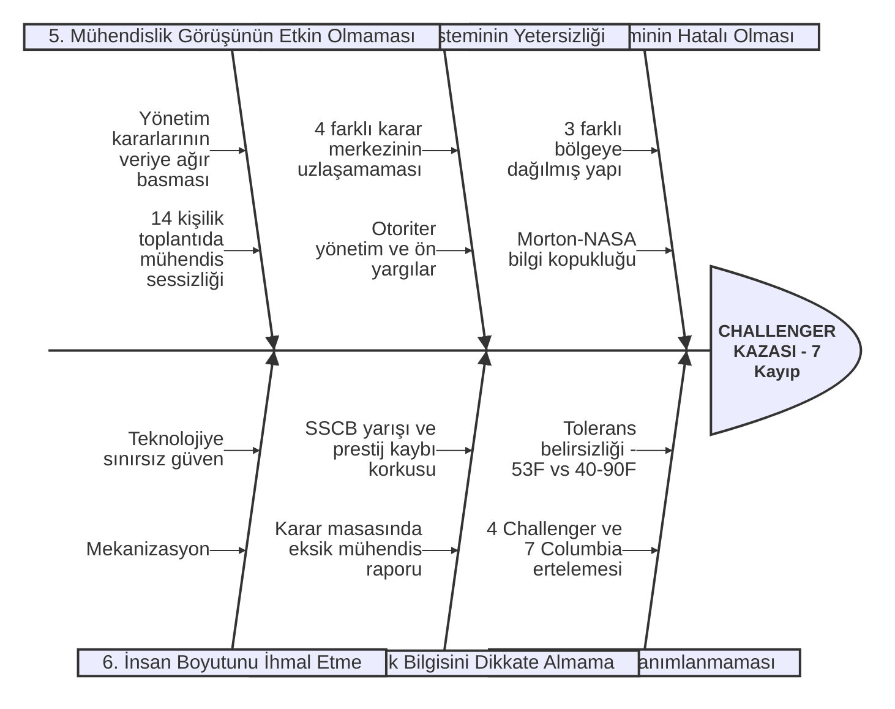
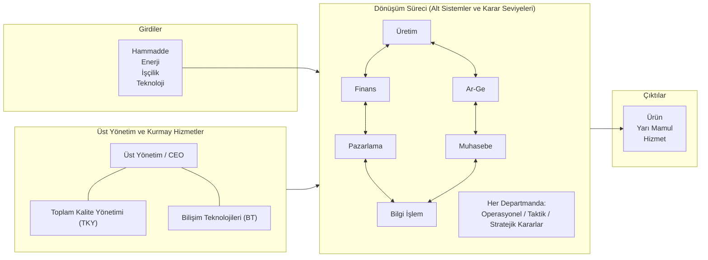
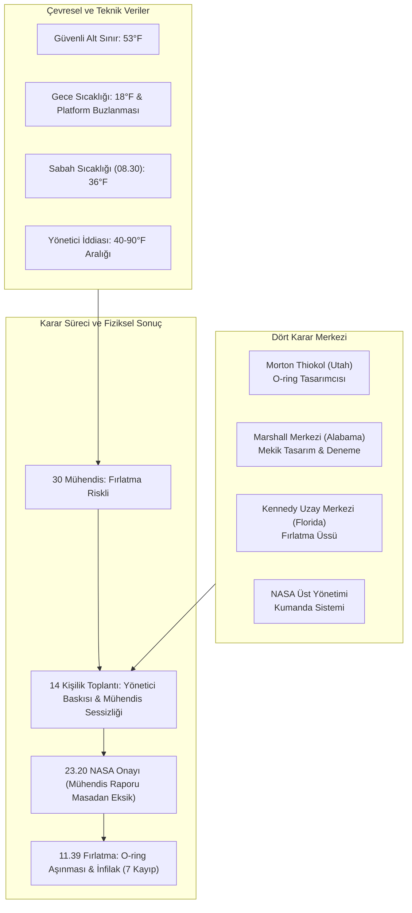
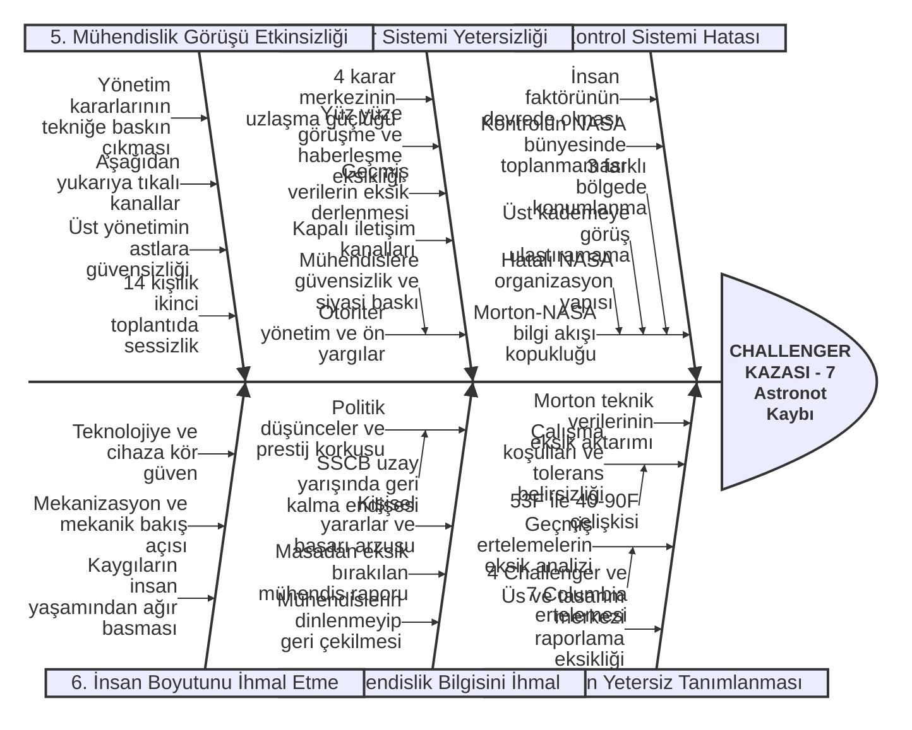

# Soruşturma Dosyası: Sistem Analizi, Kök Neden Çözümlemesi ve Challenger Vakası

Bir iş analisti, yazılımcı ya da yönetici olarak bir şirketin kapısından içeri girdiğinizi düşünün. Masaya oturur oturmaz yapay zekâyı, ERP modüllerini ve veri tabanı mimarilerini sıralamaya başlarsanız o şirketin gerçek derdini ıskalarsınız. İşletmenin MR'ını çekmek, veriden kök nedene inmek ve kriz anında sorumluluğun kime düşeceğini görmek bundan başka bir dikkat gerektirir.

---

## 1. Soruşturma: Sınavda veya Gerçek İş Hayatında Bildiğiniz Her Şeyi Dökmek Neden Kaybettirir?
## Soruşturma: Challenger Neden İnfilak Etti?

### Kriz ve Çelişki
28 Ocak 1986 sabahı. Challenger Uzay Mekiği fırlatıldıktan kısa süre sonra saat 11.39'da infilak ediyor ve 7 astronot hayatını kaybediyor. Oysa fırlatma öncesi veriler ortadaydı:

* Kauçuk sızdırmazlık halkalarını (O-ring) üreten **Morton Thiokol (Utah)** firması güvenli alt sınırı **53°F** olarak belirlemişti.
* Fırlatmadan önceki gece sıcaklık **18°F**'a düşmüş, platformda yoğun buzlanma oluşmuş, Atlantik Okyanusu'ndaki fırtına da kurtarma gemilerinin çıkışını imkânsız hâle getirmişti.
* Fırlatma sabahı saat 08.30'da sıcaklık güvenli sınırın 17 derece altında, **36°F** idi.
* Buna rağmen bir NASA yöneticisi **40-90°F** gibi 50 derecelik geniş bir aralık öne sürüp *"Bu rakamları değiştirmenin sırası mı?"* diye baskı kuruyordu. Üstelik 36°F, o uydurma 40°F sınırının bile altındaydı.

Bu kadar açık veriye rağmen fırlatma onayı nasıl çıktı?

### Çıkarım: Sistem Yaklaşımı ve Geriye Doğru Endüksiyon
Burada duygulara ya da niyet okumaya kapılmadan **Sistem Analizinin "Durumun Tanımı"** aşamasına geçilir. İşletme sorunları bir **network (ağ) diyagramı** gibi işler. Kariyer planınızda 5 yıl sonraki hedefinizi (yüksek lisans, orta kademe yöneticilik) geleceğe koyup bugünden dil ve teknik eğitimlere başlamanız gibi, **yönetim soldan sağa kurulur; kriz ise sağdan sola (Geriye Doğru Endüksiyon) çözülür.**

**Balık Kılçığı (Ishikawa) Diyagramı** ile kazanın arkasındaki **6 olası kök neden** incelenir:
1. Kontrol sisteminin hatalı olması: 3 farklı bölgeye dağılmış yapı, Morton-NASA bilgi kopukluğu.
2. Ürünün iyi tanımlanmaması: Tolerans belirsizliği (53°F ile 40-90°F farkı), önceki 4 Challenger ve 7 Columbia ertelemesinin eksik değerlendirilmesi.
3. Karar verme sisteminin yetersizliği: 4 farklı karar merkezinin (NASA, Florida/Kennedy, Alabama/Marshall, Utah/Thiokol) uzlaşamaması, otoriter yönetim ve ön yargılar.
4. NASA yetkililerinin mühendislik bilgisini dikkate almaması: SSCB ile uzay yarışında geri kalma ve prestij kaybı korkusu, son karar masasında mühendis raporunun bulunmaması.
5. Mühendislik görüşünün etkin olmaması: Yönetim kararlarının teknik veriye ağır basması ve 14 kişilik ikinci toplantıda mühendislerin dinlenmediklerini düşünüp sessizce yerlerine oturması.
6. NASA yetkililerinin insan boyutunu ihmal etmesi: Teknolojiye ve cihaza duyulan sınırsız güven, mekanizasyon.

---

## Soruşturma: İktidar Baskısı Altında Fatura Yöneticiye mi Kesilir, Mühendise mi?

### Kriz ve Çelişki
Utah genel müdür muavini, başmühendise *"Mühendislik şapkanı çıkarıp yönetici şapkanı tak."* der. Dört merkez oy birliğiyle fırlatmayı onaylar ve 7 insan ölür. Asıl düğüm buradadır: Siyasi ve yönetsel baskı altında yanlış karar veren yönetici mi sorumludur, yoksa elinde kesin bilimsel veri varken susup geri çekilen mühendis mi?

### İki Farklı Okuma ve Çıkar Çatışması
1. **Kurumsal Okuma (Yönetim ve İletişim Çöküşü):** Kazayı bir yönetim, hiyerarşi ve karar sorunu sayar. Fırlatma yetkisi yöneticilerdedir, iletişim kanalları tıkalıdır ve karar vericiler prestij ile takvim baskısı altında hareket etmiştir. Morton Thiokol mühendislerinin sunduğu teknik itirazlar orta kademe yönetim bariyerine takılmış ve saat 23.20'deki nihai karar masasına (Seviye I yönetimine) ulaştırılmamıştır.
2. **Radikal Veri Okuması ve Olgusal Eleştirisi:** Bu okuma, yukarı çıkıldıkça siyasi ve ekonomik baskının artmasını doğal kabul eder; bu baskıyı durduracak tek gücün mühendislik verisi olduğunu savunur. 53°F (11.6°C) ile fırlatma sabahı beklenen 18°F (-7.7°C) arasındaki uçuruma dayanarak, mühendislerin şerh koyarak, istifa ederek veya basına giderek fırlatmayı durdurması gerektiğini ileri sürer. **Ancak tarihsel kayıtlar (Rogers Komisyonu Raporu) mühendislerin pasif kalmadığını, aksine kurumsal olarak devre dışı bırakıldığını kanıtlar:**
	* **Resmî Ret ve Dışlanma:** Başmühendisler Roger Boisjoly ve Arnold Thompson, telekonferansta 53°F altındaki fırlatmaya resmî olarak karşı çıkmış ve contaların yanık fotoğraflarını kanıt olarak sunmuştur. Ancak Thiokol üst yönetimi (*"Mühendislik şapkanı çıkar, yönetici şapkanı tak"* diyerek) mühendisleri nihai oylamadan dışlamış ve kararı sadece 4 yöneticinin oyuyla tersine çevirmiştir.
	* **İmza Reddi:** Kennedy Uzay Merkezi'ndeki Thiokol mühendisi ve proje direktörü Allan McDonald, yönetimin fırlatma onay belgesini imzalamayı reddederek fiilen şerh koymuş ve gece yarısına kadar NASA yetkilileriyle tartışmıştır.
	* **Fiziksel ve Bürokratik İmkânsızlık:** Karar gece 23.20 sularında, mühendisler fırlatma rampasından 3.000 km uzaktaki Utah'ta telekonferanstayken alınmıştır. Ayrıca NASA, *"fırlatmanın güvenli olduğunu kanıtlama"* kuralını tersine çevirip mühendislerden *"roketin kesinlikle patlayacağını matematiksel olarak kanıtlamalarını"* isteyerek teknik ekibi bürokratik olarak kilitlemiştir. Dolayısıyla sorumluluk görevini sonuna kadar yapan mühendislerde değil, teknik vetoyu ezen yönetim yapısındadır.

### Gerçek Hayat Uygulaması: Sivil Denetim Mekanizması
Bu vakadan çıkarılacak en pratik ders **Sivil Denetim (Civil Oversight)** mekanizmasıdır. Bir ülkede parlamento, yürütme ve Sayıştay birbirini nasıl dengelerse; bir üniversitede anabilim dalı, bölüm başkanı, dekan ve rektör birbirini nasıl denetlerse; bir işletmede de **Üretim, Finans, Pazarlama ve Mühendislik** birbirini öyle denetler.

Resmî kurumlarda ve büyük projelerde **söz uçar, yazı kalır.** Sizi kurumsal bir hataya ortak etmek isteyen yöneticiye karşı teknik verinizi yazılı kayda geçirip gerektiğinde açıkça **şerh düşmek**, hem vicdanî hem de hukukî tek kalkanınızdır.

---

# Sistem Analizi ve Tasarımı: Sorun Çözme Metodolojisi, Durumun Tanımı ve Challenger Vakası

## 1. Kavramsal Hiyerarşi, Tarihsel Evrim ve İşletmenin Sistem Olarak Kurgulanması

### 1.1. Temel Paradigma ve Kavramsal Kesinlik

Bilimsel ve yönetsel çözümlemelerde ilk koşul, incelenen olgunun adını kesin biçimde koymaktır. İlgili kavram netleştirildikten sonra yapılan tanımlar ve kuramsal açılımlar anlamlı bir zemine oturur. Bu aşamada iki temel kavram birbirinden ayrılır:

* **[[paradigma]] (Paradigm)**, belirli bir dönemde bilimsel veya yönetsel topluluğun olguları anlamlandırma çerçevesini belirleyen ana bakış açısıdır. Geleneksel işletme anlayışından günümüz modern işletme anlayışına evrilmenin temel paradigmasını **[[Sistem Düşüncesi]]** (Sistem Yaklaşımı) oluşturur.
* **[[Parametre]] (Parameter)**, belirli bir model ya da sistem içinde işleyerek sistemin davranışını ve çıktısını etkileyen sayısal katsayı veya değişkendir. Parametreler, ana paradigmanın kurduğu çerçeve içinde ölçüm ve modelleme işlevi görür.

### 1.2. Kavramlar Hiyerarşisi ve Tarihsel Süreklilik

Modern işletme ve bilgi sistemleri anlayışı, insanlığın tarihsel gelişim yolculuğuyla birlikte biçimlenmiştir. Dilin, konuşmanın, yazının, harflerin ve paranın icadıyla başlayan insanlık serüveni ekonomik yapıyı doğurmuştur. Bu yapı içinde organizasyonları anlamlı kılan en karmaşık varlık insandır. İnsanın merkezde durduğu ekonomik yaşamda iki eylem yüksek karmaşıklık taşır: bir insanın cebindeki parayı ticari rızayla kendi cebinize aktarmak ve insanlar arasında kalıcı bir sevgi ile güven ilişkisi kurmak.

Bu tarihsel birikimi ve işletmelerin evrimini açıklayan **[[Kavramlar Hiyerarşisi]]** şu sıralamayı izler:

> **Felsefe $\rightarrow$ Bilim** *(Temel Bilimler $\rightarrow$ Uzmanlaşma $\rightarrow$ Uygulamalı Bilimler)* **$\rightarrow$ Teknoloji $\rightarrow$ Uzmanlaşma $\rightarrow$ Verimlilik $\rightarrow$ Kalite (Nitelik) $\rightarrow$ Otomasyon $\rightarrow$ İnternet**

Her aşamanın tarihsel dönemle doğru eşleştirilmesi analitik tutarlılık gereğidir:
* **1750'ler (Endüstri Devrimi):** Seri üretimin ve ilk kurumsal işletme yapılarının doğduğu dönemdir.
* **1940'lar ([[Yöneylem Araştırması]] / Operations Research):** Karmaşık lojistik ve üretim problemlerinin matematiksel modellerle çözülmeye başlandığı, sistem düşüncesinin bilimsel temelinin atıldığı evreyi ifade eder.
* **1960'lar ([[Yapay Sentezler]] / Artificial Synthesis):** Parçalı bilgilerin bir araya getirilip bütünsel modellere dönüştürüldüğü ara evredir.
* **1980'ler ([[Sistem Yaklaşımı]] ve [[Süreç Yaklaşımı]]):** İşletmelerin birbiriyle etkileşen alt sistemler ve uçtan uca iş süreçleri biçiminde ele alındığı olgunluk dönemidir.
* **1995 ve Sonrası (İnternet Çağı):** Küresel ağ bağlantısallığının ve gerçek zamanlı veri paylaşımının yaygınlaştığı dönemdir.

Tarihsel dönüşüm çalışanlardan beklenen yetkinlikleri de kökten değiştirmiştir. Geçmişte üniversite mezunlarından temel istatistik bilgisi, yabancı dil ve B sınıfı sürücü ehliyeti beklenirken günümüz iş görüşmelerinde programlama dilleri, kodlama becerisi ve yapay zekâ okuryazarlığı standart ölçütler arasına girmiştir. Nitekim yapay zekânın kod yazma becerisi bir önceki yıl her 7 ayda bir iki katına çıkarken güncel durumda **her 4 ayda bir iki katına** ulaşmaktadır; rutin olarak 2,5 saatte yazılan karmaşık kod mimarileri anlık üretilebilmektedir.

### 1.3. İşletme Mimarisi: Dönüşüm Süreci, Kurmay Hizmetler ve Karar Seviyeleri

Geleneksel yaklaşımlarda işletmeler dönemsel olarak tek bir işlevin prizmasından yorumlanmıştır. 1960'larda satış yönlü, 1980'lerde muhasebe odaklı, 1990'larda ise bilgisayar teknolojisinin tek başına öne çıkarıldığı yapılar öne sürülmüştür. Günümüz **[[Sistem Yaklaşımı]]** ise karmaşayı yönetilebilir alt başlıklara bölen ve parçalar arası etkileşimi kuran bütüncül bir organizma modeli sunar.

İşletmenin büyük bir karmaşa yığını halinde yönetilmesi güçleştiğinden, işletme **departmanlara (alt sistemlere)** bölünerek küçük birimleri yönetmenin avantajı elde edilir ve örgütsel düzen kurulur. Bir işletmenin **sistem döngüsü** üç temel katmandan oluşur:
1. **Girdiler (Inputs):** Hammadde, enerji, işçilik ve teknoloji.
2. **Dönüşüm Süreci (Transformation Process):** İşletmenin temel faaliyetlerini yürüten alt sistemler — **Üretim, Finans, Pazarlama, Ar-Ge, Muhasebe ve Bilgi İşlem**. Bu alt sistemler aralarında sürekli çift yönlü bilgi, malzeme ve finans akışı bulunan etkileşimli düğümlerdir.
3. **Çıktılar (Outputs):** Ürün, yarı mamul ve hizmet.

Bu temel faaliyetlerin üzerinde, doğrudan üst yönetime (CEO) bağlı çalışan iki **[[Kurmay Hizmetler]] (Staff Functions)** birimi yer alır: **[[Toplam Kalite Yönetimi]] (Total Quality Management - TQM)** ve **Bilişim Teknolojileri (Information Technology - IT)**.

Ayrıca işletmenin genelinde ve her bir departmanın kendi içinde **Yönetim Karar Seviyeleri (Management Decision Levels)** üçe ayrılır:
* **Operasyonel Seviye (Operational Level):** Günlük, rutin işleyişe dair kısa vadeli kararlar.
* **Taktik Seviye (Tactical Level):** Orta vadeli kaynak tahsisi ve süreç optimizasyonu kararları.
* **Stratejik Seviye (Strategic Level):** Uzun vadeli yönelim, rekabet ve konumlanma kararları.

Her seviyedeki yöneticinin yetkisi ve aldığı kararın etki alanı farklılaştığı için karar seviyeleri bu üçlü yapıyla ayrıştırılır. Bu katmanlaşma, doğrudan **[[Bilgi Sistemleri Hiyerarşisi]]** (Yönetim Bilişim Sistemleri - YBS, Karar Destek Sistemleri - KDS / DİS, Kurumsal Kaynak Planlaması - KKP/ERP) ile bütünleşir. Dersin ilk fazı işletmenin geleneksel yapıdan bu etkileşimli sistem yapısına evrimini incelerken ikinci fazı bu çok katmanlı yapının KKP gibi bütünleştirici bilgi sistemleriyle yönetilmesini ele alır. Donanım ve ağ iletişiminde 7 katmanlı **[[OSI Modeli]]**'nin farklı alanları ortak bir veri omurgasında birleştiren bütünleştirici işlevi buna benzer bir mimari mantık sunar.

> Bkz. [[ybs3023-2#İşletme Bilgi Sistemi ve Dönüşüm Süreci|2. Ders, İşletme Bilgi Sistemi ve Dönüşüm Süreci]]

| Analiz Boyutu               | Geleneksel İşletme Anlayışı                                   | Sistem Tabanlı Modern İşletme Anlayışı                            |
| :-------------------------- | :------------------------------------------------------------ | :---------------------------------------------------------------- |
| **Temel Paradigma**         | İşlevsel izolasyon ve dönemsel tek odak (satış, muhasebe vb.) | Bütüncül sistem düşüncesi ve alt sistem etkileşimi                |
| **Dönüşüm Süreci**          | Kapalı kutu veya tek yönlü doğrusal işleyiş                   | Departmanlar arası çift yönlü etkileşim ağı                       |
| **BT ve Kalite Konumu**     | Destekleyici yan araçlar                                      | Doğrudan CEO'ya bağlı stratejik kurmay hizmetler                  |
| **Yönetim ve Karar Yapısı** | Merkeziyetçi ve tek katmanlı yetki                            | Operasyonel, taktik ve stratejik karar seviyelerine ayrılmış yapı |
| **Sorun Çözme Yaklaşımı**   | Belirtiye odaklanan anlık müdahale                            | Bütünsel, disiplinler arası ve kök nedene inen bilimsel analiz    |

---

## 2. Sistem Yaklaşımı ile Sorun Çözme Metodolojisi

### 2.1. Sistem Yaklaşımının Dört Aşaması

Sistem yaklaşımıyla sorun çözme süreci; ilk ikisi **kuramsal çerçeveyi**, son ikisi **uygulama çerçevesini** oluşturan dört ardışık aşamadan meydana gelir. Bu aşamalar, bir organizasyonda yürütülecek her türlü analiz ve bilgi sistemi projesinin temel yol haritasını çizer.

1. **Sistem Analizi (System Analysis - Kuramsal):** Mevcut durumun tüm gerçekliğiyle ortaya konulduğu teşhis aşamasıdır ve beş alt adımdan oluşur:
   * *Durumun Tanımı:* Organizasyonda bir sorun ya da iyileştirme ihtiyacı gördüğünü düşünen paydaşların kimler olduğunun, iyileşmeden kimlerin fayda sağlayacağının ve böyle bir değişime gerçek anlamda ihtiyaç duyulup duyulmadığının saptandığı başlangıç adımıdır. İşletmenin gerçek anlamda bir MR'ının çekilmesi bu aşamada tamamlanır; sonraki tüm adımların geçerliliği buradaki isabetli teşhise dayanır.
   * *Sistemin Tanımı:* İncelenen alt sistemin sınırlarının, öğelerinin ve işleyişinin belirlenmesi.
   * *Sistem Çevresinin Tanımı:* İşletmenin dışındaki diğer aktörlerin, rakiplerin ve çevresel koşulların neler yaptığının çözümlenmesi. Örneğin bir kafeteryada siparişlerin gecikmesi üzerine masadan alma modeline ve müşteri memnuniyetine dönük bir proje geliştirilirken çevredeki rakip işletmelerin uygulamaları incelenir.
   * *Çevrenin Hedefleri:* Ana işletmenin ve çevresel aktörlerin stratejik hedeflerinin netleştirilmesi.
   * *Bilgi ve Veri Analizi:* Çözüm için toplanacak veri yapılarının, türlerinin ve analiz tekniklerinin belirlenmesi.
1. **Sistem Tasarımı (System Design - Kuramsal):** Analiz bulgularına dayanarak yeni veya iyileştirilmiş sistemin modellendiği aşamadır. Alt adımları şunlardır: **Öngörü, Kestirim, Davranış Modellemesi, Optimizasyon, Yönlendirme Sisteminin Kurulması, Güvenlik Sistemi** ve **Gelişme Sisteminin Kurulması**.
2. **Sistem Hazırlama (System Preparation - Uygulama):** Tasarlanan sistemin hayata geçirilmeye hazır hale getirildiği **Belgeleme (Dokümantasyon)** ve **Kurma** aşamasıdır.
3. **Sistem İşletimi (System Operation - Uygulama):** Sistemin canlı ortama alındığı ve sürdürüldüğü **Başlangıç, Pilot (Deneme) İşletimi, Değerlendirme** ve **İyileşme İşletimi** adımlarını kapsar.

| Ana Çerçeve | Aşama | Alt Adımlar ve Temel İşlevler |
| :--- | :--- | :--- |
| **Kuramsal Çerçeve** | **1. Sistem Analizi** | Durumun tanımı, sistemin tanımı, sistem çevresinin tanımı, çevrenin hedefleri, bilgi ve veri analizi |
| **Kuramsal Çerçeve** | **2. Sistem Tasarımı** | Öngörü, kestirim, davranış modellemesi, optimizasyon, yönlendirme sistemi, güvenlik sistemi, gelişme sistemi |
| **Uygulama Çerçevesi** | **3. Sistem Hazırlama** | Belgeleme ve fiziksel/yazılımsal kurulum |
| **Uygulama Çerçevesi** | **4. Sistem İşletimi** | Başlangıç, pilot (deneme) işletimi, değerlendirme ve sürekli iyileşme işletimi |

### 2.2. Durumun Tanımı ve Kök Neden Çözümleme Araçları

Bir projeye başlarken doğru metodoloji iki adımı sırayla işletir: önce işletmenin gerçek sorununu analiz ederek ihtiyacı netleştirmek, ardından mevcut teknik yetkinliklerle bu ihtiyaca yönelik iyileştirme geliştirmek. Baştan sona tersine ilerleyip işletmenin ihtiyacını dinlemeden eldeki teknik araçları dayatmak analiz sürecini saptırır. Örneğin stok takibinde basitçe raftaki kalan miktarı saymak işletmenin ihtiyacını karşılamakta eksik kalır; hammadde işletmenin ana damarıdır ve **Güvenlik Stoku** hesaplamaları, **[[RFID]]** ve **Barkod** teknolojileriyle atölye/mağaza içi gerçek zamanlı takip esas alınır.

Durumun tanımı aşamasında verileri anlamlandırmak ve sorunun kaynağına inmek için dört temel teknik kullanılır:
* **[[Histogram]] (Histogram)**, veri dağılımının sıklığını görselleştirir.
* **[[Pareto Analizi]] (Pareto Analysis)**, sorunların büyük çoğunluğuna yol açan az sayıdaki belirleyici nedeni ayrıştırır.
* **[[Saçılma Diyagramı]] (Scatter Diagram)**, iki değişken arasındaki korelasyonu ve ilişki yönünü ortaya koyar.
* **[[Balık Kılçığı Diyagramı]] (Fishbone / Ishikawa Diagram - Neden-Sonuç Analizi)**, sorunun ana omurgası üzerine potansiyel kök nedenleri (ana dallar) ve bunları besleyen tali nedenleri (yan kılçıklar) yerleştirerek ana kaynağa ulaşmayı sağlar.

### 2.3. Ağ Yapıları ve Geriye Doğru Endüksiyon

İşletme sorunları bir **[[Ağ Diyagramı]] (Network Diagram)** mantığıyla modellenir; çünkü ağ diyagramları olası tüm karar seçeneklerini ve ilişkileri üzerinde barındırır. Bu yapının çözüm mantığı yaşamın ve stratejik planlamanın doğasıyla özdeştir: **Hayat ve işletme yönetimi soldan sağa kurulup yaşanır; sorunlar ise sağdan sola çözülür.**

Beş yıl sonra yüksek lisansını tamamlamış, sektör deneyimli bir orta kademe yöneticisi olma hedefi, beşinci yılın sonuna yerleştirilmiş bir **strateji**dir. Bu hedefe ulaşmak için bugünden atılan adımlar (yabancı dil geliştirmek, teknik eğitimler ve proje kursları almak, yurt dışı deneyimi kazanmak) ise o stratejinin **taktikleri**dir. Benzer biçimde bir ağ diyagramı soldan sağa doğru kurulur; ortaya çıkan sonuçtan (sağdan) başlayarak **[[Geriye Doğru Endüksiyon]] (Backward Induction)** yöntemiyle sola doğru dallar budanır ve ana kök nedene ulaşılır.

### 2.4. Bilimsel Metodoloji ve Analiz Sınırları

Sistem yaklaşımının üç temel ilkesi analizin nesnelliğini güvence altına alır:
1. **[[Bütünsel Bakış]] (Holistic View):** Parçaları birbirinden koparmadan sistemin tamamını gözetmek.
2. **[[Disiplinler Arası Yaklaşım]] (Interdisciplinary Approach):** Teknik, yönetsel, ekonomik ve insani boyutları bir arada değerlendirmek.
3. **[[Bilimsel Metodoloji]] (Scientific Methodology):** Çıkarımları kişisel öngörüler veya vaka metni dışındaki niyet okumalar yerine doğrudan elde mevcut somut verilerle temellendirmek.

---

## 3. Vaka İncelemesi: Challenger Uzay Mekiği Kazası (Ocak 1986)

### 3.1. Olgusal Çerçeve, Aktörler ve Kritik Metrikler

**Challenger Vakası**, sistem analizinin durumun tanımı aşamasını ve çok merkezli karar süreçlerindeki kırılmaları incelemek için klasik bir örnek olaydır. Vaka metnindeki temel olgusal veriler şu şekilde sıralanır:

* **Zaman ve Sonuç:** Ocak 1986 (kış mevsimi). Uzay mekiği sabah 11.39'da fırlatılmasının ardından infilak etmiş ve 7 astronot hayatını kaybetmiştir.
* **Çok Merkezli Yapı (4 Karar Merkezi):** Süreç dört farklı coğrafi ve yönetsel merkez arasında yürütülmüştür:
  1. **NASA Üst Yönetimi / Kumanda Sistemi:** Nihai karar ve koordinasyon otoritesi.
  2. **Kennedy Uzay Merkezi (Florida):** Fırlatmanın gerçekleştirildiği üs.
  3. **Marshall Merkezi (Alabama):** Uzay mekiğinin tasarlandığı, geliştirildiği ve denendiği merkez (Florida'ya coğrafi yakınlığına karşın ayrı bir karar merkezidir).
  4. **Morton Thiokol (Utah):** Mekikteki kauçuk sızdırmazlık halkalarını (**[[O-ring]]**) tasarlayıp üreten deneyimli firma.
* **Fiziksel Mekanizma ve Kritik Sıcaklık Metrikleri:**
  * Tasarımcı firma Morton Thiokol'ün belirlediği güvenli çalışma alt sınırı **53°F**'tır. Bu derecenin altında kauçuk ringler esnekliğini yitirip yüksek hızda aşınmakta, fırlatma anında aşağı püskürtülen yoğun ateşin yakıt tanklarına sızmasını engellemekte yetersiz kalmaktadır.
  * Fırlatmadan önceki gece saat 23.00 civarında sıcaklık **18°F** ölçülmüş; ateşleme platformunun altında motor patlamalarını azaltmak için kullanılan su sisteminin bulunduğu alanda yoğun buzlanma oluşmuştur. Eşzamanlı olarak Atlantik Okyanusu'ndaki şiddetli fırtına, olası bir başarısızlıkta itici roketleri ve mürettebatı kurtarmak için gemi gönderilmesini güçleştirmiştir.
  * Fırlatma sabahı saat 08.30'da ortam ısısı **36°F**'tır. Bu değer, 53°F güvenli sınırının **17 derece** altındadır.
  * NASA yöneticilerinden biri **40-90°F** arasında bir çalışma aralığı bulunduğunu öne sürmüştür. 50 derecelik bu geniş aralık metriklerin kurum içi yorumlanmasındaki tutarsızlığı göstermekle birlikte, sabah ölçülen 36°F değeri o 40°F sınırının dahi altında kalmaktadır.
* **Karar ve İletişim Süreci:**
  * Başmühendis, alacağı karara zemin oluşturmak ve sorumluluğu paylaşmak amacıyla Morton Thiokol'den 34 (karma toplantı öncesi mühendisler grubunda 30) mühendisin katıldığı bir telekonferans düzenlemiştir. Mühendisler 53°F altındaki fırlatmanın yüksek risk taşıdığı konusunda görüş birliğine varmıştır.
  * Ardından verilen 5 dakikalık aranın sonrasında mühendisler ve yöneticilerden oluşan 14 kişilik 30 dakikalık ikinci bir telekonferans yapılmıştır. Mühendisler yeterince dinlenmediklerini hissederek tartışmadan çekilmiş ve sessizce yerlerine oturmuştur.
  * Bu aşamada Utah işletmesinin genel müdür muavini meşhur baskı cümlesini kurmuştur: *"Mühendislik şapkanı çıkarıp yönetici şapkanı tak."*
  * Yöneticiler ringlerin emniyetli olduğu yönünde uzlaşmış; saat 23.00'te Utah grubu fırlatmayı onaylamış, Alabama'daki NASA sorumluları kararın faksla Kennedy Uzay Merkezi'ne iletilmesini istemiş ve saat 23.20'de NASA üst yönetimine fırlatma onayı verilmiştir. Karar oy birliğiyle alınmış, ancak sonradan elde edilen bilgilere göre **nihai karar masasında Thiokol mühendislerinin ringler hakkındaki olumsuz görüşünü içeren rapor eksik bırakılmıştır.**

### 3.2. Balık Kılçığı Analizi ile Altı Olası Kök Nedenin Değerlendirilmesi

Durumun tanımı aşamasında analistler, Challenger kazasını açıklayan **6 olası kök neden** belirlemiş ve her biri için bir **[[Balık Kılçığı Diyagramı]]** oluşturarak tali nedenleri (alt kılçıkları) içeriden dışarıya doğru çözümlemiştir:

1. **Kontrol Sisteminin Hatalı Olması:** İnsan faktörünün devrede olması, tüm kontrolün NASA bünyesinde bütünleşik biçimde toplanmaması ve Morton ile NASA arasındaki bilgi akışının kesintili kalmasıyla beslenir. Bilgi akışındaki bu tıkanıklığın tali nedenlerini yetkililerin üç farklı bölgede konumlanması, mühendislerin üst kademeye görüş ulaştırmakta yetersiz kalması ve NASA organizasyon yapısının hatalı kurgulanması oluşturur.
2. **Ürünün Yetersiz Tanımlanması:** Morton'un NASA'ya tüm teknik verileri eksiksiz sunmaması, çalışma koşullarının belirsizliği, tolerans limitlerinin netleştirilmemesi (53°F ile 40-90°F arasındaki çelişki), geçmiş verilerin eksik değerlendirilmesi (önceki süreçte Challenger'ın 4, Columbia'nın 7 kez ertelenme gerekçelerinin vaka verilerinde belirsiz kalması) ve fırlatma üssü ile tasarım merkezi arasındaki raporlama eksikliğine dayanır.
3. **Karar Verme Sisteminin Yetersizliği:** Birden fazla (4) karar merkezinin uzlaşma güçlüğü, hatalı organizasyon yapısı, yüz yüze görüşme ve haberleşme eksikliği, geçmiş verilerin eksik derlenmesi, mühendislik görüşlerinin dışlanması (iletişim kanallarının kapalı kalması) ve üst yöneticilerin otoriter karar verme eğilimiyle (mühendislere güvensizlik ve siyasi baskı kaynaklı ön yargılar) açıklanır.
4. **NASA Yetkililerinin Mühendislik Bilgisini Dışarıda Bırakması:** Sovyetler Birliği ile sürdürülen uzay yarışında geri kalma endişesi ve prestij kaybı korkusu gibi "daha geniş politik düşünceler", fırlatmayı başarıya ulaştıran yönetici olma arzusu gibi "kişisel yararlar", karar masasından eksik bırakılan yetersiz raporlar ve mühendislerin dinlenmedikleri yargısıyla görüşlerini savunmaktan çekilmeleri bu kök nedeni oluşturur.
5. **Mühendislik Görüşünün Etkinsizliği:** Yurt içi ve yurt dışı prestij kaygıları ile kişisel kararların ağırlığı nedeniyle yönetim kararlarının teknik kararlara baskın çıkması, kapalı iletişim kanalları yüzünden mühendislerin üst kademeye ulaşamaması, üst yönetimin astlara güven duymaması ve mühendislerin ikinci toplantıda sessizliğe çekilmesiyle şekillenir.
6. **NASA Yetkililerinin İnsan Boyutunu İhmal Etmesi:** Teknolojinin hızlı gelişimiyle cihaza duyulan sınırsız güven, insanı dışlayan mekanik bakış açısı (**[[Mekanizasyon]]**) ve kişisel ile yönetsel kaygıların insan hayatından ağır basmasıyla açıklanır.

| Aday Kök Neden | Doğrudan Tetikleyici Ana Dallar | Destekleyici Tali Nedenler (Alt Kılçıklar) |
| :--- | :--- | :--- |
| **1. Kontrol Sistemi Hatası** | İnsan faktörü, dağınık kontrol, Morton-NASA bilgi kopukluğu | 3 farklı bölgeye konumlanma, hatalı NASA organizasyon yapısı, yukarı iletişim engeli |
| **2. Ürünün Yetersiz Tanımı** | Eksik teknik bilgi aktarımı, belirsiz toleranslar, eksik veri | Önceki ertelemelerin (4 Challenger, 7 Columbia) analiz eksikliği, 53°F ile 40-90°F çelişkisi |
| **3. Karar Sistemi Yetersizliği** | 4 karar merkezi, otoriter yönetim, haberleşme eksikliği | Mühendislere güvensizlik, siyasi ön yargılar, kapalı iletişim kanalları |
| **4. Mühendislik Bilgisini İhmal** | Politik ve prestij odaklı geniş düşünce, kişisel yararlar | SSCB uzay yarışı korkusu, masadan eksik rapor, mühendislerin geri çekilmesi |
| **5. Mühendislik Görüşü Etkinsizliği** | Yönetim kararlarının teknik kararlara baskın çıkması | Astlara güvensizlik, aşağıdan yukarıya tıkalı kanallar, 14 kişilik toplantıdaki sessizlik |
| **6. İnsan Boyutunu İhmal** | Teknolojiye kör güven, mekanizasyon | Kişisel ve yönetsel kaygıların insan yaşamının önüne geçmesi |

### 3.3. Kurumsal Çıkarım: Yönetim Sorunu ve Sivil Denetim Mekanizması

Altı olası kök nedenin geriye doğru endüksiyonla elenip süzülmesi sonucunda vakanın kurumsal teşhisi netleşir: **Challenger kazasının esas kaynağı bir yönetim sorunu (karar verme sorunu)dur.** Bu sorun; NASA ile Morton Thiokol arasındaki bilgi akışının yetersizliği, NASA içinde mühendislerin fikirlerini üst yönetime aktarmakta yetersiz kalması ve telekonferansa katılan yetkililerin kişisel faktörlerinin etkisiyle fırlatmayı onaylamasının doğrudan sonucudur. İnsansız bir aracın mali kaybı ekonomik olarak telafi edilebilirken 7 insanın yaşamını yitirmesi ağır bir sosyal maliyet ve ailevi travma yaratmıştır. Üstelik birkaç ertelemenin doğuracağı olası prestij kaybı, 7 astronotun ölümünün yol açtığı küresel prestij yıkımının yanında çok küçük kalmıştır.

Bu tür yönetsel körlüklerin önlenmesi, organizasyonların kendi içinde barındırdığı **[[Sivil Denetim]]** mekanizmasının işletilmesine bağlıdır:
* **Kurumsal Denge Mekanizması:** Parlamenter bir sistemde cumhurbaşkanı, başbakan, parlamento ve Sayıştay'ın birbirini denetlemesi ya da bir üniversitede anabilim dalı başkanı, bölüm başkanı, dekan ve rektörün karşılıklı denetim kurması gibi; bir işletmede de üretim, finans, pazarlama ve mühendislik birimleri birbirinin hatalarını frenleyen sivil denetim unsurlarıdır. Örneğin üretimdeki bir gecikmenin faturasını tüm işletme ve müşteri memnuniyeti öder.
* **Yazılı Kayıt ve Şerh Koyma (Formal Dissent):** Kurumsal karar süreçlerinde *"Söz uçar, yazı kalır"* ilkesi işler. Dilekçelerin kayıt numarasına bağlanması ve telekonferansların arşivlenmesi gibi resmi prosedürler, teknik uzmanların kararlara karşı yazılı şerh düşmesini ve sorumluluk zincirinin şeffaflaşmasını güvence altına alır.