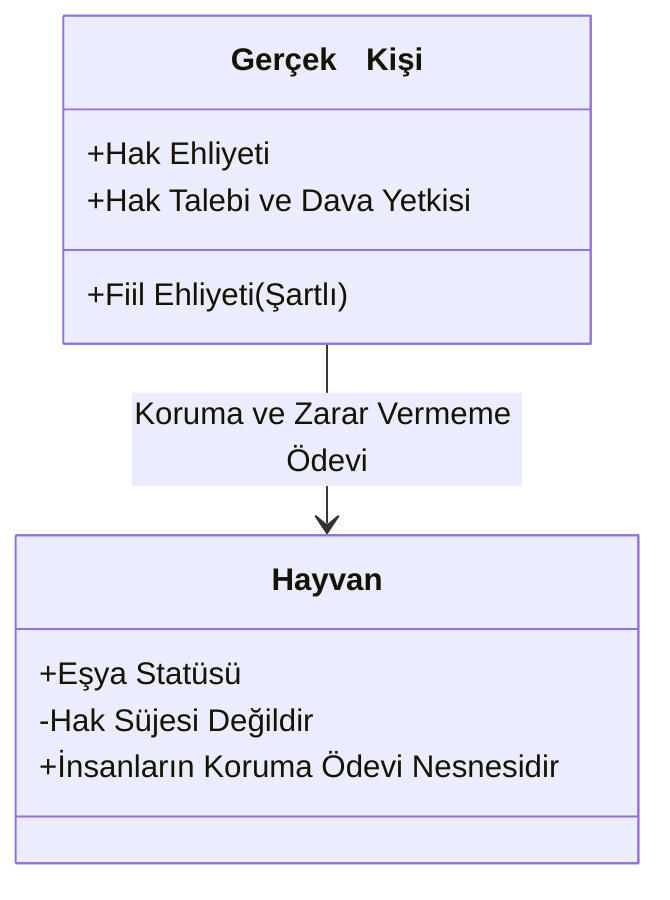
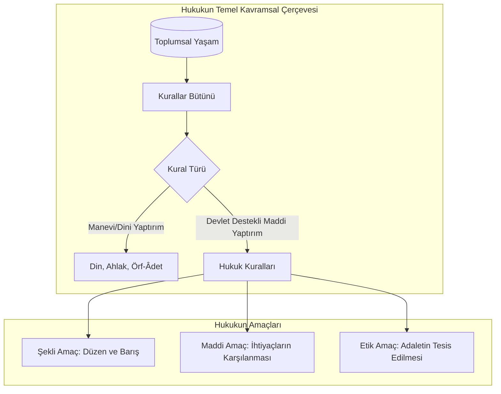

## Kavramsal Çerçeve

- [[kavram-hak|Hak]]: Hukuk düzeni tarafından kişilere tanınan, korunan menfaati ve bu menfaatin korunması veya gerçekleştirilmesi için sahibine sağlanan irade ve yetki.
- **[[kavram-hürriyet|Hürriyet]] (Özgürlük)**: İnsanın doğuştan, sırf insan olması sebebiyle sahip olduğu; dışsal bir tanımaya veya yetkilendirmeye ihtiyaç duymaksızın var olan eylemde bulunma ve bulunmama serbestisi.
- **[[Ödev]]**: Hukuk düzeninin veya toplumsal kuralların kişiye yüklediği; belirli bir davranışı sergileme ya da belirli bir davranıştan kaçınma yükümlülüğü.
- **[[İhsak-ı Hak Yasağı]]**: Bir hakkın ihlali durumunda, hak sahibinin bizzat güç veya cebir kullanarrak hakkını elde etmesininin yasaklanması; hakkın yerine getirilmesinin münhasıran devlet organları (**yargı** ve **icra**) vasıtasıyla talep edilmesi zorunluluğudur.
- **[[Hukuk]]**: Toplum hâlinde yaşayan kişilerin birbirleriyle ve toplulukların birbiriyle veya devletle olan ilişkilerini düzenleyen, kamu gücüyle desteklenmiş, uyulması zorunlu ve maddi yaptırıma bağlanmış kurallar bütünü.
- **[[Pozitif hukuk]] (Yürürlükteki Hukuk/Dogmatik Hukuk)**: Belirli bir ülkede belirli bir zamanda yürürlükte bulunan, yetkili makamlar tarafından konulmuş yaızılı ve yazısız hukuk kurallarının tamamı (*Olan hukuk*).
- **[[İdeal Hukuk]] (Normatif Hukuk/Tabii Hukuk)**: Yürürlükteki hukukun ötesinde; adalete, insan onuruna ve ahlaka en uygun olan, toplumsal gereksinimleri eksiksiz karşılamayı hedefleyen kurgusal ve ulaşılmak istenen hukuk nizamı.
- **[[Hukuk Pozitivizmi]]**: Hukukun geçerliliğini yalnızca yetkili siyasi otoriterinin iradesine ve usulüne uygun şekilde konulmuş kurallara bağlayan; adalet ve ahlâk gibi soyut değerleri hukukun zorunlu kurucu unsuru saymayan yaklaşımdır.
- **[[Doğal Hukuk Anlayışı]]**: Hukukun kaynağını akıl, evrensel adalet ilkeleri ve ahlâkî kodlarda gören; pozitif hukuk normlarının meşruiyetini bu üstün ilkelerden aldığını kabul eden yaklaşım.
- **[[Adalet]]**: Herkese hakkı olanı verme, suçu ve kusuru hassasiyetle ölçme, tarafsızlığı koruma ve keyfîlikten uzak kalarak toplum vicdanını tatmin etme idealidir.
- **[[Eşitlik]] (Nıspî/Hukukî Eşitlik)**: Aynı hukukî durumda bulunanlar arasında ayrım gözetmeksizin aynı kuralı uygulamak; farklı durumda olanlara ise durumlarının gerektirdiği ölçüde farklı işlem yapmak. *Eşitler arasında eşitlik*.

---

## İşlenen Başlıklar ve Ayrımlar
### 1. Hak, Hürriyet ve Ehliyet İlişkisi
- **Hürriyetin Önceliği**: [[kavram-hurriyet|Hürriyet]], hukuk düzeninin varlığından bağımsız olarak doğuştan mevcuttur. Kişinin tek başına bulunduğu bir alanda yalnızca hürriyetten söz edilir.
- **Hakkın Toplumsal Tabiatı**: İkinci bir kişinin varlığıyla birlikte hürriyet alanları kesişir. Sınırlandırma ihtiyacı doğar ve menfaatlerin hukuken güvence altına alınması zorunluluğu ile [[kavram-hak|hak]] kavramı ortaya çıkar.
- **Hak Sahipliği ve Kullanım**: Kişi hak sahibi olmakla birlikte bu hakkı doğrudan kullanma kudretine sahip olmayabilir. Hak sahibi olmak (hak ehliyeti) insan olmakla başlarken, hakkı bizzat kullanabilmek (fiil ehliyeti) ayırt etme gücü ve erginlik gibi şartlara bağlanmıştır.

### 2. Hak Süjesi Olma ve Hayvanların Hukukî Statüsü
- Hukuk düzeni bakımından yalnızca **insanlar** (gerçek kişiler) ve insan iradesiyle kurulan topluluklar/kurumlar ([[Tüzel kişilik|tüzel kişiler]]) hak süjesidir (**öznesidir**).
- Hayvanlar, hak talep etme ve bu hakkı korumak adına yetki kullanma iradesine sahip olmadıkları gerekçesiyle pozitif hukuk sisteminde hak öznesi değil, eşya statüsünde değerlendirilir.
- **Ödev Nesnesi Olarak Hayvanlar**: Hak ile ödev daima birbirinin karşılığıdır; birinin hakkı diğerinin ödevidir. Bu dengenin istisnası hayvanlar üzerindedir. Hayvanların subjektif bir hakkı bulunmamakla birlikte, insanlar kanunlar tahtında hayvanlara eziyet etmeme, zarar vermeme ve onları koruma ödevi bulunmaktadır.
	- *Başlı başına zırvalık bu kısım. Hoca her nasıl ki ahlâka ve etiğe evrensel diyerek çuvallıyorsa burada da çuvallıyor. İnek, koyun, keçi hayvan değil midir? Çin'de hayvanlara zarar vermenin hukuken cezası yoktur mesela, ödev olarak da görülmez. Böyle bir ödevimiz de bulunmaz, bunlar tamamıyla normatif, evrensel olamayacak düzeyde iddialar.*

### 3. Ödevin Türleri
Ödev, kişinin sergilemesi gereken hukukî davranış modelidir.

- **Olumlu Nitelikteki Ödev**: Kişinin aktif bir eylemde bulunma, verme veya yapma yükümlülüğüdür (Örn: Satıcının malı teslim etmesi, borçlunun parayı ödemesi).
- **Olumsuz Nitelikteki Ödev**: Kişinin belirli bir eylemden kaçınma, yapmama veya katlanma yükümlülüğüdür. (Örn: Gürültü yapmama, başkasının mülküne girmeme, vücut bütünlüğüne müdahale etmeme).

### 4. Toplumsal Düzen Kuralları ve Hukukun Ayırıcı Unsuru
Toplum hayatını düzenleyen ahlâk, din, görgü/örf-adet hukuk kuralları mevcuttur. Hukuk kurallarını diğer tüm kurallardan ayıran temel nitelik **maddi yaptırımdır**:

| Kural Türü           | İhlalin Neticesi                           | Yaptırımın Mahiyeti                     |
| :------------------- | :----------------------------------------- | :-------------------------------------- |
| **Görgü / Örf-Âdet** | Kınanma, ayıplanma, dışlanma               | Manevi/Sosyal tepki                     |
| **Ahlâk**            | Vicdan azabı, toplumsal tecrit             | Manevi/Bireysel iç muhakeme             |
| **Din**              | Günahkâr sayılma, uhrevi ceza              | Uhrevi/Kişisel inanç alanı              |
| **Hukuk**            | Hapis, adli para cezası, haciz, cebri icra | **Devlet eliyle uygulanan maddi cebir** |

### 5. Hukukun Amaçları
- **Şekli Amaç (Düzeni Korumak)**: Güçlünün güçsüzü ezmesini engellemek, anarşiyi önlemek ve toplumsal barışı tesis etmek.
- **Maddi Amaç (İhtiyaçları Karşılamak)**: Değişen ekonomik, teknolojik ve sosyal koşullara uyum sağlayarak bireylerin maddi ve hukukî güvenlik taleplerine cevap vermek.
- **Etik Amaç (Adaleti Sağlamak)**: Kuralların toplum vicdanıyla örtüşmesini sağlamak; hukukî düzeni yalnızca bir emirler manzumesi olmaktan çıkarıp gerçek bir "hukuk düzeni" vasfına eriştirmek.

### 6. Adaletin Sembolizmi (Themis Heykeli)
Hukuk doktrininde (daha doğrusu Batı'da) adalet; Adalet Tanrıçası Themis tasviriyle somutlaştırılır:

* **Terazi:** Suçun, kusurun ve menfaat dengesinin hassas ve objektif biçimde tartılması.
* **Göz Bağı:** Tarafsızlık; kişilerin statüsünden, kimliğinden veya dış etkilerden bağımsız hüküm verme.
* **Kılıç:** Hukuki yaptırımın gücü; adaletin yerine getirilmesindeki caydırıcılık ve cebir.
* **Açık Göğüs:** Adaletin tahrik ediciliği ve dokunulmazlığı. Adalet ve yargı gücü menfaat odakları için ne denli cezbedici, iştah kabartıcı ve tahrik edici olursa olsun; ona asla el uzatılamaz, müdahale edilemez ve lekelenemez.
* **Ayak Altındaki Yılan:** Kötülüğün varlığı ve bu kötülüğün hukuk tarafından kontrol altında tutulması zorunluluğu.
* **Ayak Altındaki Kitap:** Keyfiliğin reddi; hüküm ve yaptırımın münhasıran yürürlükteki kanuna dayanması zorunluluğu.
* **Çocuk Motifleri:** Saflık, lekesizlik ve tarafsız temiz niyet.

>[!warning] Not
> Mitolojideki Themis heykelinde (örneğin Atina Ulusal Arkeoloji Müzesi'ndeki M.Ö. 300 tarihli Rhamnous Themis Heykeli'nde) çocuk motifi kesinlikle yoktur. Rönesans dönemi adalet fresklerinde (veya Cesare Ripa’nın ünlü simgeler kitabı *Iconologia*'da), Aaalet alegorisinin yanında bazen masumiyeti temsil eden küçük çocuk figürleri (putto/melek çocuk) veya adaletin korumakla yükümlü olduğu yetimleri/zayıfları simgeleyen çocuklar çizilirdi. Bazı Avrupa adalet saraylarının cephe kabartmalarında, Adalet figürünün eteklerine sığınmış masum çocuk kabartmaları bulunur. 

### 7. Eşitlik İlkesinin Neliği
Hukuk düzenindeki eşitlik ilkesi, **eşitler arasında eşit davranmayı** dikte eder. Farklı kıdeme, vasfa, ihtiyaca veya hukukî duruma sahip kişilere aynı uygulamanın yapılması eşitlik değil, eşitsizlik ve adaletsizlik doğurur.

---

