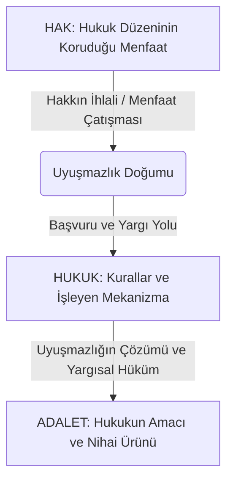
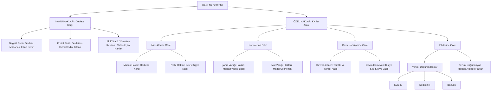
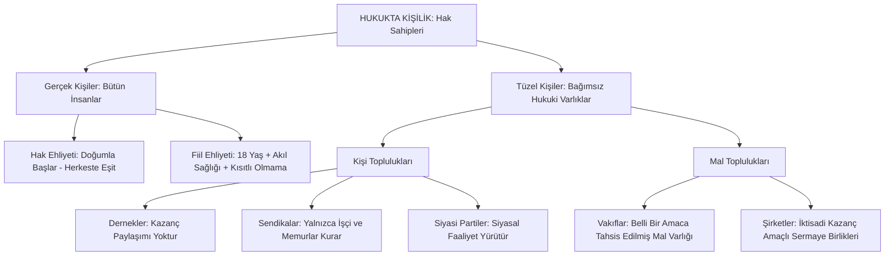
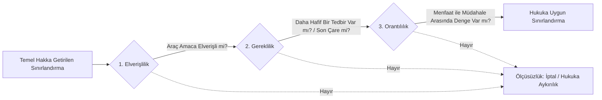

## Kavramsal Çerçeve

- **[[kavram-hak|Hak]]**: Hukuk düzeni tarafından korunan ve sahibine bu korunmadan yararlanma yetkisi tanınan menfaat.
* **[[Hukuk]]:** Toplumsal ilişkileri düzenleyen, hakları kuran, sınırlarını çizen ve ihlal halinde işletilen kurallar mekanizmasıdır.
* **[[Adalet]]**: Hukuk mekanizmasının uyuşmazlıkları çözüme kavuşturarak ortaya çıkardığı nihai ürün ve denge durumudur.
* **[[Kamu Hakları]]**: Kişilerin veya vatandaşların doğrudan devlete karşı sahip oldukları, kamu hukuku ilişkilerinden doğan haklardır.
* **[[Özel Haklar]]**: Eşit statüdeki kişiler arasındaki özel hukuk ilişkilerini düzenleyen kurallardan doğan haklardır.
* **[[Hak Ehliyeti]]**: Haklara ve borçlara sahip olabilme iktidarıdır. Sağ ve tam doğumla başlar, ölümle sona erer; tüm insanlar bu ehliyete eşit olarak sahiptir.
* **[[Fiil Ehliyeti]]**: Kişinin bizzat kendi irade beyanıyla hak edinebilme ve borç altına girebilme iktidarıdır. Erginlik, ayırt etme gücü ve kısıtlı bulunmama şartlarına bağlıdır.
* **[[Mutlak Hak]]**: Hak sahibi tarafından herkese karşı ileri sürülebilen, herkes tarafından ihlali mümkün olan ve tüm toplumun uymakla yükümlü olduğu haktır.
* **[[Nispi Hak]]**: Yalnızca belirli bir hukukî ilişkinin tarafı olan kişi veya kişilere karşı ileri sürülebilen hak.
* **[[Şahıs Varlığı Hakları]]**: Kişinin manevi alanına giren, kişiliğini koruyan, ekonomik değer taşımayan ve kişiye sıkı sıkıya bağlı olan haklardır. Bu haklar kural olarak devredilemez, başkasına bırakılamaz, miras yoluyla geçmez ve zamanaşımına uğramaz. 
* **[[Mal Varlığı Hakları]]**: Mal varlığı hakları, kişinin ekonomik alanına giren, para ile ölçülebilen ve malvarlığı değeri taşıyan haklardır. Bu haklar kural olarak devredilebilir, miras yoluyla intikal eder, zamanaşımına tabidir ve hak sahibi bunlardan feragat edebilir. 
* **Devredilebilen Haklar**: Hukukî muamelelerle başkalarına aktarılabilen, miras yoluyla intikali mümkün olan ve mal varlığı değerini oluşturan haklardır.
* **Devredilemeyen Haklar**: Doğrudan hak sahibinin şahsına bağlı olan; başkasına devri, feragati veya miras yoluyla intikali mümkün bulunmayan haklardır.
* **[[Yenilik Doğuran Haklar]] (İnşai Haklar)**: Hak sahibinin tek taraflı irade beyanıyla karşı tarafın hukuk alanında doğrudan sonuç doğurarak mevcut hukukî durumu kuran, değiştiren veya sona erdiren haklardır.
* **[[Yenilik Doğurmayan Haklar]] (Alelade Haklar)**: Kullanılmasıyla mevcut hukukî durumu değiştirmeyen, var olan yetkinin olağan şekilde icrasını sağlayan haklardır.
* **Gerçek Kişiler**: İnsan olarak varlığı bulunan ve sağ doğumla kişilik kazanan, ölümle kişiliği sona eren tüm bireylerdir
* **[[Tüzel kişiler|Tüzel Kişiler]]**: Bağımsız bir varlık teşkil etmek üzere hukuk düzeni tarafından kişi kabul edilen kişi veya mal toplulukları.
* **Kişi Topluluğu**: En az belirli sayıda şahsın ortak bir gayeyi gerçekleştirmek üzere güçlerini ve faaliyetlerini birleştirmesiyle vücut bulan tüzel kişilerdir.
* **Mal Topluluğu**: Belirli ve sürekli bir gayeye tahsis edilmiş mal varlığının bağımsız bir kişilik kazanmasıyla oluşan tüzel kişilerdir.
* **[[Ölçülülük İlkesi]]:** Temel bir hakkın kamu menfaati gereğince sınırlandırılmasında elverişlilik, gereklilik ve orantılılık bağının korunmasını teminat altına alan anayasal denetim ölçütüdür.

## İşlenen Konular ve Ayrımlar

### 1. Hak, Hukuk ve Adalet
Hukuk mekanizmasının işleyişi şu mantıksal sıra üzerinden gerçekleşir:

1. Hukuk düzeni bireye korunmaya değer bir menfaat tahsis eder. Bu durum [[kavram-hak|hak]] olarak adlandırılır.
2. Bu hakkın ihlali veya borcun ifa edilmemesi hâlinde taraflar arasında uyuşmazlık doğar.
3. Hak sahibi, uyuşmazlığın giderilmesi için kurallar bütünü ve yargı mekanizması olan [[Hukuk|hukuk]] organlarına müracaat eder.
4. Bu mekanizmanın uyuşmazlığa çözüm bağlayarak ortaya koyduğu nihai hüküm [[Adalet|adalet]] kavramıdır.

### 2. Hakların Temel Ayrımı: Kamu Hakları ve Özel Haklar
Haklar, taraf iradeleri ve ilişkinin niteliği bakımından iki temel alana ayrılır:

#### a) Kamu Hakları ve Devletin Statüleri (Jellinek Sınıflandırması)
Bireyin devlete karşı konumunu ve devletten beklenen davranış yükümlülüğünü belirler:

- **[[Negatif Statü Hakları]] (Koruyucu Haklar)**: Devletin bireyin özel alanına müdahale etmemesini, pasf kalmasını gerektiren haklardır. Bireyin devlete karşı özerk alanını teminat altına alır (örn: konut dokunulmazlığı, mülkiyet hakkı, haberleşme hürriyeti, şeref ve itibarın korunması).
- **[[Pozitif Statü Hakları]] (İsteme Hakları)**: Bireyin devletten olumlu bir hizmet, edim ve tesis talep etme yetkisini içeren haklardır. Devletin sosyal ve ekonomik alanda müdahalesini, teşkilatlanmasını ve harcama yapmasını gerektirir (örn: sosyal güvenlik hakkı, sağlık hakkı, dinlenme hakkı, sendikal güvenceler).
- **[[Aktif Statü Hakları]] (Katılma Hakları)**: Bireyin siyasal mekanizmaya ve devlet yönetimine katılımını sağlayan yetkilerdir. **Bu haklar münhasıran vatandaşlara aittir; yabancılar bu haklardan istifade edemez** (örn: seçme ve seçilme hakkı, dilekçe hakkı).

#### b) Özel Haklar ve Ehliyet Rejimi
Özel hukuk ilişkilerinden doğan haklar, eşitler arası hukukî muamelelere dayanır. Özel haklara sahip olma bakımından bütün insanlar doğdukları andan itibaren [[hak ehliyeti]] gereğince tam bir eşitlik içindedir.

Buna mukabil, özel hakları bizzat kullanma iktidarı olan [[fiil ehliyeti]] bakımından insanlar eşit değildir. **Bir hakkı tek başına kullanabilmek, 18 yaşın ikmali (erginlik), ayırt etme gücünün mevcudiyeti ve kısıtlı bulunmama şartlarına tabidir.** Fiil ehliyeti bulunmayanların hakları kanunî temsilcileri (veli veya vasi) vasıtasıyla kullanılır.

### 3. Özel Hakların Sınıflandırılması
Özel haklar taşıdıkları hukukî vasıflara göre dört ana başlık altında ikili ayrımlara tabi tutulur:

| Tasnif Ölçütü               | Alt Dalı                      | Hukuki Niteliği                                                                                                             | Tipik Örnekler                                                                          |
| :-------------------------- | :---------------------------- | :-------------------------------------------------------------------------------------------------------------------------- | :-------------------------------------------------------------------------------------- |
| **Niteliklerine Göre**      | [[Mutlak Hak]]                | Herkese karşı ileri sürülebilir; herkes ihlal edebilir; herkes uymakla yükümlüdür.                                          | Yaşam hakkı, vücut bütünlüğü, mülkiyet hakkı, adın korunması.                           |
| **Niteliklerine Göre**      | [[Nısbi Hak]]                 | Belirli bir hukukî ilişkinin karşı tarafına ileri sürülebilir. Borç ilişkilerinden doğar.                                   | Alacak hakkı, işçinin ücret isteme hakkı, işverenin iş görme talebi.                    |
| **Konularına Göre**         | [[Şahıs Varlığı Hakları]]     | Kişinin manevi alanını korur; parayla ölçülemez; kişiye sıkı sıkıya bağlıdır.                                               | Özel hayatın gizliliği, boşanma hakkı, nişanı bozma hakkı, adın değiştirilmesi talebi.  |
| **Konularına Göre**         | [[Mal Varlığı Hakları]]       | Kişinin maddi menfaatlerini korur; parayla ölçülebilir ekonomik bir değere sahiptir.                                        | [[Mülkiyet Hakkı]], [[Alacak Hakkı]], [[Miras Hakkı]].                                  |
| **Devir Kabiliyetine Göre** | [[Devredilebilen Haklar]]     | Sözleşmeyle [[temlik]] edilebilir, kiralanabilir, mirasçılara intikal edebilir.                                             | Taşınmaz mülkiyeti, para alacakları, fikri mülkiyetin mali hakları.                     |
| **Devir Kabiliyetine Göre** | [[Devredilemeyen Haklar]]     | Kişiye sıkı sıkıya bağlıdır; vekaletle aktarılamaz; miras yoluyla geçmez.                                                   | İtibarın korunması, ergin kılınmayı (kazai rüşt) talep hakkı, nişanı bozma hakkı.       |
| **Etkilerine Göre**         | [[Yenilik Doğuran Haklar]]    | Hak sahibinin tek taraflı irade beyanıyla hukukî durumu değiştirmesine imkân veren haklardır. Karşı tarafın onayı gerekmez. | Sözleşmenin feshi, ayıplı malda satış bedelinden indirim talebi, boşanma.               |
| **Etkilerine Göre**         | [[Yenilik Doğurmayan Haklar]] | Kullanılmasıyla mevcut hukukî durumu değiştirmeyen, var olan durumun sürdürülmesinden ibaret haklardır.                     | Kiracının kiralanan konutta oturması, işçinin mevcut sözleşmeyle iş görmeyi sürdürmesi. |

#### Yenilik Doğuran Hakların İç Tasnifi
- **Kurucu Yenilik Doğuran Haklar**: Hak sahibinin tek taraflı irade beyanıyla, daha önce var olmayan yeni bir hukuki ilişki (veya hak) doğurmasına imkân veren haklardır. Karşı tarafın ayrıca onay vermesi gerekmez.
	- *Örnek*: Alım hakkı (opsiyon) sahibinin, alım hakkını kullandığını bildirmesiyle satış sözleşmesinin kurulması. Önalım hakkı sahibinin, taşınmazın üçüncü kişiye satılması üzerine hakkını kullanarak malı kendi adına alması da aynı gruptadır.
- **Değiştirici Yenilik Doğuran Haklar**: Var olan hukukî ilişkiyi ortadan kaldırmadan, içeriğini veya şartlarını tek taraflı irade beyanıyla değiştiren haklardır.
	- *Örnek*: Ayıplı bir televizyon alan kişinin, sözleşmeyi bozmadan satış bedelinden indirim talep etmesi. Sözleşme devam eder, yalnızca ödenecek bedel değişir. Kısmi ayıp hâlinde, sözleşmenin ücretsiz onarım talep edilerek sürdürülmesi de değiştirici nitelik taşır.
- **Bozucu Yenilik Doğuran Haklar**: Var olan hukukî ilişkiyi tek taraflı irade beyanıyla tamamen sona erdiren haklardır.
	- *Örnek*: İşverenin haklı nedenle iş sözleşmesini feshetmesi, kiracının kira sözleşmesini fesih bildirimiyle sona erdirmesi, nişanlının nişanı bozması ya da eşin boşanma davası açarak mahkeme kararıyla evliliği sona erdirmesi.

### 4. Hak Sahipliği ve Kişilik Türleri

Hukuk âleminde hak ve borçlara ehil varlık ikiye ayrılır:

#### a) Gerçek Kişiler
Biyolojik varlığı bulunan insanlardır. Tam ve sağ doğumla birlikte tüm insanlar hak ehliyetine kavuşur.

#### b) Tüzel Kişiler
İnsanların tek başlarına gerçekleştiremeyecekleri amaçları hayata geçirmek üzere oluşturdukları, hukuken bağımsız kabu edilen varlıklardır (bkz. [[Tüzel kişiler]], [[Tüzel kişilik]]):

##### Kişi Topluluğu
- **Dernekler**: Kazanç paylaşma amacı gütmeyen, belili amacı gerçekleştirmek üzere kurulan topluluklardır. Önceden izin almaksızın serbestçe kurulurlar. Kâr amacı güdemez ve üyelerine kâr payı dağıtamazlar; ancak dernek amacını gerçekleştirmek üzere iktisadi işletme kurup kâr elde edebilirler.
- **Sendikalar**: Yalnızca **işçiler ve kamu görevlileri (memurlar)** tarafından kurulabilen meslekî kişi topluluklarıdır. **Kanunun belirlediği çalışan statüsünde bulunmayanların (öğrenciler, emekliler) kurduğu örgütlenmeler, *Sendikalar Kanunu* kapsamında sendika tüzel kişiliği kazanamaz; *Dernekler Kanunu* hükümlerine tabi dernek statüsünde kalır.**
- **Siyasi Partiler**: Demokratik siyasal hayata katılmak amacıyla teşkilatlanan bağımsız kişi topluluklarıdır.

##### Mal Topluluğu
- **Vakıflar**: Belirli ve sürekli bir amaca tahsis edilmiş bağımsız mal varlıklarıdır. Asliye Hukuk Mahkemesi nezdinde tutulan sicile tescil ile kişilik kazanırlar.
- **Şirketler**: İktisadi gayelerle sermayenin bir araya getirilmesiyle kurulan, ticaret siciline tescille tüzel kişilik kazanan yapılardır.

### 5. Temel Hakların Sınırlandırılmasında Ölçülülük Ölçütleri
Temel haklar sınırsız değildir. Anayasal düzenlemeler ve kanunlarla sınırlandırılabilir. Ancak getirilen her sınırlamanın meşru sayılabilmesi için [[ölçülülük ilkesi]] gereğince şu üç şartı birlikte sağlaması gerekir:

1. **Elverişlilik**: Başvurulan sınırlandırma aracının, ulaşılmak istenen meşru amacı gerçekleştirmeye elverişli olmasıdır.
2. **Gereklilik**: Ulaşılmak istenen amaç bakımından hedefe ulaştıracak en hafif, bireyin hakkını en az zedeleyen aracın seçilmiş olmasıdır.
3. **Orantılılık**: Elde edilmek istenen kamu menfaati ile sınırlanan temel hakın ağırlığı arasında makul ve adil bir dengenin bulunmasıdır.

---

## Şemalar

#### 1. Hak, Hukuk ve Adalet Döngüsü

#### 2. Hakların Genel Sınıflandırması

#### 3. Hak Sahipliği: Kişilik Türleri

#### 4. Temel Hakların Sınırlandırılmasında Ölçülülük Süzgeci

