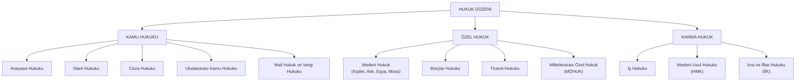

## Sınava Dair

Hoca, hukuka aykırılık ile suç arasındaki kapsam ilişkisinin sınav sorusu olabileceğini söyledi. 
- **Soru Mantığı**: Suç teşkil eden her fiil zorunlu olarak hukuka aykırılık barındırır; buna karşılık hukuka aykırı olan her fiil ceza hukuku anlamında suç oluşturma vasfından uzak kalır.
- Bir kimsenin komşusuna zarar verme kastıyla arsa sınırına yüksek duvar örmesi durumu. Bu eylem dürüstlük kuralını çiğnediği için hukuka aykırılık teşkil eder ve Medeni Hukuk kapsamında yapının yıktırılması veya tazminat yaptırımına bağlanır; eylem ceza sorumluluğu alanının tamamen dışında kalır. 

## Ceza Yargılamasının Evreleri ve Tarafların Sıfatları

### Soruşturma Evresi (Investigation Phase)
Bir suç işlendiği izlenimi oluştuğunda delillerin kaybolmasını önleme ve davanın açılması için yeterli şüphenin bulunup bulunmadığını araştırma ihtiyacı bu evreyi başlatır. Savcılık ve polisin olayı inceleyip delil topladığı ilk dönemdir. Suç şüphesinin yetkili adli mercilerce öğrenilmesinden başlayarak cumhuriyet savcığılığı tarafından düzenlenen iddianamenin yetkili mahkemece kabülüne kadar geçen adli süreci kapsar. Bu evrede suç isnadı altında bulunan birey **şüpheli** sıfatını taşır.

### Kovuşturma Evresi (Prosecution and Trial Phase)
Toplanan delillerin kamuya açık, tarafların eşit koşullarda katıldığı bir yargılama ortamında değerlendirilmesi ve nihai karara bağlanması hedeflenir. Mahkeme huzurundaki yargılama ve duruşmalar sürecidir. İddianamenin mahkemece kabulü ile başlayıp yargılamanın neticesinde verilen hükmün kesinleşmesine kadar devam eden evredir. Bu evrede yargılanan kişi **sanık** sıfatını alır. Yargılama mahkûmiyet kararıyla kesinleştiğinde bireyin sıfatı **hükümlü** hâline gelir.

*Akılda Kalsın*: İddianamenin mahkemece kabulü, süreci soruşturmadan kovuşturmaya, bireyin sıfatını ise şüphelinden sanığa dönüştüren temel yargısal eşiktir.

---

# Hukuk Sistemi ve Alt Dalları

## 1. Kamu Hukuku
Kamu gücünü temsil eden devlet ile bireyler arasındaki astlık-üstlük ilişkisini ve toplum düzenini kurmayı amaçlayan kuralların bütünüdür. Bu alanda kamusal menfaat ve kamu düzeni önceliklidir.

### 1.1. Anayasa Hukuku (Contitutional Law)
Devletin siyasal ve hukukî teşkilatını en üst norm düzeyinde kurma ihtiyacından doğar. Sade dille; **devlet organlarının yetkilerini ve vatandaşların anayasal haklarını gösteren temel hukuktur**; **devletin temel yapısını, yasama, yürütme ve yargı organlarının işleyişini, birbirleriyle olan dengesini ve bireylerin temel hak ve hürriyetlerini düzenleyen kamu hukuku dalıdır**. Temel metni Türkiye Cumhuriyeti Anayasası'dır.


### 1.2. İdare Hukuku (Administrative Law)
Devletin kamu hizmetlerini yürütürken tabi olduğu usulleri ve kamu idaresinin sınırlarını çizme ihtiyacına dayanır. Kamu kurumlarının işleyişini ve memurların hukukî statüsünü düzenleyen disiplindir. Bir diğer deyişle, **idarenin teşkilat yapısını, kamu personeli rejimini, idari işlemlerin geçerlilik şartlarını ve idarenin yargısal denetimini tanzim eden hukuk alanıdır**. Devlet Memurları Kanunu, İdari Yargılama Usulü Kanunu ve Kamu İhale Kanunu gibi zengin mevzuat kaynaklarına dayanır.

### 1.3. Ceza Hukuku (Criminal Law)
Toplumsal barışı sarsan eylemlerin önlenmesi ve bireylerin temel haklarının korunması amacıyla devletin cezalandırma yetkisini kullanmasını tanzim eder. Suçları ve bu suçlara uygulanacak yaptırımları düzenleyen alandır. **Suç teşkil eden eylemleri belirleyen, bu eylemlere uygulanacak hürriyeti bağlayıcı cezaları, adli para cezalarını ve güvenlik tedbirlerini tespit eden kamu hukuku disiplinidir**. Temel kaynağı 5237 sayılı Türk Ceza Kanunu'dur.


#### Suç (Crime/Delictum)
Toplum düzeni koruma, kamu barışını sürdürme ve bireylerin temel haklarını güvence altına alma ihtiyacı en ağır hukukî yaptırımların işletilmesini zorunlu kılar. 

Suç; toplumun hukukî düzenince yasaklanmış ve yaptırımı hapis veya adli para cezası olarak belirlenmiş davranıştır. Bir diğer deyişle, **kusur yeteneği bulunan bir kimsenin hukuka aykırı ve kusurlu hareketine [[suç]] denir**.

Bireyin bilerek ve isteyerek komşusunun malına zarar vermesi suçun somut bir örneğidir. Suç, genel "hukuka aykırılık" kavramından, **doğrudan ceza kanunlarında tanımlanmış olması ve hürriyeti bağlayıcı ceza veya adli para cezası yaptırımına bağlanmış bulunması özelliğiyle ayrılır**.

#### Hukuka Aykırılık ve Suç Ayrımı
Hukuk düzeni, kendi koyduğu kurallara aykırı olan her duruma eşit düzeyde ceza yaptırımı bağlamak yerine farklı yaptırım türleri geliştirir. Hukuka aykırılık, hukuk kurallarının emrettiği veya yasakladığı davranış modelleriyle çelişen tüm fiilleri kapsayan çatı kavramdır. **Suç ise, bu geniş çerçevenin yalnızca ceza kanunlarınca yaptırıma bağlanan özel bir parçasıdır.** 


#### Kanunilik İlkesi (Prenciple of Legality)
> «Nullum crimen nulla poena sine lege» (Kanunsuz suç ve ceza olmaz).

Devletin cezalandırma yetkisini keyfî uygulamalardan arındırmak ve bireylere hangi eylemlerin ceza gerektirdiğini önceden bildirme ihtiyacı kanunilik ilkesini doğurur. Kanunda açıkça yazmayan bir eylem için ceza verilebilmesi ve kanunda belirlenen ceza sınırının aşılabilmesi engellenir. Diğer bir deyişle, **suç teşkil eden eylemler ile bunlara uygulanacak yaptırımların ancak ve sadece yasama organınca çıkarılan yazılı kanunla yaratılabilmesini/belirlenebilmesini/konulabilmesini zorunlu kılan ilkeye kanunilik ilkesi denir.**

Trafikte seyir hâlindeyken cep telefonu kullanmak mevzuatta açıkça yaptırıma bağlandığı için cezalandırılır. Mevzuatta açıkça yasaklanmamış bir eylem ise benzer riskler oluştursa dahi kanunilik ilkesi gereği suç vasfı kazanmaksızın serbest hareket alanında kalır. Bu ilke, ahlak kurallarının veya örf-adetin doğrudan ceza [[ihdas]] edebildiği sistemlerden kanunun mutlak üstünlüğü esasıyla ayrılır.


#### Kanunu Bilme Yükümlülüğü
> *Ignorantia legis neminem excusat!*
> *Kanunu bilmemek mazeret sayılmaz!*

Hukuk normlarının uygulanabilirliğini kişilerin subjektif bilgi düzeyine bağlamak kamusal düzeni zedeleyeceği için kanunu bilme karinesi kabul edilir. Birey bir kuralı bilmediğini ileri sürerek ceza almaktan kurtulma imkânı bulamaz. Bir diğer deyişle bu kural, **yürürlüğe giren kanunların toplumun tüm fertleri tarafından bilindiğinin hukuken varsayılması ve mevzuat bilgisizliğinin sorumluluğu ortadan kaldıran bir savunma gerekçesi olarak kabul görmemesidir**.

Trafikte araç kullanırken telefonla konuştuğu içni durdurulan bir sürücünün kuralın varlığından haberdar olmadığını söylemesi sorumluluğunu sürdürür.

#### Kusur İlkesi (Principli of Guilt / Mens Rea)
Bireye ceza verilebilmesi, iradesiyle gerçekleştirdiği eylemin kınanabilir bulunmasına bağlıdır. Kişinin gerçekleştirdiği hareket üzerinde iradkî hâkimiyeti, seçme şansı ve sorumluluğu bulunur. Terimsel anlamıyla kusur ilkesi, **ceza sorumluluğunun ancak failin isnat yeteneğine dayalı kastî veya taksirli bir iradesinin varlığı hâlinde doğabileceğini** ifade eder. Akıl sağlığı yerinde olan bir bireyin hırsızlık yapması durumunda kusur yeteneği tam kabul edilir; akıl hastalığı bulunan kişide ise isnat yeteneği bulunmadığından eyleme ceza yerine güvenlik tedbiri uygulanır.

#### Cezaların Şahsiliği İlkesi
Orta Çağ ve kabile hukuku pratikleridne görülen toplu cezalandırmanın önüne geçilmesi amacıyla cezanın bireyselleştirilmesi benimsenmiştir. Sade ifadeyle; **her fail sadece kendi işlediği suçtan sorumludur, başkasının suçu için başkası cezalandırılamaz.**

#### [[masumiyet karinesi|Masumiyet Karinesi]] (Presumption of Innocence)
Yargılama makamlarının ve toplumun bireyi peşinen suçlu ilan etmesini önlemek amacıyla evrensel bir güvence tesis edilmiştir. **Mahkeme kararı kesinleşene kadar herkes suçsuz kabul edilir**.

*Akılda Kalsın: Ceza hukuku; kanunilik güvencesiyle sınırları çizilmiş, kusur ve şahsilik zemininde yükselen, kesin hükme dek bireyin masumiyetini esas alan bir kamu hukuku disiplinidir.*


### 1.4. Uluslararası Kamu Hukuku (Public International Law)
Egemen devletlerin ve uluslararası örgütlerin birbirleriyle kurdukları ilişkileri kurallara bağlar. Devletler arası hukuku ifade eder; **egemen süjeler arasındaki ilişkileri, uluslararası antlaşmaları, sınır protokollerini ve uluslararası örgütlerin faaliyetlerini düzenleyen kamu hukuku disiplinidir.** Temel kaynağını uluslararası antlaşmalar oluşturur.

### 1.5. Mâlî Hukuk ve Vergi Hukuku (Fiscal and Tax Law)
Devletin kamu hizmetlerini finanse edebilmek için ihtiyaç duyduğu kamusal gelirlerin toplanmasını ve harcanmasını düzenler. **Kamu gelirlerinin tarh, tebliğ, tahakkuk ve tahsil süreçleri ile kamu harcamalarının yapılmasını belirleyen kamu hukuku dalıdır**. Bireylerden ve kurumlardan toplanan vergiler bu alanın konusudur.

## 2. Özel Hukuk
Eşit haklara sahip süjelerin kendi aralarında irade serbestisi ve sözleşme özgürlüğü ilkeleri çerçevesinde kurdukları ilişkileri düzenleyen alandır.

### 2.1. Medenî Hukuk (Civil Law)
Kişinin doğumundan ölümüne ve sonrasına dek şahsi, ailevi ve [[hukuk-ayni|ayni]] ilişkilerini düzenleme ihtiyacından doğar. **Dört ana kısımdan oluşur: Kişiler Hukuku, Aile Hukuku, Eşya Hukuku ve Miras Hukuku**. Temel kaynağı 4721 sayılı Türk Medeni Kanunu'dur. 2002 yılında yürürlüğe giren kanun gereğince evlilik birliğinde eşler tam eşit haklara sahiptir

> *Not*: 2002 yılından önce Türkiye'de 1926 yılına ait Medenî Kanun uygulanmaktaydı.

### 2.2. Borçlar Hukuku (Law of Obligations)
Piyasa ekonomisinde bireylerin karşılıklı taahhüt altına girerek mal ve hizmet mübadelesi yapabilmesini güvence altına alır. Borcun doğumunu ve ifasını tanzim eder; **taraflar arasında sözleşmelerden, haksız fiillerden veya sebepsiz zenginleşmeden doğan alacak-borç ilişkilerini inceleyen özel hukuk dalıdır**. Temel kaynağı 6098 sayılı Türk Borçlar Kanunu'dur. Kira ve satım sözleşmeleri bu hükümlere bağlıdır.

### 2.3. Ticaret Hukuku (Commercial Law)
Piyasa ekonomisinin gerektirdiği hız, güven ve uzmanlık ihtiyaçlarına cevap verir. Tacirleri, şirketleri ve ticari işlemleri kurallara bağlayan alandır; **ticari işletmeleri, ticaret şirketlerini, kıymetli evrakı (çek, poliçe, bono), taşıma ve lojistik ilişkilerini, deniz ticaretini ve özel sigortacılık faaliyetlerini düzenleyen özel hukuk dalıdır**. Temel kaynağı 6102 sayılı Türk Ticaret Kanunu'dur.


### 2.4. Milletlerarası Özel Hukuk (Conflict of Laws/Private International Law)
Özel hukuk ilişkisine yabancı bir unsur (vatandaşlık, ikametgâh veya malvarlığının bulunduğu ülke) karıştığında ortaya çıkan hukukî belirsizliği giderir. Yabancı unsurlu olayda hangi ülkenin kanununun uygulanacağını belirleyen hukuktur. Yabancılık unsuru taşıyan özel hukuk uyuşmazlıklarında uygulanacak yetkili hukuku tespit eden bağlama kurallarını, Türk mahkemelerinin milletlerarası yetkisini ve yabancı mahkeme kararlarının tanınması ile tenfizini (icra edilebilirliğini) düzenleyen disiplindir. 5718 sayılı [[MÖHUK]] (Milletlerarası Özel Hukuk ve Usul Hukuku Hakkında Kanun) temel metindir. Bu dal, maddi uyuşmazlığın özünü bizzat çözmek yerine, uyuşmazlığı çözecek yetkili devlet hukukunu gösteren bağlama kuralları üretmesi bakımından diğer özel hukuk dallarından ayrılır.


*Akılda Kalsın: Medenî hukuk beşikten mezara genel çerçeveyi çizer; Borçlar ve Ticaret hukuku piyasa ilişkilerini uzmanlaştırır; Milletlerarası Özel Hukuk ise işin içine bir sınır veya yabancı karıştığında hangi ülkenin kurallarının geçerli olacağını tayin eder.*


## 3. Karma Hukuk -Hakkın Korunması Usulleri-
Özel hukuk ilişkisi olarak başlayan ancak zayıf tarafın korunması veya kamu düzeninin sağlanması amacıyla devletin emredici müdahalede bulunduğu disiplinler grubudur.

### 3.1. İş Hukuku (Labor Law)
İşçi ile işveren arasındaki sözleşmesel ilişkiyi düzenler. **İktisaden zayıf konumda bulunan işçinin korunması amacıyla devletin taban sınır olarak asgari ücret belirlemesi veya iş güvencesi kuralları getirmesi bu alana karma nitelik kazandırır.** Temel kaynakları 4857 sayılı İş Kanunu, Deniz İş Kanunu, Basın İş Kanunu ve 6331 sayılı İş Sağlığı ve Güvenliği Kanunu'dur.

### Medenî Usul Hukuku (Civil Procedure Law)
Maddî hukukun bireylere tanıdığı hakların ihlali durumunda uyuşmazlığın mahkemeler aracılığıyla çözülmesini sağlar. **Yargılama faaliyetinin kamusal otoritesi ile özel hak taleplerini birleştiren karma bir alandır. Özel hakların yargı organları önünde ileri sürülmesini, dava açma sürelerini, dilekçeleri, delillerin sunulmasını ve hükmün oluşturulmasını belirleyen şeklî hukuk dalıdır.** Temel kaynağı 6100 sayılı [[HMK]]'dir (Hukuk Muhakemeleri Kanunu). Bu dal, hakkın özünü ve varlığını belirleyen [[maddi hukuk|Maddî Hukuk]] kurallarından; davanın nasıl yürütüleceğini belirleyen biçimsel ve şeklî niteliğiyle ayrılır.

### İcra ve İflas Hukuku (Enforcement and Bankruptcy Law)
Mahkemenin verdiği kararın borçlu tarafından rızaen yerine getirilmemesi hâlinde hakkın hayata geçirilmesini sağlar. **Devletin [[cebri icra]] tekeli ile alacaklının mülkiyet hakkını birleştiren karma bir disiplindir. Maddî hukuktan kaynaklanan para ve teminat alacaklarının devlet gücüyle borçlunun malvarlığına el konularak tahsil edilmesini düzenleyen yaptırım disiplinidir.** Temel kaynağı 2004 sayılı İcra ve İflas Kanunu'dur (İİK). Borcunu ödemeyen tarafın banka hesaplarına haciz konulması bu alana aittir.


## Ağ Zinciri
### Ceza Sorumluluğundan Hakkın Cebren İnfazına

Hukuk düzeni, bireylerin barış içinde bir arada yaşamalarını temin etmek üzere iki ana eksen üzerine kuruludur: **kamu düzeninin korunması ve özel hakların tanzimi.** 

Kamu Hukuku alanında devlet, egemenlik yetkisini kullanarak kamusal düzeni tesis eder. Anayasa Hukuku devletin temel organlarını ve bireylerin temel haklarını en üst normatif düzeyde belirlerken, İdare Hukuku kamu hizmetlerinin yürütülmesini ve idari işlemlerin sınırlarını tanzim eder. Mâlî Hukuk ve Vergi Hukuku kamusal harcamaların finansmanı için gelir toplama yetkisini kurallara bağlarken, Uluslararası Kamu Hukuku egemen devletlerin antlaşmalarını ve sınır ilişkilerini düzenler. Bu kamusal çatının en keskin sınırını çizen Ceza Hukuku ise kamu barışını sarsan en ağır ihlalleri suç olarak tespit eder ve kanunilik, kusur ile şahsilik süzgecinden geçirerek cezalandırır. Bu alanda şüpheden kesin hükme doğru [[ATLAS/Depo/Kavramlar/hukuk/soruşturma|soruşturma|soruşturma]] ve [[kovuşturma]] adımları takip edilir; bireyin lekelenmeme hakkı masumiyet karinesiyle korunur.

Özel Hukuk ekseninde ise eşit statüdeki bireyler irade serbestisi ve sözleşme özgürlüğü çerçevesinde hukuki münasebetler kurar. Bu alanın ana omurgasını oluşturan Medeni Hukuk, bireyin doğumundan ölümüne ve sonrasına uzanan hayat ilişkilerini dört temel kitapta tanzim eder. Kişiler Hukuku şahsiyetin başlangıcını ve fiil ehliyetini koruma altına alırken, Aile Hukuku evlilik birliğinde eşlerin eşitliğini esas kılar. Eşya Hukuku eşyalar üzerindeki mutlak ayni hakları, mülkiyeti, sınırlı ayni hakları ve tapu sicilini güvenceye bağlarken, Miras Hukuku vefat eden kimsenin terekesinin intikalini düzenler. Bireylerin piyasa içindeki mal ve hizmet mübadelesini sağlayan Borçlar Hukuku; sözleşmeler, haksız fiiller ve sebepsiz zenginleşmeden doğan alacak-borç ilişkilerini kurallara bağlar. İktisadi faaliyetlerin büyümesi, kurumsallaşması ve uzmanlaşması Ticaret Hukukunu doğurur; bu disiplin ticari işletmeleri, şirketler hukukunu, çek ve bono gibi kıymetli evrakı, deniz ticaretini, taşımacılık operasyonlarını ve özel sigortacılığı yönetir. Özel hukuk ilişkilerine yabancı bir vatandaşlık, ikametgâh veya sınır aşan bir malvarlığı dahil olduğunda ise Milletlerarası Özel Hukuk devreye girer; bu disiplin uyuşmazlığı esastan doğrudan çözmekten farklı bir yöntem izleyerek, yetkili Türk mahkemesini ve olaya hangi devletin maddi hukukunun uygulanacağını gösteren bağlama kurallarını tespit eder.

Karma Hukuk ekseninde ise özel hak ilişkilerine devletin kamusal koruma ve yargısal yaptırım gücü dahil olur. İşçi ile işveren arasındaki iktisadi güç dengesizliğini gidermek amacıyla devlet sözleşme serbestisine emredici kurallarla müdahalede bulunur; asgari ücreti ve iş güvencesi standartlarını belirleyerek İş Hukukunu türetir. Özel hukukun ve karma hukukun tanıdığı tüm bu maddi hakların ihlali halinde mahkeme huzurundaki yargılama sürecini Medeni Usul Hukuku yürütür; dava dilekçelerinin verilmesini, süreleri, iddiaların sunulmasını ve ispat faaliyetini kurallara bağlayarak yargısal ilamı oluşturur. Mahkemenin verdiği karara rağmen borçlunun ifadan kaçınması halinde ise devreye İcra ve İflas Hukuku girer; devletin cebri icra organları marifetiyle borçlunun malvarlığına el konularak, haciz ve satış yoluyla alacaklının hakkı devlet gücüyle tahsil edilir.

```code
Hukuk Sistemi
 ├── Kamu Hukuku (Devlet Üstünlüğü ve Kamu Düzeni)
 │    ├── Anayasa Hukuku (Temel Düzen ve Organlar)
 │    ├── İdare Hukuku (Kamu Hizmeti ve İdari İşlemler)
 │    ├── Ceza Hukuku (Suç, Ceza, Soruşturma, Kovuşturma)
 │    ├── Uluslararası Kamu Hukuku (Devletler Arası İlişkiler)
 │    └── Mali Hukuk ve Vergi Hukuku (Kamu Gelir ve Giderleri)
 ├── Özel Hukuk (Eşitlik ve İrade Özerkliği)
 │    ├── Medeni Hukuk (Kişiler, Aile, Eşya, Miras)
 │    ├── Borçlar Hukuku (Sözleşmeler, Haksız Fiil, Sebepsiz Zenginleşme)
 │    ├── Ticaret Hukuku (Şirketler, Kıymetli Evrak, Taşıma, Sigorta)
 │    └── Milletlerarası Özel Hukuk (Yabancılık Unsuru, MÖHUK, Bağlama Kuralları)
 └── Karma Hukuk (Özel Hak ile Kamusal Müdahalenin Birleşimi)
      ├── İş Hukuku (İşçi-İşveren İlişkisi ve Kamu Müdahalesi)
      ├── Medeni Usul Hukuku (Yargılama Usulü, Dava, İspat, Hüküm)
      └── İcra ve İflas Hukuku (Devlet Gücüyle Cebri İcra, Haciz, Satış)
```

## Ayırt edilmesi gereken meseleler.

- **Soruşturma ve Kovuşturma:** Soruşturma, yetkili adli makamların suç şüphesini öğrenmesiyle başlayıp iddianamenin kabulüne kadar devam eder ve bu evredeki kişi "şüpheli" unvanını taşır. Kovuşturma ise iddianamenin kabulünden hükmün kesinleşmesine kadar sürer; bu evrede kişi "sanık", kesinleşen mahkûmiyet sonrası ise "hükümlü" unvanını alır.
- **Maddi Hukuk ve Usul Hukuku:** Maddi hukuk (Türk Medeni Kanunu, Türk Borçlar Kanunu, Türk Ticaret Kanunu), hakkın özünü, kimin hak sahibi veya borçlu olduğunu, alacağın doğum koşullarını belirler. Usul hukuku (Hukuk Muhakemeleri Kanunu) ise bu hakkın mahkemede nasıl talep edileceğini, dilekçelerin sunulma takvimini, delillerin ikame biçimini ve yargılamanın usul adımlarını tayin eder.
- **Uluslararası Kamu Hukuku ve Milletlerarası Özel Hukuk:** Uluslararası Kamu Hukuku, egemen devletlerin ve uluslararası teşkilatların birbirleriyle olan kamusal antlaşmalarını ve uyuşmazlıklarını konu edinir. Milletlerarası Özel Hukuk ise bünyesinde yabancılık unsuru (vatandaşlık, yerleşim yeri veya malvarlığının bulunduğu yer bakımından) barındıran özel hukuk süjeleri arasındaki uyuşmazlıklarda hangi ülke hukukunun uygulanacağını tespit eden kanunlar ihtilafı kurallarını içerir.

## Şemalar


