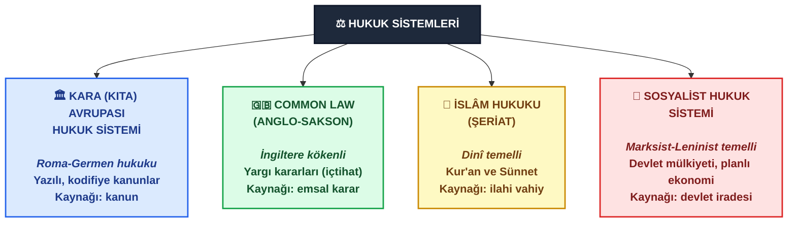
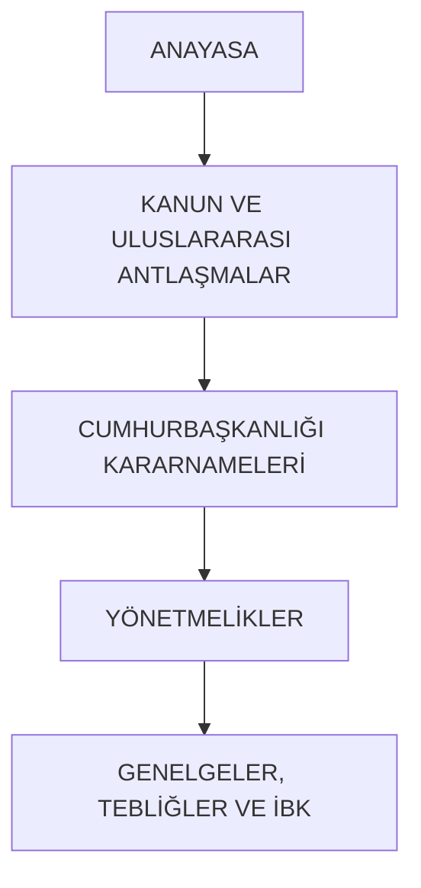
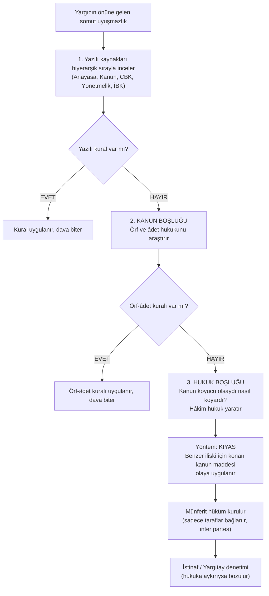

## Kavramsal Çerçeve ve Açıklamalar

### Hukuk Sistemleri (Legal Systems)
Yeryüzündeki egemen devletlerin toplumsal düzeni tesis etmek, iktidarı sınırlandırmak ve uyuşmazlıkları çözümlemek amacıyla benimsedikleri kurallar, kurumlar ve yargısal usuller bütünüdür. Küresel ölçekte hukuk sistemleri tarihsel köklerine, kaynaklarının yazılılık durumuna ve yargıcın rolüne göre dört ana kuşakta teşekkül etmiştir.

#### Kara (Kıta) Avrupası Hukuk Sistemi (Civil Law / Continental European Legal Systems)
Kökeni Roma Hukuku'na (*Corpus Iuris Civilis*) dayanan, 11. yüzyıldan itibaren İtalya'daki Bologna Üniversitesi merkezli [[glossatör]]ler ve şerhçiler tarafından sistemleştirilen hukuk ailesidir.

* **Sistemik Omurga**: Sistemin en belirgin alameti Roma geleneğinden devralınan [[hukuk-5#1. Kamu Hukuku|Kamu Hukuku]] ve [[hukuk-5#2. Özel Hukuk|Özel Hukuk]] ikili ayrımıdır.
* **Kaynak Yapısı**: Pozitif kanun metinlerine, kodifiye edilmiş yasalara ve soyut kuramsal kavramlara dayanır. Yargı organları karar verirken doğrudan kanun koyucunun yürürlüğe koyduğu yazılı metinleri ve kavramsal tanımları gerekçe gösterir.
* **Coğrafî Yayılım**: Kıta Avrupası ülkeleri, Türkiye, Japonya ve Güney Amerika devletleri bu sisteme dâhildir. Türkiye, İsviçre Medenî Kanunu'nu mehaz (örnek) alarak kurduğu Türk Medeni Kanunu ile bu ailenin tam üyesi konumundadır.

#### Anglo-Amerikan Hukuk Sistemi (Common Law / Anglo-Saxon Legal System)
İngiltere'de 11. yüzyılda Norman Fethi sonrasında gezici krallık yargıçlarının kararları ve yerel örf-adet kurallarının birleşimiyle doğan, daha sonra Amerika Birleşik Devletleri ve İngiliz Milletler Topluluğu coğrafyasına yayılan sistemdir.

* **Yargıç Hukuku (Judge-Made Law)**: Sistemin ana omurgasını meclislerin çıkardığı soyut yasalar yerine geçmiş yargı kararları teşkil eder.
* **Emsal Karar Doktrini (Stare Decisis)**: Alt mahkemeler ve çağdaş yargıçlar, benzer olaylarda daha önce üst yargı organları veya selefleri tarafından verilmiş emsal mahkeme kararlarına doğrudan bağlıdır.
* **Esneklik ve Gelenek Birlikteliği**: Sistem, yazılı olmayan hukuka ve geleneksel normlara dayanması yönüyle muhafakâr; soyut kavram kısıtlarına takılmaksızın somut olayın adaleti üzerinden yeni içtihat üretebilmesi yönüyle dinamik ve esnek bir yapı sergiler.

#### İslâm Hukuku (Islamic Law/Sharia)
Temel meşruiyetini ilahî vahiyden ve peygamberin örneklerinden alan dinî hukuk düzenidir.

- **Kaynaklar**: Aslî kaynaklar Kur'an ve Sünnet (hadisler); ikincil kaynaklar ise icmâ (hukukçuların görüş birliği) ve kıyastır.
- **Tarihsel Uygulama ve Kodifikasyon**: Tarihsel süreçte Osmanlı Devleti yalnızca şer'i hükümleri tatbik etmekle kalmamış; padişahın örfî yetkisine dayanan kanunnameler, nizamnameler ve tüzükler meydana getirerek geniş bir yazılı mevzuat külliyatı oluşturmuştur. 19. yüzyılda *Ahmet Cevdet Paşa* başkanlığında hazırlanan [[Mecelle]] (Mecelle-i Ahkâm-ı Adliye), İslam borçlar ve eşya hukukunun medenî kanun formunda [[Kodifikasyon|kodifiye edilmiş]] bir sentezidir.

#### Sosyalist Hukuk Sistemi
Marksist-Leninist ideolojinin mülkiyet ve devlet teorisine dayanan, 20. yüzyılda Sovyetler Birliği ve Doğu Bloku ülkelerinde uygulanan sistemdir. Günümüzde Kuzey Kore...

- **Mülkiyet Anlayışı:** Burjuva hukuku olarak nitelendirdiği klasik özel hukuk ayrımını ve üretim araçları üzerindeki bireysel mülkiyet hakkını reddeder. 
- **Sistemik Amaç**: Kamu mülkiyetini tesis etmek, toplumsal hakları ve bölüşüm ilişkilerini korumak, üretimi merkezi devlet planlamasına tâbi kılmaktır. Bireysel menfaat karşısında kolektif devlet iradesine mutlak üstünlük tanır.

### Pozitif Hukuk
[[Pozitif hukuk]]; **belirli bir ülkede, belirli bir zaman diliminde yürürlükte bulunan, yetkili organlar tarafından konulmuş yazılı ve yazılı olmayan hukuk kurallarının bütünüdür.** Yürürlükteki Türk Hukuku ifadesi, Türkiye Cumhuriyeti sınırları dâhilinde bağlayıcılığı hâiz pozitif hukuku tanımlar.

### Normlar Hiyerarşisi
Hukuk düzenini oluşturan normlar arasındaki aslık-üstlük ilişkisini ifade eden yapısal piramittir. Bu modelde alt basamakta yer alan her norm, geçerliliğini ve meşruiyetini bir üst basamakta bulunan norma uygunluğundan alır. Hiçbir alt norm, üst normun hükmünü değiştiremez; üst norma aykırı içerik taşıyamaz.

1. **[[Anayasa]]:** Devletin temel teşkilatını, kuvvetler ayrılığı dengesini ve vatandaşların temel hak ve ödevlerini belirleyen en üstün normatif metindir. Bütün kanunlar anayasaya uygun olmak mecburiyetindedir.
2. **[[Uluslararası Antlaşmalar]]:** Usulüne göre yürürlüğe konulmuş antlaşmalar kural olarak kanun gücündedir. **Temel hak ve özgürlüklere ilişkin milletlerarası antlaşmalar ile ulusal kanunların aynı konuda farklı hükümler içermesi durumunda, milletlerarası antlaşma hükümlerine öncelik tanınır.**
3. **[[hukuk-kanun|Kanun]]:** Yasama organı (Türkiye Büyük Millet Meclisi) tarafından anayasadaki biçimsel kurallara uygun olarak çıkarılan genel, soyut ve sürekli kurallardır.
4. **[[Cumhurbaşkanlığı Kararnamesi]] (CBK):** Yürütme yetkisine ilişkin konularda Cumhurbaşkanı tarafından çıkarılan düzenleyici işlemlerdir. 2017 anayasa değişikliği ile yürütme erkindeki Bakanlar Kurulu ve Kanun Hükmünde Kararname (KHK) uygulaması yürürlükten kalkmış, tüzük çıkarma yetkisi lağvedilmiş; yürütmenin düzenleme aracı CBK olarak yapılandırılmıştır. **Kanunda açıkça düzenlenen alanlarda CBK çıkarılamaz; kanun ile CBK çeliştiğinde kanun hükümleri geçerlilik taşır.**
5. **[[Yönetmelik]]:** Cumhurbaşkanı, bakanlıklar ve kamu tüzel kişilerinin kendi görev alanlarını ilgilendiren kanunların ve kararnamelerin uygulanmasını sağlamak üzere çıkardıkları yazılı normlardır.
6. **Alt Düzenleyici İşlemler ([[Genelge]] ve [[Tebliğ]]):** İdarenin teşkilat içi işleyişi yönlendirmek, kanun ve yönetmelik hükümlerini operasyonel düzeyde açıklamak amacıyla yayımladığı idari talimatlardır.
7. **[[İçtihadı Birleştirme Kararları]] (İBK):** Yargıtay veya Danıştay içtihatları arasında derin çelişkiler ortaya çıktığında, bu çelişkileri gidermek amacıyla ilgili yüksek mahkemenin genel kurullarınca alınan, benzer davalarda tüm yargıçları ve mahkemeleri bağlayan içtihat metinleridir.

### Pozitif Hukukun Kaynakları
Bir hukukî uyuşmazlığın çözümünde başvurulacak dayanaklar bağlayıcılık güçlerine göre üç kategoriye ayrılır:

| Kaynak Türü                                 | İçerik                                                                       | Hukukî Niteliği ve Bağlayıcılık Derecesi                                               |
| :------------------------------------------ | :--------------------------------------------------------------------------- | :------------------------------------------------------------------------------------- |
| **Yazılı Kaynaklar (Asli/Birincil)**        | Anayasa, Uluslararası Antlaşmalar, Kanun, CBK, Yönetmelik, Genelge, İBK      | Mutlak bağlayıcıdır; yargıç öncelikle bu metinleri tüketmekle yükümlüdür.              |
| **Yazılı Olmayan Kaynaklar (Asli/İkincil)** | [[Örf ve Adet Hukuku]]                                                       | Yazılı kaynakta boşluk bulunması hâlinde bağlayıcı aslî kaynak olarak devreye girer.   |
| **Yardımcı Kaynaklar (Tali/İhtiyari)**      | [[Doktrin]] (Bilimsel Görüşler) ve [[içtihat\|Yargı Kararları]] (İçtihatlar) | Bağlayıcılıktan muaftır; yargıca uyuşmazlığı aydınlatmada rehberlik ve tavsiye sağlar. |

### [[Örf ve Adet Hukuku]]
Toplumda kendiliğinden doğan, uzun süreli bir tatbikatla yerleşen ve devletin yargı gücüyle bağlayıcılık atfettiği yazılı olmayan kurallardır. Bir toplumsal alışkanlığın salt örf-adet olmaktan çıkıp örf ve adet hukuku niteliği kazanması iki kurucu unsura bağlıdır:
1. **Maddi Unsur (Kadimlik / Süreklilik):** Davranış biçiminin çok uzun süredir kesintisiz tekrarlanması (uzun süreli tatbikat).
2. **Manevi Unsur (Genel İnanış):** Toplumun bu kurala uymayı hukukî bir zorunluluk saydığına dair inanç (*opinio juris*).

Bu iki unsur gerçekleşince kural hukuk kuralı niteliği kazanır ve devlet otoritesi bunu gerektiğinde [[cebri icra]] ile uygular.

### Eşya Hukukunda Bağlantı Normları

#### Mütemmim Cüz (Ayrılmaz Parça)
Yerel âdetlere göre asıl şeyin temel unsuru olan, o şey yok edilmedikçe, zarara uğratılmadıkça veya yapısı değiştirilmedikçe ondan ayrılması mümkün olmayan parçadır. Çerçeve ile gözlük camı gibi. Asıl eşyaya yapılan tasarruf ayrılmaz parçayı da doğrudan kapsar.

>Bir eşyanın parçası olan, ayırırsan eşyaya ya da o parçaya zarar veren şey. Ayrı bir eşya sayılmaz, asıl eşyanın bir parçasıdır. Ayırınca bozuluyor mu? Bozuluyorsa mütemmim cüzdür.    Asıl eşyayı satılırsa parça da kendiliğinden satılmış olur. Ayrıca parçayı ayrı satmak veya ayrı mülkiyete konu etmek mümkün değildir.

#### Eklenti (Tamamlayıcı Parça)
Asıl şeyin mâlikinin, o şeyin işletilmesi, korunması veya ondan yararlanılması için kalıcı olarak asıl şeye tahsis ettiği taşınır eşyadır. Gözlük ile gözlük kılıfı veya telefon ilet aşıma kılıfı eklenti bağına örnektir.

> Asıl eşyanın yanında duran, ona yardımcı olsun diye mal sahibinin bilerek tahsis ettiği ayrı bir eşya. Ayırınca ikisi de bozulmaz, ama beraber kullanılmaları amaçlanır.

### Yargısal Boşluk Doldurma ve Hakimin Hukuk Yaratması
Hukuk düzeninde yargıcın önüne gelen somut bir davada, olaya uygulanacak hiçbir yazılı ve yazılı olmayan normun bulunmaması durumu bir **hukuk boşluğudur**. Türk Medeni Kanunu'nun 1. maddesi uyarınca yargıç, uyuşmazlığı kesin bir karara bağlamakla mükelleftir; kanun hükmünün yokluğunu gerekçe göstererek davayı sonuçsuz bırakma yetkisinden yoksundur.

#### **Yargısal Karar Alma Sırası:**
  1. Yargıç önce yazılı kaynakları hiyerarşik sırayla inceler.
  2. Yazılı kaynakta kural bulunmaması (kanun boşluğu) halinde örf ve adet hukukunu araştırır.
  3. Yazılı olmayan kaynakta da hüküm bulunmaması durumunda (hukuk boşluğu) bizzat kanun koyucu olsaydı nasıl bir kural koyacak idiyse ona göre **hukuk yaratır**.
#### **Kıyas Yoluyla Hukuk Yaratma** 
Yargıç, hukuk yaratırken tamamen keyfî ve soyut hüküm kurma serbestisine sahip değildir. Kanun koyucunun benzer nitelikteki başka bir hukukî ilişki için öngördüğü kanun maddesini, nitelikleri uyuşan mevcut uyuşmazlığa benzeterek tatbik eder. 
  * *Somut Örnek:* Türk Medeni Kanunu boşanma hâlinde çocuğun velayeti kendisinde bulunmayan baba ile çocuk arasındaki kişisel münasebet tesisini açıkça düzenlemiştir. Babanın vefat ettiği bir senaryoda, torununu görmek isteyen babaannenin çocukla görüşme hakkı kanunda doğrudan düzenlenmemiştir. Yargıç burada yazılı hukukta ve örf-adet hukukunda bir kural bulunmadığını tespit ederek kanun koyucunun baba için getirdiği kişisel münasebet hakkını kıyasen babaanneye [[teşmil]] eder.
##### Yaratılan Hukukun Sınırları ve Niteliği
  * **Hakimin yarattığı hukuk bir kanun niteliği taşımaz; genel, soyut ve üçüncü kişileri bağlayıcı bir nitelik arz etmez. Hüküm yalnızca davanın tarafları açısından bağlayıcıdır**.
  * Hakimin oluşturduğu bu karar *İstinaf* ve *Yargıtay* gibi üst mahkemelerin yargısal denetimine tâbidir; hukuka aykırılık tespitinde üst mahkeme kararı bozma yetkisini haizdir.

# Geniş Çerçeve

| Parametre | Kara Avrupası Hukuk Sistemi | Anglo-Amerikan (Common Law) | İslam Hukuku (Klasik Dönem) | Sosyalist Hukuk Sistemi |
| :--- | :--- | :--- | :--- | :--- |
| **Temel Köken** | Roma Hukuku / Justinianus Kanunları | İngiliz Krallık Yargıçları İçtihatları | İlahi Vahiy (Kur'an ve Sünnet) | Marksist-Leninist İdeoloji |
| **Birincil Norm Kaynağı** | Yazılı Kanunlar ve Kodifiye Metinler | Emsal Mahkeme Kararları (Precedents) | Kutsal Metinler, İcma ve Kıyas | Devlet Planlama Kararları ve Kamu Mevzuatı |
| **Yargıcın Konumu** | Kanunu uygulayan, kavramları yorumlayan uygulayıcı | Emsal oluşturan, içtihatla kural koyan yapıcı | Hüküm çıkaran, nasları somut olaya uyarlayan müçtehit | Kolektif devlet çıkarını koruyan kamu görevlisi |
| **Kamu/Özel Hukuk Ayrımı** | Sistemin temel ayrım çizgisi | Bütünleşik ve iç içe geçmiş yapı | Hakullah ve Kul Hakkı eksenli ayrım | Özel hukukun reddi, mutlak kamu mülkiyeti |
| **Bağlayıcı İçtihat Gücü** | Sadece İçtihadı Birleştirme Kararları genel bağlayıcıdır | Her emsal karar alt mahkemeleri doğrudan bağlar | Müftü/Kadı içtihadı münferit olayla kaimdir | Yüksek Sovyet ilkeleri doğrultusunda belirlenir |
| **Coğrafi Temsil** | Kıta Avrupası, Türkiye, Japonya | İngiltere, ABD, Kanada, Avustralya | Tarihsel İslam devletleri, şer'i monarşiler | Tarihsel SSCB, Kuzey Kore, Küba |
