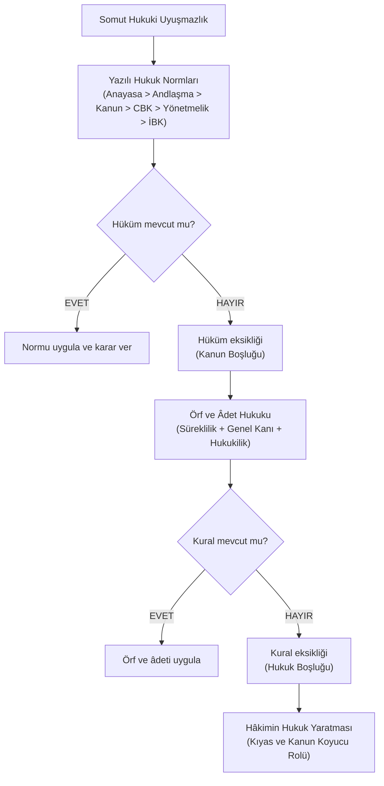

# 1. Pozitif Hukukun Kaynakları ve Normlar Hiyerarşisi

## 1.1. Yazılı Kaynaklar

### Anayasa (Constitution)
Devlet gücünün sınırlandırılması, anarşinin önlenmesi ve temel hakların güvenceye bağlanması ihtiyacından doğağr. Bir devletin en üstün, temel kurallar manzumesidir. Anayasa; devletin temel yapısını, kuruluşunu, yasama, yürütme ve yargı organlarının işleyişini belirleyen, bireylerin temel hak ve hürriyetlerini güvence altına alan **en üst basamaktaki temel kanun** metnidir. Örneğin 1982 Anayasası Türkiye Cumhuriyeti sınırları içindeki tüm normların meşruiyet temelidir. Anayasa, genel yasama işlemlerinden tüm alt kademedeki normlara çatı kurması ve mutlak uygunluk denetimi içermesiyle ayrılır.

### Milletlerarası Andlaşma
Farklı devletlerin egemenlik alanlarını aşan ilişkilerini hukuki güvenlik içine alma ihtiyacını çözer. Egemen devletler arasında imzalanan bağlayıcı anlaşma metnidir. Milletlerarası andlaşma; uluslararası hukuk kişileri arasında karşılıklı hak ve borçlar doğuran, usulüne uygun onaylanan **yazılı bağlayıcı tasarruf** işlemidir. Örneğin Avrupa İnsan Hakları Sözleşmesi (AİHS) temel hakları korur. Temel hak ve özgürlüklere dair milletlerarası andlaşmalar, kanunlarla çatışması halinde kanunun üstünde tutulmasıyla iç hukuk kanunlarından ayrılır; teknik ve ticari andlaşmalar ise kanunla eşit düzeyde yer alır.

### [[Kanun]]
Toplumsal temaslarda öngörülebilirlik tesis etme ve bireyler arasındaki çatışmaları önleme ihtiyacına cevap verir. Meclis tarafından kabul edilen genel ve sürekli kurallar bütünüdür. Kanun; yasama organı tarafından anayasada öngörülen usullere uygun kabul edilen, **genel, soyut, objektif ve sürekli** nitelik taşıyan temel yazılı hukuk kuralıdır. Örneğin Türk Medeni Kanunu aile ve miras ilişkilerini yönetir. Kanun, bireysel idari işlemlerden toplumun tamamını kapsayan soyut ve sürekli bir etki alanına sahip bulunmasıyla ayrılır.

### Cumhurbaşkanlığı Kararnamesi
Yürütme organının hızla değişen iktisadi ve idari olaylara süratle müdahale edebilmesi ihtiyacını karşılar. Yürütmenin başı tarafından doğrudan yürürlüğe konan düzenleyici normdur. *Olağan Cumhurbaşkanlığı Kararnamesi (CBK)*; Anayasa'nın yürütme yetkisine bıraktığı konularda çıkarılan, kanunlara uygun bulunması zorunlu olan ve **kişilik hakları, siyasal haklar ile suç ve ceza ihdası alanlarını düzenleme yetkisinden muaf tutulan** düzenleyici işlemdir. Örneğin bakanlık teşkilat yapılarının kurulması CBK ile yürütülür. CBK, uzun yasama müzakereleri gerektiren kanunlardan doğrudan yürütme makamının tasarrufuyla hayata geçmesiyle ayrılır.

### Olağanüstü Hâl Cumhurbaşkanlığı Kararnamesi
Ağır kriz, savaş veya doğal afet anlarında kamu düzenini süratle yeniden kurma ihtiyacından kaynaklanır. Olağanüstü hâl dönemlerinde yürütmeye geniş yetki sağlayan istisnai hukuki araçtır. Olağanüstü Hâl CBK'si; olağanüstü hâlin getirdiği zorunluluklar çerçevesinde çıkarılan, olağan kararnamelerdeki hak kısıtlamalarına bağlı kalmaksızın temel hakları düzenleyebilen ve **kanun hükmünde** kabul edilerek *Meclis* onayına sunulan düzenleyici normdur. Örneğin olağanüstü hâl döneminde kamu güvenliğini sağlamaya yönelik sokağa çıkma düzenlemeleri bu yolla getirilir. Bu norm, kanunun altında kalan olağan CBK'lerden doğrudan kanun seviyesinde etki doğurmasıyla ayrılır.

### Yönetmelik
Kanunların ve Cumhurbaşkanlığı kararnamelerinin günlük hayattaki uygulanma biçimlerini gösterme ve kamu kurumlarının iç düzenini kurma ihtiyacını karşılar. Kamu kurumlarının yayımladığı alt uygulama kuralıdır. Yönetmelik; Cumhurbaşkanı, bakanlıklar ve kamu tüzel kişilerinin kendi görev alanlarını ilgilendiren kanun ve CBK'lerin **uygulanmasını sağlamak amacıyla** bunlara uygun olarak çıkardıkları yazılı normdur. Örneğin üniversitelerin eğitim-öğretim ve sınav yönetmelikleri kurum içi işleyişi belirler. Yönetmelik, kanun ve kararnamelerden doğrudan bir üst norma dayanma zorunluluğu taşımasıyla ayrılır.

### İçtihadı Birleştirme Kararı
Yüksek mahkemelerin benzer olaylarda farklı hükümler vermesi neticesinde doğan yargısal güvensizliği ve tereddüdü bertaraf etme ihtiyacından doğar. Mahkemeler arasındaki farklı içtihatları tek çatı altında toplayan ilkesel karardır. İçtihadı Birleştirme Kararı (İBK); Yargıtay Büyük Genel Kurulu tarafından, dairelerin benzer olaylara ilişkin çelişkili kararlarını ortadan kaldırmak üzere verilen ve **tüm adli yargı hâkimleri ile Yargıtay daireleri için kanun gibi bağlayıcılık taşıyan** üst mahkeme kararıdır. Örneğin iş sözleşmesinin feshinde işyeri küçülmesinin sınırlarını çizen İBK tüm iş mahkemelerini bağlar. İBK, sadece davanın taraflarını bağlayan ve diğer mahkemeler için tavsiye niteliğinde kalan münferit ilam mahkemesi kararlarından genel bağlayıcılığı ile ayrılır.

## 1.2. Yazılı Olmayan Kaynaklar

### Örf ve Âdet Hukuku
*Bkz. [[Örf ve Adet Hukuku|Örf ve Âdet Hukuku]]*

Yazılı mevzuatın hayatın gerisinde kaldığı veya düzenleme içermediği durumlarda adaleti sağlama ihtiyacından doğar. Toplumun asırlardır uyguladığı ve devletin koruduğu yazılı olmayan kurallardır. Örf ve âdet hukuku; toplumda kesintisiz tekrarlanan (**maddi unsur / süreklilik**), toplum vicdanında uyulmasının zorunlu olduğuna dair sarsılmaz bir inanç doğuran (**manevi unsur / genel kanı**) ve devletin hukuki yaptırımıyla desteklenen (**hukukilik unsuru**) yazılı olmayan bağlayıcı hukuk kaynağıdır. Örneğin tarım ve hayvancılık alanındaki yarıcılık ve ortakçılık usulleri bu kapsama girer. Örf ve âdet hukuku, devlet yaptırımı taşımayan ve ahlaki planda kalan sıradan geleneklerden hukuken bağlayıcı bir yaptırıma kavuşmuş olmasıyla ayrılır.

## 1.3. Yargısal Hukuk Yaratma
### Hâkimin Hukuk Yaratması
Yazılı metinlerde ve örf-âdet kurallarında somut bir kural bulunmadığı zamanlarda yargılama faaliyetinin tıkanmasını önleme ihtiyacına cevap verir. Hâkimin kanun koyucu yetkisine bürünerek uyuşmazlığı çözmesidir. Hâkimin hukuk yaratması; Türk Medeni Kanunu'nun 1. maddesi uyarınca, somut olay hakkında yazılı ve yazılı olmayan kaynaklarda çözüm bulunmadığı takdirde, hâkimin **kanun koyucu gibi hareket ederek kıyas yoluyla kural üretmesi** ve bu kuralı uyuşmazlığa uygulaması yetkisidir. Örneğin gelişen dijital sözleşme modellerindeki bir boşlukta hâkimin benzer borç ilişkilerinden kıyas yoluyla hüküm kurması bu yetkidir. Bu yetki, kanunun hâkime tanıdığı takdir yetkisinden kuralın tamamen eksik olduğu durumlarda sıfırdan norm üretilmesiyle ayrılır.

*Akılda Kalsın:* Yazılı normlar tüketildiğinde örf ve âdet kuralına başvurulur; örf ve âdet kuralı eksik kaldığında hâkim bizzat kanun koyucu vasfıyla kural oluşturur.

# 2. Hukuk Kurallarının Türleri

## 2.1. Emredici Hukuk Kuralı
Toplum düzenni, ahlâkı, kamu menfaatini ve zayıf tarafları keyfî tasarruflardan koruma ihtiyacından kaynaklanır. Tarafların mutlak sûrette uymak zorunda olduğu kurallardır. Emredici hukuk kuralı; **kişilerin aralarındaki münasebetlerde farkı yönde anlaşma yapmalarının kanunen engellendiği, doğrudan ve zorlayıcı biçimde tatbik edilen hukuk kuralıdır**. Örneğin, erginlik yaşının 18 olarak belirlenmesi veya evliliğin resmî memur huzurunda kurulması zorunluluğu emredici kuraldır. Emredici kural, tarafların serbest iradeleriyle değiştirebildiği yedek hukuk kurallarından kamu düzenini mutlak koruma vasfıyla ayrılır.

## 2.2. Yedek Hukuk Kuralları
### Tamamlayıcı Hukuk Kuralı
Bireylerin hukukî sözleşmeler yaparken her detayı düşünememesi veya ayrıntıları sözleşmeye yazmaması hâlinde sözleşmenin ayakta kalması ihtiyacını karşılar. Sözleşmede boş bırakılan yerleri dolduran yasal hükümdür. Tamamlayıcı hukuk kuralı; tarafların aksini kararlaştırma hakkı saklı bulunmakla beraber, **sözleşmede üzerinde durmadıkları ve boş bıraktıkları hususlarda** kendiliğinden devreye giren yedek hukuk normudur. Örneğin, T**ürk Borçları Kanunu madde 207/2 uyarınca teslim vâdesi yazılmayan satım sözleşmelerinde borçların aynı anda ifa edilmesi kuralı devreye girer**. Tamamlayıcı kural, sözleşmede yer alan bulanık ifadeleri netleştiren yorumlayıcı kurallardan sözleşmede hiç bulunmayan şartı eklemesiyle ayrılır.

### Yorumlayıcı Hukuk Kuralı
Tarafların sözleşmede kullandığı kavramların belirsiz kalması neticesinde doğacak ihtilafları giderme ihtiyacını çözer. **Anlamı muğlak ifadeleri kesinleştiren kuraldır**. Yorumlayıcı hukuk kuralı; taraflarca sözleşmeye dâhil edilen ancak **birden fazla anlama gelebilecek açıklıktan uzak ifadelerin** kanun koyucu tarafından tek bir mânâya bağlandığı kural türüdür. **Örneğin Türk Borçlar Kanunu madde 91/1 uyarınca kira sözleşmesindeki "ayın ortası" ifadesinin ayın on beşinci günü kabul edilmesi yorumlayıcı kuraldır.** Bu kural, boş bırakılan şartı dolduran tamamlayıcı kuraldan tarafların mevcut fakat belirsiz iradesini aydınlatmasıyla ayrılır.

## 2.3. Tanımlayıcı Hukuk Kuralları

### Tanımlayıcı Hukuk Kuralı
Hukukî ilişkilerin hangi kavramsal çerçeveye oturduğunu tespit etme ve anlam kargaşasını önleme ihtiyacından doğar. Bir hukukî müessesenin yasal unsurlarını gösteren normdur. Tanımlayıcı hukuk kuralı; kanun koyucu tarafından bir hukuki kurumun veya ilişkinin **temel kurucu unsurlarının ve niteliklerinin açıkça belirlendiği** kuraldır. Örneğin **Türk Medeni Kanunu madde 118'in "Nişanlanma, evlenme vaadiyle olur" düzenlemesi tanımlayıcıdır**. Tanımlayıcı kural, doğrudan hak veya borç doğuran yaptırımlı kurallardan hukuki kavramın içeriğini tarif etmesiyle ayrılır.

> *Akılda Kalsın:* Emredici kural irade serbestisini sınırlar; tamamlayıcı kural sözleşmedeki suskunluğu giderir; yorumlayıcı kural bulanık ifadeyi netleştirir; tanımlayıcı kural ise kavramın yasal çerçevesini kurar.

---

# 3. Yargı Teşkilatı ve Yargı Çeşitleri

## 3.1. Anayasa Yargısı
Kanunların anayasal sınırlarda kalmasını temin etme ve vatandaşların temel haklarını kamu otoritesine karşı savunma ihtiyacını karşılar. Anayasaya uygunluğu ve anayasal hakları denetleyen yargı koludur. Anayasa yargısı; kanun ve kararnamelerin anayasaya uygunluğunu **norm denetimi** yoluyla, kamu gücünün temel hak ihlallerini ise **bireysel başvuru** yoluyla karara bağlayan, Anayasa Mahkemesi eliyle icra edilen yargı düzenidir. Örneğin bir kanun maddesinin Anayasa'ya aykırılık iddiasıyla incelenmesi bu kolda gerçekleşir. Anayasa yargısı, bireyler arasındaki uyuşmazlıkları doğrudan karara bağlayan genel mahkemelerden doğrudan anayasallık denetimi yapmasıyla ayrılır.

## 3.2. Uyuşmazlık Yargısı
Farklı yargı kollarının aynı davasa görev çatışması yaşaması veya birbirlerinin görev alanına girdiğini savunarak dosyayı reddetmesi durumunu çözme ihtiyacından doğar. Mahkemeler arasındaki görev kavgasını nihayete erdiren yargı merciidir. Uyuşmazlık yargısı; adli ve idari yargı organları arasında ortaya çıkan **görev ve hüküm uyuşmazlıklarını kesin olarak bağlayan**, *Uyuşmazlık Mahkemesi* tarafından yürütülen özel yargı koludur. Örneğin bir tazminat davasının İş Mahkemesi mi yoksa İdare Mahkemesi mi tarafından görüleceğine bu mahkeme karar verir. Uyuşmazlık yargısı, davanın esasına girip nihai uyuşmazlığı çözen mahkemelerden sadece doğru yargı merciini tayin etmesiyle ayrılır.

## 3.3. İdari Yargı
Devletin idari eylem ve işlemlerini hukukta uygunluğunu denetleme ve vatandaşları kamusal haksızlıklara karşı koruma ihtiyacına cevap verir. İdarenin işlem ve eylemlerini denetleyen bağımsız yargı koludur. İdari yargı; kamu idaresinin tek taraflı tasarruflarına karşı açılan iptal davaları ile idarenin kusurundan doğan zararların giderildiği tam yargı davalarını karara bağlayan, **Danıştay'ın en üst temyiz makamı olduğu** yargı düzenidir. Örneğin bir memurun haksız disiplin cezasına karşı açtığı dava bu kolda görülür. İdari yargı, eşitler arasındaki hukuki münasebetleri inceleyen adli yargıdan tarafında mutlaka bir kamu gücünün bulunmasıyla ayrılır.

## 3.4. Adli Yargı
Suç sayılan fiilleri cezalandırma ve bireyler arasındaki özel hukuk çatışmalarını barışçıl yolla neticelendirme ihtiyacından kaynaklanır. Genel mahkemelerin yürüttüğü ceza ve hukuk davaları düzenidir. Adli yargı; ceza hukuku ve özel hukuk kapsamındaki davaları inceleyen, ilk derecede hukuk ve ceza mahkemelerinden, istinafta Bölge Adliye Mahkemelerinden ve **temyiz basamağında Yargıtay'dan** oluşan genel yargı düzenidir. Örneğin alacak davaları, boşanma davaları ve hırsızlık suçunun muhakemesi bu kolda görülür. Adli yargı, idarenin kamu gücünü denetleyen idari yargıdan bireyler arası veya birey-kamu arasındaki adli ve cezai ilişkileri çözmesiyle ayrılır.

> *Akılda Kalsın:* Mahkemeler arası görev çatışmasında Uyuşmazlık Mahkemesi nihaidir; idarenin eylemlerinde Danıştay, adli uyuşmazlıklarda Yargıtay zirve denetim merciidir.

---

# 4. Hukukun Uygulanma Boyutları

## 4.1. Hukukun Yer Bakımından Uygulanması

Devletin kendi hakimiyet alanında kamu barışını ve hukuk birliğini sağlama ihtiyacını karşılar. Kanunların ülke coğrafyasında geçerli olması prensibidir. Hukukun yer bakımından uygulanması; bir devletin yürürlüğe koyduğu hukuk kurallarının kural olarak o devletin **coğrafi egemenlik sınırları içerisindeki tüm hadiselere ve kişilere tatbik edilmesini ifade eden mülkilik (yersellik)** ilkesidir. Örneğin Türkiye sınırları içindeki bir sözleşmeye Türk hukuku uygulanır. Mülkilik ilkesi, yabancılık unsuru taşıyan durumlarda başka bir ülke hukukunun uygulanmasına imkan tanıyan şahsilik (dışsallık) prensibinden sınır içi mutlak hakimiyeti esas almasıyla ayrılır.

## 4.2. Hukukun Zaman Bakımından Uygulanması
Bireylerin kurallara güven duyması ve geleceğe yönelik tasarruflarını önceden öngörebilmesi ihtiyacından kaynaklanır. Kanunun hangi andan itibaren hayata geçeceğini tayin eden ilkedir. Hukukun zaman bakımından uygulanması; kanunun **Resmî Gazete'de yayımlandığı veya kendi metninde gösterilen tarihte yürürlüğe girerek yürürlükten kalkış anına kadar devam eden olaylara ileriye etkili biçimde uygulanmasını** ifade eden ilkedir. Örneğin 2002 tarihli Medeni Kanun bu tarihten sonraki olaylara tatbik edilir. Zaman bakımından uygulama, coğrafi yetkiyi gösteren yer bakımından uygulamadan kuralın kronolojik etki süresini yönetmesiyle ayrılır.

## 4.3. Hukukun Anlam Bakımından Uygulanması ve Yorum Yöntemleri

### Lafzî Yorum
Kanun koyucunun iradesini ilk elden, metne sadık kalarak anlama ihtiyacını çözer. Metnin sözcük anlamına bakılarak yapılan yorumdur. Lafzî (sözel) yorum; kanun metninde yer alan **sözcüklerin dizilişine, gramer kurallarına ve dil bilgisi yapısına** dayanılarak kuralın doğrudan anlaşılması faaliyetidir. Örneğin evliliğin resmî memur huzurunda kurulacağı kuralının metinden doğrudan anlaşılması bu yöntemdir. Lafzî yorum, metnin arka planındaki amacı soruşturan amaçsal yorumdan doğrudan sözcüğün görünür manasına odaklanmasıyla ayrılır.

### Sistematik Yorum
Kanun maddelerinin tek başına değil, kanunun ve hukuk düzeninin bütünü içindeki yerini gözetme ihtiyacından doğar. Bir kuralın hukuk nizamının genel yapısı içindeki konumuna göre yorumlanmasıdır. Sistematik (mantıksal) yorum; kuralın bağlı bulunduğu **kanunun sistematiği, genel ilkeleri ve diğer normlarla olan bağlantıları** göz önüne alınarak anlamlandırılması tekniğidir. Örneğin evlenme engellerini düzenleyen maddelerin miras hükümleriyle birlikte okunması bu yöntemdir. Sistematik yorum, sadece dil bilgisine odaklanan lafzi yorumdan normu bütüncül hukuk mimarisi içine oturtmasıyla ayrılır.

Sistematik yorum faaliyetinde hâkim iki temel mantıksal çıkarım tekniğinden istifade eder:

1. **Aksi ile Kanıt (Zıt Kanıt / Argumentum a contrario):**
    * **İşleyiş Mantığı:** Kanun koyucunun belirli bir duruma özel olarak bağladığı sonucun zıttı, metinde anılmayan diğer tüm durumlar için geçerlilik taşır.
    * **Somut Olay:** Türk Medeni Kanunu'nda evlenme engelleri sayılırken eşlerin üstsoyu ve altsoyu ile evlenmesi açıkça yasaklanmıştır. Hâkim bu hükmü yorumlarken yansoy akrabaları inceler. Kanun maddesi yansoy hısımları bu özel yasak kapsamına almadığı için, aksi ile kanıt yöntemi gereğince baldız veya kuzen ile evlenmenin önünde yasal bir engel bulunmadığı neticesine varılır.

2. **Kanunun Evleviyetle Uygulanması (Haydi Haydi Yorumu / Argumentum a fortiori):**
    * **İşleyiş Mantığı:** Çoğun içinde az da yer alır; bütün için doğru kabul edilen bir yasal sonuç, o bütünün bir parçası veya ön adımı olan durumlar için öncelikle ve haydi haydi geçerlidir.
    * **Somut Olay:** Kanunun belirli derecedeki hısımlar arasında evlenmeyi kesin olarak yasaklaması karşısında, bu kişilerin nişanlanıp nişanlanamayacağı sorusu doğar. Evlenmeyi yasaklayan bir kanun koyucunun, evliliğin bir ön basamağı ve parçası olan nişanlanmayı öncelikle ve haydi haydi yasakladığı sonucuna varılır. Benzer şekilde, bir öğrenciyi üniversiteden çıkarma yetkisine sahip kılınan bir disiplin kurulu, evleviyet kuralı uyarınca daha hafif nitelikteki uzaklaştırma ve kınama cezalarını haydi haydi verme yetkisine sahiptir.

### Amaçsal Yorum
Zamanın değişmesiyle lafzın dar kalması ve somut adalet gereksinimlerinin karşılanması ihtiyacından kaynaklanır. Kuralın konuluş hedefine bakılarak yapılan yorumdur. Amaçsal (gai) yorum; kuralın yürürlüğe girdiği dönemin ve uyuşmazlığın çözüldüğü günün **sosyal, ekonomik, kültürel şartları ile taraflar arasındaki adil menfaat dengesi** dikkate alınarak kanunun hedefine göre anlamlandırılmasıdır. Örneğin kadının çalışmasını koca iznine bağlayan eski kanun hükmünün değişen sosyal hayat karşısında geçersiz kalması bu mantıkla anlaşılır. Amaçsal yorum, metne sıkı sıkıya bağlı kalan sözel yorumdan toplumun adalet ihtiyaçlarını ve menfaat dengesini öne almasıyla ayrılır.

> *Akılda Kalsın:* Lafzî yorum metnin lafzını okur; sistematik yorum kuralın sistemdeki yerini tartıp zıt kanıt ve [[evleviyet]] bağları kurar; amaçsal yorum ise kanunun gayesini gözetir.

# Geniş Çerçeve
### Mantık Zinciri: Uyuşmazlıktan Hükme

Hukuk düzeninde uyuşmazlıkların çözümü keyfiyete kapalı, katı bir sıralama zinciriyle yürütülür:

Bu sıralama mutlak bağlayıcılık içerir. Bir hâkim, yazılı hukuk normlarında somut çözümü içeren bir madde yer aldığı sürece örf ve âdet kuralına yönelemez; yazılı kural ile örf ve âdet kuralının her ikisinin de eksik kaldığı tespit edildiğinde bizzat kanun koyucu vasfıyla kıyas yoluyla hüküm oluşturur.

### Karıştırılan Çiftlerin Ayırt Edici Çerçevesi

* **Olağan CBK ile Olağanüstü Hâl CBK'sı:** Olağan Cumhurbaşkanlığı Kararnameleri kanunların altında yer alır; kişi hakları, siyasi haklar ile suç ve ceza ihdası alanlarında düzenleme yetkisi taşımaz. Olağanüstü Hâl Cumhurbaşkanlığı Kararnameleri ise doğrudan kanun hükmündedir; temel hak ve özgürlükleri kısıtlama yetkisine sahiptir ve Resmî Gazete'de yayımlandığı gün TBMM onayına sunulur.
* **Tamamlayıcı Hukuk Kuralı ile Yorumlayıcı Hukuk Kuralı:** Tamamlayıcı kurallar, tarafların sözleşmede tamamen unuttuğu ve boş bıraktığı alanları doldurur (örneğin ifa zamanının belirlenmemesi durumunda aynı anda ifa şartının getirilmesi). Yorumlayıcı kurallar ise tarafların sözleşmeye dahil ettiği ancak muğlak, birden fazla anlama gelebilecek ifadelerini açıklığa kavuşturur (örneğin "ayın ortası" ifadesinin ayın 15'i olarak belirlenmesi).
* **İçtihadı Birleştirme Kararı ile Emsal Yargı Kararı:** İlk derece mahkemelerinin veya bölge adliye mahkemelerinin münferit kararları yalnızca davanın taraflarını bağlar ve diğer mahkemeler için yol gösterici tavsiye niteliğindedir. Yargıtay Büyük Genel Kurulu tarafından verilen İçtihadı Birleştirme Kararları ise tüm hâkimleri ve yüksek mahkeme dairelerini bağlayan, yazılı hukuk normu kuvvetinde bir kaynaktır.

---

# İlgili Kanunlar

Ders kapsamında doğrudan incelenmesi, okunması ve sınav hazırlığında esas alınması bildirilen mevzuat hükümleri aşağıda listelenmiştir:

1. **2547 sayılı Yükseköğretim Kanunu Madde 54 (1. Fıkra):**
   * *Kapsam:* Yükseköğretim kurumlarında öğrenci disiplin suçları ve cezaları doğrudan bu fıkradan okunacaktır (eski Disiplin Yönetmeliği mülga durumdadır).
   * *Sınav Karşılığı:* Sınav düzenini bozucu eylemler için kınama; fiilen kopya çekmek için bir yarıyıl uzaklaştırma; başkasının yerine sınava girmek için uzaklaştırma yaptırımları uygulanır.

(1) Disiplin cezaları ve disiplin cezalarını gerektiren disiplin suçları:
- a) Kınama: Öğrenciye öğrencilikle ilgili kusurlu davranışlarından dolayı kınandığının yazılı olarak bildirilmesidir. Kınama cezasını gerektiren eylemler şunlardır:
	- 1) Yükseköğretim kurumu yetkililerince istenilen bilgileri yanıltmak amacıyla eksik veya yanlış bildirmek,
	- 2) Ders, seminer, sınav, uygulama, laboratuvar, atölye çalışması, bilimsel toplantı ve konferans gibi çalışmaların düzenini bozmak,
	- 3) (İptal alt bent: Anayasa Mahkemesinin 22/2/2024 tarihli ve E: 2023/78, K: 2024/55 sayılı Kararı ile)
	- 4) Yükseköğretim kurumunca veya yükseköğretim kurumunun izniyle asılmış güncel duyuruları, program ve benzerlerini koparmak, yırtmak, değiştirmek, karalamak veya kirletmek,
	- 5) Sınavlarda kopyaya teşebbüs etmek,
	- 6) Üniversite kampüsünde üniversite senatosu tarafından belirlenen alanlar dışında, sigara ve diğer tütün ürünleri ile elektronik sigara kullanmak.

- b) Yükseköğretim kurumundan bir haftadan bir aya kadar uzaklaştırma: Öğrenciye, yükseköğretim kurumundan bir haftadan bir aya kadar uzaklaştırıldığının ve bu süre içerisinde derslere ve sınavlara katılamayacağının yazı ile bildirilmesidir. Yükseköğretim kurumundan bir haftadan bir aya kadar uzaklaştırma cezasını gerektiren eylemler şunlardır:
	- 1) Öğrenme ve öğretme hürriyetini engelleyici veya yükseköğretim kurumlarının işleyiş ve huzurunu bozucu eylemlerde bulunmak,
	- 2) Disiplin soruşturmalarının usulüne uygun bir şekilde yürütülmesini engellemek,
	- 3) Yükseköğretim kurumundan aldığı kendine hak sağlayan bir belgeyi başkasına vererek kullandırmak veya başkasına ait bir belgeyi kullanmak,
	- 4) Yükseköğretim kurumunda kişilerin şeref ve haysiyetini zedeleyen sözlü veya yazılı eylemlerde bulunmak,
	- 5) Yükseköğretim kurumu personelinin, kurum içinde ya da dışında, şeref ve haysiyetini zedeleyen sözlü veya yazılı eylemlerde bulunmak,
	- 6) Yükseköğretim kurumunda alkollü içki içmek,
	- 7) (İptal alt bent: Anayasa Mahkemesinin 22/2/2024 tarihli ve E: 2023/78, K: 2024/55 sayılı Kararı ile)
	- 8) Yükseköğretim kurumu personeli veya öğrencilerini tehdit etmek.
- c) Yükseköğretim kurumundan bir yarıyıl için uzaklaştırma: Öğrenciye, yükseköğretim kurumundan bir yarıyıl uzaklaştırıldığının ve bu sürede öğrencilik haklarından yararlanamayacağının yazı ile bildirilmesidir. Yükseköğretim kurumundan bir yarıyıl için uzaklaştırma cezasını gerektiren eylemler şunlardır:
	- 1) Yükseköğretim kurumlarında işgal ve benzeri fiillerle yükseköğretim kurumunun hizmetlerini engelleyici eylemlerde bulunmak,
	- 2) Kurum personeli veya öğrencilerine fiili saldırıda bulunmak,
	- 3) Yükseköğretim kurumlarında hırsızlık yapmak,
	- 4) Yükseköğretim kurumu bünyesinde mevcut bina, demirbaş eşya ve benzeri malzemeyi tahrip etmek veya bilişim sistemine zarar vermek,
	- 5) Sınavlarda kopya çekmek veya çektirmek,
	- 6) Seminer, tez ve yayınlarında intihal yapmak veya bunları anket uygulaması, veri toplama gibi akademik değerlendirme içermeyen katkılar hariç olmak üzere, kişisel emeği ve akademik birikimi dışında kısmen ya da tamamen başkalarına yazdırmak,
	- 7) Yükseköğretim kurumundan uzaklaştırma cezası almış olmasına rağmen bu karara uymamak,
	- 8) 24/6/2004 tarihli ve 5199 sayılı Hayvanları Koruma Kanununun 28/A maddesinin üçüncü ve dördüncü fıkralarında sayılan fiillerden birini yükseköğretim kurumlarında işlemek.

- ç) Yükseköğretim kurumundan iki yarıyıl için uzaklaştırma: Öğrenciye, yükseköğretim kurumundan iki yarıyıl uzaklaştırıldığının ve bu sürede öğrencilik haklarından yararlanamayacağının yazı ile bildirilmesidir. Yükseköğretim kurumundan iki yarıyıl için uzaklaştırma cezasını gerektiren eylemler şunlardır:
	- 1) Yükseköğretim kurumu görevlilerine karşı cebir ve şiddet kullanarak görevin yapılmasına engel olmak,
	- 2) Öğrencilere karşı cebir ve şiddet kullanarak yükseköğretim hizmetlerinden yararlanmalarını engellemek,
	- 3) Yükseköğretim kurumları içerisinde uyuşturucu veya uyarıcı madde kullanmak, taşımak, bulundurmak,
	- 4) Sınavlarda tehditle kopya çekmek, kopya çeken öğrencilerin sınav salonundan çıkarılmasına engel olmak, kendi yerine başkasını sınava sokmak veya başkasının yerine sınava girmek,
	- 5) Yükseköğretim kurumlarında cinsel tacizde bulunmak,
	- 6) Yükseköğretim kurumlarında 10/7/1953 tarihli ve 6136 sayılı Ateşli Silahlar ve Bıçaklar ile Diğer Aletler Hakkında Kanuna aykırı olarak ateşli silahlarla mermilerini ve bıçaklarla saldırı ve savunmada kullanılmak üzere özel olarak yapılmış bulunan diğer aletleri, patlayıcı maddeleri taşımak ve bulundurmak,
	- 7) Yükseköğretim kurumunun bilişim sistemine girerek kendisine veya başkasının yararına haksız bir çıkar sağlamak ya da kişilerin mağduriyetine neden olmak,
	- 8) Soruşturma ile görevlendirilenleri tehdit etmek,
	- 9) 5199 sayılı Kanunun 28/A maddesinin ikinci fıkrasında sayılan fiili yükseköğretim kurumlarında işlemek.

- d) Yükseköğretim kurumundan çıkarma: Öğrenciye, bir daha çıkarıldığı yükseköğretim kurumuna alınmamak üzere öğrencilikten çıkarıldığının yazı ile bildirilmesidir. Yükseköğretim kurumundan çıkarma cezasını gerektiren eylemler şunlardır:
	- 1) Mahkeme kararıyla kesinleşmiş olmak kaydıyla suç işlemek amacıyla örgüt kurmak, böyle bir örgütü yönetmek veya bu amaçla kurulan örgüte üye olmak,
	- 2) (İptal alt bent: Anayasa Mahkemesinin 22/2/2024 tarihli ve E: 2023/78, K: 2024/55 sayılı Kararı ile)
	- 3) Uyuşturucu veya uyarıcı maddeleri satmak, başkalarına vermek ya da ticaretini yapmak,
	- 4) 6136 sayılı Kanuna aykırı olarak ateşli silahlarla, mermilerini ve bıçaklarla saldırı ve savunmada kullanılmak üzere özel olarak yapılmış bulunan diğer aletleri, patlayıcı maddeleri kullanmak,
	- 5) Kişilerin vücudu üzerinde cinsel davranışlarda bulunmak suretiyle cinsel dokunulmazlıklarını ihlal etmek.

6. **Türkiye Cumhuriyeti Anayasası Madde 90 (Son Fıkra):**
   * *Kapsam:* Usulüne göre yürürlüğe konulmuş temel hak ve özgürlüklere ilişkin milletlerarası andlaşmalar ile kanunların aynı konuda farklı hükümler içermesi halinde çıkacak uyuşmazlıklarda milletlerarası andlaşma hükümleri esas alınır.
   * *Usulüne göre yürürlüğe konulmuş milletlerarası andlaşmalar kanun hükmündedir. Bunlar hakkında Anayasaya aykırılık iddiası ile Anayasa Mahkemesine başvurulamaz.*

1. **Türk Medeni Kanunu Madde 1:**
   * *Kapsam:* Kanunun uygulanması ve kaynakların sıralanışı kuralıdır. Kanun, sözüyle ve özüyle değindiği bütün konularda uygulanır. Kanunda uygulanabilir bir hüküm bulunmadığında hâkim, örf ve âdet hukukuna göre; bu da bulunmadığında kanun koyucu olsaydı nasıl bir kural koyacak idiyse ona göre karar verir.
   * *Kanun, sözüyle ve özüyle değindiği bütün konularda uygulanır. Kanunda uygulanabilir bir hüküm yoksa, hâkim, örf ve âdet hukukuna göre, bu da yoksa kendisi kanun koyucu olsaydı nasıl bir kural koyacak idiyse ona göre karar verir. Hâkim, karar verirken bilimsel görüşlerden ve yargı kararlarından yararlanır.*

1. **Türk Borçlar Kanunu Madde 207/2:**
   * *Kapsam:* Satım sözleşmelerinde tamamlayıcı kural örneğidir. Sözleşme ile farklı bir vade kararlaştırılmadığı veya aksine bir yerel adet bulunmadığı takdirde satıcı ve alıcı borçlarını aynı anda ifa etmekle yükümlüdür.
   * *Sözleşme ile aksi kararlaştırılmadıkça veya aksine bir âdet bulunmadıkça, satıcı ve alıcı borçlarını aynı anda ifa etmekle yükümlüdürler*

1. **Türk Borçlar Kanunu Madde 91/1:**
   * *Kapsam:* Borçların ifasında sürelerin belirlenmesine ilişkin yorumlayıcı kural örneğidir. Borcun ifası için ayın başı kararlaştırılmışsa ayın birinci günü, ayın ortası kararlaştırılmışsa ayın on beşinci günü, ayın sonu kararlaştırılmışsa ayın son günü anlaşılır.
   * *Borcun ifası için bir ayın başlangıcı veya sonu belirlenmişse, bundan ayın birinci ve sonuncu günü; ayın ortası belirlenmişse, bundan da ayın onbeşinci günü anlaşılır.*

1. **Türk Medeni Kanunu Madde 118:**
   * *Kapsam:* Tanımlayıcı hukuk kuralı örneğidir. Hüküm, nişanlanmanın evlenme vaadiyle kurulduğunu kesin biçimde tanımlayarak kavramın sınırlarını çizer.
   * *Nişanlanma, evlenme vaadiyle olur. Nişanlanma, yasal temsilcilerinin rızası olmadıkça küçüğü veya kısıtlıyı bağlamaz.*