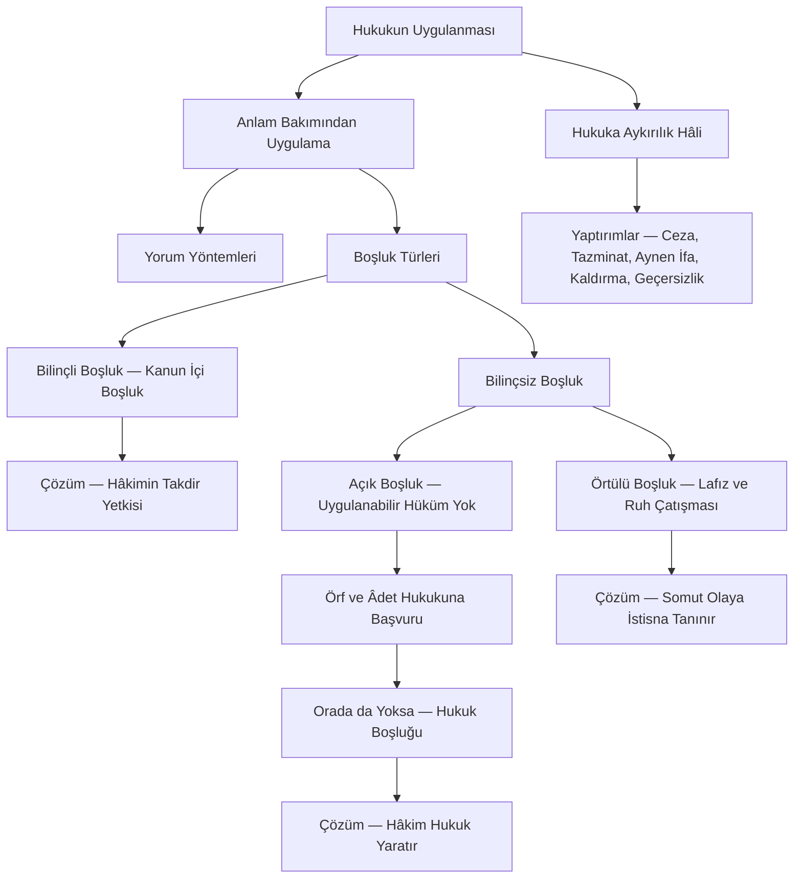
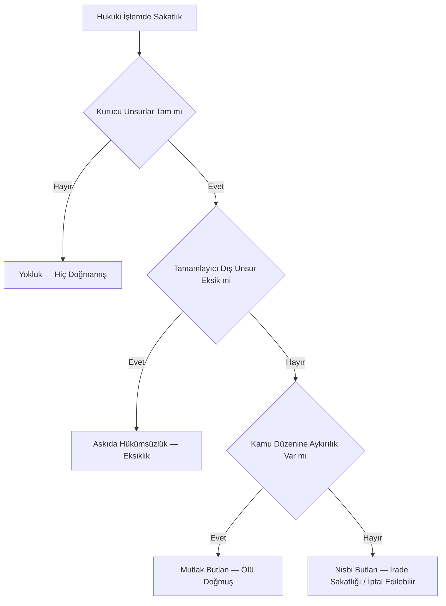

> Final sınavında, daha önce ders kapsamında paylaşılan YÖK disiplin/kopya maddesinin soru olarak gelebileceği belirtilmiştir.

# Derse Dair
Hukukun anlam bakımından uygulanması iki aşamalıdır: Önce [[hukuk-6#4.3. Hukukun Anlam Bakımından Uygulanması ve Yorum Yöntemleri|Yorum yöntemleriyle]] kuralın anlamı çözülür; kural bulunamaz veya var olan kural somut olayda adaletsizliğe yol açarsa **boşluk** kavramı devreye girer. Hukuk kurallarına aykırı davranıldığında ise devletin zorlayıcı gücü olan **yaptırım** mekanizmaları işler.

---

## Hukukun Anlam Bakımından Uygulanması ve Boşluk Kavramı
Türk hukuk sisteminde kanunlar somut olayları tek tek saymaz, **soyut** ve genel kurallar koyar. Bu yüzden uygulamada hâkim, kural bulamadığı durumlarla karşılaşır. Ancak hâkim, yargılamada "*hüküm yok*" diyerek uyuşmazlığı çözümsüz bırakamaz.

### Hukuk Boşluğu ve Kanun Boşluğu Ayrımı
- **[[Hukuk Boşluğu]]**: Somut olaya uygulanabilecek bir hükmün **hem yazılı kaynaklarda hem de yazılı olmayan kaynaklarda (örf ve âdet hukuku) bulunmamasıdır**. Yazılı veya yazılı olmayan kaynaklar hukunun bütününü oluşturduğu için burada tam bir boşluk vardır. Çözümü **hâkimin hukuk yaratmasıdır** (örneğin yazılı veya örf âdet kuralı bulunmayan, ata eyer/semer satılması gibi uyuşmazlıklarda hâkim kural koyarak sorunu çözer).
- **[[Kanun Boşluğu]]**: Medenî Kanun'daki "kanun" ifadesi tüm **yazılı kaynakları (mevzuatı)** kapsar. Somut olaya uygulanacak hükmün yazılı kaynaklarda bulunmamasına kanun boşluğu denir. Çözümü, boşluğun bilinçli mi yoksa bilinçsiz mi olduğuna göre değişir.

### Bilinçli Boşluk (Kanun İçi Boşluk)
Kanun koyucu (yasama organı olan *Türkiye Büyük Millet Meclisi*; hâkim yargı organıdır ve kanun koymaz), her somut ihtimali önceden düzenleyemeyeceği için konuyu genel hatlarıyla düzenler ve detayını **bilerek ve isteyerek** hâkime bırakır. Kural vardır ama içi boş bırakıldığı için buna **kanun içi boşluk** da denir.

- **Çözüm Yolu**: Hâkimin [[Takdir Yetkisi]] ile doldurulur.
- **Örnekler**:
	- Haksız fiilde kusurun derecesini ve tazminatın tam miktarını belirlemek.
	- **Yoksulluk nafakası:** Boşanan taraflardan biri (kadın veya erkek) yoksulluğa düşerse diğer taraf nafaka öder. Bu nafaka çocuğa verilen **iştirak nafakası** ile karıştırılmamalıdır; yoksulluğa düşen eşin evlilikteki yaşam standardını korumayı hedefler, yoksulluk kalkınca veya yeniden evlenince sona erer. Acun Ilıcalı veya Cem Yılmaz (Ahu Yağtu ile anlaşmalı boşanma örneği) ile işçi Ali ve Ayşe'nin boşanmasında "yoksulluk" ölçütü aynı tutulamaz; bu sınırı takdir yetkisiyle hâkim belirler. (Taraflar evlilik veya anlaşmalı boşanma sözleşmesiyle de nafaka şartlarını düzenleyebilir.)

### Bilinçsiz Boşluk: Açık Boşluk ve Örtülü Boşluk
Kanun koyucunun aslında düzenleme getirmesi gereken bir konuda hüküm koymayı **ihmal etmesi veya unutması** hâlinde [[Bilinçsiz Boşluk]] doğar. İki türü vardır:

#### 1. Açık Boşluk
Hukuken çözüme bağlanması gereken bir konuda yazılı kaynaklarda **ne sözüyle (lafzı) ne de diğer yorum yöntemleriyle uygulanabilir bir hüküm bulunmamasıdır.**

- **Çözüm Zinciri**: Yazılı kaynakta hüküm yoksa önce **örf ve âdet hukukuna** bakılır. Orada da hüküm yoksa açık kanun boşluğu artık **hukuk boşluğuna dönüşür** ve **hâkim hukuk yaratır** (özel hukukta benzer bir hükmü *kıyas* yoluyla uygular).
- **Uyarı**: **Ceza hukukunda kıyas kesinlikle yasaktır!** Suç ve cezalar yalnızca kanunla açıkça düzenlenir. *Kıyas sadece özel hukukta uygulanır!*
- **Örnekler**:
	- Velayetin annede olduğu bir boşanma sonrasında **babaannenin torunuyla kişisel ilişki kurma hakkı** talep etmesi. Kanunun yalnızca anne-babayı düzenlediği varsayımında yorum yöntemleriyle babaanneye ulaşılamaz; örf-âdet hukukunda da kural yoksa hâkim, anne-babaya ilişkin hükmü kıyasen uygulayarak boşluğu doldurur.
	- Kısmî süreli (part-time) çalışanların hafta tatili ücretine hak kazanıp kazanmadığı tartışması (haftanın 6 günü birer saat çalışana verilip haftanın 2 günü sekizer saat çalışana verilmemesi örneği).

#### 2. Örtülü Boşluk
Açık boşluğun aksine, somut olaya uygulanabilir bir kanun hükmü vardır. Ancak **hükmün lafzı (sözü) ile ruhu (amacı) birbiriyle ters düşmektedir**. Kuralı aynen uygulamak hakkaniyete, dürüstlüğe ve adalet duygusuna aykırı sonuç doğurur.

- **Çözüm Yolu**: Burada [[Takdir Yetkisi]] değil, hâkimin o olay özelinde **kurala istisna getirerek hükmü uygulamaması** (amaca göre sınırlama) söz konusudur. Anlaşılmazlık hâlinde son sözü Yargıtay söyler.
- **Örnek Vaka Ayrımı ("Ayırt etme gücü olmayanın yaptığı işlem geçersizdir" kuralı)**:
	- *Kuralın normal işlediği durum*: Akıl hastası bir kişinin cep telefonu satın alması ya da antikacıdan çok değerli bir tabloyu çok ucuza (veya çok pahalıya) alması **geçersizdir**. Tarafların "alan razı satan razı" demesi sonucu değiştirmez zira kural **kamu düzeni** gereği konmuştur. Alınanlar geri verilir, bir zarar doğmuşsa tarafların ekonomik durumu gözetilerek hakkaniyetle çözülür. (Benzer biçimde ağır akıl hastaları kamu düzeni gereği evlenemez; Down sendromu gibi durumlarda ise sağlık raporuyla ayırt etme gücünün varlığı tespit edilebilirse evlilik mümkündür.)  
	- *Örtülü boşluk oluşan durum:* Aynı akıl hastasının **Millî Piyango bileti alıp büyük ikramiye kazanması** ya da restoranda yemek yiyip bitirmesi. İşlemi başa döndürüp geri vermek adaletsiz veya imkânsız olduğundan kuralın ruhuna aykırıdır; hâkim bu olaya özgü istisna tanıyarak işlemi **geçerli** sayar.

| Boşluk Türü             | Kanundaki Durum             | Temel Özellik                     | Çözüm Yöntemi                              |
| :---------------------- | :-------------------------- | :-------------------------------- | :----------------------------------------- |
| **[[Bilinçli Boşluk]]** | Hüküm var, içi boş          | Kanun koyucu bilerek bırakmıştır  | Hâkimin **takdir yetkisi**                 |
| **[[Açık Boşluk]]**     | Hüküm hiç yok               | Lafız ve yorumla da sonuç çıkmaz  | Örf-âdet → yoksa **hukuk yaratma / kıyas** |
| **[[Örtülü Boşluk]]**   | Hüküm var ama ters          | Hükmün **lafzı ile ruhu** çatışır | Kurala **istisna tanıma (uygulamama)**     |
| **[[Hukuk Boşluğu]]**   | Yazılı + yazılı olmayan yok | Tüm hukuk kaynakları boştur       | **Hâkim hukuk yaratır**                    |

---

## Hukuka Aykırılığın Karşılığı: Yaptırım Türleri
Hukuk kurallarını din, ahlâk veya görgü kurallarından (dışlama, ayıplama) ayıran em temel özellik, ihlal hâlinde devletin zorlayıcı gücü olan [[yaptırım]] ile karşılaşılmasıdır. Yaptırımın iki temel işlevi vardır: Suç ve ihlal gerçekleşmeden önce **önleyici (caydırıcı)** işlev, ihlal sonrası bozulan dengeyi **düzeltici (telafi edici)** işlev. Tek bir hukuka aykırı fiil (örneğin hırsızlık) aynı anda birden fazla yaptırımı (ceza + aynen teslim + tazminat) doğurabilir.

### İlk Dört Yaptırım Türü

#### 1. Ceza
> Bkz. [[hukuk-4#1.3. Ceza Hukuku (Criminal Law)|Ceza Hukuku]]

- Hukuka aykırı olup kanunlarda suç veya kabahat olarak tanımlanan eylemlere uygulanır. Amacı suç işlenmesini önlemek, toplumsal dengeyi sağlamak ve suçluyu ıslah etmektir. 
- *Türleri:* Adli para cezası, idari para cezası (trafik cezaları gibi), hapis cezaları (süreli, müebbet, ağırlaştırılmış müebbet) ve disiplin cezaları (memurlarda kınama, aylıktan kesme, memuriyetten men; öğrencilerde uzaklaştırma, okuldan atılma).

#### 2. [[Tazminat]]
- Hukuk kuralının ihlali sonucu kişilerin uğradığı **maddi veya manevi zararın giderilmesidir** (örneğin trafik kazasında tedavi masrafı ve iş kaybı maddi; yaşanan travma manevi tazminat konusudur). 
- *Kritik İş Hukuku Ayrımı*: **[[Kıdem tazminatı]]** ve **[[ihbar tazminatı]]**, adı tazminat olsa da bir ihlal yaptırımı değil, kanundan doğan bir hak ediştir. Buna mukabil **[[sendikal tazminat]]** ve **[[ayrımcılık tazminatı]]** hukuka aykırılığın yaptırımıdır ve koşulları varsa ayrıca **[[manevi tazminat]]** da istenebilir.
- *Mobbing (Bezdiri - Psikolojik Taciz) ve İspat*: İş yerinde tek seferlik sert bir söz mobbing sayılmaz. **Süreklilik ve sistematiklik** (sürekli dışlama, söz vermeme,d değersizleştirme) şarttır. (Cinsel tacizde tek sefer yeterlidir.) Hem tazminat hem ceza davası açılabilir. İspatta e-postalar, tarafı olunan WhatsApp mesajları, tanıklar ve iş yerindeki mevcut kameralar kullanılabilir; izinsiz ses veya görüntü kaydı almak kural olarak yasal değildir (ceza ve aile hukukunda destekleyici delil tartışmaları istisnaidir; cinsel tacizde tanık yoksa tutarlı ve ayrıntılı beyan esas alınabilir).

#### 3. [[Aynen İfa]] (Aynen Teslim): 
- Hukuka aykırılık sonucu bozulan durumun doğrudan düzeltilmesi için **belirli bir şeyin verilmesi veya yapılmasıdır**. Çalınan telefonun geri verilmesi ya da parası ödenen buzdolabının teslim edilmesi bu kapsamdadır. Gecikmeden kaynaklı ek zarar varsa ayrıca maddi tazminat istenir.

#### 4. Hukuka Aykırılığın Ortadan Kaldırılması
- İhlal nedeniyle ortaya çıkan hukuka aykırı durumun durdurulması ve kaldırılmasıdır. Özellikle **yayın yoluyla kişilik haklarının ihlalinde** (kişinin sadece arkadaşlarına açık paylaştığı bir fotoğrafın izinsiz yayınlanması veya hakaret içeren paylaşımlar) yayının kaldırılması talep edilir; zarara göre maddi/manevi tazminat da devreye girer. (Kamuya mal olmuş kişilerin kamusal alandaki fotoğrafları özel hayatı ve kişilik haklarını ihlal etmedikçe farklı değerlendirilir; bir çekimde kazara arka plandan geçmek ise kişilik hakkına zarar vermiyorsa kaldırma sebebi sayılmaz.)

## Geçersizlik Yaptırımı ve Türleri
Hukukî işlemlerin hukuk kurallarına aykırı şekilde yapılması hâlinde **[[Geçersizlik]]** yaptırımı ortaya çıkar. Sınavlarda en çok karıştırılan bu alan dört alt türe ayrılır:

### 1. Yokluk ("*Hiç Doğmamış İşlem*")
Hukukî işlemin **kurucu unsurlarının eksik olması** hâlidir. İşlem hukuk dünyasında hiç kurulmamıştır.

- **Örnekler**: Evlilikte kurucu unsurlar; bir kadın ve bir erkek, olumlu irade beyanı ("hayır" şakası yapılırsa işlem yok hükmündedir) ve yetkili evlendirme memuru önünde yapılma şartlarıdır. İmam nikâhı veya yetkisiz bir hâkim önünde yapılan nikâh **yok hükmündedir**. Aynı şekilde TBMM yerine Cumhurbaşkanının "kanun" çıkarması da yoklukla sakattır.
### 2. Mutlak Butlan / Kesin Geçersizlik ("*Ölü Doğmuş İşlem*")

![[Pasted image 20261116102240.png]]

İşlemin kurucu unsurları tamdır (işlem doğmuştur); ancak **kamu düzenini, genel ahlâkı veya emredici hükümleri** ilgilendiren <u>geçerlilik şartları mevcut değildir</u>.

#### Mutlak Butlanın Üç Temel Özelliği
1. İşlem **en baştan itibaren geçersizdir**.
2. İşlem **[[herkes tarafından ileri sürülebilir]]**.
3. İşlem **her zaman** ileri sürülebilir (süre sınırı yoktur).

#### Örnekler
- Uyuşturucu veya böbrek satımı sözleşmesi, kölelik anlaşmaları (bunlar **eksik borç** niteliğindedir; mahkeme korumaz, ödenen para veya böbrek dava yoluyla istenemez) ve ayırt etme gücü olmayan akıl hastasının yaptığı işlemler.
- **CHP Kurultayı (2023):** 4-5 Kasım 2023'te yapılan CHP kurultayında Özgür Özel, Kemal Kılıçdaroğlu'nu yenerek genel başkan seçildi. Ancak kurultayda delegelerin iradesinin hukuka aykırı biçimde etkilendiği iddiasıyla dava açıldı. 21 Mayıs 2026'da mahkeme, kurultayın **mutlak butlan** nedeniyle başından itibaren geçersiz olduğuna karar verdi. Böylece Özgür Özel'in seçilmesi de geçersiz sayıldı ve kurultaydan önceki genel başkan Kemal Kılıçdaroğlu'nun yönetimi devralmasına hükmedildi. Karar temyiz sürecine konu oldu.

> **Kritik İstisna (Geriye Yürümeme):** Normalde mutlak butlan nedeniyle geçersiz olan bir işlem, başından itibaren hukukî sonuç doğurmaz ve taraflar aldıklarını geri vermek zorunda kalabilir. Ancak **Aile Hukuku (evlilik)** ve **İş Hukuku (hizmet sözleşmesi)** alanlarında geçmişte yaşananların ve gerçekleşen edimlerin geri alınamaması nedeniyle farklı bir kural uygulanır. Örneğin, evlilik süresince doğan haklar veya işçinin harcadığı emek yok sayılamaz. Bu nedenle **geçmişte doğmuş hukukî sonuçlar korunur**; evlilik hâkimin kararına kadar, geçersiz hizmet sözleşmesi ise iş ilişkisi sona erdirilene kadar geçerli bir ilişkinin sonuçlarını doğurur.

### 3. Nısbi Butlan ("*Sonradan İptal Edilebilir İşlem*")
İşlemin kurucu unsurları tamdır ve kamu düzenine aykırılık yoktur ancak taraflardan birinin iradesi **[[irade sakatlığı]]** hâllerinden biri olan **hata, hile veya tehdit (ikrah/korkutma)** ile sakatlanmıştır.

- **Özelliği**: İşlem doğmuştur ancak geçersizliği **yalnızca iradesi sakatlanan taraf** (işlemin tarafı) ileri sürebilir ve bu hak **belirli bir süreye** tabidir.
- **Örnekler**: İkiz kardeşlerden biriyle yanlışlıkla evlenme (**hata**), iyi bilmediği bir yabancı dili çok iyi bildiğini söyleyerek iş sözleşmesi yapma (**hile**), silah zoruyla nikâh masasına oturtulma (**tehdit**).

### 4. Askıda Hükümsüzlük ("Eksiklik")
[[Kurucu unsur|Kurucu unsurları]] tam olan bir işlemin geçerli hâle gelebilmesi için **tamamlayıcı bir dış unsura** (onay/icazet) ihtiyaç duyulmasıdır.
- **Örnek:** Ayırt etme gücüne sahip 15 yaşındaki bir küçüğün, veli onayı olmadan yaptığı satın alma sözleşmesi. Veli onay verene kadar işlem askıdadır. Onay verilirse baştan itibaren **geçerli**, veli reddederse **kesin geçersiz (mutlak butlan)** olur.

| Geçersizlik Türü           | Hukuki Durumu              | Kim İleri Sürebilir               | Süre Sınırı                |
| :------------------------- | :------------------------- | :-------------------------------- | :------------------------- |
| **[[Yokluk]]**             | Hiç doğmamıştır            | Herkes                            | Yoktur                     |
| **[[Mutlak Butlan]]**      | Ölü doğmuştur              | Herkes                            | Yoktur                     |
| **[[Nisbi Butlan]]**       | İptal edilebilir doğmuştur | Yalnızca iradesi sakatlanan taraf | Vardır                     |
| **[[Askıda Hükümsüzlük]]** | Tamamlayıcı unsuru bekler  | Onay makamının kararına bağlıdır  | Onay/ret sürecine bağlıdır |