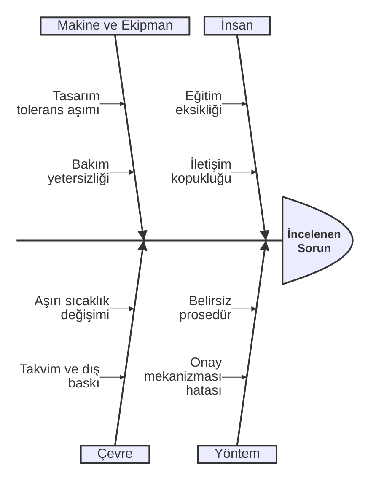

---
tags:
  - bilgi/techne
---

Kaoru Ishikawa'nın geliştirdiği, ortaya çıkmış bir sorunun arkasındaki olası ana neden kategorileriyle bunları besleyen tali nedenleri omurga üstünde görselleştiren kök neden çözümleme aracıdır. Üretim ve yönetim incelemelerinde insan, makine, yöntem, malzeme, ölçüm ve çevre dalları sık kullanılır. Her dal içeriye doğru detaylanarak belirtiden ana kaynağa iner. [[Sistem Yaklaşımı]]nın durumun tanımı aşamasında [[Geriye Doğru Endüksiyon]] mantığıyla çalışır.

