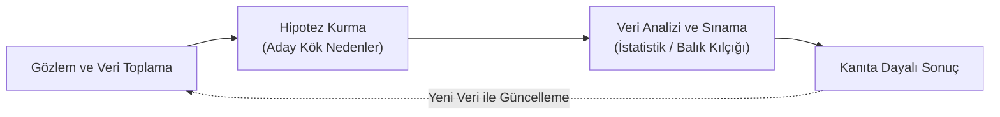

---
tags:
  - bilgi/techne
---

Çözümleme ve karar süreçlerinde çıkarımları kişisel sezgilere ya da niyet okumalarına bırakmadan doğrudan gözlemlenebilir verilere, ölçülebilir metriklere ve sınanabilir kanıtlara dayandırma disiplinidir. Önce durum gözlemlenip veri toplanır, sonra hipotez kurularak analiz araçlarıyla sınanır. Kanıtı olmayan varsayımlar elenir. Challenger incelemesinde 53°F sınırı ve 36°F ölçümü gibi vaka metnindeki somut verilere bağlı kalmak bu disiplinin gereğidir.

