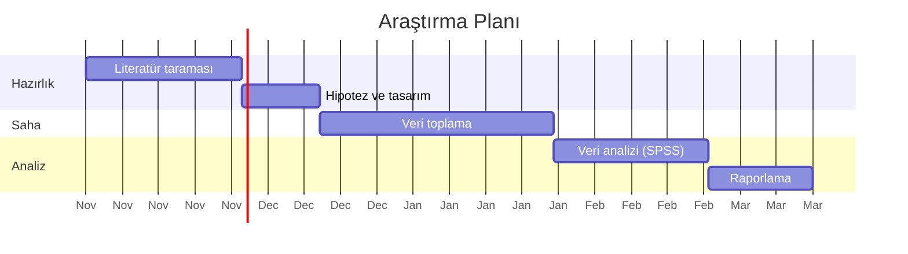

---
tags:
  - bilgi/techne
---
Bir iş veya [[kavram-proje|proje]] kapsamındaki görevlerin başlangıç-bitiş zamanlarını, sürelerini ve birbirine göre sıralamasını yatay çubuklar hâlinde gösteren görsel planlama ve zaman çizelgeleme aracıdır.

