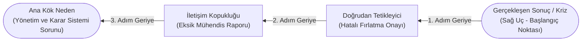

---
tags:
  - bilgi/techne
---

Karar analizinde ve sistem çözümlemesinde sürecin son noktasından (sağ uçtan) başlayıp adım adım başlangıca doğru ilerleyerek en uygun yolu ya da krizin ana nedenini bulma yöntemidir. Yönetim soldan sağa kurulur. Sorun ise sağdan sola çözülür. Beş yıl sonraki kariyer hedefini belirleyip bugün alınacak eğitimleri ona göre seçmek bu mantıkla işler. Kaza incelemelerinde de gerçekleşen sonuçtan geriye doğru [[Ağ Diyagramı]] ve [[Balık Kılçığı Diyagramı]] dalları budanarak kök nedene inilir.

