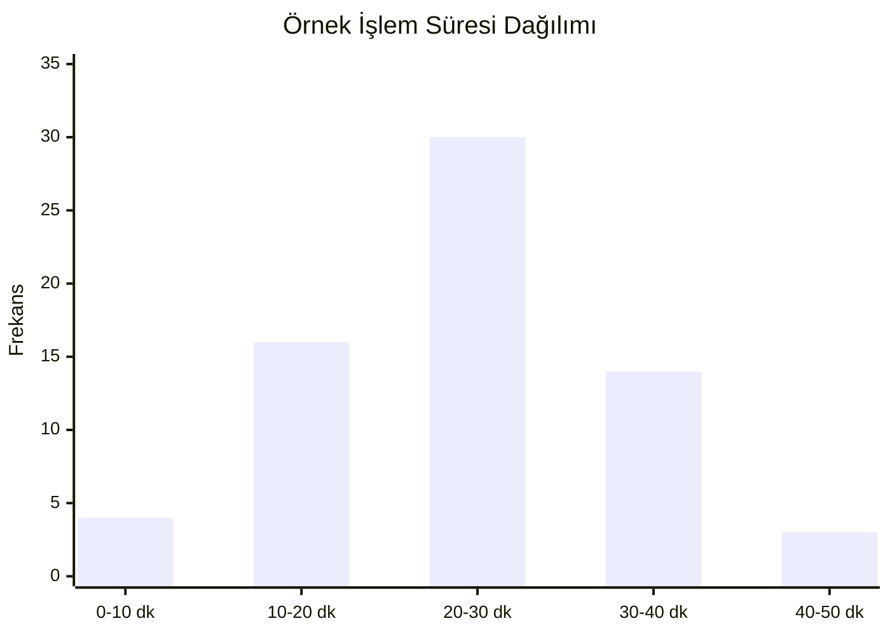

---
tags:
  - bilgi/techne
created: 2026-11-22
---
Sürekli ya da gruplandırılmış sayısal verilerin belirli sınıf aralıklarındaki görülme sıklığını bitişik dikey sütunlarla gösteren istatistik grafiğidir. Verinin hangi aralıkta yığıldığını, yayılım genişliğini ve çarpıklığını tek bakışta açığa çıkarır. Kök neden çözümlemesinde süreç sapmalarını görmek için kullanılır. [[Sistem Yaklaşımı]]nın durumun tanımı aşamasında dağınık ölçümleri anlamlı dağılımlara dönüştürür.

