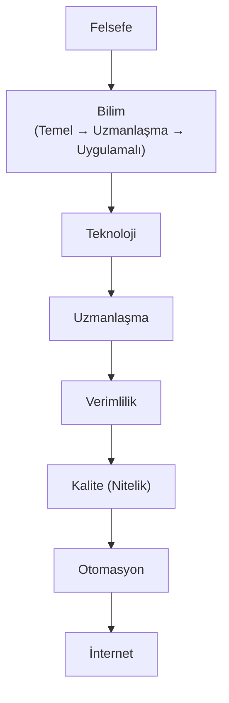

---
tags:
  - bilgi/techne
---

İnsanlığın bilgi üretme serüveninden modern dijital işletme yapılarına uzanan düşünsel ve teknolojik evrim basamaklarını sıralar. Her halka bir öncekinin birikimi üstünde yükselir.

* Felsefe
* Bilim (temel bilimler, uzmanlaşma ve uygulamalı bilimler)
* Teknoloji
* Uzmanlaşma
* Verimlilik
* Kalite ve nitelik ([[Toplam Kalite Yönetimi]])
* Otomasyon
* İnternet

1750'lerdeki Endüstri Devrimi seri üretimi başlatırken 1940'larda [[Yöneylem Araştırması]] matematiksel modellemeyi getirdi. 1960'larda [[Yapay Sentezler]] parçalı bilgileri birleştirdi, 1980'lerde ise [[Sistem Yaklaşımı]] ile [[Süreç Yaklaşımı]] olgunlaştı. 1995 sonrasında internetin yaygınlaşmasıyla gerçek zamanlı küresel veri ağı kuruldu.

