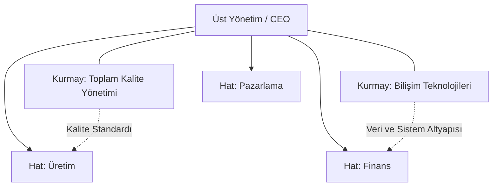

---
tags:
  - bilgi/techne
---

İşletmede doğrudan üretim ya da satış yapan ana hat birimlerinden ayrı konumlanıp doğrudan üst yönetime (CEO) bağlı çalışan destek ve rehberlik birimleridir. Emir vermekten çok uzmanlık, koordinasyon ve denetim desteği sunarlar. Yatay yapıları sayesinde tüm alt sistemlere dokunurlar. Bkz. [[Kurmay Yetkisi]]

Modern işletme mimarisinde iki ana kurmay birim bulunur:
* [[Toplam Kalite Yönetimi]]
* Bilişim Teknolojileri

