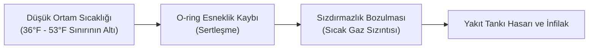

---
tags:
  - bilgi/techne
created: 2026-11-22
---
Mekanik bağlantılarda ve basınçlı sistemlerde eklem aralarından sıvı ya da gaz sızmasını engelleyen halka biçimli kauçuk sızdırmazlık elemanıdır. Challenger uzay mekiğinin katı yakıt itici roket segmentlerinin birleşim yerlerinde kullanılmıştır. Üretici Morton Thiokol güvenli çalışma alt sınırını 53°F belirlemişti. Fırlatma sabahı sıcaklığın 36°F'a düşmesiyle halkalar esnekliğini yitirdi ve yüksek basınçlı ateşin yakıt tankına sızmasını önleyemedi.

