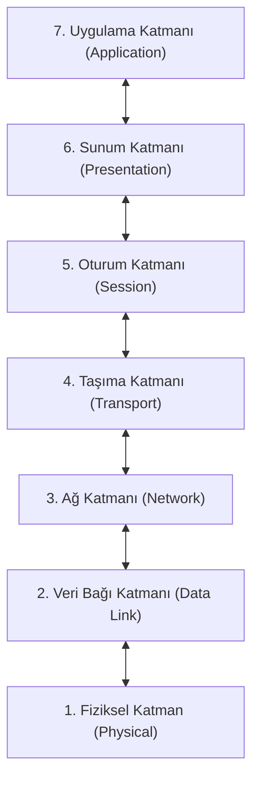

---
tags:
  - bilgi/techne
---

ISO'nun farklı donanım ve yazılımlar arasındaki ağ iletişimini standartlaştırmak için tanımladığı 7 katmanlı kavramsal ağ mimarisidir. Fiziksel kablodan uygulama arayüzüne kadar her katman kendi görevini üstlenip bir üst katmana hizmet verir. Bu modüler yapı ağ iletişimindeki karmaşayı yönetilebilir parçalara böler. İşletmedeki [[Bilgi Sistemleri Hiyerarşisi]] gibi farklı bileşenleri ortak bir veri omurgasında buluşturur.

