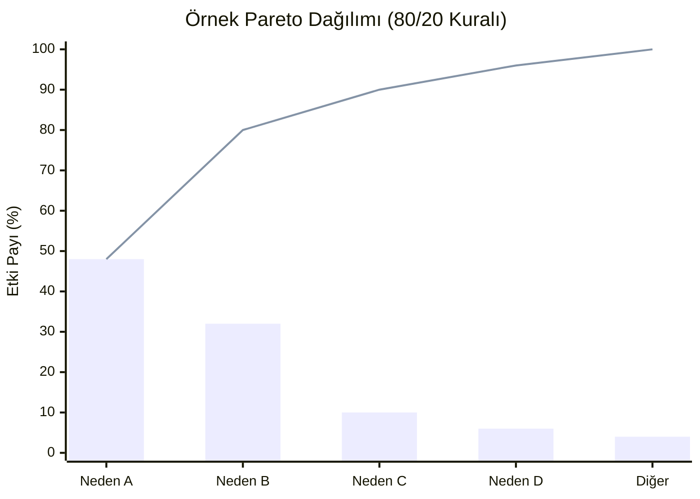

---
tags:
  - bilgi/techne
---

İtalyan iktisatçı Vilfredo Pareto'nun adıyla anılan ve 80/20 kuralına dayanan karar önceliklendirme tekniğidir. Bir sistemdeki sorunların yaklaşık yüzde 80'ini doğuran az sayıdaki belirleyici nedeni ayırır. Önce en büyük etki yaratan kökler seçilir. Nedenleri büyükten küçüğe sıralayan sütunlarla kümülatif oranı gösteren çizgiyi aynı grafikte birleştirerek kısıtlı kaynağın ilk olarak nereye yöneltileceğini netleştirir.

