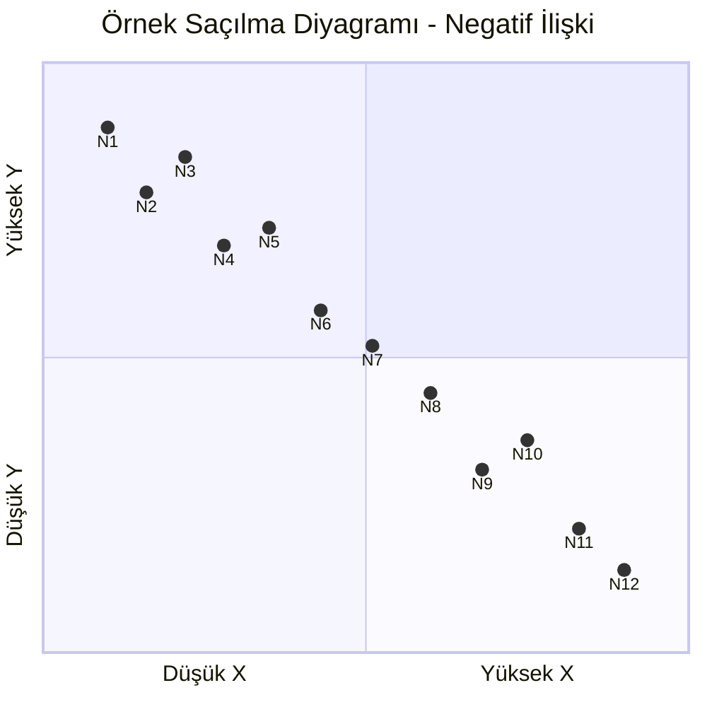

---
tags:
  - bilgi/techne
---

İki farklı sayısal değişken arasındaki ilişkiyi ve bu ilişkinin yönünü iki eksenli düzlemdeki gözlem noktalarıyla inceleyen analiz aracıdır. Değişkenler birlikte artıyorsa pozitif, biri artarken öteki düşüyorsa negatif ilişki görülür. Noktalar düzlemde rastgele dağılmışsa iki veri arasında bağ yoktur. Challenger vakasında ortam sıcaklığı düştükçe [[O-ring]] aşınma riskinin yükselmesi negatif ilişki örneğidir. Ancak iki değişkenin birlikte hareket etmesi tek başına nedensellik kanıtlamaz, kök nedeni doğrulamak için [[Balık Kılçığı Diyagramı]] gibi araçlarla inceleme gerekir.

