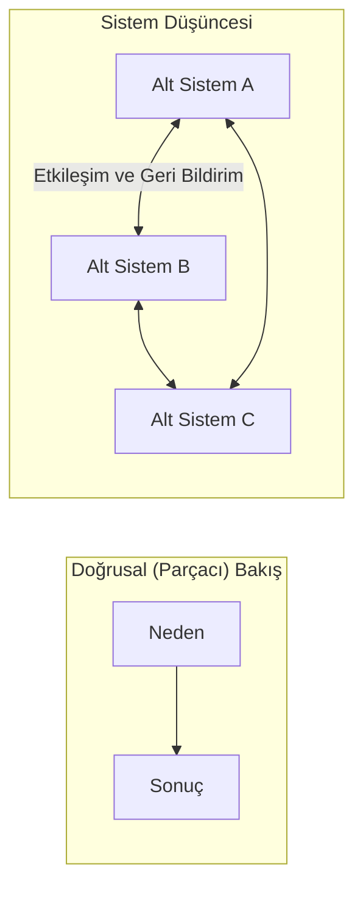

---
tags:
  - bilgi/techne
---

Bir bütünü oluşturan ögeleri aralarındaki karşılıklı etkileşim ve geri bildirim döngüleriyle birlikte inceleyen düşünme biçimidir. Parçaların toplamı bütünü vermez. Tek bir alt sistemde yapılan değişiklik, bağlı tüm birimleri zincirleme etkiler. Doğrusal düşünce bir nedenin tek bir sonuca yol açtığını varsayar, sistem düşüncesi ise sonucun geri dönüp nedeni nasıl dönüştürdüğünü izler. İşletmelerde sorun çözme yöntemi olan [[Sistem Yaklaşımı]] ve [[Bütünsel Bakış]] ilkesi doğrudan bu çerçeveden doğar.

