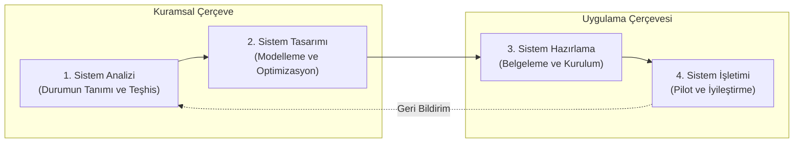

---
tags:
  - bilgi/techne
---

1980'lerde olgunlaşan ve i**şletmeleri çevresiyle sürekli etkileşen girdi, dönüşüm süreci, çıktı döngüsüne sahip alt sistemler bütünü sayan sorun çözme metodolojisidir.** Kuramsal ve uygulamalı dört aşamada işler.

* Sistem analizinde durum, sistem ve çevre tanımlanıp hedefler ile veri yapısı incelenir.
* Sistem tasarımında öngörü, kestirim, davranış modellemesi, optimizasyon, yönlendirme, güvenlik ve gelişme sistemleri kurulur.
* Sistem hazırlama aşamasında dokümantasyon tamamlanıp kurulum yapılır.
* Sistem işletimi başlangıç, pilot deneme, değerlendirme ve sürekli iyileşme adımlarını kapsar.

İlk iki aşama kuramsal çerçeveyi, son iki aşama uygulama çerçevesini oluşturur. Her aşama [[Bütünsel Bakış]], [[Disiplinler Arası Yaklaşım]] ve [[Bilimsel Metodoloji]] ilkelerine dayanır.

> Örgütleri birbirinden kopuk parçalar yerine dış çevresiyle etkileşim hâlinde çalışan bütünleşik birer açık [[Sistem]] olarak inceleyen çağdaş yönetim yaklaşımıdır. Alt sistemlerin farklı yönlere çeken iç amaçlarını eşgüdümleyerek örgütün ana hedeften sapmasını önlemeyi esas alır ve tüm modern süreç yaklaşımlarının zeminini oluşturur.
