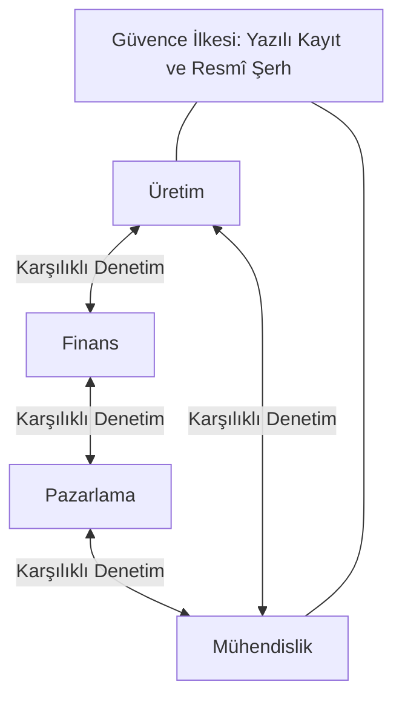

---
tags:
  - bilgi/techne
---

Bir organizasyonun ya da devlet yapısının tek bir otoritenin hatalı kararına teslim olmaması için farklı birimlerin ve uzmanlıkların birbirini yatay ve dikey yönde frenlediği kurumsal denge mekanizmasıdır. Güçler dengesi bu sayede işler. Devlette yasama, yürütme ve Sayıştay birbirini nasıl denetlerse işletmede de üretim, finans, pazarlama ve mühendislik birimleri birbirinin hatasını öyle durdurur. Teknik itirazların yazılı kayda geçirilip gerektiğinde açıkça şerh düşülmesi bu denetimin ana güvencesidir.

