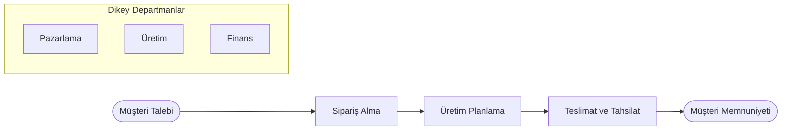

---
tags:
  - bilgi/techne
---

İşletme faaliyetlerini dikey departman sınırlarını aşan, müşteriye değer üreten yatay ve uçtan uca iş akışları biçiminde yönetme anlayışıdır. Birimler arasındaki kopukluğu aşar. Siparişin alınmasından üretime ve teslimata kadar geçen zinciri tek akışta topladığı için sorumluluk boşluklarını kapatır. 1980'lerde [[Sistem Yaklaşımı]] ile birlikte gelişen bu bakış, [[Toplam Kalite Yönetimi]] ve kurumsal kaynak planlaması (ERP) yazılımlarının omurgasını kurdu.

