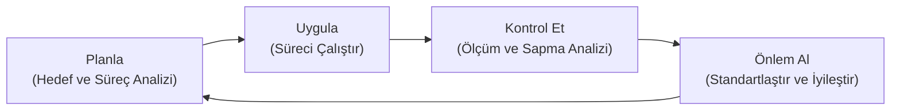

---
tags:
  - bilgi/techne
---

Kaliteyi üretim sonundaki ayıklama kontrolünden çıkarıp üst yönetimden saha çalışanına kadar herkesin katılımıyla her süreçte sürekli iyileştirmeyi hedefleyen yönetim felsefesidir. Doğrudan CEO'ya bağlı [[Kurmay Hizmetler]] birimlerinden biridir. Sorunların kaynağına inerken [[Histogram]], [[Pareto Analizi]], [[Saçılma Diyagramı]] ve [[Balık Kılçığı Diyagramı]] gibi araçları kullanır. İşleyişini planla, uygula, kontrol et ve önlem al (PUKÖ) döngüsü yürütür.

