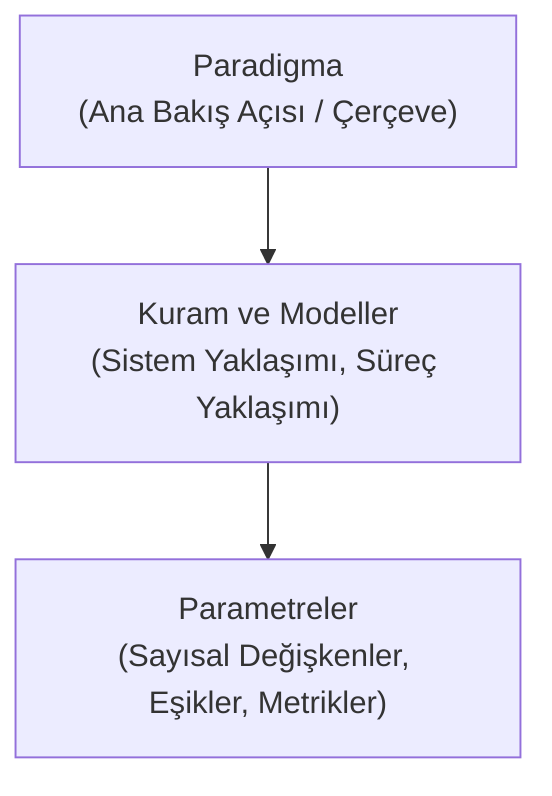

---
tags:
  - bilgi/techne
created: 2026-11-22
---
Belirli bir dönemde bilim topluluğunun ya da yönetim anlayışının olguları yorumlama biçimini çizen ana bakış açısıdır. Neyin sorun sayılacağını ve hangi çözüm yollarının geçerli kabul edileceğini bu çerçeve belirler. Kurallar değiştiğinde bütün yöntemler de yenilenir. İşletme biliminde parçalı işlevsel odaklanmadan [[Sistem Düşüncesi]]ne geçiş, tam anlamıyla bir paradigma değişimini anlatır.

[[Parametre]] ile sık karıştırılsa da ikisi ayrı katmanlarda durur. [[Parametre]] modelin içindeki ölçülebilir sayısal değişkendir, paradigma ise o modelin üzerine kurulduğu zihniyettir.

